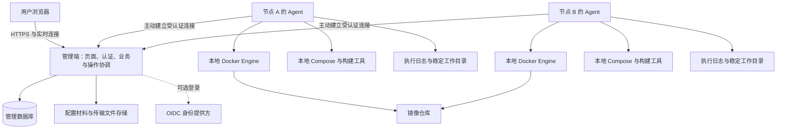
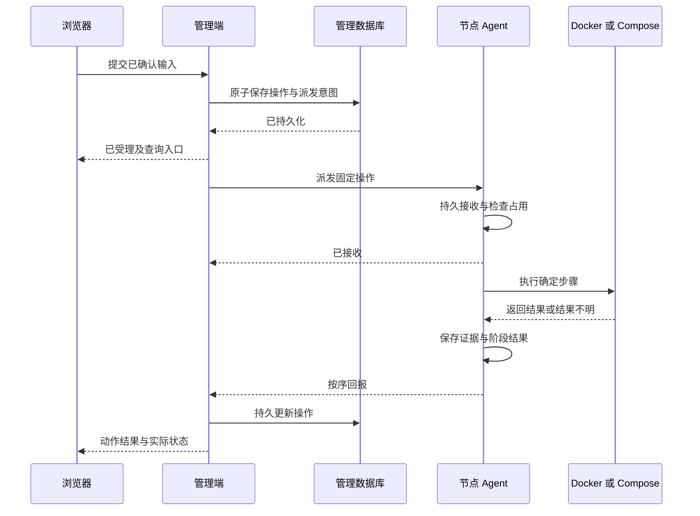

# Docker Manager 架构设计

更新日期：2026-10-30。修订：AR-20261030-02。状态：当前阶段工作基线；用户认可总体方向，通信协议及其他细节保留定稿与验证。

职责：定义系统由哪些部分组成，各部分如何通信、保存信息、执行操作，并在断线或故障后恢复。供后续数据、接口、测试、运维设计和实现规划使用。

包含：系统边界、组件职责、部署拓扑、通信方向、执行链路、并发恢复、信任边界、技术选型及验证安排。排除：重新定义功能行为、表字段和索引、接口路径与报文、安装命令、测试脚本、版本范围与开发排期。

输入：[需求说明 REQ-20261030-02](requirements.md)、[功能设计 FD-20261030-02](functional-design.md)与[文档编写方案](documentation-plan.md)。业务术语与范围由需求说明维护，用户可见行为由功能设计维护，未决状态由[待定事项](open-questions.md)维护。已归档旧稿不作为本篇依据。

## AR00 设计结论与适用前提

推荐采用 **Web 界面 + 模块化单体管理端 + 节点侧 Agent**。Agent 主动连接管理端，在对应节点本地访问 Docker、执行 Compose 并记录执行过程。管理端保管受管理配置与操作意图，节点负责实际执行；节点运行事实不能由管理端保存的一份配置代替。

管理端建议使用 Go，前端采用 Vue 与 TypeScript，节点 Agent 同样使用 Go；以本机 SQLite 和独立材料存储支撑单个活动管理端，按已知个人自托管定位降低部署负担。运行规模尚未明确，这些是本轮技术建议，不是用户已经选定的技术栈，也不是容量或高可用承诺。

本篇按完整目标设计，不以首版缩减能力。功能设计中的 P01—P12 继续作为条件输入，相关架构在 AR12 展开；产品范围改变时同步调整对应模块，不因为写进架构就自动纳入。

以下前提影响方案成立，具体跟踪于 Q09、A01—A06：

- 每个目标环境可以运行被信任的执行程序，并允许它访问相应 Docker 环境。若不能安装 Agent，需改用 AR01 的替代方案并重新验证执行链路。
- 节点可以通过直连、既有 VPN 或代理建立到管理端的出站连接。管理端完全不可达时，本方案不宣称自动穿透网络限制。
- 暂以一个活动管理端管理同一安装实例；同一 Docker 环境只有一个本产品的写入所有者。若需要多活或多人跨组织隔离，须补需求并调整协调与部署架构。
- 节点平台、CPU 架构、Docker / Compose 版本与规模没有正式兼容承诺。开发电脑使用 Windows 不能据此决定目标节点平台。

## AR01 方案比较与选择理由

### AR01.1 节点接入方式

| 方案 | 对本项目的作用 | 成本和限制 | 本轮判断 |
| --- | --- | --- | --- |
| 管理端 + 出站 Agent | 节点本地处理 Compose 材料、终端、构建和执行恢复；不要求管理端主动连入每个节点 | 需要分发、升级和信任节点程序；管理端须能被节点访问 | 推荐作为统一执行路径，适合已明确的混合网络与完整资源管理 |
| 管理端通过 SSH 执行 | 可利用已有 SSH 运维环境，远程上传材料并运行工具 | 管理端须能到达各节点；需管理 SSH 凭据、文件路径、远端进程及结果恢复 | 可作为不允许安装 Agent 时的替代，不默认同时承诺两套执行后端 |
| 管理端直接访问远程 Docker API | 资源查询和多数容器、镜像、网络、卷操作较直接 | 单独暴露 Docker API 不解决完整 Compose 材料、节点文件和本地进程管理；需要额外执行机制补齐 | 不作为完整产品的唯一架构；只在明确能力边界后考虑适配 |

Docker 官方支持用 SSH 或 TLS 保护远程 daemon 访问，参见 [Docker 连接保护](https://docs.docker.com/engine/security/protect-access/)。上表对完整 Compose 流程的判断是基于本项目功能的架构分析，不表示远程 API 不能用于任何 Compose 场景。

### AR01.2 管理端组织方式

建议采用模块化单体：身份、节点、配置、操作协调和查询模块在同一管理端部署，通过明确的内部边界协作。它们具有独立职责，但不要求分别运行成服务。

微服务方案有利于独立扩缩，但会引入服务发现、跨服务一致性和更多安装维护工作；现有需求没有给出足以抵消这些成本的规模依据。纯浏览器直连节点则无法承担统一身份、配置保管和持续执行恢复，不适合当前目标。

单体不等于所有工作放进请求处理线程：长任务由持久操作协调器管理；文件流和实时连接有独立资源预算。以后拆分组件时仍需保留本篇的输入固定、执行所有权和结果核对规则。

## AR02 系统边界与部署拓扑

图中 Agent → 管理端表示连接建立方向，连接建立后允许双方交换命令和结果。浏览器只访问管理端，不持有 Docker 连接凭据，也不直接访问节点执行入口。

管理端可以与某个被管理节点同机，仍通过该节点的 Agent 执行，避免出现一套特殊的本地权限和恢复路径。管理端可以位于独立服务器，节点之间不要求互通；Node Cross 通过管理端协调，不能假定两端能直接建立连接。

Agent 属于管理基础设施，独立安装和维护，不注入用户的 Compose 配置，也不自动给应用增加 sidecar、网络或卷。它退出不应停止已有应用；应用继续由 Docker 运行。

外部边界包括 Docker / Compose、镜像仓库、可选 OIDC、用户指定的配置来源和数据存储。产品可以发现外部变化，但不能对其他管理工具、宿主管理员或应用写入提供排他控制。

## AR03 组件职责与依赖

### AR03.1 管理端

| 模块 | 负责内容 | 依赖及限制 |
| --- | --- | --- |
| Web 与访问入口 | 静态页面、用户请求、会话及实时连接入口 | 调用应用模块，不直接拼 Docker 或宿主命令 |
| 身份与授权 | 本地或 OIDC 身份、角色和节点范围、敏感操作判断 | 角色政策引用 FD13，所有入口共用同一授权判断 |
| 节点目录与连接 | 节点身份、连接状态、协议能力、最近观测信息 | 连接在线不等于 Docker 或 Compose 可用 |
| 配置与材料 | 原文、附件、修订、材料清单及引用校验 | 管理配置，不把数据库内容当成已运行状态 |
| 资源查询与视图 | 节点快照、资源关联、按权限过滤的视图 | 保留来源与新鲜度，不把缺失数据统计为零 |
| 操作协调器 | 固定输入、冲突检查、持久派发意图、阶段推进、结果核对 | 唯一的资源变更入口；自动化也走同一路径 |
| 文件与流代理 | 分块传输、输出转发、流量限制及会话关闭 | 不把大型构建包或日志一次性装入内存 |
| 条件扩展模块 | 配置历史、模板、数据传输、通知、调度、管理备份 | 仅在相应 P 项纳入时启用，不能绕过授权与操作协调 |

模块依赖方向为访问入口 → 业务规则与操作协调 → 节点执行适配 / 存储接口。身份、材料和操作标识可被模块引用，但不由各模块独立重定义。内部任务推进与外部 Docker 副作用之间不使用跨机器数据库事务。

### AR03.2 节点 Agent

Agent 负责连接认证、节点能力探测、命令接收与去重、本地执行记录、材料准备、Docker / Compose 调用、结果核对，以及日志、终端和统计转发。

Agent 接受有明确目标与操作类型的请求，不暴露通用宿主 shell 执行接口。容器终端按容器内执行能力单独处理，不把终端输入拼进宿主命令。Agent 不自行决定给用户什么权限，也不根据配置变动自动部署。

每个 Agent 绑定一个明确的 Docker 环境。同一宿主上的多个 daemon 或 rootless 环境分别建模，连接身份不能仅由主机名或 IP 推断。重装或连接目标变化时重新核对身份，不把新环境静默接到旧节点记录上。

## AR04 连接协议与节点身份

### AR04.1 通信分工

**通信协议尚未定稿（A09）。** 下表仅为当前推荐：浏览器实时通道、管理端与 Agent 的传输协议、消息编码、认证承载与文件通道仍需比较后确认。用户已明确指出这一点并同意继续数据设计；不能把本篇的推荐当作已经选定 WebSocket 或具体消息格式。

| 路径 | 推荐方式 | 承担内容 |
| --- | --- | --- |
| 浏览器 → 管理端 | HTTPS；实时状态与交互使用受认证 WebSocket | 查询、编辑、操作提交、状态、日志与终端；终端连接与普通状态订阅隔离 |
| Agent → 管理端 | TLS 上的持久 WebSocket，节点证书双向认证 | 心跳、能力、命令、确认、阶段事件与结果查询；采用版本化消息 |
| Agent ↔ 管理端文件传输 | Agent 主动发起的 HTTPS 上传 / 下载，绑定操作和材料身份 | 配置包、构建上下文、镜像归档及条件数据传输；支持限流和完整性检查 |
| Agent → Docker / 本地工具 | 对指定本地端点的 SDK 调用、受控子进程 | 不依赖当前登录 shell 或全局 Docker context |

控制消息、日志输出和大文件分别设预算，避免一次镜像导出阻塞心跳或取消请求。代理必须支持最终采用的连接、超时和文件传输方式；不支持时明确报兼容问题。传输方案在本篇比较并确认，消息字段、编码、交互顺序与错误码在接口设计中细化；接口阶段若改变传输方案，应回填本节，保持一处维护。

### AR04.2 注册、信任与撤销

建议由管理员生成短时、单次使用且限定本次节点接入的注册凭据。Agent 在本地生成并保管节点身份私钥，验证管理端证书后仅提交公钥或证书签名请求及节点身份，不上传节点私钥。注册凭据消耗后改用独立节点证书；管理端核对登记信息，防止仅凭名称抢占已有节点。

每个节点记录当前管理实例及写入所有权代次。重连可以建立新会话，但不能让旧会话继续接受新命令；执行票据绑定管理实例、节点身份、操作和有效期，避免同一凭据被当作任意节点执行权。

证书轮换保留受控重叠期；过期、撤销或身份变化时拒绝新操作，已开始的步骤按 AR08 核对。管理端对注册入口、节点协议和浏览器入口分别鉴权。若使用反向代理，推荐让 Agent 的双向认证在管理端可验证的专用通路终止；不能相信来自公开请求的自报身份头。

重新部署管理端、从备份恢复或更换节点所有者时，需要隔离旧实例并重新确认执行所有权。普通心跳超时只说明失联，不是强制接管旧执行器的授权。

## AR05 信息所有权与持久化

### AR05.1 三类事实分别维护

| 信息 | 主要维护者 | 一致性原则 |
| --- | --- | --- |
| 受管理配置、授权与操作意图 | 管理端 | 保存修订后固定输入；更新不直接意味着节点已应用 |
| 容器、镜像、网络、卷与应用数据的实际状态 | 对应节点与 Docker / 应用 | 管理端保留观测快照和时间，变更后重新查询，不用期望值覆盖事实 |
| 执行证据、步骤与未完成影响 | 管理端操作记录 + Agent 本地执行日志 | 双方记录关联同一操作，出现差异时核对，不按最后收到的消息盲目覆盖 |

对于已接管 Stack，建议管理端保存的修订是以后部署的主要输入；节点工作目录是执行落地及诊断位置。外部改动先作为差异处理，按 FD12 选择导入或覆盖，不做无条件双向同步。Git 来源若纳入，则区分来源提交与产品内修改，见 AR12。

### AR05.2 存储分工

管理数据库保存节点、配置修订的元信息、授权、操作与派发意图等结构化信息。配置正文、附件和较大材料由独立材料存储保管，数据库保存受权限控制的引用与摘要；普通日志、镜像归档和大数据传输不挤入事务表。

单活动管理端方案建议 SQLite，数据库置于可靠本地文件系统，以短事务协调写入；不把 WAL 数据库放在共享网络目录上当多机数据库。SQLite 的 [WAL 文档](https://sqlite.org/wal.html)明确说明同机要求及一次一个写入者的限制，因此吞吐与持久化策略须用目标规模验证。

Agent 使用独立持久执行日志和材料索引，建议同样采用本地 SQLite；它不是管理数据库的副本。节点身份、未结束执行、去重证据和稳定工作目录都不能随容器临时层或工具升级被清空。

### AR05.3 数据库与文件的一致性

材料先写入临时区，校验长度、摘要及文件结构后持久发布为不可变内容，再提交引用它的配置修订。数据库提交前保证被引用内容可读取；失败只留下未引用材料，不能留下被宣称已保存但实际缺失的配置。

文件持久发布与数据库事务不能天然构成一个事务。重启时核对未完成发布；垃圾回收只处理已确认无引用、无操作和备份保留占用的材料，并留出恢复窗口。数据库发现引用缺失时标记不可用并阻断依赖操作，不能悄悄当空文件执行。

材料内容摘要用于完整性与复用判断，不是访问凭证。即使底层内容共用，下载、复制和导出仍按各业务对象授权。加密、备份固定和密钥恢复见 AR11、AR14，表结构及事务细节交数据设计。

## AR06 Docker、Compose 与工作目录

### AR06.1 执行接口

| 操作类别 | 推荐执行方式 | 原因与限制 |
| --- | --- | --- |
| 容器、镜像、网络、卷及其关联 | Agent 使用 Docker Engine SDK / API | 可以获得结构化身份和结果，按节点 API 版本协商，不解析人类输出替代所有查询 |
| Stack 校验、部署、启停、重建与移除 | Agent 调用经过兼容验证的 Docker Compose CLI | 使用原生 Compose 解释多文件、变量、profiles 与生命周期，不在管理器重写一套执行引擎 |
| 镜像构建 | 节点现有 Docker 构建能力与经过验证的 Buildx / BuildKit 路径 | 与本地上下文、输出和取消管理一致；记录实际 builder 与工具版本 |
| 终端、日志和统计 | Engine 的相应接口及流 | 按容器真实身份访问，生命周期与权限由管理端协调 |

Docker 提供 Go SDK，并要求根据 daemon 与所需能力选择 API 版本，参见 [Engine SDK](https://docs.docker.com/reference/api/engine/sdk/)。采用 SDK 不消除语义和版本兼容验证。

构建优先使用既有默认 Docker builder；[Docker driver](https://docs.docker.com/build/builders/drivers/docker/)使用 Engine 内置的 BuildKit。需要其他 builder、跨平台能力或额外组件时，必须作为明确能力和环境前提评估，不能为了构建静默给用户安装额外运行资源。

子进程使用固定程序路径和参数数组，明确 Docker 端点、项目名、文件次序、工作目录与环境；不拼接用户文本生成宿主 shell 命令。Compose 原文中的应用命令仍按用户声明执行，调用边界不能擅自改写其含义。

### AR06.2 原文、解析和环境

管理端负责编辑和材料完整性检查，Agent 使用目标工具版本完成最终配置解析与执行前核对。预览必须对应确定修订及实际选定的变量、文件顺序和工具能力；浏览器中的语法提示不是最终可部署证明。

明确传入插值环境，隔离管理端和 Agent 自身的环境变量，尤其是 Docker 端点、Compose 文件与项目设置；允许用户声明的值按原生优先级参与解析。插值环境和容器环境分别处理。参见 [Compose 插值与变量来源](https://docs.docker.com/compose/how-tos/environment-variables/variable-interpolation/)。

多文件合并、include、extends 各自沿用原生路径规则；不把文件扁平化后假装含义相同。外部引用需要在确认前取得并固定本次内容或不可变版本，不能在预览与执行时重复读取一个可变远程地址。镜像标签、软件仓库及运行数据仍可能变化，不据此承诺整个应用可逐字节重现。

引用材料的拉取只发生在明确的来源适配器或节点执行阶段，带访问策略、来源范围和凭据；不能让未授权用户通过任意 URL 请求探测管理端网络。允许使用的内网来源由管理员配置，不能一概封禁与自托管需求冲突的内部仓库。

### AR06.3 稳定路径与运行数据

每个受管理 Stack 在节点上有稳定的项目工作目录；不可变修订与临时准备目录另存。`./data` 等相对宿主挂载路径不能因每次部署换了修订目录而指向新的空目录。多文件的原生解析基准见 [Compose 合并规则](https://docs.docker.com/compose/how-tos/multiple-compose-files/merge/)。

保存和预览只改变管理材料或临时副本，不修改当前运行容器正在挂载的文件。进入已确认部署后，Agent 持有该 Stack 的写入占用，核对节点工作区与预期差异，再按材料清单发布文件并执行 Compose。

工作目录内区分产品提供的配置文件、构建输入与应用生成的数据路径。发布只处理获准的材料，不能通过目录镜像同步删除未列入配置清单的文件。若同一路径既被应用写入又准备作为配置覆盖，必须作为影响项返回用户选择，不由部署器自动覆盖。

发布中的文件替换可能影响已经挂载该文件的运行容器；确认摘要应显示这类影响。文件发布与 Compose 执行不构成原子事务，逐项记录已发布内容；中断后先核对，不能擅自整体回退文件和运行数据。对绑定单文件的 inode 变化、只读挂载和重建效果安排专门验证，不承诺改写源文件一定即时反映到容器中。

若 Agent 容器化，供 Compose 与构建使用的工作区必须与 Docker 宿主端路径保持可验证的一致映射；只有挂载 Docker socket 并不足以处理宿主文件。绑定路径位于 daemon 所在主机的限制参见 [Docker bind mounts](https://docs.docker.com/engine/storage/bind-mounts/)。不能满足映射时改用宿主进程部署，或明确相应能力不可用。

临时包解压限制在准备区内，检查路径穿越、符号链接、文件类型和体积；用户在 Compose 中显式声明的宿主挂载是另一项已授权输入，不与上传包解压权限混淆。仍被容器挂载或构建使用的文件必须持续保留，不能按临时文件过期时间删除。

## AR07 操作受理、派发与执行证据

依据：FD03 的业务状态及 FD05—FD11 的实际操作。内部接收、派发和确认阶段只用于实现这些状态，不再定义另一套用户业务状态。

### AR07.1 从请求到结果

1. 管理端核对当前身份、节点与资源权限、输入修订、目标身份和冲突范围。需要用户确认的检查项仍按功能设计处理，不在接口层自动代答。
2. 在同一管理数据库事务中保存操作及固定输入引用、冲突占用和待派发意图。提交成功后才能返回已受理；不能先发送再补操作记录。
3. 派发器读取持久意图，复核授权与开始执行期限，将同一操作发送到对应 Agent。传输失败可重投同一消息，不生成新的资源操作。
4. Agent 校验管理归属、节点代次、输入摘要与能力，在本地持久记录接收及占用后确认。相同操作与相同输入返回原记录；相同标识但输入不同直接拒绝。
5. 取得材料并完成本地预检后，Agent 在第一次修改前重新核对目标及执行许可。过期任务不因重新连上就执行；已明确尚未开始时才可返回未执行。
6. Agent 在每个有副作用步骤开始前记录意图，执行后记录证据和结果，按序上报。管理端持久接收后推进已知状态；浏览器只订阅这份结果，不自行判断成功。
7. 最终结果同时包含工具执行信息和能够取得的实际资源状态，分别判断动作完成与应用健康。失败、部分完成和未知分别映射 FD03，保留影响清单。

### AR07.2 投递、去重与未知窗口

采用可重试投递、持久去重和结果核对，**不承诺 Docker 副作用恰好发生一次**。Agent 在调用 Docker 后、保存结果前崩溃，或 CLI 已产生影响但尚未返回时，都可能无法证明动作是否完成。

这类窗口先查询原执行记录、受管进程和实际资源；仍不能确认则保持结果待核实与相关写入占用，不自动重放。给容器附加未约定标签或修改 Compose 不能作为去重前提；主要利用操作日志、Docker 返回的真实标识和可验证的资源关联。

阶段事件带执行尝试身份和递增顺序，管理端忽略已经处理的重复事件，迟到进度不能覆盖新结果。Agent 只有在管理端确认持久接收后才按保留策略裁减回传日志。

执行去重证据与用户可搜索历史分开保留。清理展示历史不能让旧操作再次可执行；过期指令通过开始执行期限和节点代次拒绝。Agent 执行日志丢失或被恢复为旧快照时进入恢复隔离，核对后才能接收新的写入，不能当成一个没有执行过任何任务的全新节点。

### AR07.3 本地子进程监督

Compose 和构建任务由 Agent 内部执行监督模块管理，脱离浏览器请求生命周期。记录程序版本、参数摘要、受控环境、工作目录、输入清单、进程身份、输出位置和步骤结果；日志中的秘密按 AR11 处理。

管理端重启不终止节点上的本地步骤。Agent 重启后先核对原进程树和执行日志，进程身份包含能区分 PID 复用的信息；只记一个 PID 不足以判断原操作是否还在运行。无法认定旧执行已停止时，不启动第二个冲突子进程。

进程监督的具体机制按确认的平台选用，例如受管服务进程或进程组；跨 Agent 重启的可识别性列为 V03 验证项。CLI 退出、被杀死或输出通道关闭都不单独证明 Docker 后台工作已停止，仍须核对资源结果。

## AR08 并发、断线、取消与恢复

### AR08.1 冲突和执行所有权

管理端在受理阶段执行冲突策略，Agent 在执行侧再次保证互斥。占用范围至少包括节点环境、Stack 项目身份、受影响容器和已知共享资源；资源名字只用于展示和名称预留，已有对象按实际身份操作。

Stack 更新与其容器重建、卷删除与引用它的部署等存在交集，必须识别。无法可靠列明影响的破坏性操作采用更保守的节点级写入占用；查询与日志不因此全部阻塞。后来的冲突请求按 FD03 返回已有操作，不悄悄排队等待用户可能已经忘记的动作。

节点端持久记录所有者代次，旧管理会话不能接收新命令。改变代次只能阻止旧请求开始，不能停止已经运行的 Docker 操作或 CLI；接管前仍须核对旧执行器与实际资源。占用不因心跳超时、租约过期或管理端重启而自动释放。

同一管理目录禁止两个活动写入实例；节点端拒绝独立管理实例同时取得写控制。若旧管理端可能仍运行，必须由部署层隔离，再进行受控接管。不同 Agent 绕过彼此访问同一 Docker daemon 也不能被本方案自动协调，注册和部署时应识别并禁止这种受管重复路径。

内部互斥不约束外部工具。每次修改前后仍检查对象身份和可观测变化；外部变化可能与检查形成竞态，因此不承诺全局串行或跨资源事务。

不同资源的身份能力并不相同。例如普通卷的删除接口按卷名定位，没有“仅当仍为检查到的版本时删除”的前置条件；该接口形态见 [Moby 官方 Engine API 定义中的 VolumeDelete](https://github.com/moby/moby/blob/master/api/swagger.yaml)。据此推断，外部工具在复查后删除并重建同名卷时，单靠管理器复查不能完全排除误删窗口。当前方案在发现变化时阻断，并明确这一限制；若要求绝对避免此类竞态，需要外部写入排他或 daemon 侧条件执行机制，作为 A08 继续确认。FD03.3 的对象身份规则在这一类操作上需同步限定，不以架构描述冒充已实现的绝对保证。

### AR08.2 故障处理矩阵

| 故障窗口 | 管理端与 Agent 的处置 | 不可推导的结论 |
| --- | --- | --- |
| 操作未持久受理前请求失败 | 客户端按同一次请求查询或重提，管理端检查是否已受理 | 浏览器超时不证明没有操作 |
| 已持久受理但尚未派发 | 重启后读取原派发意图，检查期限、权限和目标 | 不能创建一个新操作替代原操作 |
| Agent 已接收但应答丢失 | 重投原操作或查询，Agent 返回持久记录 | 缺少应答不表示没有接收 |
| 本地步骤执行中失联 | Agent 可完成当前已开始且输入齐备的步骤并保存结果；管理端显示未知或最后观测 | 失联不等于应用停止，也不授权开始新的破坏性阶段 |
| Agent / CLI 重启或身份不明 | 检查执行日志、进程身份和实际资源，保留冲突占用 | 不能仅凭进程消失宣告完全没有副作用 |
| 完成结果未到达管理端 | Agent 保留结果并重报；管理端按序核对和持久接收 | 不能因此再次执行已经完成的动作 |
| 磁盘满或持久记录不可写 | 不再开始新副作用步骤；保留已经发生影响并上报存储异常 | 不允许先执行再假定以后能补日志 |
| 管理数据库恢复旧副本 | 按 AR14 进入恢复模式，隔离旧派发记录并与节点核对 | 旧快照中的待执行不等于现在仍应执行 |

### AR08.3 取消与授权撤销

取消请求持久保存并幂等送达原执行器；已接收取消与实际停止分别记录。没有修改资源时可以直接结束；已开始的步骤按其能力停止或完成到可解释边界，再停止后续推进。只有确认实际停止点后才报告已取消。

终止 CLI 时处理受管进程树，并检查 Docker 侧仍可能继续的工作。完成与取消竞态以实际证据为准：已成功的操作不被迟到取消改成已取消，已经写入的数据不自动恢复。纯传输重试与资源变更重试分别处理。

用户权限、节点身份或凭据被撤销后，拒绝新的动作和失效的交互访问；尚未开始副作用的任务在派发及启动前复核许可。已经开始的动作按上述取消规则处理，不能假称立即撤回。

Agent 离线时无法即时获知管理端的撤销。开始许可采用短有效期，并在连接恢复时更新授权代次；已经开始的本地步骤可能继续。允许的撤销传播延迟、票据有效期和会话续租上限需在 Q09 中确认，接口与安全测试据此验证。

## AR09 关键执行链路

本节只定义组件分工，用户选择与结果语义继续引用功能设计。

### AR09.1 Stack 部署与配置变化

管理端冻结材料修订和操作选项 → Agent 下载校验材料 → 目标版本 Compose 解析 → 管理端确认检查结果仍对应用户选择 → 取得执行许可 → Agent 发布获准文件并执行 Compose → 核对实际资源 → 回报分阶段结果。

保存修订、最近尝试和最近成功应用保持不同引用。部分失败后，已创建资源与已发布文件都保留证据；再部署使用新的操作关联旧结果。任何自动清理必须限定为确定无引用的临时材料，不能把失败 Stack 或数据当作临时产物删除。

### AR09.2 独立容器编辑与重建

Agent 从真实容器读取配置与引用，执行器保留不能由 UI 编辑但重建所必需的设置。前后能力不匹配或无法保真重建时返回阻断项，不静默丢字段。

可原地更新的设置使用对应 API；需重建的变更按明确步骤记录旧容器身份、实际镜像与挂载、替换动作和新容器身份。匿名卷按实际卷身份复用，不能通过重建一个同名或空卷代替。旧容器是否保留、名称如何转移、何时不可恢复由执行策略在 FD06 允许的影响范围内实现，并通过 V05 验证失败窗口。

### AR09.3 Node Cross

管理端在已授权的来源对象上固定材料修订，生成目标材料与差异清单；材料通常经管理端传输，来源和目标节点不要求直连。已有完整管理材料时，来源节点离线不妨碍配置整理；缺失的节点文件必须明确补齐，不能只复制引用字符串后报材料完整。

目标部署是独立操作，按 AR09.1 执行；配置复制与部署各自有结果。采用 P03 的两端独立方案时，复制后不建立自动同步任务，来源变更不改写目标输入。

若 P03 的移动或 P10 数据迁移纳入，由管理端协调有明确检查点的多阶段流程：数据一致性处理、传输、目标部署、验收切换、来源停止和清理分别记录。目标结果未知时不推进来源清理；来源停止或删除使用新的当前状态核对与对应授权，不能永久复用旧确认。

该流程不是跨节点原子事务。数据库一致性、访问入口切换和两端避免同时写入可能依赖应用配合；本架构不承诺网络分区下瞬时切换或无条件自动回滚。

### AR09.4 镜像、网络和卷

| 能力 | 组件协作及证据 |
| --- | --- |
| 镜像拉取、推送 | Agent 使用指定节点和仓库授权，转发进度，记录实际镜像身份与最终结果；传输进度不等于完成 |
| 镜像构建 | 材料模块固定上下文清单，Agent 本地构建并保存输出与 builder 信息；成功后查询实际生成的镜像，不隐式部署容器 |
| 镜像导入、导出 | 文件通道传输归档，Agent 调用对应加载 / 保存能力；材料生成、节点导入、用户下载分别确认，临时文件受引用与保留策略管理 |
| 镜像删除及条件清理 | 先查询容器引用和标签身份，执行前重查；实际保留、删除或失败分别记录，不用预估大小当实际回收值 |
| 网络创建与关联 | Agent 校验目标能力，执行 Engine 操作，再读取端点状态；Compose 相关偏差上报管理端，不自动改原文 |
| 卷创建与关联 | 卷资源操作由 Engine 执行，挂载变更转为容器重建或 Compose 流程；不假设存在通用在线改挂载能力 |
| 网络和卷删除 | 操作协调器核对共享引用，Agent 在执行侧复查；可用时按实际不可变身份定位，发现名称复用或属性变化则阻断；仅按名称定位对象的外部并发窗口按 AR08.1 / A08 处理，不自动删除使用者 |

## AR10 实时查询、文件流与资源预算

节点快照来自 Agent 的 Engine 查询和可取得事件。事件用于提示刷新与展示变化，定期完整核对修正丢失或乱序；不能依靠一条持续事件流证明从未漏掉资源变化。

管理端查询响应带观测时间、连接状态及是否完成刷新。跨节点聚合若纳入 P01，分别过滤每个节点的权限和新鲜度，不等所有节点在线才返回；统计未知与零值分开。

日志、终端与统计流为独立会话，绑定用户、节点、实际容器身份和权限。管理端校验订阅及会话续期，撤权时关闭相关流；Agent 不因浏览器重新连接而重放终端输入。容器重建后需要绑定新身份，不能把旧连接接到同名新容器。

流量采用有界缓冲与反压：日志过快时可以截断并显示缺口，统计可以降低采样或合并中间值，终端不能静默丢弃输入并伪装成功；操作终态、去重证据和取消结果不能用丢弃日志的策略处理。

文件传输以确定材料标识、大小和校验清单为依据，分块写入临时区域，完成校验后才发布。断点续传仅在支持该传输类型且可验证已有分块时使用；镜像加载和资源变更本身不能按文件续传规则盲目继续。

管理端中转大文件会消耗带宽和磁盘，使用流式传输、配额和并发限制；来源离线、目标空间不足或文件过期时返回明确结果。可选外部对象存储或节点直传需经过新的网络与授权设计，不作为本稿隐含依赖。

## AR11 身份、凭据与信任边界

### AR11.1 用户身份与授权

P05 采用本地账号或 OIDC 时，都映射到产品内部账号，再使用同一授权模块判断角色、节点范围与能力；具体角色政策继续由 FD13 维护。OIDC 身份验证成功不直接授予资源权限。

推荐采用服务端维护的浏览器会话；Cookie 设置安全属性并配合跨站请求防护，WebSocket 验证会话和来源。会话不作为长期 Docker 或 Agent 凭据。原始配置、日志、文件下载、终端与变更请求分别授权，不能只靠前端隐藏按钮。

OIDC 使用成熟库执行授权码流程并结合 PKCE，验证回调关联、签名、签发方、受众与有效期；外部身份按签发方和主体标识关联，不按邮箱自动合并。依据 [OIDC Core](https://openid.net/specs/openid-connect-core-1_0.html) 与 [OAuth 安全最佳实践 RFC 9700](https://www.rfc-editor.org/rfc/rfc9700.html)。具体提供方及登出能力列入兼容验证。

提供方停用用户不一定实时通知本产品。若需要即时或有界失效，须选择提供方支持的事件 / 登出机制，或通过会话有效期和重新验证限制延迟；不能只在首次登录验证后宣称永久同步撤权。

若采用本地密码，使用成熟密码散列实现，建议 Argon2id，并按目标环境验证成本参数；密码不以可逆方式保存。建议依据 [OWASP 密码存储指南](https://cheatsheetseries.owasp.org/cheatsheets/Password_Storage_Cheat_Sheet.html)。初始化及恢复入口需证明部署管理权，不能设计成公开绕过身份验证的备用登录。

### AR11.2 凭据与敏感材料

管理端保存的仓库秘密、OIDC 客户端秘密、管理端自身及签发私钥、敏感配置采用受控加密保管；节点端身份私钥只由 Agent 本地保管，管理端保存其公钥、证书和信任状态。主密钥独立于普通数据库和导出包，通过部署秘密或受限密钥文件提供。密钥版本、轮换与恢复材料需要单独管理，密钥丢失不能靠恢复数据库自动找回明文。

Agent 身份文件使用受限访问，不能把同一身份目录克隆给不同节点。节点私钥丢失时重新注册并撤销旧身份，在核对原节点环境和未结束操作后建立关联；管理端备份不包含或重建 Agent 私钥，不凭同名节点自动恢复身份。

Agent 只取得当前操作需要的凭据，不接收全站凭据库。CLI 使用独立的临时认证环境及受限文件，避免改变宿主默认 Docker 登录；已被实际挂载或持续引用的配置文件按使用周期保留，不能误当短期凭据文件清理。

含敏感值的正文、解析结果、输出和备份同样受访问控制；仅加密独立凭据表不能保护写在 Compose 或 env 中的秘密。普通日志做已知值遮蔽，但不承诺能够识别所有应用自定义输出；诊断导出必须遵守材料权限与脱敏选择。

### AR11.3 节点执行权

Agent 与 Docker 访问属于高信任边界。Docker 的 [Engine 安全说明](https://docs.docker.com/engine/security/)指出，控制 daemon 的使用者可借宿主挂载等能力影响主机。因而“允许部署 / 终端，但禁止查看秘密”不能形成对该节点执行者的强隔离。

本方案保护不同节点、账号和执行入口的授权关系，不把共享 Docker daemon 当作互不信任租户的隔离设施。管理端被完全控制时可影响其授权节点；Agent 被控制时可影响所在节点。每节点独立身份、限定材料访问和不共享全站秘密，用来限制跨节点扩散范围。

用户材料和日志均按不可信内容处理：页面不执行其中脚本，上传不越界解压，参数不注入宿主 shell，Agent 的回报不能自行修改其他节点身份或用户权限。

## AR12 条件能力的架构承接

本节承接功能设计 P01—P12，保持各项条件状态。内部必要的配置修订、执行证据和传输支持，不自动等于用户已经要求完整历史、备份或自动化产品。

| 条件能力 | 在本架构中的实现位置 | 需要保留的边界 |
| --- | --- | --- |
| P01 全局视图、分组和批量 | 管理端视图模块、节点快照、操作协调器 | 分组不改变归属；批量固定目标清单并生成各节点操作，部分结果独立 |
| P02 完整 Stack 与材料 | AR06 的材料工作区和原生 Compose 执行器 | profiles、引用与多文件须进入兼容矩阵；不支持时明确能力，不静默丢字段 |
| P03 两端独立复制与移动 | 管理端关联操作，目标 Agent 执行，来源清理独立授权 | 不依赖节点直连；不自动同步或跨节点回滚 |
| P04 已有资源接管 | 查询模块识别证据，材料模块核对原始配置，显式建立管理关系 | 读取资源不证明拥有完整原文；接管本身不部署；来源目录策略需明确 |
| P05 账号与 OIDC | AR11 的身份、授权与会话，节点执行许可 | 登录方式可调整，角色含义不下放给 Agent 自行解释 |
| P06 历史、恢复、模板 | 在不可变材料与修订上增加用户可访问视图和保留策略 | 恢复形成新修订；模板引用不能带出未授权秘密，历史清理不能删除活动输入 |
| P07 仓库与凭据 | 加密凭据服务、目标授权、Agent 临时认证环境 | 使用与读取权限分离；删除影响待执行任务，不能抹去已发生推送 |
| P08 可搜索操作历史 | 操作记录查询与可选历史归档 | 展示历史与执行去重分开保留；不暗含终端录制或永久日志 |
| P09 自身维护与备份 | AR14 的一致备份、恢复模式和兼容升级 | 管理数据恢复不重放节点部署，密钥与材料均需可恢复 |
| P10 应用数据处理 | 管理端协调，Agent 的独立数据读写执行器和文件通道 | 与配置材料分仓及分权限；数据一致性须按类别和应用策略验证 |
| P11 自动化与扩展 | 来源适配、触发入口、调度模块、通知出口，统一走操作协调器 | 外部触发不直达 Agent，沿用权限、冲突、取消和影响范围 |
| P12 资源补充能力 | 现有资源执行器、能力探测与观察视图 | 重启、复制、清理、导入类型与事件等需分别验证，不按一个总开关宣称支持 |

### AR12.1 数据迁移与备份

数据执行器按被确认的数据类型访问明确的卷或宿主路径，不能把配置包导出当作数据备份。运行前建立一致性条件，记录是否停写、快照或使用应用专用方法；纯文件复制无法证明数据库逻辑一致。

通过管理端中转时，传输会话绑定来源、目标、数据类别和操作，目标在独立暂存区接收并校验；恢复或覆盖现有数据作为另一步取得明确许可。部分传输不能被目标部署当作可用数据；失败时保留来源，并标出目标的未完成数据和后续处置。

卷数据访问采用宿主受控能力，或在明确授权后使用专门数据工具；如需额外工具容器，它必须作为独立管理动作记录和清理，不能偷偷插入用户 Stack。第三方卷驱动和远程存储不保证可通过某个统一文件路径读取，需专用适配与验证。

### AR12.2 Git、自动化与对外接口

Git 来源由独立来源适配器获取明确提交和材料清单，写入配置模块；Webhook 认证、限流并绑定固定目标，不能把请求正文当任意命令。定时模块只负责生成到期触发，操作协调器复核授权和冲突；错过时刻、重叠和预授权影响范围沿用 FD16。

镜像更新提示依赖可取得的仓库镜像身份，检查失败为未知；通知消费已记录的事件，发送失败不回滚业务结果。对外 API 复用应用层与授权，访问令牌的创建、到期和撤销在对应接口与身份设计中展开，不复用 Agent 的节点证书。

这些模块可以随是否纳入产品启用，不要求为了预留它们部署消息队列、插件运行时或独立服务。

## AR13 性能、可观测性与兼容性

### AR13.1 资源预算与扩展边界

按照节点连接、并发资源操作、Compose / 构建进程、日志订阅、文件传输分别设置容量预算。限制按管理实例和节点执行，超出时拒绝或按明确可见的策略等待；不能无界创建后台任务。冲突写入依旧执行 FD03 的拒绝规则，不被普通容量队列取代。

管理数据库使用短事务，避免把节点网络等待、构建或大文件写入放在数据库事务内；批量快照合并更新，原始指标和大量日志不逐条写入业务数据库。操作执行的关键持久证据不能为降低写入量而跳过。

性能目标、节点和容器规模、配置包大小、日志速率、历史保留量、恢复时限仍由 Q09 确定。测试按这些目标验证，而不是写出未经测量的“支持无限节点”或固定吞吐承诺。

若单机数据库写入、文件存储或连接容量不能满足已确认目标，优先分离大文件和查询压力；若确需跨主机多写入者，再评估 PostgreSQL、共享对象存储及独立工作进程。更换数据库不自动得到高可用，必须同时设计领导权、节点代次、流连接路由及故障接管。

### AR13.2 运行诊断

诊断信息至少能够关联用户请求、操作、执行尝试、节点会话及实际资源；记录步骤耗时、连接重建、输入校验失败、日志缺口和状态核对结果。操作记录服务于用户和恢复，系统诊断日志服务于运行维护，两者的内容和保留策略分开。

管理端暴露自身可用性、数据库和材料存储可写性、连接与工作预算等检查结果；Agent 额外报告 Docker、Compose、构建能力、本地存储与未结束执行。管理端可用不代表所有节点可用。

监测磁盘余量、持久化失败、未核实任务数量及持续时间、连接失败和传输积压。产品内通知若未纳入 P11，仍需可供运维读取的诊断出口，但不据此新增通知产品。

### AR13.3 版本与环境能力

协议版本、管理端版本、Agent 版本、Docker API、Compose 与构建工具分别识别。连接握手报告能力集合；命令只使用双方支持且满足目标平台条件的能力。不认识的新命令被明确拒绝，不能退化成忽略参数后执行。

管理端与 Agent 的升级兼容窗口、Docker / Compose 最低和最高验证范围、rootless、Docker Desktop、Windows 容器及特殊卷驱动的支持范围需明确。可先用 Linux Engine 的 amd64 / arm64 环境建立验证基准，这只是验证建议，不据此确认或排除其他平台需求。

工具版本被发布物明确管理，不能每次运行时下载“最新版”。若允许使用宿主已安装工具，须探测其真实版本和路径、检查支持范围，并让诊断能说明实际使用的是哪一份工具。

## AR14 部署、升级与恢复架构

### AR14.1 部署单元

建议管理端以一个应用部署单元交付，内含编译后的前端资源和后台服务，持久挂载管理数据库、材料存储与必要密钥；不要求用户另外部署前端运行服务。Agent 单独交付，可作为宿主服务或满足 AR06 路径条件的容器运行。

反向代理、TLS 入口和 OIDC 是可配置的外围设施。Agent 具备独立节点身份与持久执行目录，升级时不重置注册。管理端与 Agent 的安装、配置值和服务命令留给部署与运维文档，本篇只确定需要哪些部署单元和持久边界。

用户工作负载不会因为管理端退出而被关闭。管理端不可用时暂不能发起新管理操作，节点已开始的步骤按 AR08 处理；现有 Docker 应用的运行仍取决于 Docker 和应用自身。

### AR14.2 升级边界

升级前暂停接收新的写操作，盘点活动与未知操作，等待可完成的步骤或进入受控维护状态；不能把升级当作一次无差别杀进程。管理数据库变更带版本并在可恢复备份前提下执行，Agent 执行日志与协议同样需要兼容策略。

滚动升级只在验证过的管理端 / Agent 版本组合间进行，不保证任意新旧版本互通。无法兼容的节点保持可诊断但禁止相关变更；不静默切换到未经验证的执行路径。

回退应用程序二进制不保证能读取已经升级的数据库或日志。若存储变更不可向后兼容，使用明确的恢复流程，恢复后仍须与真实节点核对。

### AR14.3 管理数据备份与恢复

P09 纳入时提供对应产品能力；无论是否提供 UI，存储设计都需要支持一致备份和故障恢复，不能只有“复制数据库文件”的假设。

备份先固定管理数据库的一个一致视图及其引用材料清单，并对这些材料设置回收保护；复制一致数据库快照，再复制被固定的不可变材料，最后校验清单和加密恢复条件。对于 SQLite，使用受支持的在线备份或受控停写方式，不直接拷贝活跃主数据库文件并忽略 WAL，参见 [SQLite Backup API](https://www.sqlite.org/backup.html)。

数据库快照、材料内容、必要身份与密钥的恢复方式共同决定备份是否可用。主密钥备份单独保护，普通配置导出不夹带全站恢复秘密；每个备份明确实际包含的类别。应用卷和宿主数据不被算作管理程序备份的一部分。

恢复启动时进入只核对、不派发的恢复模式：

1. 确认旧管理实例已停止写入且不能继续下发，验证备份版本、材料完整性和解密能力。
2. 建立新的恢复代次，隔离快照中的待派发和未结束操作，不立即送往 Agent。
3. 与 Agent 的持久记录、节点实际资源及部署材料核对，导入能够证明的既有结果；管理端备份中不存在但 Agent 仍记得的操作也要识别，不能忽略。
4. 保留仍未知的操作和冲突范围；节点执行日志同样缺失时，要求进一步恢复或明确核对，不能以空记录证明可以安全重跑。
5. 仅在确认所有权和相应范围可安全操作后恢复新请求。恢复旧配置不自动覆盖节点，部署仍是新操作。

重连证书、旧会话和执行许可随恢复代次核对。更大的代次编号本身不授予接管权，须通过已有可信管理关系和受控恢复授权；否则旧备份或另一管理实例可能抢占节点。

## AR15 技术选型建议与替代条件

这些是本篇为具体架构作出的建议，尚未安装依赖或建立应用工程。版本在兼容验证及实施准备时固定，不把当前文档写成未经验证的依赖清单。

| 层面 | 推荐方案 | 选择依据与替代条件 |
| --- | --- | --- |
| 前端 | Vue + TypeScript，静态构建并由管理端提供 | 适合管理表单、编辑与实时视图；React + TypeScript 也可满足架构，若维护偏好不同可替换而不改变节点协议 |
| 管理端 | Go，模块化单体 | 与 Agent 共用协议类型和部分基础库，便于统一维护节点执行与并发连接；具体 Web 框架由实现评估选择 |
| 节点 Agent | Go，Engine SDK + 受控本地工具 | Docker 官方 Go SDK 支撑结构化操作；Python 也有官方 SDK，但部署运行时和进程管理方案需要相应评估 |
| 业务数据库 | 单活动管理端的本地 SQLite；Agent 独立本地执行日志 | 部署依赖较少，前提是本机存储和验证后的写入规模；需多主机协调或容量超限时评估 PostgreSQL |
| 配置与文件 | 不可变材料存储 + 数据库引用，节点稳定工作目录 | 兼顾原文保留、文件传输与持久引用；远程对象存储仅在容量和部署需求成立后替换材料后端 |
| 任务协调 | 数据库事务中的操作与派发意图，进程内派发器，Agent 持久日志 | 避免仅靠内存队列丢任务；暂无引入独立消息队列的明确需求，后续替换也必须保留去重与核对 |
| 节点通信 | HTTPS / WSS，Agent 主动建立连接，节点双向认证 | 与混合网络及代理部署相适应；若网络禁用该方式，再比较 HTTP/2 等通道，不能承诺任意网络可用 |
| Docker 与 Compose | SDK 管资源，固定版本 CLI 管原生 Compose，节点实际构建工具 | 避免自行实现 Compose 语义；工具兼容和进程监督成本需通过验证承担 |
| 登录 | 本地身份与 OIDC 适配器，统一服务端会话及授权模块 | 实现 FD13 的模式选择；采用仅 OIDC 时也保留内部账号及权限关系，不重复一套业务授权 |

Vue 的 TypeScript 支持可参考 [官方文档](https://vuejs.org/guide/typescript/overview.html)。上表关于维护成本和适配性的选择属于本项目判断，不是外部文档替用户作出的技术偏好决定。

## AR16 必须安排的技术验证

以下是验证安排，尚未执行。它们用于判断架构能否兑现功能设计，不是已经通过的测试，也不替代后续测试与验收文档。

| 编号 | 要解决的不确定性 | 验证结果需要说明 | 若不成立 |
| --- | --- | --- | --- |
| V01 | 混合网络中的出站连接、代理与节点身份 | 目标网络可连接、重连可恢复、旧会话失效、证书轮换可行 | 调整连接部署或接入方案，明确不能满足的网络前提 |
| V02 | Compose 原生语义与固定输入 | 多文件、include/extends、env、profiles、附件、构建上下文、可变远程引用均能在预览与执行间保持相同含义 | 调整材料执行方案；受影响能力保持未验证，不通过静默改写配置绕过 |
| V03 | 持久执行、崩溃窗口与取消 | 在受理、接收、调用 Docker、CLI 退出及结果回报各处故障后无盲目重放，未知可核对，进程身份可辨认 | 重设计执行监督、日志或平台前提，不能宣称可靠恢复 |
| V04 | 并发、过期任务与管理接管 | Stack / 容器 / 共享卷网络冲突被拦截；过期请求、新旧会话、恢复旧库不造成第二个执行器 | 调整节点互斥及所有权机制；必要时缩小允许的并发而非删功能 |
| V05 | 容器重建和资源删除的影响 | 未编辑字段保留、匿名卷引用正确、可检测的对象消失与名称复用会阻断；验证仅按名称操作的外部竞态窗口及重建失败影响 | 对不支持配置明确阻断，修改重建策略；按 A08 限定身份保证或增加执行前提 |
| V06 | 工作区、挂载文件与文件发布 | 版本变更不改变相对数据路径；保存不影响运行挂载；容器化 Agent 路径可用；中断不误删数据 | 调整稳定目录或 Agent 部署方式，回填功能限制 |
| V07 | 构建、镜像导入导出与大文件 | 目标平台工具链可用，传输限额与中断清楚，不把部分导入或下载当完整成功 | 调整执行器和文件通道，明确传输能力及预算 |
| V08 | 登录、授权与撤销 | 本地或实际 OIDC 提供方可用；跨节点、流、下载和终端无授权绕过，撤销延迟可测 | 调整身份适配、会话和许可机制，回填权限与时限要求 |
| V09 | 数据库、材料及备份恢复 | 写满、断电模拟、未完成发布、材料回收与恢复旧快照均保持可解释状态，节点任务不被重放 | 调整持久化或恢复方案，不把备份包生成当恢复能力成立 |
| V10 | 已确认规模下的性能 | 节点数、并发、日志量、材料体积满足 Q09 目标，过载时有界退让 | 调整数据库、流量和部署拓扑，不凭猜测给容量承诺 |
| V11 | P10 数据一致性与切换 | 对选定卷 / 路径 / 应用验证停写、传输、恢复和失败处置，区分文件完整与业务可用 | 调整数据类别及应用适配，配置跨节点继续独立成立 |

验证先固定 Q09 的环境与目标，再在受控测试环境执行；需要真实节点、安装或数据操作时另行安排。当前文档工作没有连接用户的 Docker 节点，也没有运行这些实验。

## AR17 追溯、未决项与后续文档

### AR17.1 功能到架构的覆盖

| 上游需求 / 功能 | 本篇设计入口 |
| --- | --- |
| R01、R02、R09、R10；FD01—FD04 | AR01—AR05：独立节点、组件、连接和事实所有权；AR14：自托管部署 |
| R03、R08；FD02 | AR03、AR10、AR15：按已确认能力构建 Web 入口，视觉可迭代，不据参照产品增加环境类型 |
| R04、R05；FD05 | AR05—AR09：Web 配置保管、原生 Compose、稳定路径与部署执行 |
| R06、R07；FD07 | AR09.3、AR12.1：配置跨节点、分阶段结果及独立的数据流程 |
| R11、R12；FD06 | AR06.1、AR08、AR09.2：独立容器生命周期、重建与冲突处理 |
| R13；FD09 | AR10、AR11：日志、终端、统计及交互授权 |
| R14；FD08 | AR06.1、AR09.4、AR10：六项镜像操作、构建、传输与凭据 |
| R15、R16；FD10、FD11 | AR08、AR09.4：网络和卷资源及关联，使用中删除与实际状态核对 |
| FD03 的结果、并发与恢复 | AR07、AR08、AR14：持久执行、未知结果和恢复模式 |
| FD12—FD16；P01—P12 | AR11、AR12、AR14：身份、接管、复用、维护、数据与自动化的条件承接 |

### AR17.2 本轮需要保留的选择

未决状态与决定时点集中维护在 open-questions.md，本表只指出架构依赖：

| 编号 | 本轮具体建议 | 改变时的主要影响 |
| --- | --- | --- |
| A01 | 模块化单体 + 每节点主动出站 Agent | 改为 SSH 或无 Agent 需重做连接、文件落地和执行恢复路径 |
| A02 | Go 管理端与 Agent，Vue / TypeScript 前端，本地 SQLite 与材料存储 | 改语言或数据库需调整适配、交付、事务及容量验证；不改变既有业务含义 |
| A03 | 管理端保管受管理修订，节点稳定工作目录，外部改动先核对 | 采用节点文件主导或自动同步会改变配置冲突、恢复、接管和 Cross 流程，须回到功能设计 |
| A04 | 一套活动管理端、每个 Docker 环境一个有效写入所有者 | 多活需要额外协调、领导权、共享存储和故障切换设计，不能只多开副本 |
| A05 | 本地工具执行、受控环境、持久日志、去重与未知结果核对 | 平台、工具版本、进程监督与文件语义决定可靠性，须完成相关验证 |
| A06 | P05 / P07 的身份与凭据、P09 / P10 的恢复和数据处理按条件方案设计 | 登录模式、角色、数据类别和恢复目标变化时，联动授权、存储及执行边界 |
| A08 | 对仅按名称定位且无条件执行能力的操作，检测变化并明确外部并发限制 | 若需绝对避免同名替换竞态，必须增加外部写入排他或 daemon 侧机制，并细化 FD03.3 的保证范围 |
| A09 | HTTPS / WSS 等仅为通信推荐，具体协议与编码尚未定稿 | 后续比较请求响应、双向流、文件传输、代理兼容、认证、重连和背压；架构维护选型，接口维护交换契约，数据设计与传输方式分离 |

数据设计接下来应定义管理对象与材料引用、身份与授权关系、操作与执行证据、事务和生命周期；业务状态含义引用 FD03，持久化原则引用 AR05、AR07、AR14。接口设计随后定义各组件之间的请求、消息、流、版本协商、错误和重复请求约定；通信协议按 A09 继续收敛，需要调整连接架构时同步回填本篇。

测试文档承接 V01—V11 及已确认行为，运维文档承接部署单元、持久目录、密钥、升级与恢复流程。开发实施计划在完整设计达到相应条件后决定版本范围，本篇不安排首版任务。

2026-10-30，AR-20261030-01 形成第三份架构初稿。用户随后反馈“大体上没问题，但是好像通讯协议之类的还没有定稿；可以下一个文档了”。AR-20261030-02 据此更新工作基线，明确 A09 通信协议未定稿，并以此为输入继续数据设计；其他技术建议、条件能力和验证安排保持原状态。后续调整先修改负责该规则的文档，再核对本篇对应章节与验证项。

外部技术依据在相关段落直接链接，核对日期为 2026-10-30。官方文档中的一般能力不等于本项目已经完成版本兼容或故障验证。
