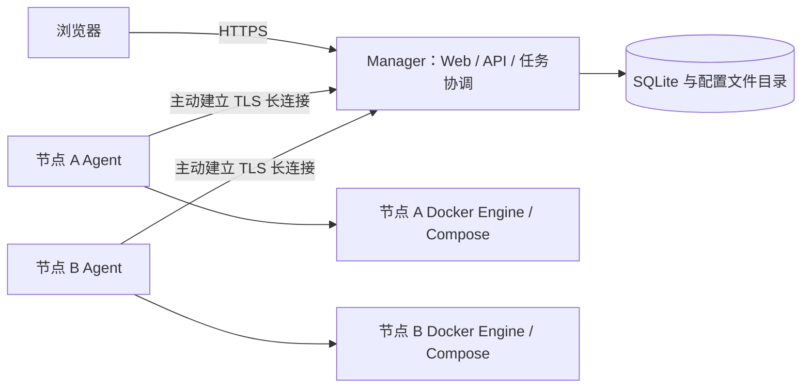

# 架构设计初稿 v0.1

日期：2026-10-30。**本文具体方案均为助手推荐、待用户审阅，不代表用户已确认或技术选型已冻结。**
需求依据：[requirements.md](requirements.md)、[open-questions.md](open-questions.md)。UI/UX 随实现迭代。
尚未开展原型、兼容性测试、性能测试或真实节点验证；具体版本与容量目标在实施前确认。

## 1. 范围与组织方式

- 面向个人自托管，兼顾以后分享；管理多个独立 Docker 节点，不依赖集群调度。
- 导航与操作边界为 Node → Stack / Docker 资源；不增加独立 Service 管理层。
- Compose 文件中的 `services` 保留原生意义，可展示容器归属，不成为另一个管理对象。
- 首个建议闭环：接入节点 → UI 创建配置 → 校验 → 部署 → 查看任务与资源；再验证 Node Cross。
- 数据迁移、跨节点调度、GitOps、多租户及完整细分 RBAC 不作为当前设计前提。
- 未管理的 Compose 项目先只读发现其配置归属；已有容器允许范围内的显式启停操作。配置接管须另行设计冲突、来源和目录处理规则。

## 2. 推荐部署拓扑



推荐每节点 Agent 主动连接 Manager，控制命令通过已认证的双向通道下发。
这样不要求 Manager 能直接访问每个节点的入站端口，但**每个 Agent 必须能访问 Manager 地址**。
Manager 可放在可达云主机，或通过用户维护的 VPN / 反向代理提供可达入口；本项目不默认附带穿透服务。
若节点被禁止出站或 Manager 仅在不可达局域网，此方案不能直接解决，需要先确定网络路径。

| 路径 | 优点 | 代价与适用边界 |
| --- | --- | --- |
| 推荐：Agent 主动连接 | 混合网络下统一方向；可保留本地任务记录 | 需要安装升级 Agent；Manager 必须可达 |
| Manager 主动连接 Agent | 连接模型直观，适合统一内网 | 每节点需可达入口、防火墙与证书管理 |
| SSH 直连 | 可复用现有 SSH 运维入口 | Manager 需持有 SSH 凭据；命令、断线与进程恢复仍需实现 |

先建议 HTTPS 注册与文件传输、WSS 双向任务/事件通道，复用一个 TLS 入口。
反向代理需支持连接升级及合理的空闲超时；心跳、退避与消息大小上限需原型确定。
gRPC 双向流是替代候选；没有吞吐与代理兼容证据前不增加第二套协议。

## 3. 组件与技术候选

| 部分 | 推荐候选 | 理由与替代路径 |
| --- | --- | --- |
| Manager / Agent | Go | 便于交付独立程序；Node.js / TypeScript 可统一语言，但需管理运行时 |
| Web | Vue 3 + TypeScript | 适合编辑器与资源页面；React 同样可用，最终取决于维护熟悉度 |
| 元数据与队列 | SQLite，单 Manager 写入 | 简化个人部署；多副本写入或更高并发需求再评估 PostgreSQL |
| 配置正文 | Manager 本地受控文件目录 | 易导出与校验；也可存数据库，但需重新评估备份与大对象处理 |
| 节点执行 | 本机 Docker Engine API + Compose CLI | Engine 用于资源观察，Compose 用于 Stack 操作；避免自行实现 Compose |

以上不指定依赖版本；实施前核实维护状态、许可证、目标平台与支持矩阵。
Manager 负责认证、配置权威、revision、任务调度、审计和节点观察缓存。
Agent 负责本地目录、校验执行、Docker 访问、持久化执行记录、日志与观察结果上报。
浏览器只调用 Manager，不直接访问 Docker socket 或 Agent。

## 4. 配置权威与执行目录

Manager 中保存的草稿与不可变 revision 是管理器配置的权威来源；节点文件是执行副本。
保存草稿不改变运行态；部署必须显式指定 revision，任务不得读取随后变化的草稿。
Agent 检测受管文件摘要与已记录副本不一致时，阻止覆盖并报告 drift；先由用户选择恢复或导入新草稿。
不自动把节点外部修改反向同步成最新版本，也不默认接管其他 Compose 项目。

建议目录布局（示意，实际根目录与权限待安装设计确认）：

```text
Manager data/
  manager.db
  blobs/<content-hash>                 # 配置正文，不是运行数据
Agent state/
  executions/                         # 任务日志与执行凭据记录，受限权限
  revisions/<stack-id>/<revision-id>/  # 只读配置快照
Agent work/<stable-stack-directory>/
  compose.yaml                        # 当前执行配置
  .env                                # 当前执行环境文件
  config/app.conf                     # 明确声明的文本附件
  data/                               # 示例运行数据；禁止作为配置清单的一部分清理
```

每 Stack 使用固定、首次部署后不随 revision 改变的项目目录；不能直接在版本号子目录执行部署。
例如 `./data:/var/lib/app` 始终解析到同一工作目录中的 `data`，避免每次升级得到空目录。
固定目录名、Compose 解析出的项目名和 Stack ID 分别记录；UI 显示名可以变化。
创建时先按原生输入与稳定目录解析建议项目名，UI 让用户明确确认 project_name；执行时以原生 `-p` 参数传入这个已确认值，并在执行上下文中展示和记录。它是显式项目名选择，不额外附加管理器前缀，也不改写 Compose 原文。
同一 Stack 的 project_name 固定且检查节点内冲突。若后续 Compose 顶层 name 或插值输入与固定名矛盾，应要求用户处理并说明 `-p` 的优先级，不能静默改成另一项目；换项目名使用新建或复制流程。Node Cross 的目标项目名同样显式确认，不修改来源。
管理器进程环境不得泄漏到 Compose 插值；固定输入环境、工作目录与文件参数并记录摘要。

部署时先校验快照、准备临时文件，再在 Stack 独占锁内更新固定目录的受管配置并执行 Compose。
文件替换清单与阶段须写入执行日志；进程中断后先修复或核对文件集，不能假定多文件天然原子替换。
只更新清单中的配置；禁止递归同步删除工作目录，禁止覆盖检测到的运行数据目录或路径类型冲突。
旧附件清理需核对受管清单、摘要及引用；不能把旧配置回退等同于数据库或卷数据回滚。
附件本身被应用写入时也会产生 drift；首版推荐只读配置挂载，并明确这不是强制改写 Compose。

## 5. Compose 支持边界

首版建议支持单个 Compose 主文件、显式 `.env` / `env_file` 与受管文本附件，保持用户原文。
解析用于校验与依赖发现，执行交给 Compose；不把规范化输出反写成用户文件。
管理器不额外生成网络、卷或容器名前缀；Compose 自身的默认网络、项目命名和声明资源照常生效。
相对配置依赖须落在工作目录允许范围内；绝对 bind 路径表示目标节点依赖，不随配置跨节点复制。
外部卷、网络、宿主路径、端口、架构和镜像访问权限需在目标节点核对；预检不能保证执行时无竞争。
`build`、`include`、跨文件 `extends`、多 Compose 文件及远端配置获取建议暂缓。
发现这些形式或不能安全识别的文件依赖应明确返回 `UNSUPPORTED_FEATURE`，不静默忽略或改写。
字段支持范围与 Compose 能力协商在实现时列矩阵；不承诺“任意 Compose 均可运行”。
用户原文可保存在草稿中，但只有通过当前支持边界和目标节点校验的 revision 才可部署。

官方依据：相对路径与项目目录规则见 [Compose services](https://docs.docker.com/reference/compose-file/services/)；项目名优先级见 [Specify a project name](https://docs.docker.com/compose/how-tos/project-name/)。
bind mount 指向 Docker daemon 所在主机，且默认可写，见 [Bind mounts](https://docs.docker.com/engine/storage/bind-mounts/)。本节工作目录与拒绝策略是本项目建议，尚未原型验证。

## 6. 执行、断线与恢复

任务状态统一为 `queued / running / succeeded / failed / unknown / canceled`，详见 [数据与接口](data-and-api.md)。
同 Stack 的 queued / running / unknown 任务阻止新变更与注销，但允许保存草稿；所属容器的直接变更共用此锁。不同 Stack 可并行，节点并发上限待测。
Manager 先持久化任务再下发；Agent 先持久化接收记录再确认，开始 Docker 副作用前记录执行阶段。
Manager 重启、网络断线或超时不能证明执行失败；证据不足转 `unknown`，禁止自动重复执行。
Agent 重连上报未确认任务、持久执行记录、文件摘要与资源观察，Manager 按任务 ID 核对补齐结果。
Agent 重启后进程可能退出、继续或已完成；本地记录缺失时保持 unknown，不能仅凭“容器在跑”判成功。
幂等键与执行记录降低重复执行风险，不保证跨进程崩溃下的 exactly-once。
无法核实的任务继续占用变更门禁。人工解除必须先确认旧执行不会继续产生副作用，且 Agent 持久记录该 task 不得再次执行；只有用户说明或容器正在运行不足以解除。旧任务仍保留 unknown 与核对证据，不伪造成功。
离线节点拒绝新部署；尚未下发的排队任务遇断线记为明确未执行失败。已经下发但缺少回执的任务进入 unknown，重连只核对原任务，不自动执行旧排队意图。

`succeeded` 表示指定命令与文件阶段完成并收到可靠结果；运行态、健康检查及观察时间另行显示。
`docker compose up -d` 启动后台容器不等于服务健康，依据见 [Compose up](https://docs.docker.com/reference/cli/docker/compose/up/)。
失败可留下部分已更新资源；自动 down、自动回滚和删卷均不作为失败处理默认动作。

## 7. Node Cross

用户指定来源 Stack 的某个 revision，或已保存的 draft.version（先固定成快照），再指定目标节点和名称，生成独立目标草稿并保留来源。
复制的是该 revision 的 Compose、环境文件和附件清单；记录来源 ID / revision，之后不双向同步。
不自动部署，不复制运行数据、Docker 卷、镜像缓存、节点证书或 Manager / OIDC 凭据。
配置中可能嵌入业务秘密；复制预览覆盖全部文件与变量，已标记敏感值默认不复制，用户可显式选择带入或在目标重新填写。无法可靠识别的内嵌秘密要求用户审阅，不能声称自动脱敏完整。
目标同名 Stack 默认拒绝；实际 Compose 项目名、端口、显式容器名及外部资源冲突单独检查。
目标部署仍走 revision 与校验流程；源 Stack 不停机、不删除，不将配置复制称为数据迁移。

## 8. 账号、节点身份与交付

推荐简单内置账号 + 可选 OIDC，支持安装时选择 OIDC-only；最终模式仍待用户选择。
不提供公开注册；通过配置中的一次性引导凭据建立本地管理员，或预置获准的 OIDC `issuer + sub`。
不使用“第一个访问者成为管理员”；OIDC 身份须通过明确 allowlist，不凭同域邮箱自动授权。
获准账号首版统一 admin，页面明确其可控制全部节点；细分 RBAC 后置必须再次审查影响。
OIDC 关联使用 `(issuer, sub)`，不单靠邮箱自动合并；账号关联要求已有账号重新认证并显式操作。
使用标准库校验签名、issuer、audience、有效期、state / nonce，采用授权码流程；细节实施前安全评审。
Cookie 会话建议 HttpOnly / Secure / SameSite，并对变更接口做 CSRF 防护；会话撤销与登录限速需实现。
OIDC 故障不自动开启本地登录或跳过认证；OIDC-only 的本机恢复工具须显式运维执行并留审计。
官方依据：[OIDC Core](https://openid.net/specs/openid-connect-core-1_0.html)，身份稳定键与验证要求来自规范；产品授权和恢复策略为本项目建议。

用户登录凭据与节点身份彻底分离：短期一次性注册令牌绑定节点，再颁发可撤销、可轮换的专属凭据。
建议注册后使用 mTLS；Agent 校验 Manager 证书，Manager 校验节点证书、节点绑定与撤销状态。
撤销立即禁止新命令并断开连接，但无法撤销节点上已经发生的 Docker 副作用；恢复须重新注册。
Agent 仅暴露受支持任务，不提供任意 shell API；Compose 参数使用参数数组，不拼接 shell 字符串。
Agent 的 Docker 访问权限意味着对宿主机的高权限控制，不能把容器化包装视为安全隔离。
依据：[Docker Engine security](https://docs.docker.com/engine/security/)；首批系统、CPU 架构、rootless 支持均待确认。
推荐 Manager 容器或独立程序、Agent 系统服务；容器化 Agent 需要另证宿主路径与 daemon 路径一致性。
容器化 Agent 的工作目录须映射到 daemon 宿主机同一路径；仅在 Agent 容器内存在的路径不能作为可用宿主 bind 源。不能检查宿主绝对路径时预检标为未知。
安装前检查 Engine / Compose、存储目录、TLS、时间同步与出口；安装器不默认开放未认证 Docker TCP 端口。
备份须一致保存 SQLite、配置 blobs、密钥和认证配置；加密备份与密钥分开保管，恢复后重核节点与未决任务。
Manager 备份不包含节点运行数据；卷、bind 目录及应用一致性备份是另一个明确选择的流程。
升级先备份与检查协议兼容；恢复演练、未知任务恢复和路径保护通过后再宣布可用。
