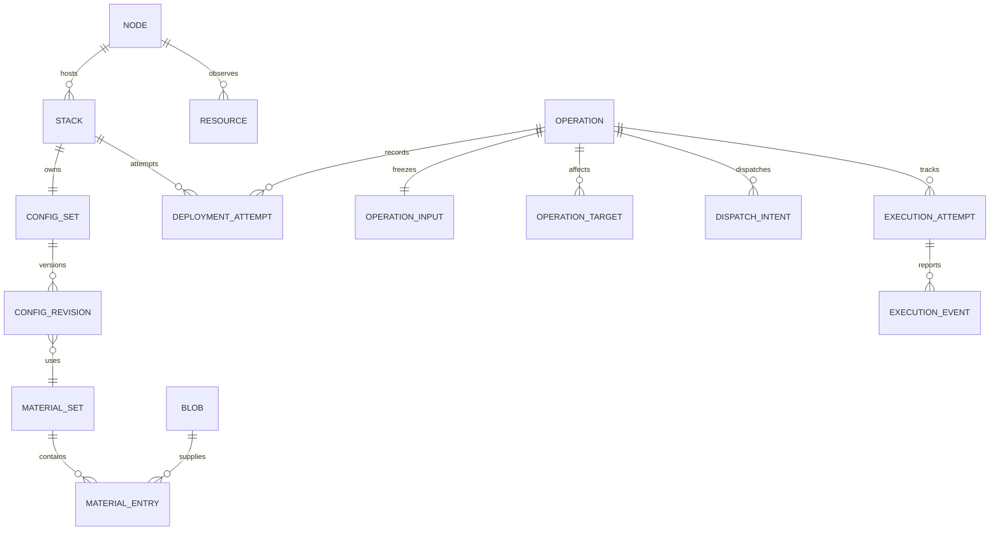

# Docker Manager 数据设计

更新日期：2026-10-30。修订：DD-20261030-02。状态：草案；已按单一职责收紧内容，逻辑模型、物理映射与数据保留参数待确认。

职责：定义产品需要保存哪些数据，以及这些数据的结构、关系、一致性约束和生命周期。

包含：管理端及 Agent 的持久实体、标识与字段含义、关系、约束、索引、数据库事务边界、敏感数据表示、文件引用与保留条件、备份清单及结构迁移约束。排除：业务行为和状态转换、组件执行与恢复机制、通信协议及消息交互、备份恢复操作流程、测试场景及版本排期。

输入：[需求说明 REQ-20261030-02](requirements.md)、[功能设计 FD-20261030-02](functional-design.md)、[架构设计 AR-20261030-02](architecture.md)。状态含义和操作规则由功能设计维护；持久化技术与组件边界引用架构；本篇维护逻辑结构、约束及数据生命周期。[待定事项](open-questions.md)集中维护未决状态。

## DD00 模型边界与约定

存储分工引用[架构设计 AR05](architecture.md#ar05-信息所有权与持久化)，不在本篇重新选型。以下使用关系模型描述；SQLite 的物理映射以 A02 最终选择为前提。

通信协议待定项 A09 由[架构设计 AR04](architecture.md#ar04-连接协议与节点身份)维护。操作标识、事件序号和接收记录在本篇只定义持久表示；传输方式、消息格式、确认与重传交互属于接口设计。上游尚未确定的语义保留为条件字段，不由本篇补成定案。

F / P 条件能力继续保持原状态。为它们提供模型不代表范围已经批准；可选表在相应能力启用时使用。必要的输入修订和执行去重数据即使没有“完整历史查询”产品功能也必须保留。

### DD00.1 通用字段与类型

下表中的字段名为逻辑名。除明确标 `?` 可空外，字段必须有值；分组字段在同一描述中列出，最终物理列拆分按本篇含义落实。`enum` 是受约束的代码，不能以任意字符串替代。各实体的 `id` 为主键；关系表使用写明的组合主键或独立主键加唯一约束。

| 类型或公共字段 | 建议表示 | 规则 |
| --- | --- | --- |
| `id`、`*_id` | 不透明随机唯一标识，数据库可用文本 | 不使用显示名称或网络地址作为主键；不同类型的 ID 不互换 |
| `created_at`、`updated_at`、`*_at` | UTC 时刻，精度在物理设计时统一 | 界面按时区转换；时间用于展示和期限判断，不作为可靠事件顺序 |
| `row_version` | 正整数 | 可变业务行的乐观并发版本，更新成功加一；不可变修订不靠覆盖修改 |
| `*_epoch`、`seq`、`revision_no` | 非负或正整数，逐项指定作用域 | 数据库保存范围与溢出检查；与网络连接、传输帧计数区分 |
| `digest`、`digest_algorithm` | 字节摘要及算法标识 | 校验确定内容，不代替授权；输入摘要算法与规范化版本一同记录 |
| `document` | 带 `schema_version` 的结构化数据 | 用于复杂工具输入或观测详情；主键、授权、状态、引用和常用筛选不能全部藏在其中 |
| `deleted_at?` | 可空 UTC 时刻 | 仅表示管理记录停用或墓碑化，不证明远端资源已删除 |

可变实体默认包含创建时间、更新时间和行版本；不可变记录包含创建时间与内容版本；事件包含发生时间、接收时间及其作用域序号。表中只重复列出需要特别说明的字段。

正文统一沿用 `Node`、`Stack`、配置材料、运行数据等术语。后面的 `resource_generation` 是管理器的观测代次，不是 Docker 提供的版本条件，也不能解决 A08 的外部同名重建竞态。

## DD01 持久范围与对象关系

| 信息类别 | 保存位置与用途 | 不作为该信息的替代物 |
| --- | --- | --- |
| 节点、账号、管理关系、已保存配置 | 管理数据库与材料存储，作为管理输入 | 不据此认定节点在线或配置已经部署 |
| Docker 资源观测 | 管理端缓存快照及 Agent 的最近观测 | 缓存不是 Docker 本身；读取失败不清空为零 |
| 操作、输入、派发意图、结果与恢复证据 | 管理数据库及 Agent 本地执行数据库 | 一次消息发送或 CLI 返回值不能代替完整影响记录 |
| 配置原文、附件、构建上下文、镜像归档 | 材料存储，数据库维护引用与校验清单 | 不全部放入数据库大字段；原文不被解析预览覆盖 |
| 应用卷、宿主目录、容器可写层中的业务数据 | 原所在节点；P10 启用时另有传输或备份产物 | 不自动进入配置包或管理程序备份 |
| 日志、统计、终端流 | 默认为有界实时流；必要的操作输出单独保存 | 不默认永久保留日志、指标历史或终端所有输入 |

图是核心关系摘要。`STACK` 可在移除节点管理后变为未绑定记录，此时节点关联为空；历史操作中的原目标仍保留。原始配置接管、模板等条件来源不会改变这些核心关系。

## DD02 节点、注册与管理所有权

依据：FD04；AR04、AR08、AR14。

| 实体 | 主要字段 | 约束与用途 |
| --- | --- | --- |
| `installation` | `id`、`restore_epoch`、`mode`、`schema_version` | 每个管理实例一条；恢复代次不以恢复旧数据库的方式自动沿用，模式区分正常与恢复核对 |
| `node` | `id`、`display_name`、`description?`、`lifecycle`、`current_binding_id?`、`deleted_at?` | 显示名称不全局唯一；移除管理保留墓碑与历史引用，不级联删除节点运行资源 |
| `execution_environment` | `id`、`verified_identity_key?`、`identity_evidence_document`、`verification_state` | 管理器识别的实际 Docker 环境；已核验的身份键唯一，地址别名和不同 Agent 路径不能各自建立第二个已知相同环境 |
| `node_binding` | `id`、`node_id`、`environment_id`、`installation_id`、`registration_epoch`、`owner_epoch`、`agent_identity`、`engine_identity_document`、`status` | 每节点及每个已识别执行环境至多一个有效写绑定；重装与目标变更新建绑定，保留旧身份 |
| `enrollment` | `id`、`token_hash`、`intended_node_id?`、`created_by`、`expires_at`、`consumed_at?`、`revoked_at?` | 注册秘密只存不可逆校验值；单次消耗与绑定建立在同一事务内竞争 |
| `node_identity_version` | `id`、`binding_id`、`public_material`、`fingerprint`、`not_before`、`not_after`、`revoked_at?` | 证书方案成立时记录证书及公钥；节点私钥不在管理数据库；轮换可有受限重叠期 |
| `node_observation` | `node_id`、`binding_id`、`observed_at`、`received_at`、`connection_state`、`engine_state`、`compose_state`、`capability_document`、`observation_seq` | 主键为节点，保存最近有效观测；按绑定和序号更新，旧连接迟到结果不得覆盖新绑定 |

绑定身份保存 Agent 与实际 Docker 环境的证据，IP、主机名和 socket 路径只是属性。`execution_environment.verified_identity_key` 的核验结果来自 AR04、AR08；未核验记录保留独立状态，不能用新随机 ID 表示已证明是不同环境。

同一环境的新旧绑定共享 `environment_id`；旧执行和未释放占用保留关联。能力文档保存实际工具版本、平台和支持情况，属于观测而非管理员声明。身份识别与绑定切换机制引用 AR04、AR08，所需证据字段列入 D03。

当前连接实例是运行态对象，可丢弃；可保留最后连接及失败摘要帮助排障，但其记录存在不证明连接仍活跃。通信方案定稿后可补适配器连接元数据，不把连接 ID 用作持久节点 ID 或操作去重 ID。

`node_binding` 保存归属和代次，不以该记录代替执行许可。其语义引用 AR08、AR14；A04 的单写所有者假设和 A09 的身份承载继续保留原状态。

## DD03 Stack、配置修订与部署引用

依据：FD01、FD05、FD07、FD12、FD14；AR05、AR06。

| 实体 | 主要字段 | 约束与用途 |
| --- | --- | --- |
| `stack` | `id`、`node_id?`、`display_name`、`project_name`、`management_mode`、`config_set_id`、`last_attempt_id?`、`last_successful_apply_id?`、`deleted_at?` | 绑定状态要求节点非空；同一节点有效管理关系中的项目身份唯一；一个 Stack 对应一个配置集合 |
| `config_set` | `id`、`current_revision_id?`、`revision_counter`、`lifecycle` | 新建未保存时可无修订；当前修订必须属于自身集合，不能指向另一 Stack 的内容 |
| `config_revision` | `id`、`config_set_id`、`revision_no`、`parent_revision_id?`、`material_set_id`、`composition_document`、`author_actor_id`、`change_summary?`、`source_kind`、`source_document?` | `(config_set_id, revision_no)` 唯一；保存后不可变；composition 保存入口文件、合并次序和环境来源等组合设置；父修订属于同一集合，跨集合来源单列 |
| `deployment_attempt` | `id`、`stack_id`、`operation_id`、`config_revision_id`、`execution_profile_document`、`input_digest`、`result_state`、`started_at?`、`finished_at?` | 一个部署操作至多一条尝试；配置必须属于该 Stack 的集合；实际镜像与工具证据关联操作结果 |
| `stack_resource_link` | `stack_id`、`resource_id`、`association_kind`、`evidence_document`、`observed_at`、`ended_at?` | 记录已证实的运行关联或疑似归属；不能只靠名称判定归属；有效关系与历史关系分开 |
| `stack_origin`（P03 / P04） | `stack_id`、`source_stack_id?`、`source_revision_id?`、`source_snapshot`、`adoption_operation_id?` | 复制或接管的来源说明；来源删除后仍可解释，不使两端共享可变配置头 |

`project_name` 与 `display_name` 为独立字段。结束管理关联后仍需保留的资源引用按 FD05、FD12 保存，不由数据表级联删除远端资源。

保存与部署的三个引用明确分开：

- `current_revision_id` 表示最新保存内容，保存成功只推进它。
- `last_attempt_id` 表示最近已受理的部署尝试，可能失败、部分完成或未知。
- `last_successful_apply_id` 表示最近一次有证据的成功应用。它不意味着现在依然健康，也不证明没有外部修改。

最近成功应用引用只能关联 FD05 定义的成功结果；实际资源快照与健康信息单独保存。历史恢复所产生的新修订保留来源关系，原修订及已有操作输入不变。

`execution_profile_document` 保存本次明确的文件顺序、变量来源、启用组、镜像与构建选择等结构化输入；具体字段在 P02 与接口设计收敛后细化，但其中引用的材料与秘密必须有单独可检查的关系，不能靠扫描任意文档猜依赖。

## DD04 材料、文件与敏感内容

### DD04.1 不可变材料结构

| 实体 | 主要字段 | 约束与用途 |
| --- | --- | --- |
| `blob` | `id`、`storage_key`、`content_digest`、`digest_algorithm`、`byte_length`、`media_type?`、`status`、`encryption_key_version_id?`、`crypto_metadata?` | 发布后的内容不可变；存储键唯一且由服务生成，不接受任意宿主路径；重发布不复用正在回收对象的存储键；损坏或缺失有独立状态 |
| `material_set` | `id`、`manifest_version`、`manifest_digest`、`status`、`sealed_at?` | 开放时可组装，封存后清单不可变；只有封存且内容可用的集合可成为配置修订 |
| `material_entry` | `material_set_id`、`logical_path`、`blob_id`、`purpose`、`file_mode?`、`sensitivity` | 主键 `(material_set_id, logical_path)`；路径规则与目标平台兼容；正文、env、附件、构建材料明确分类 |
| `material_reference` | `id`、`material_set_id`、`source_path`、`reference_kind`、`declared_value`、`resolved_path?`、`resolved_blob_id?`、`resolution_status` | 保存文件引用或外部依赖的解析证据；不能把宿主路径当成已打包文件；远程固定内容应有持久引用 |
| `retention_pin` | `id`、`blob_id`、`reason`、`operation_id?`、`backup_id?`、`transfer_id?`、`expires_at?`、`released_at?` | 原因限定且对应所有者字段必须匹配；活动执行、未知结果和备份中的 pin 不因普通期限自行释放 |
| `node_material_hold` | `id`、`binding_id`、`workspace_identity`、`native_resource_identity?`、`blob_id`、`usage_kind`、`evidence_version`、`released_at?` | 将节点运行挂载和构建使用回报为管理端可枚举的引用；与 Agent 本地路径引用对应，失联不等于释放 |

配置原文保持原字节内容；解析后的有效配置另存为可重建缓存或受保护操作证据，不能覆盖原文。变量的未设置、空字符串、字面内容和秘密引用分别保存，不能全转换成一个可空字符串。

秘密可以存在于正文、附件或变量中。`sensitivity` 用于处理策略，不代表已完整自动识别。内容存储必须支持对整个敏感材料加密；普通摘要只存可公开的选择信息，完整输入和输出按权限访问。

同一内容可以被多份材料引用，但内容复用不传递授权。物理去重仅在相同保护域和加密策略允许时进行；不要将公开的全局内容摘要当作跨账号存在性查询接口。

### DD04.2 引用与发布

真实引用包括材料条目、固定远程解析结果、操作输入、执行证据、节点材料占用、备份清单和活动传输；这些关系必须能在数据库中枚举。引用计数最多作为加速缓存，不能成为唯一清理依据。`node_material_hold` 的绑定、材料及证据必须关联一致；操作输入引用与运行引用之间不能出现无保护间隔。节点离线不改变材料引用的释放状态。

新增引用与标记回收共享数据库原子性边界：只有可发布状态的材料允许新增引用，只有无有效引用和保留占用的材料允许进入待回收状态。待回收对象不再复用；相同内容的新对象使用新 `blob.id` 和独立 `storage_key`。这些约束保证旧对象的删除不会破坏新引用，文件发布与回收机制引用 AR05.3。

封存清单要求已上传文件的路径、名称、摘要和存储引用完整；Compose 校验结果另存 `validation_record`，不作为材料存储完整性的同一字段。保存与部署前提引用 FD05。节点宿主绝对路径、外部卷和外部网络作为依赖声明保存，不为它们虚构 `blob_id`。构建材料与应用运行数据分别建模。

数据库事务不包含文件系统写入。已提交的有效材料引用必须对应已持久发布的内容；缺失、损坏及回收未完成各有可保存的状态。崩溃处理与用户可见结果引用 AR05.3、FD05。

## DD05 Docker 资源与观测缓存

依据：FD06、FD08—FD12；AR08—AR10，尤其 A08。

| 实体 | 主要字段 | 约束与用途 |
| --- | --- | --- |
| `resource` | `id`、`node_id`、`binding_id`、`kind`、`native_key`、`identity_strength`、`resource_generation`、`first_seen_at`、`last_seen_at`、`missing_since?` | 产品自己的资源记录；容器 / 网络可利用原生 ID，普通卷等名称定位对象标明较弱身份；不能把观测代次传给 Docker 当原子前置条件 |
| `resource_snapshot` | `resource_id`、`snapshot_version`、`observed_at`、`received_at`、`scan_id`、`status_document`、`configuration_document?`、`capability_document?` | 主键资源 ID，保存最新可用快照；原始详情可能敏感，不用于普通列表直出 |
| `resource_edge` | `id`、`node_id`、`from_resource_id`、`to_resource_id`、`relation_kind`、`edge_key`、`detail_document`、`observed_at`、`ended_at?` | 只表示两端都存在的 Docker 资源关系，如容器使用镜像或连接网络；同节点约束，不为宿主路径或端口虚构资源 |
| `container_mount` | `container_resource_id`、`target_path`、`mount_kind`、`volume_resource_id?`、`host_source_path?`、`options_document`、`observed_at` | 主键前两项；卷、宿主绑定、tmpfs 等类型限定来源字段；卷关联由此表维护，避免再独立写一套 edge |
| `container_port_binding` | `id`、`container_resource_id`、`container_port`、`protocol`、`host_address?`、`host_port?`、`observed_at` | 同一容器的端口、协议和宿主绑定组合唯一；仅暴露未发布与真实宿主绑定分开表达 |
| `observation_scan` | `id`、`node_id`、`binding_id`、`scope`、`scan_seq`、`started_at`、`completed_at?`、`completeness` | 只有成功完成的相应范围扫描可标记该范围未出现资源为缺失；断线或权限不足不能产生批量删除结论 |

同一绑定内有效资源按类型和原生键做唯一检查；识别到新一代同名对象时结束旧关系并新建资源记录，历史操作仍引用旧记录。无法识别同名替换时保留证据限制，不能用本地生成的 ID 假称拥有原生稳定身份。

镜像内容身份与标签别名分开保存：`image_alias(node_id, binding_id, repository, tag, resource_id, observed_at)` 是当前观测关系，主键为绑定、仓库和标签，并检查资源所属节点与绑定一致；不以标签作镜像永久主键。摘要与平台等来自实际镜像详情。拉取、构建、导入和推送的输入与结果保存在操作及证据中，不把结果归档伪装成已运行容器。

网络端点与卷挂载关系关联容器实际身份；停止的容器仍可能占用卷。宿主目录挂载保存在挂载详情，不伪装成 Docker 卷；容量未取得与容量为零分别表达。

节点离线时保留最后快照和观测时间。事件可以促使刷新，但只有顺序与范围有效的观测更新快照；旧绑定的回报、迟到扫描和低版本数据不得覆盖较新结果。操作结束时的关键快照另存为证据，不依赖将来可能被覆盖的实时缓存。

## DD06 操作、输入、目标与执行结果

依据：FD03；AR07—AR09。业务状态直接对应 FD03，不因数据库实现另造一套“部署成功”定义。

### DD06.1 操作主体与确定输入

| 实体 | 主要字段 | 约束与用途 |
| --- | --- | --- |
| `actor` | `id`、`kind`、`user_id?`、`display_snapshot`、`disabled_at?` | 人、系统或条件自动化身份；用户删除后保留最小执行者标识，不把历史行为改挂新同名账号 |
| `operation` | `id`、`kind`、`actor_id`、`origin`、`business_state?`、`state_version`、`restore_epoch`、`accepted_at`、`started_at?`、`finished_at?`、`cancel_requested_at?`、`parent_operation_id?` | 主记录；受理后尚未开始时业务结果可空，以派发阶段表示；取消请求与结果分开，未知不写假结束时间；状态修改需要版本检查及证据 |
| `operation_input` | `operation_id`、`schema_version`、`digest_version`、`input_digest`、`sealed_document_blob_id`、`material_set_id?`、`config_revision_id?`、`confirmed_impact_digest?` | 主键操作 ID；一经受理不可变；包含全部会改变行为的选项，保密值通过受保护引用固定 |
| `operation_target` | `id`、`operation_id`、`target_kind`、`node_id`、`binding_id`、`environment_id`、`stack_id?`、`resource_id?`、`native_identity_snapshot`、`expected_observation_version?`、`role` | 一个操作可有多个目标；类型限定必填关联，FK 和事务检查节点、绑定与执行环境一致；历史绑定保留 |
| `operation_material` | `operation_id`、`blob_id`、`purpose` | 主键 `(operation_id, blob_id, purpose)`；包括输入、校验输出、结果归档和证据，供授权与回收枚举 |
| `request_dedup` | `actor_id`、`request_scope`、`key_hash`、`input_digest`、`operation_id`、`expires_at?` | 主键前三项；同一标识不同输入拒绝；标识的外部携带方式留接口设计 |

输入摘要关联封存输入及其 `digest_version`，不从可变配置头重新计算；秘密版本、实际目标绑定和影响选择有明确持久引用。摘要的规范化与交换约定由接口设计维护。凭据轮换不能原地改变已封存输入中的秘密版本。

`request_dedup` 与执行器去重记录有独立主键及保留周期；请求窗口到期不级联删除执行证据。新操作与原操作的关联通过独立 ID 表达，重复提交和重试行为引用 FD03、AR07.2。

### DD06.2 派发与尝试

| 实体 | 主要字段 | 约束与用途 |
| --- | --- | --- |
| `dispatch_intent` | `id`、`operation_id`、`target_id`、`step_key`、`attempt_id`、`authorization_snapshot_id`、`start_before`、`delivery_state`、`next_delivery_at?`、`delivery_count` | `(operation_id, target_id, step_key, attempt_id)` 唯一；记录语义派发意图，投递次数与执行尝试次数分开 |
| `execution_attempt` | `id`、`operation_id`、`target_id`、`step_key`、`attempt_no`、`node_execution_id?`、`owner_epoch`、`input_digest`、`phase`、`outcome?`、`last_contiguous_seq`、`last_applied_seq` | 一个逻辑步骤的一次执行尝试；接收连续水位与已应用业务水位分开；尝试关联的输入和未释放占用保留 |
| `execution_event` | `attempt_id`、`source_epoch`、`seq`、`event_kind`、`occurred_at`、`received_at`、`evidence_blob_id?`、`event_digest`、`processing_state` | 主键前三项；同键内容摘要一致；处理状态为待应用、已应用或隔离，不以记录存在代替已应用标记 |
| `operation_step` | `operation_id`、`step_key`、`dependency_document`、`state`、`current_attempt_id?`、`effect_summary?` | 主键前两项；保存分阶段进展，依赖必须属于同一操作且无环；状态汇总不代替步骤事实 |
| `authorization_snapshot` | `id`、`actor_id`、`permission_epoch`、`node_binding_id`、`owner_epoch`、`impact_digest`、`input_digest`、`issued_at`、`start_before`、`revoked_at?` | 当时被授权内容的证据；摘要及目标与固定输入一致；当前授权另有状态与版本 |

`phase` 是存储执行受理、准备、调用、结果记录等内部阶段，不直接新增用户状态。每次结果推进都注明依据；CLI 返回、Docker 观测和应用健康分别保留，不能用一个 exit code 覆盖全部结果。

`last_contiguous_seq` 表示连续持久接收范围，`last_applied_seq` 表示已完成业务数据更新的范围；两者独立，序号缺口和待应用记录必须可表达。处理标记、结果引用及应用水位的原子性见 DD07。乱序、确认和结果快照的交换约定由接口设计维护，重启处理机制引用 AR07、AR08。

### DD06.3 业务状态表示

| FD03 状态 | 建议存储代码 | 关联数据 |
| --- | --- | --- |
| 检查中、待确认 | `checking`、`awaiting_confirmation` | 如需持久保存，使用独立准备记录及校验引用，与已受理操作区分 |
| 未执行 | `not_executed` | 未开始依据和原因引用 |
| 执行中 | `running` | 已开始步骤、开始时间；取消请求独立字段 |
| 成功、失败、部分完成 | `succeeded`、`failed`、`partially_completed` | 步骤结果、影响摘要和证据引用；健康观测另存 |
| 结果待核实 | `outcome_unknown` | 未核实尝试、占用和材料引用；完成时间可空 |
| 已取消 | `cancelled` | 实际停止点、已发生影响及结果证据 |

状态含义及允许转换完整引用[功能设计 FD03.2](functional-design.md#fd032-用户可见状态)。已受理但尚未开始由 `accepted_at`、派发阶段和可空 `business_state` 表达；本表只规定存储表示，不定义界面文案或新的业务状态。

## DD07 校验、冲突占用与事务边界

### DD07.1 校验和占用记录

`validation_record` 保存 `id`、配置修订 / 操作输入引用、输入摘要、目标绑定、工具能力摘要、检查范围、检查时间、结论、问题清单引用和失效原因。脱离节点的语法检查与节点预检分别记录；配置、目标、工具或前提变化后，原检查不能被当作当前部署许可。

`conflict_claim` 保存 `id`、`operation_id`、`attempt_id?`、`node_id`、`binding_id`、`environment_id`、`scope_kind`、`scope_key`、`claim_mode`、`acquired_at`、`released_at?`、`release_evidence_id?`。`scope_kind` 区分环境门闩、Stack、容器、共享资源和新名称预留；冲突在同一实际环境范围核对，不能按新绑定分区绕开旧占用。未知结果仍持有占用，不使用租约到期自动释放。

唯一索引只覆盖精确同键约束；层级范围的重叠检查与占用写入必须具有同一原子性边界。冲突政策引用 FD03，协调及 Agent 互斥机制引用[架构设计 AR08.1](architecture.md#ar081-冲突和执行所有权)，不在本篇指定锁实现或调度算法。

同一次受理的占用、固定输入和派发意图必须全部提交或全部回滚。释放占用需保留 `release_evidence_id`；删除占用行不改变操作结果。

### DD07.2 必须原子完成的数据库变更

| 事务 | 同一事务内完成 | 数据不变量与边界 |
| --- | --- | --- |
| T01 保存配置 | 校验预期 `row_version`；插入新修订及引用；推进配置头与修订计数 | 配置头与新增修订一致；文件持久性前提见 DD04 |
| T02 受理操作 | 授权版本与去重键检查、输入及目标固定、重叠冲突检查、占用、步骤、尝试和派发意图 | 不存在只有派发记录却无固定输入或占用的已提交状态；秘密和材料引用一并固定 |
| T03 保存执行事件 | 检查尝试及代次、去重插入事件和证据引用、标记待应用、推进连续接收水位 | 接收水位只覆盖已持久化事件；保存不等于应用，证据引用有效 |
| T04 保存事件对应结果 | 按版本更新步骤和业务结果、部署成功引用及占用释放证据；同事务标记已应用并推进应用水位 | 结果变更与事件处理标记不能部分提交；运行观测独立保存 |
| T05 保存取消请求 | 保存取消请求及关联传递意图 | 请求记录与实际取消结果分开；同一请求不产生重复意图 |
| T06 保存撤销 | 修改账号 / 授权 / 凭据状态并推进授权版本，保存关联失效记录 | 本地撤销状态、传播记录与远端生效证据分别表达 |
| T07 固定备份或标记回收 | 固定备份清单和材料 pin，或核对无引用后标记回收 | 文件复制与删除在事务外，进度和内容状态独立保存 |

SQLite 实现时每个连接显式启用并检查外键约束，不能假设驱动默认已开启；参见 [SQLite 外键说明](https://www.sqlite.org/foreignkeys.html)。写入协调采用短写事务及版本条件更新，忙冲突作有界处理，不能持有事务等待网络或用户。SQLite 一次只允许一个写事务，参见 [事务说明](https://www.sqlite.org/lang_transaction.html)。

事件处理标记是持久字段；去重命中不删除原记录或改变其处理标记。T04 将结果、标记和应用水位绑定为一个原子变更，未提交时保留原待应用状态及材料引用。终态与取消相关写入共用状态版本检查。启动扫描、重试及消息确认不在本篇定义。

数据库、文件系统和 Docker 三者不组成一个事务。任何表名中的“成功”只代表有证据的对应阶段，不产生跨系统自动回滚保证。

## DD08 Agent 本地执行数据与工作区

Agent 数据库独立于管理数据库，没有跨机器外键；通过管理实例、节点绑定、操作 ID、尝试 ID、输入摘要和代次核对语义。具体消息结构仍由 A09 / 接口设计确定。

| 本地实体 | 主要字段 | 约束与生命周期 |
| --- | --- | --- |
| `agent_identity` | `local_identity_id`、`private_key_locator`、`public_identity`、`registration_epoch`、`journal_generation` | 私钥保存在节点受限身份存储，表只定位；账本代次与身份来源可追溯 |
| `controller_binding` | `installation_id`、`owner_epoch`、`trust_material`、`recovery_state`、`last_reconciled_at?` | 一个有效控制归属；会话不作为控制归属主键，旧执行保留原归属 |
| `execution_journal` | `execution_id`、`installation_id`、`operation_id`、`attempt_id`、`binding_epoch`、`owner_epoch`、`input_digest`、`input_material_locator`、`start_before`、`phase`、`outcome?` | `(installation_id, attempt_id)` 唯一且对应固定输入摘要；每次尝试保留所属操作和授权依据 |
| `local_step` | `execution_id`、`step_key`、`intent_recorded_at`、`effect_started_at?`、`completed_at?`、`process_identity?`、`tool_profile`、`result_evidence?` | 主键前两项；意图、开始与结果分别记录；进程身份包含 PID、启动证据与宿主启动身份 |
| `local_event` | `execution_id`、`journal_generation`、`seq`、`event_digest`、`event_document`、`evidence_locator?` | 主键前三项；属于恢复证据而非网络帧；未获管理端持久确认不得按普通日志裁减 |
| `delivery_checkpoint` | `execution_id`、`manager_restore_epoch`、`acknowledged_seq`、`acknowledged_at` | 确认连续且已落库事件的水位；恢复旧管理库后不能继续沿用旧确认假定其仍拥有结果 |
| `local_claim` | `execution_id`、`scope_kind`、`scope_key`、`acquired_at`、`released_at?`、`release_evidence?` | 与管理端共同实现执行互斥；断线、重启、期限到达不单独构成释放依据 |
| `execution_tombstone` | `installation_id`、`attempt_id`、`input_digest`、`final_outcome`、`owner_epoch`、`retention_reason` | 可在详细日志清理后保存最小去重结论；需与可接受指令期限和恢复政策协调 |

本地步骤的工具配置保存实际程序版本、参数及受控环境引用，不把包含密码的完整命令写进普通日志。未开始、已经开始但结果未知、完成但未回报三种情况必须可区分。

执行事件序号和账本代次属于持久账本，不属于连接。`delivery_checkpoint` 必须包含对应管理端恢复代次；不同代次的记录不可互相替代。账本损坏、恢复隔离及补传机制引用 AR07.2、AR08、AR14。

### DD08.1 工作区与文件引用记录

| 本地实体 | 主要字段 | 约束与用途 |
| --- | --- | --- |
| `workspace` | `id`、`node_binding_id`、`stack_id`、`stable_root`、`host_mapping_document`、`workspace_generation`、`last_verified_at?` | 每个有效 Stack 工作区唯一；根目录变化是显式迁移，不能随配置修订自动改变 |
| `workspace_file` | `workspace_id`、`relative_path`、`role`、`current_digest?`、`source_blob_id?`、`external_change_state`、`last_verified_at` | 主键前两项；配置 / 构建 / 运行数据 / 未知文件分开；未识别文件不默认可删除 |
| `file_publication` | `execution_id`、`entry_no`、`workspace_id`、`relative_path`、`old_digest?`、`new_blob_id?`、`action`、`phase`、`evidence?` | 主键前两项；逐文件记录写入、替换或明确删除；部分失败可表达混合状态，不把整目录写成某修订已全部发布 |
| `runtime_file_reference` | `id`、`workspace_id`、`relative_path`、`native_resource_identity`、`usage_kind`、`source_blob_id?`、`content_generation`、`filesystem_identity?`、`observed_at`、`released_at?` | 活动挂载、构建及未知执行保护具体路径及内容代次；受管理材料关联具体 blob，外部数据可无 blob；停止容器不等于引用消失 |

`runtime_file_reference` 与管理端 `node_material_hold` 对应；路径、内容代次和 `blob_id` 分别保存，同一路径的新旧内容可同时被引用。内容身份未核实时保留可能仍有效的引用。`workspace_file.current_digest` 只是观测证据，不表示运行数据版本。文件发布与运行路径保护机制引用 AR06.3。

管理端仅缓存工作区概要与已回报证据，不凭旧数据库宣布节点文件已发布或可回收。节点工作区中的运行数据也不因为管理端删除 Stack 记录而级联删除。

## DD09 身份、权限与秘密引用

账号模式和角色政策继承 P05，凭据库继承 P07。下述模型支持建议方案，但不把通信认证、OIDC 提供方或权限粒度视为已定稿。

| 实体 | 主要字段 | 约束与用途 |
| --- | --- | --- |
| `user_account` | `id`、`display_name`、`status`、`authorization_version`、`deleted_at?` | 产品内部身份；账号停用不删除其历史执行者记录 |
| `local_login`（本地模式） | `user_id`、`normalized_login`、`password_hash`、`hash_profile`、`password_changed_at` | 登录名有效范围唯一；只保存密码散列及参数，不存可恢复密码 |
| `identity_provider`（OIDC） | `id`、`issuer`、`client_identifier`、`client_secret_version_id?`、`enabled`、`configuration_version` | 提供方配置与授权范围分开；变更 issuer 按身份来源变更处理 |
| `external_identity`（OIDC） | `id`、`user_id`、`provider_id`、`issuer`、`subject`、`display_claims?`、`linked_at` | `(issuer, subject)` 唯一，issuer 与提供方匹配；邮箱是属性，不能做自动合并键 |
| `role`、`role_capability`（P05） | 角色 ID 与代码；`(role_id, capability_code)` | 角色语义在 FD13；能力集合可以调整，变更须使旧授权快照失效或重查 |
| `user_role`、`user_node_grant` | `(user_id, role_id)`；`(user_id, node_id, capability_code)` | 角色与节点范围分别关联；不能将节点分组自动当权限组 |
| `policy_version` | `installation_id`、`version` | 全局策略变化推进版本，配合账号版本使既有许可重新检查；具体缓存传播归架构与接口 |
| `login_session` | `id`、`user_id`、`token_hash`、`created_at`、`expires_at`、`last_seen_at`、`revoked_at?`、`authorization_version`、`provider_id?` | 只存不可逆会话令牌校验值；最后访问时间不能无限延长最大期限；会话策略待 Q09 |
| `interactive_session` | `id`、`login_session_id`、`node_id`、`resource_id?`、`kind`、`authorized_until`、`closed_at?` | 日志 / 终端 / 统计的授权与审计索引；连接句柄在内存，不在表中保存具体网络帧 |

共享库中秘密与使用关系分别保存：

| 实体 | 主要字段 | 约束与用途 |
| --- | --- | --- |
| `secret` | `id`、`kind`、`display_name`、`current_version_id?`、`status` | 逻辑秘密对象，不默认向用户回显 |
| `secret_version` | `id`、`secret_id`、`version_no`、`ciphertext_locator`、`key_version_id`、`crypto_metadata`、`revoked_at?` | `(secret_id, version_no)` 唯一；内容不可变，轮换产生新版本，撤销状态可变 |
| `key_version` | `id`、`purpose`、`external_key_locator`、`status`、`created_at` | 只存受控密钥位置与版本，不在同一数据库明文存放主密钥；节点私钥不进入管理密钥库 |
| `registry`（P07） | `id`、`endpoint`、`display_name`、`secret_id?`、`status` | 仓库定义独立于节点镜像；endpoint 规范化不改变仓库命名空间含义 |
| `credential_grant`（P07） | `secret_id`、`user_id`、`node_id`、`allowed_use`、`revoked_at?` | 主键按使用范围确定；使用授权不等于读取明文授权；系统操作也有明确 actor |
| `revision_secret_ref` | `revision_id`、`binding_key`、`secret_id` | 配置引用逻辑秘密时显式记录；不能以引用存在代表用户永远有权使用 |
| `operation_secret_ref` | `operation_id`、`binding_key`、`secret_version_id`、`use_scope` | 受理时固定实际秘密版本及授权范围；摘要引用该版本，不把秘密明文放进索引 |

`config_variable` 在支持表单变量的条件下保存 `(revision_id, scope, name)`、`value_kind`、`literal_blob_id?`、`secret_binding_key?`；由互斥约束区分未设置、空字面值、非空字面值与秘密引用，环境文件的原文本仍是材料。变量优先级及组合不由数据库另创一套规则。

授权版本、撤销状态和传播结果分别保存；本地记录“已撤销”不代表节点已有生效证据。权限政策引用 FD13，撤销与会话处理机制引用 AR08.3、AR11。

## DD10 跨节点、历史复用与数据处理

### DD10.1 配置跨节点与来源关系

配置复制需要保存来源修订、目标 Stack、目标新修订、选定材料和敏感项处理结果。建议 `cross_node_run(id, operation_id, source_target_id, destination_target_id, source_revision_id, destination_revision_id?, copy_outcome, deployment_operation_id?)`；来源与目标使用不同配置集合，即使底层复用不可变内容，也不共享可变配置头。

`deployment_operation_id` 可空，材料复制和部署结果独立保存；缺失来源材料保留失效引用与原因。复制及离线行为引用 FD07。

P03 的移动采用 `workflow_run` 与 `workflow_stage`：保存模式、来源与目标、阶段依赖、关联操作、验收记录、每次清理的授权快照及结果。数据操作、目标部署与源停止关联独立操作 ID，无跨节点数据库事务。阶段推进、授权和源清理规则引用 FD07.4、AR09.3。

### DD10.2 条件扩展实体

| 条件能力 | 实体与关键字段 | 关系与保留规则 |
| --- | --- | --- |
| P01 分组与批量 | `node_group(id,name)`、`node_group_member(group_id,node_id)`；`batch_run(id,actor_id,target_set_digest)` 与固定目标子项 | 分组只改变视图；批量子项关联独立操作和结果，不随筛选条件变化 |
| P04 配置接管 | `adoption_record(id,stack_id,operation_id,external_project_evidence,comparison_blob_id,adopted_revision_id)` | 核对证据及接管后的管理输入可追溯；解除管理结束关联，不删远端资源 |
| P06 配置历史与模板 | 历史直接使用不可变 `config_revision`；`template(id,current_revision_id)`、`template_revision(id,template_id,material_set_id,parameter_document)` | 模板修订不可变，使用时生成独立配置修订；历史恢复产生新修订，不改原历史 |
| P08 操作历史 | 现有操作与事件的查询索引；`history_archive(id,manifest_blob_id,period,status)` 如需归档 | 与执行去重和活动证据分开；历史清理不能使旧指令重新执行 |
| P09 自身备份 | DD12 的 `backup_record`、`backup_entry` 与恢复记录 | 内部恢复必要结构可以先存在，不自动等于备份 UI 已纳入 |
| P10 应用数据 | `data_job(id,operation_id,data_kind,source_target_id,destination_target_id?,consistency_mode,manifest_id?,validation_outcome)` | 数据类别明确为卷、宿主路径或受支持适配；不混入 Compose 材料清单 |
| P12 补充资源能力 | 复用操作、资源、关联与观测表，补相应输入 / 结果版本 | 不为每个菜单按钮造重复容器或镜像表；健康和事件默认不意味着长期指标库 |

配置导出和镜像导出共用传输基础，但 `artifact_kind` 必须不同；数据备份再单列类别与一致性结果，不能拿一份文件清单同时宣称配置、镜像和业务数据全部已备份。

### DD10.3 文件传输与数据备份材料

`transfer` 保存 `id`、`operation_id`、`artifact_kind`、来源与目标引用、材料标识、方向、预期长度与摘要、已验证进度、状态、到期时间和保留原因。`transfer_chunk(transfer_id, chunk_no, byte_offset, byte_length, digest, status)` 只在支持可校验分块时使用；分块大小和编号不规定网络帧大小。

`data_manifest` 保存数据类别、快照时点、停写 / 一致性方法、路径及元信息、内容引用和校验结果；传输完整、文件可读取、应用一致性与业务验收是不同字段，不能合为一个布尔值。授权快照关联确定目标及影响清单。

中断后的目标残留、占用和回收依据保持可记录；删除 `transfer` 不级联删除宿主数据。数据恢复、覆盖及来源清理流程引用 FD15.1、AR12.1。

## DD11 自动化与其他条件模块

P11 尚未确定范围；这里说明如果纳入，哪些信息必须持久保存。所有触发最终关联 DD06 的操作，不另造一条绕过权限与去重的执行通道。

| 条件能力 | 逻辑实体与关键字段 | 一致性要求 |
| --- | --- | --- |
| Git 来源 | `config_source(id,repository,credential_ref?,ref_selector,path)`；`source_revision(id,source_id,commit_identity,material_set_id)` | 分支选择与已取得提交分开；产品内修改记录来源关系，不自动回写仓库 |
| Webhook | `webhook(id,actor_id,target_scope,secret_hash_or_key_ref,status)`；`trigger_receipt(id,trigger_id,source_event_identity?,input_digest,operation_id?)` | 原始入口秘密不回显；重复事件身份冲突要核对；签名验证秘密若需要可逆使用则保存在秘密库，不能只存不可逆 hash |
| 定时操作 | `schedule(id,actor_id,time_zone,expression,action_template,revision,status)`；`schedule_occurrence(schedule_id,revision,scheduled_at,decision,operation_id?)` | 每个调度版本和预定时刻唯一；预定时刻、实际操作及跳过或停止原因分别保存 |
| 更新提示 | `image_update_observation(id,resource_id,checked_reference,observed_digest?,checked_at,result)` | 无法检查为未知；提醒记录不是部署授权 |
| 通知 | `notification_channel(id,kind,credential_ref?,configuration)`；`notification_delivery(id,event_identity,channel_id,attempt,state,next_attempt_at?)` | 业务事件与发送尝试独立；通知失败不改变原操作结果，秘密不进入通知索引 |
| 对外访问 | `access_token(id,actor_id,token_hash,scope,expires_at,revoked_at?)` | 访问范围和身份可追溯；不能复用节点身份或浏览器会话当长期集成凭据 |

插件系统、多租户账单、业务应用数据表不在当前模型中推定存在。配置包中的应用数据库是应用自己的数据，不由管理器解释为自己的业务表。

## DD12 数据保留与备份恢复记录

### DD12.1 生命周期与删除规则

| 数据类别 | 允许结束或删除的前提 | 必须继续保护的内容 |
| --- | --- | --- |
| 节点 / Stack 管理记录 | 按功能设计解除管理或明确完成资源与材料处置 | 未结束操作、历史最小归属和部署证据；不级联操作远端资源 |
| 账号与身份 | 停用或受控删除后无活动授权；个人信息保留按政策处理 | 历史 actor 的最小标识；可移除旧显示属性但不得把 ID 复用给新账号 |
| 配置修订 / 模板修订 | 非当前头、非活动输入，满足历史保留政策 | 当前部署和未知结果依赖的材料、操作输入、备份 pin；删除历史入口不直接删内容 |
| 操作展示历史 | 已结束并满足 P08 保留策略 | 执行去重摘要、未核实证据、来源归属和必要恢复信息按独立政策保留 |
| 观测快照 | 被更新或到期且非独立证据引用 | 不影响真实资源；证据快照有自己的保留关系 |
| 材料文件 | 引用图和 pin 均确认释放，经过回收标记与宽限期 | 运行挂载、活动构建、传输、备份和未知操作不可自动释放 |
| 秘密版本 | 无仍合法需要其内容的活动操作、配置历史或恢复包引用，且符合撤销政策 | 撤销可立即禁止新使用；内容销毁和引用是否可恢复分别记录 |
| Agent 执行账本 | 结果已确认接收，满足恢复与重放防护保留条件 | 未结束执行、持续文件引用和最小去重墓碑；不能随管理端历史清理一起清空 |

软删除和墓碑不代替数据保留政策。期限、大小上限、历史可恢复程度和清理宽限期由 Q09、D02 收敛，本篇记录其对各实体的保留条件。

配置历史引用被销毁的秘密或附件时保留失效引用与原因，不保留被要求销毁的明文。备份内容是否仍存在、对应密钥是否已销毁分别记录。

数据库外键默认采用限制删除；确实可重建且独立无业务引用的缓存子表才允许级联。含历史证据的关系不得通过一次删账号、节点或 Stack 级联消失。

### DD12.2 一致备份的数据结构

| 实体 | 主要字段 | 约束与用途 |
| --- | --- | --- |
| `backup_record` | `id`、`installation_id`、`schema_version`、`snapshot_identity`、`database_artifact_id?`、`manifest_digest?`、`state`、`created_at`、`completed_at?`、`key_requirements_document` | 未校验完整前不能标为完成；列明数据库、材料和解锁条件，不默认包括应用数据 |
| `backup_entry` | `backup_id`、`entry_kind`、`logical_path`、`blob_id?`、`source_locator?`、`digest`、`byte_length` | 主键前三项；目录和材料清单不可变，引用被 pin；不同类别对定位字段作互斥检查 |
| `recovery_run` | `id`、`backup_id?`、`old_restore_epoch`、`new_restore_epoch`、`old_instance_isolated_at?`、`state`、`started_at`、`finished_at?` | 保存恢复代次、旧实例隔离事实及进度；授权证据另存，不从代次数值推导 |
| `reconciliation_item` | `recovery_run_id`、`node_id`、`attempt_identity`、`manager_evidence?`、`agent_evidence?`、`resource_evidence?`、`decision` | 主键前三项；包括备份中没有但 Agent 有记录的操作，以及材料和占用差异 |

备份记录关联同一数据库快照、封存材料清单和完整性结果；清单引用在备份未结束或未明确放弃前受 pin 保护。快照内的备份元记录可能尚未完成，不能替代随备份保存的封存清单及校验结果。

管理端备份清单不包含 Agent 私钥；Agent 执行账本是独立持久数据。`reconciliation_item` 可表达管理端缺失、节点缺失及双方证据不一致，保留核对结论与来源；历史结果记录和派发意图分别关联。

备份与恢复机制引用[架构设计 AR14.3](architecture.md#ar143-管理数据备份与恢复)，实际操作步骤归部署与运维文档。本节只维护这些机制需要保存的数据和完整性约束。

## DD13 约束、索引与物理映射

### DD13.1 必须落地的约束

1. 所有外键可验证；跨节点引用、配置集合与修订、操作与尝试等一致性通过组合外键或同一事务的约束检查实现，不能仅靠 UI 传入正确 ID。
2. 每个有效节点及每个已核验执行环境只有一个有效写绑定；同一环境跨绑定的未知占用不能丢弃；每节点受管理的 Compose 项目标识唯一，释放名字不复用历史主键。
3. 配置修订、封存材料、确定操作输入和模板修订不可原地修改；需更正时产生新记录并保留关联。
4. 同一尝试、来源代次、事件序号唯一且对应固定内容摘要；记录存在与结果已应用是不同字段含义。
5. 正在执行或结果未知的操作保留占用、输入、秘密使用关系和证据引用，直至满足 DD12 的保留条件。
6. 目标类型与关联字段匹配；声明依赖、观测关联与实际已应用结果不混用一个关系标记。
7. 身份、许可和秘密的撤销状态与内容版本独立保存，历史引用存在不表示当前授权有效。
8. 时间范围、序号、长度与版本满足基本检查，完成时间与取消事实不能通过默认值伪造；null 与零值分开。

软删除后的有效唯一性可在 SQLite 使用带明确状态条件的唯一部分索引，但“当前时间尚未过期”不能作为依赖系统时间的索引条件；由事务推进有效 / 失效状态。参见 [SQLite 部分索引](https://www.sqlite.org/partialindex.html)。层级占用的一致性边界见 DD07，协调机制引用 AR08.1。

### DD13.2 建议索引

| 查询或约束用途 | 逻辑索引 |
| --- | --- |
| 节点当前管理绑定 | 对有效写绑定分别建立 `node_id`、`environment_id` 唯一约束；`execution_environment(verified_identity_key)` 对已核验非空键唯一；另索引安装实例与节点身份 |
| Stack 列表与项目冲突 | `stack(node_id, deleted_at, updated_at, id)`；有效项目唯一键 `(node_id, project_name)` |
| 配置沿革与当前头 | `config_revision(config_set_id, revision_no)` 唯一；配置头通过主键关联 |
| 材料引用与回收 | `material_entry(blob_id)`、`material_reference(resolved_blob_id)`、`operation_material(blob_id)`、`node_material_hold(blob_id, released_at)`、`retention_pin(blob_id, released_at)`；模板与备份同样可反查 |
| 节点资源及归属 | `resource(node_id, binding_id, kind, native_key)` 的有效对象约束；`stack_resource_link(stack_id, ended_at)`、`resource_edge(to_resource_id, ended_at)`、`container_mount(volume_resource_id)` |
| 操作列表与核对 | `operation(accepted_at, id)`、`operation(actor_id, accepted_at, id)`、`operation_target(node_id, operation_id)`；状态列表索引按实际规模验证 |
| 待派发扫描 | `dispatch_intent(delivery_state, next_delivery_at, id)`；同一逻辑派发意图唯一键 |
| 结果接收与顺序 | `execution_event(attempt_id, source_epoch, seq)` 唯一；待处理事件按尝试和序号查询 |
| 占用冲突 | `conflict_claim(environment_id, released_at, scope_kind, scope_key)`；旧绑定未释放占用仍在查询范围，精确同键排他唯一性不能替代层级协调 |
| 会话与身份 | `login_session(token_hash)` 唯一；`login_session(user_id, revoked_at)`；`external_identity(issuer, subject)` 唯一 |
| 传输与备份 | `transfer(operation_id, state)`、`transfer_chunk(transfer_id, chunk_no)` 唯一、`backup_entry(blob_id)` |

列表采用稳定排序键加主键分页，避免仅按同一时间戳造成遗漏或重复。不给所有原始配置、秘密或观测 JSON 建全文索引；全局搜索纳入 P01 后，只对获准可搜索的字段建立索引并在查询前限定权限范围。

### DD13.3 SQLite 的条件映射

标识可映射为 TEXT，计数和序号映射为有界整数，时刻统一采用一种 UTC 表示，布尔映射配合检查约束，结构化文档带版本并验证格式。需要参与关联和排序的字段显式列出，避免依赖散落的 JSON 路径拼成业务约束。

物理映射以外键、事务和所用索引能力可用为前提；相关技术验证引用 AR16 / V10，不在本篇另设验证场景。

## DD14 结构版本、迁移与兼容

`schema_migration(version, checksum, applied_at, application_version)` 记录已完成迁移；进行中的升级有独立维护状态，只有结构和数据检查完成才推进当前结构版本。管理端数据库与 Agent 执行库分别版本化，不能因为管理端升级就默认 Agent 账本同时升级。

结构迁移、文档内容版本、Agent 执行账本代次、配置修订号和通信协议版本是不同维度，不共用一个整数。

新增字段要能区分旧记录缺值与有效默认值；回填不篡改不可变历史输入的原始含义，如需转换视图，保存转换版本及原证据引用。维护状态、在途执行与升级协作引用 AR14.2。

SQLite 的结构修改能力与具体版本有关，复杂迁移采用经过验证的重建 / 复制 / 约束核对方式，不能假定任意 ALTER 都可用。依据见 [SQLite ALTER TABLE](https://www.sqlite.org/lang_altertable.html)。迁移脚本属于后续实现产物，本篇不提供未经验证的可执行 SQL。

结构版本必须与实际已完成的迁移一致，不能仅修改版本号表示回退。未知字段、旧版本缺值及转换结果保留各自含义；读写兼容和程序回退机制引用 AR14.2，执行步骤归部署与运维。

## DD15 上游对应与数据待定项

### DD15.1 覆盖对应

| 上游范围 | 数据设计入口 |
| --- | --- |
| R01、R02、R09、R10；节点与自托管 | DD01、DD02、DD08、DD12：身份、绑定、观测及恢复 |
| R03、R08；参照能力与可迭代 UI | 以实际业务对象设计存储，不把菜单和页面布局固化为表或默认扩大范围 |
| R04、R05；Compose 与原生材料 | DD03、DD04、DD07、DD08：修订、原文、组合、校验和工作区 |
| R06、R07；Node Cross | DD06、DD10：固定来源、独立目标与分阶段结果，运行数据单列 |
| R11、R12；容器生命周期 | DD05—DD08：资源身份、操作输入、重建证据和关联 |
| R13；日志、终端、统计 | DD05、DD06、DD09：观测和授权会话，实时内容不默认永久化 |
| R14；六项镜像操作 | DD05、DD06、DD10：镜像别名、构建输入、凭据使用、传输与归档结果 |
| R15、R16；网络与卷 | DD05、DD07、DD08：实际端点、挂载、共享引用及外部竞态限制 |
| P01—P04 | DD02—DD05、DD10：分组、材料扩展、跨节点和接管的条件关系 |
| P05—P09 | DD09、DD10、DD12：身份、秘密、模板、历史和恢复 |
| P10—P12 | DD05、DD10、DD11：数据处理、自动化及资源补充能力 |

### DD15.2 数据待定项

本篇待定项集中记录在 [open-questions.md](open-questions.md)：D01 字段与物理映射、D02 数据保留参数、D03 身份和执行证据的存储映射。上游行为或机制未定时，只保留依赖及条件模型；后续由对应文档确定规则后再更新字段和约束。

接口设计引用本篇的标识、字段含义和一致性约束，另行定义交换契约；协议选型由架构维护，A09 继续待定。测试与验收文档负责将这些约束转成验证场景，本篇不维护另一份场景清单。

2026-10-30，DD-20261030-01 形成初稿。用户随后要求数据设计保持单一职责；DD-20261030-02 将执行、交互及恢复流程收紧为数据表示与约束，改为引用功能和架构规则，移除重复验证场景。该修订未改变产品范围或确认待定方案，未进入数据库或产品实现。
