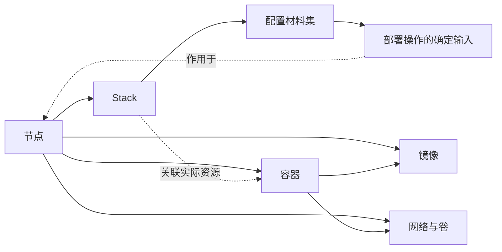
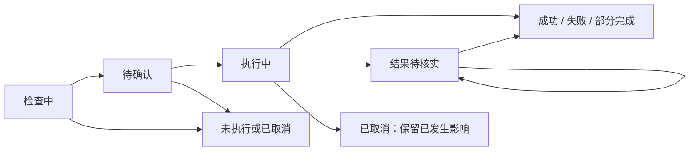

# Docker Manager 功能设计

更新日期：2026-10-30。修订：FD-20261030-02。状态：当前阶段工作基线；用户认可整体方向，细节保留后续确认和调整。

职责：说明用户使用各项功能时，产品接受什么输入、执行哪些业务步骤、展示什么结果，以及冲突和失败时如何处理。供后续架构、数据、接口和验收设计引用。

包含：业务对象、信息结构、功能流程、输入与输出、业务状态、权限及冲突规则。排除：技术栈、组件与通信协议、数据库字段、接口报文、安装命令、完整视觉规范、版本取舍与任务排期。

上游输入：[需求说明 REQ-20261030-02](requirements.md)、[文档编写方案](documentation-plan.md)。术语与目标范围由需求说明维护；本文维护功能行为，未决事项由 [待定事项](open-questions.md) 集中跟踪。已归档旧稿不作为本篇依据。

## FD00 阅读方式与确认边界

需求中的 R01—R16 已明确。用户已审阅本篇并表示“我觉得应该没问题，细节稍后再确认调整，可以继续下一个文档”，因此本文作为架构设计的当前工作输入。整体方向获得认可，具体默认行为、权限粒度及条件能力仍可在后续联动调整。

需求覆盖表中的候选能力以 **P 编号条件方案** 标识。它们回答“如果纳入，建议怎样工作”，不自行扩大产品范围。确认某个条件方案后，先更新需求说明中的范围和成功标准，再把相应章节转为正式设计。

本篇覆盖完整目标的功能设计，不按首版裁剪。尚缺范围决定或环境指标的部分如实保留，不以“以后版本”替代设计。后文的“建议”统一指本修订提出的方案，详细选项集中在 FD18，避免每段重复标注。

核心阅读路径：FD01—FD04 了解共同规则；FD05—FD11 查看日常管理、Compose、Node Cross 和资源操作；FD12—FD16 查看身份、配置复用及其他条件能力；FD17—FD18 核对覆盖与待决事项。

## FD01 业务对象与关系

依据：R01、R02、R04—R07、R11—R16。

| 对象 | 用户理解与关系 | 需要区分的内容 |
| --- | --- | --- |
| 节点 | 一个独立 Docker 环境；容器、镜像、网络、卷均属于具体节点 | 管理器中的连接记录不等于节点上的实际资源 |
| Stack | 一个节点上的应用管理对象，关联 Compose 配置与实际资源 | 管理记录、配置材料和已运行资源是三个不同对象 |
| 配置材料集 | Compose 正文及为本次部署选定的变量、文件与构建材料 | 保存的原文、解析后的有效配置、运行数据不混为一体 |
| 配置修订 | 一次保存后可被操作引用的确定输入 | 内部追踪一次部署所用输入，不自动意味着提供用户可浏览的完整历史功能 |
| 容器 | 节点上的运行资源，可能独立管理，也可能属于 Compose 项目 | 容器的实时设置不必等于保存的 Compose；容器名称不作为跨节点唯一标识 |
| 镜像 | 节点已持有的镜像及其标签、摘要和平台信息 | 同名标签在不同时间或节点可能指向不同镜像；仓库内容不等于节点已持有内容 |
| 网络与卷 | 节点上的资源，可被一个或多个容器使用 | 资源存在、声明关系和实际占用分别展示 |
| 操作 | 用户针对确定目标发起的一次工作，如部署、重建或推送 | 提交成功、执行完成与应用健康是三个不同结论 |
| 账号与身份 | 产品内账号可关联本地登录或外部身份，具体方式见 P05 | 身份验证与节点操作权限分别判断 |

建议 Stack 的管理名称与实际 Compose 项目标识分别展示：后者参与资源归属判断，一旦用于部署，改动按可能建立另一组资源的操作处理，不能作为普通显示名称修改。名称冲突按节点和实际项目身份检查。

图中的关系是业务关系，不规定数据表、组件或保存位置。Compose 中的服务定义仅在所属 Stack 内展示，不增加独立的 Service 管理层。

## FD02 信息结构与操作上下文

依据：R01—R04、R08—R10；全局聚合与分组扩展属于 P01。

建议以节点列表为入口。进入节点后查看概览、Stack、容器、镜像、网络、卷；Stack 详情包含配置、关联资源和操作结果；容器详情包含配置、运行信息、日志、终端和统计。账号、节点接入和管理程序设置使用管理入口。

| 场景 | 必须可辨认的信息 | 行为约定 |
| --- | --- | --- |
| 列表与详情 | 节点、资源名称、实际状态、信息更新时间 | 切换节点后重新确定对象，旧节点中的勾选不沿用 |
| 创建与部署 | 目标节点、应用或容器名称、配置来源 | 表单开始时确定目标；执行前再次展示目标摘要 |
| 编辑配置 | 正在编辑的保存版本、是否未保存、是否已部署 | 保存与部署分别呈现，离开时可返回处理未保存内容 |
| 删除与重建 | 目标、受影响资源、数据处理方式 | 在提交前展示具体影响，不能只有无对象名称的通用提示 |
| 长时间操作 | 操作目标、当前阶段、最近输出、是否仍可获得状态 | 关闭详情页不等于取消操作，重新打开可查询原操作 |
| 无数据 | 没有资源、无权查看、无法连接、加载失败 | 这些状态使用不同说明，不能统一显示空列表 |

P01 条件方案：提供跨节点概览、名称与标签搜索、状态筛选和用户定义分组；分组只用于组织视图，不改变 Docker 归属与权限。聚合结果标出每个节点的更新时间，离线节点计为未知，不能当作零资源。批量操作按固定目标清单逐项执行和反馈，部分成功不回滚已成功节点；提交时显示所有目标，不把当前筛选条件作为持续变化的执行范围。

这里确定导航关系与必要信息，页面布局、图标、配色和编辑器外观随实现细化。

## FD03 通用操作、并发与结果规则

依据：已确认资源操作的共同需要；可检索的长期历史属于 P08。

### FD03.1 输入固定与提交

所有写操作在提交前核对权限、目标身份、必要材料与可获得的当前状态。用户确认后固定本次输入；后续继续编辑草稿不改变正在执行的操作。

检查结果分为阻断项、需明确选择的影响项和说明项。缺少必需文件、无权操作、已知资源冲突属于阻断项；可能重建容器、使用空卷、移除数据属于影响项。检查通过只能表示已检查条件满足，不能保证执行时端口、磁盘或网络一定可用。

同一 Stack 的部署、停止、重建、删除互相冲突时，后提交者收到“已有操作进行中”及原操作入口，不隐式排队后再使用过时输入。单容器操作与所属 Stack 操作、资源删除与引用它的部署也按实际影响对象检查冲突。不同目标可独立操作，但共享资源冲突仍可能导致执行失败。

重复点击或页面重试应定位同一次已受理操作，避免重复创建。用户主动再次执行则建立新操作，先重新核对当前状态。具体识别与协调机制交给架构、数据和接口设计。

### FD03.2 用户可见状态

| 状态 | 含义 | 下一步与允许的变化 |
| --- | --- | --- |
| 检查中 | 尚未修改运行资源，正在检查输入和前提 | 可取消；进入待确认、执行中或未执行 |
| 待确认 | 已知影响需要用户作出选择 | 返回编辑、取消或提交；过期检查在提交前更新 |
| 未执行 | 输入或前提未满足，未开始修改运行资源 | 展示阻断原因，修改后可重新检查 |
| 执行中 | 至少一个实际步骤已开始 | 展示当前阶段；成功、失败、部分完成、结果待核实或进入取消流程 |
| 成功 | 本次请求的动作已完成且可取得相应证据 | 展示动作结果；应用是否健康另列 |
| 失败 | 已确定请求未达到目标 | 展示已发生的影响，不能暗示环境完全没变 |
| 部分完成 | 多对象或多阶段操作只有部分达到目标 | 逐项展示成功、失败和未执行部分；明确剩余处置 |
| 结果待核实 | 已提交或开始执行，但目前无法确定最终结果 | 查询、重连后核对或由用户处理；不能直接当作失败重试 |
| 已取消 | 未开始修改，或已确认在某一步停止后续工作 | 展示取消点和已发生影响；不表示已恢复原状 |

对取消能力作真实表达：无法安全中止的阶段说明“当前步骤继续，停止后续步骤”或“不可取消”。请求取消后仍显示执行中及“已请求取消”，核实停止后才显示已取消；不能通过删除运行资源模拟取消。中断下载、构建或部署后，已生成材料与资源单独列明。

### FD03.3 断线、重试与外部变化

- 保存失败保留当前编辑内容并说明是否收到确定结果，不将未确认写入标为已保存。结果未知时先查询保存状态，避免重试覆盖其他会话的新版本。
- 操作绑定提交时的实际对象身份。对象已消失时说明不存在；名称被新资源复用时重新选择和确认，不能把旧请求作用到新对象。删除目标已不存在可报告当前无此对象，但不伪造本次执行了删除。
- 浏览器断线、账号退出或页面关闭不自动撤销已受理的资源操作。恢复访问后查询原操作；终端会话按 FD09 单独处理。
- 节点离线时，已有运行信息显示为上次观测值及时间。影响实时资源的写操作暂不可提交；产品内配置可保存，但不得显示为部署成功。
- 已提交但结果未知时先核对实际资源与原操作。核对仍不能得出结论则保留未知，要求用户明确处理，不能自动再执行破坏性步骤。
- 保存配置时若另一个会话已保存新版本，提示冲突并提供双方内容对照；重新载入、另存内容或明确覆盖后再提交，不静默丢弃修改。
- 检测到外部工具变更时标出可证实的差异；无法完整比对时显示“尚未核对”，不能称完全一致。已确认的检查结果因对象变化而失效时，重新展示影响。
- 不承诺所有操作均可自动回滚。恢复旧配置也是一次新的部署，应用已写入的数据不因配置恢复而还原。

架构反馈（2026-10-30，待细化）：上述对象身份规则对只能按名称操作、缺少条件执行能力的资源存在外部并发限制，例如卷被外部工具删除后同名重建。保证范围与处理前提见 [架构设计](architecture.md) AR08.1 及待定项 A08；在收敛前，这部分不能作为外部并发下的绝对防误操作承诺。此处记录需细化的规则，不代替用户确认新的外部写入限制。

每次结果至少说明目标、输入摘要、动作、开始及结束或最近更新时间、已完成步骤、异常原因和可执行的下一步。是否保留长期可搜索历史及多久保留，由 P08 和运行约束进一步确定。

## FD04 节点管理

依据：R01、R02、R09、R10。节点管理的详细行为为本篇建议；分组与全局检索见 P01。

### FD04.1 接入与维护

1. 用户填写节点显示名称、备注和接入所需信息；接入形式由架构设计决定，本文不指定 Agent、SSH 或远程 Docker API。
2. 产品验证能够识别的目标环境，展示节点身份、平台、Docker / Compose 能力及连接结果；相同环境被重复接入时提示用户核对。
3. 连接成功后展示资源；连接失败可以保存为“待接通”记录，失败原因和未完成步骤可见，不显示空的正常节点。
4. 修改连接信息先验证新目标。若实际指向另一环境，要求作为新节点接入，不能把原节点的 Stack 和操作历史静默改挂过去。
5. 节点名称与备注可编辑，不改变节点实际身份或资源归属。

### FD04.2 状态与能力

| 状态 | 含义及页面行为 |
| --- | --- |
| 待接通 | 记录已建立，尚未完成有效连接；可编辑或移除记录 |
| 可用 | 当前能够取得节点信息；按已知能力开放操作 |
| 部分能力不可用 | 节点可达，但特定操作需要的能力不可用，例如无法执行 Compose；其他不受影响的操作仍可使用 |
| 无法连接 | 当前无法取得有效状态，保留最后观测时间与原因 |
| 已移除管理 | 不再发起操作或自动连接；节点实际工作负载保持原状 |

网络可达、Docker 可用和 Compose 可用分别判断。操作入口应说明具体缺少的能力，不能仅以“离线”概括所有错误。

### FD04.3 移除管理关系

建议“移除节点”只移除管理关系，不删除远端容器、Stack、镜像、网络、卷或业务数据。执行前列出关联管理配置和未结束操作；有进行中或结果未知操作时先处理，不能让其从界面消失。

关联配置应先迁出、导出或明确选择保留为未绑定材料；若用户另选删除管理配置，单独确认其清单。之后停止对该节点的管理访问。重新接入只重新发现现状，不擅自恢复旧部署或重放旧操作。配置导出作为独立能力仍属 P06；未采用时须提供其他可确认的保留方式后才能移除有配置的节点。

## FD05 Compose 配置与 Stack 生命周期

依据：R04、R05、R11。Web 创建、查看、编辑、部署属于已明确需求；完整启停、更新、重建、移除及多文件材料支持按 P02 提出条件方案。

### FD05.1 材料输入与编辑

以 Compose 原文编辑为基础，表单辅助不覆盖无法表示的合法字段。保存不因语法暂时不完整而丢失草稿；部署前必须通过与目标环境有关的校验。解析后的预览与用户原文分别展示，不能为了生成预览重写原文。

P02 建议完整支持以下输入，并在部署与 Node Cross 中使用同一套材料边界：

| 输入 | 用户可进行的操作 | 规则与错误处理 |
| --- | --- | --- |
| 单个或多个 Compose 文件 | 新建、粘贴、上传、编辑，明确入口与合并次序 | 次序变化会影响结果，需要重新检查；保留各文件原文 |
| 插值变量及环境文件 | 编辑值、选择环境文件、查看变量来源与缺失项 | 插值用变量和传给容器的环境变量分开说明；必需值缺失阻止部署 |
| 附属配置文件 | 按相对路径添加、编辑适合文本编辑的文件、替换或移除附件 | 重名路径需明确替换；正在被引用的文件移除后标出依赖错误 |
| 本地构建上下文 | 上传目录材料或材料包，选 Dockerfile 与上下文目录 | 展示上传范围和实际参与构建范围；缺少文件、不可用权限或平台能力时指出原因 |
| profiles 与服务选择 | 展示配置声明的可选组及本次启用项 | 本次选择随部署输入固定，结果展示实际期望启动的对象 |
| 外部网络、卷、宿主路径 | 展示依赖并在目标节点检查可检查的条件 | 外部资源依赖不自动变成待创建资源；宿主路径不自动打包为配置 |
| include、extends 与远程引用 | 展示引用关系、解析来源和缺失内容 | 本地引用保留结构；远程读取需用户知情并具备访问条件，无法解析时明确阻断，不静默忽略 |

多文件合并、`include` 与 `extends` 的路径解释并不相同，应遵守所选模式的原生规则；预览显示实际解析基准。该约束来自 Docker 的 [合并说明](https://docs.docker.com/compose/how-tos/multiple-compose-files/merge/)、[include 说明](https://docs.docker.com/reference/compose-file/include/)及 [extends 说明](https://docs.docker.com/compose/how-tos/multiple-compose-files/extends/)。产品不自创统一覆盖这些规则的“相对路径规则”。

上传材料的路径只组织本次配置包，不能借上传覆盖任意宿主文件；这不等于禁止用户在 Compose 中有意声明宿主绝对路径。构建上下文、配置附件和宿主数据分别识别。远程配置引用在确认部署前取得并固定本次使用的内容或不可变版本；无法取得确定输入时阻断部署，不能预览一份内容却执行另一份。镜像标签仍需在结果中记录实际获取的镜像身份，不能仅因固定了配置文本就声称整个部署可精确重现。体积、文件类型及目标版本限制由需求约束收敛后补齐，当前不虚构无限支持。

### FD05.2 创建、保存与部署

1. 在节点中创建 Stack，填写管理名称并确认实际 Compose 项目标识。
2. 编写配置、补齐材料。保存生成确定的配置修订，尚未改变节点运行资源。
3. 选择部署，展示本次材料、目标节点、预期资源、变量来源及已知冲突；用户选择镜像拉取、构建和启用组等行为，遵循配置的原有含义。
4. 校验配置语法、必需材料、目标能力，以及能够检查的路径、网络、卷、镜像访问和名称冲突。无法预判的条件说明检查范围。
5. 用户确认本次输入与影响后执行，按步骤展示拉取、构建、创建、启动等进度。
6. 结束后展示本次操作结果和实际资源。保存的配置、最近尝试部署的配置、最近成功应用的配置分别标识；不能用最后一次保存覆盖部署记录。

管理器不自动增加网络、卷、代理容器或其他应用资源。Compose 依据用户配置和原生默认规则创建的资源仍属于正常行为。

### FD05.3 保存状态、部署结果和运行状态

三个维度分别显示，避免一个“正常”状态掩盖差异：

| 维度 | 表达内容 | 例子 |
| --- | --- | --- |
| 配置 | 未保存、已保存；当前保存内容是否与最近部署输入相同 | 已保存修改，但尚未部署 |
| 部署 | 未部署、执行中、成功、失败、部分完成、结果待核实 | 新修订部署失败，旧容器仍运行 |
| 运行 | 实际容器状态、健康检查结果及信息新鲜度 | 2 个运行、1 个退出；一个容器未配置健康检查 |

显示运行资源汇总时保留各容器明细。一次性任务正常退出、被关闭的 profile 与常驻服务故障不能仅靠“没在运行”混为一类；根据本次选择、退出信息及配置判断，无法确定时显示事实。没有健康检查不等于健康检查通过。

Compose 在配置或镜像变化时可能重建容器；本项目需如实展示这种影响，不能承诺“更新”总是原地修改或不中断。参见 [Docker Compose up](https://docs.docker.com/reference/cli/docker/compose/up/)。

### FD05.4 生命周期操作

以下完整操作组合属于 P02；已明确的创建、编辑和部署仍按前述规则覆盖。

| 操作 | 输入与前提 | 结果与边界 |
| --- | --- | --- |
| 更新部署 | 选定保存修订、镜像及构建策略，查看变更影响 | 将确定输入应用到当前 Stack；可能重建，不自动删除已不在配置中的其他资源 |
| 启动 | 已有可启动的相关容器 | 启动既有资源，不应用尚未部署的配置；缺少容器时提示使用部署 |
| 停止 | 明确需要停止的 Stack 或配置内选择范围 | 停止运行，不删除配置与持久化存储；超时后的处理须展示给用户 |
| 重启 | 明确对象与可能中断 | 对既有容器执行停止再启动；不等价于更新配置或镜像 |
| 重建 | 确定修订、镜像和材料，列出旧资源影响 | 按输入替换相应容器，保留挂载引用规则；不承诺容器可写层内容保留 |
| 移除部署 | 列出要停止和移除的容器、网络等资源 | 管理配置保留为未部署状态，数据删除单独选择 |
| 删除管理配置 | 已无仍由其管理的实际资源，或用户先完成明确的解除管理 / 移除部署及保留资源处置 | 删除产品保存的指定材料与管理记录，不含隐式远端清理；仅停止容器不满足此前提 |
| 解除管理 | 属于 P04 | 保留实际资源，界面明确其转为外部资源 |

移除部署默认保留命名卷、匿名卷中的数据及宿主目录；额外删除数据时逐项确认并检查占用。保留匿名卷不代表以后部署能自动找到并复用它，界面应列出其实际标识和恢复关联方式。外部网络和外部卷不随 Stack 移除；这个边界与 Compose 的 [down 行为](https://docs.docker.com/reference/cli/docker/compose/down/)一致。

孤立资源清理、镜像删除和数据清理是独立选择，不与更新或移除部署自动绑定。任何清理都先展示实际对象；执行前状态变化时重新检查。

### FD05.5 失败、偏差与恢复

语法或材料错误在执行前返回具体位置。拉取或构建失败展示输出和产生的材料；执行中失败保留已创建、已替换和仍运行的资源明细。不能在失败后自动执行一次整体删除来“清理现场”。

用户可以修正材料后重新部署、重新核对节点状态，或根据影响清单明确移除残留资源。部署旧配置只恢复声明的输入，不代表镜像标签内容或业务数据回到过去；需要精确重现时同时核对实际镜像摘要和材料。

对 Compose 管理的容器，单容器日志、终端、统计和启停仍可使用。直接修改配置、网络或挂载时先说明可能被下一次 Compose 部署覆盖；默认引导修改所属 Stack。若用户明确选择临时直接修改，记录偏差，不自动把实际资源反向写成 Compose。

## FD06 独立容器管理

依据：R11、R12；诊断功能见 FD09。重启、复制与额外配置项按 P12 提出建议。

### FD06.1 创建与查看

创建时选择节点、镜像与名称，填写启动参数和资源配置。建议完整输入分组如下，具体可用项根据目标能力展示：

| 分组 | 内容 | 提交前检查 |
| --- | --- | --- |
| 启动 | 命令、入口、用户、工作目录、环境变量 | 空值与未设置区分，变量敏感值不进入普通摘要 |
| 联网 | 网络选择、别名、端口与监听地址 | 端口格式及已知占用，网络是否存在且可连接 |
| 存储 | 命名或匿名卷、宿主目录、临时挂载、只读选项 | 来源、容器内目标、已有数据和覆盖视图影响 |
| 运行策略 | 重启策略、健康检查、CPU 与内存等限制 | 目标平台支持情况和相互冲突的设置 |
| 高级选项 | 标签、日志设置、设备、权限与能力等 | 显示超出普通容器隔离范围的影响；不伪装为无副作用的普通选项 |

创建前展示摘要；可选择仅创建或创建后启动。镜像获取失败时不报容器创建成功；容器创建成功但启动失败时保留实际容器及错误，允许后续检查、修改或移除。

详情展示实际配置、状态、镜像身份、端口、挂载、网络、归属和近期操作；未理解的底层字段可以只读展示。编辑时不得因表单未覆盖就删除原有设置，无法保真重建时应阻断并指出字段。

### FD06.2 编辑与重建

1. 从当前容器读取设置，用户修改后查看前后差异。
2. 按目标环境判断可直接修改的部分与需要重建的部分。不能把保存表单统一标为“在线编辑成功”。Docker 的 [container update](https://docs.docker.com/reference/cli/docker/container/update/)只覆盖特定设置且有平台限制，其他修改须按实际能力处理。
3. 直接更新时，成功后重新读取实际值；部分设置失败则逐项显示。
4. 重建前确认镜像、启动设置、网络和挂载引用，以及容器可写层不会自动迁移的影响；在可行时先完成镜像和材料检查。
5. 进入替换步骤后记录旧容器与新容器的身份和实际状态。停止旧容器、移除或改名、创建新容器等具体机制交架构决定，产品必须展示可能中断和可恢复程度。
6. 新容器失败时保留配置和实际影响；旧容器仍可恢复时提供明确恢复操作，已经不可恢复时说明原因，不宣称自动回滚成功。

挂载持久化数据与容器可写层分别说明；使用同一卷不保证应用升级不会修改其数据。匿名卷复用必须引用实际卷身份，不能通过新建空匿名卷冒充数据保留。

### FD06.3 运行与删除

| 操作 | 行为 | 典型异常 |
| --- | --- | --- |
| 启动 | 对已存在的容器启动；已运行则报告当前状态 | 端口占用、依赖或挂载不可用，展示启动失败原因 |
| 停止 | 请求停止并显示等待结果 | 不能仅因请求超时认定已停止；强制终止作为明确的后续选择 |
| 删除 | 展示节点、容器及存储影响；运行中先要求选择停止流程 | 使用中、权限不足或对象已改变时返回实际情况，不顺带删除镜像与命名卷 |
| 重启（P12） | 明确停止再启动的中断影响 | 停止成功而启动失败时显示部分结果 |
| 复制（P12） | 复制设置形成待创建内容，重新确定名称、端口和挂载 | 不复制运行进程或可写层；共享原卷须明确选择，不能默认当独立数据副本 |

网络连接与断开按 FD11；挂载变更按本节编辑与重建流程。删除容器附带删除匿名卷属于单独选择，并列出实际卷，不能用“清理”笼统包含所有数据。

## FD07 Node Cross

依据：R06、R07。配置用于另一节点已明确；复制后的关系、移动和运行数据处理按 P03、P10 提出方案。

### FD07.1 建议的主要操作

P03 建议以“复制到其他节点”为主要入口：选定来源配置修订，形成目标配置草稿，允许调整后部署；来源配置和资源保持原状，两端后续独立编辑，保留来源说明但不自动同步。理由是复制复用与故障恢复的影响较易判断，不会因目标部署问题连带改变来源。

这是一项本轮建议，不能从历史讨论推断已经确认。若用户需要持续同步或真正移动，须采用对应的明确流程，不能把它们藏在“复制”按钮下。

### FD07.2 完整配置复制流程

1. 打开来源 Stack，选用当前保存配置或最近成功部署输入。两者不同则先展示差异；未保存编辑须先保存或明确纳入一次性复制输入。
2. 选择目标节点和项目名称，列出可获得的配置材料、缺失依赖与未包含的数据。只有来源引用而无法取得的文件不能伪装成已复制。
3. 逐类处理环境差异：端口、路径、网络、外部卷、镜像平台、仓库访问、环境变量和敏感值。明确哪些保持原值、哪些重填、哪些由目标已有资源满足。
4. 复制材料形成独立目标草稿。可以只保存；目标离线时可完成材料整理，部署检查留到可连接时。
5. 目标部署使用 FD05 流程，提交前展示来源、目标、选定配置及“包含配置 / 未包含数据”的清单。
6. 操作结束分别显示材料复制和目标部署结果。目标失败不修改来源，不自动删除目标上已生成的资源；提供检查、修正与明确清理入口。

复制完成后来源继续变化，不改变已经形成的目标草稿或已受理操作。重新从来源复制是新的操作，已有目标内容必须比较后明确替换，不能按同名自动覆盖。

### FD07.3 材料与敏感信息规则

| 类型 | 配置复制中的处理 |
| --- | --- |
| Compose 原文、已纳入管理的环境文件与附件 | 按所选修订复制，保留组织关系并重新检查目标解析结果 |
| 本地构建上下文 | 在 P02 纳入并且材料可取得时复制；不把缺少源码的镜像声明当作已有构建材料 |
| 管理器中的仓库或其他凭据引用 | 默认要求选择目标可用凭据；跨节点有权使用同一凭据时可明确复用，不向用户展示原始秘密 |
| 配置正文中直接写入的敏感值 | 标示其将被带到目标，允许保留、替换或移除；缺少所需权限时阻断对应材料转移 |
| 外部网络、卷与宿主绝对路径 | 保留声明并检查目标条件，不自动复制外部对象或路径内容 |
| 命名卷、匿名卷、宿主目录中的运行数据 | 不属于普通配置复制；只有选择 P10 数据处理流程才传输 |
| 容器可写层、运行进程与连接 | 不属于配置复制的产物，不宣称可以复制出相同运行现场 |

检测不到所有敏感值，界面须允许用户自己标记和检查材料；不得声称材料已被完整自动脱敏。

### FD07.4 移动与可选数据

P03 若纳入“移动”，建议拆成可追踪的准备、必要的数据处理、目标部署、验收切换、来源停止或清理阶段。配置复制、运行切换和来源数据删除分别确认；目标通过检查也不自动删除来源。

有持续写入数据时，先按 P10 明确停止写入或应用一致性处理，避免两个实例同时写入独立副本后再声称完成迁移。来源停止而目标失败时，展示当前可恢复路径；目标可能已接受新写入时，不能自动重新启用来源并保证数据无冲突。

用户完成验收切换后，分别选择是否停止来源和是否移除部署。源数据删除仍是独立操作。目标失败、结果未知或验证未完成时，来源清理步骤不自动推进。

## FD08 镜像与镜像仓库

依据：R14；标签管理、清理为 P12；长期仓库凭据管理为 P07。

### FD08.1 镜像操作

| 操作 | 输入与主流程 | 输出与失败边界 |
| --- | --- | --- |
| 查看 | 选择节点，查看镜像身份、标签、摘要、平台、大小和容器引用 | 同一镜像的多个标签能够辨认；不能据标签名称断言镜像内容一致 |
| 拉取 | 填写仓库地址、镜像名、标签或摘要，按需选择平台与凭据 | 展示获取进度与实际镜像身份；认证、网络、平台或空间失败分别说明 |
| 构建 | 选择节点、上下文、Dockerfile、构建参数和输出镜像名称 | 展示材料检查与构建输出；成功生成镜像不自动启动容器 |
| 推送 | 选择本地镜像和明确的目标仓库与标签，核对凭据 | 推送前展示完整目标；部分上传不等于目标镜像已可用，完成后展示可取得的远端结果 |
| 导入 | 上传镜像归档，选择目标节点，检查格式、体积与平台条件 | 导入后列出镜像和标签；原有标签可能改变时提示影响，失败保留已确定结果 |
| 导出 | 选择本地镜像、标签及可支持的平台范围 | 生成可下载的归档及清单；下载完成与服务端生成完成分别显示，过期可重新生成 |
| 删除 | 明确删除某标签还是实际镜像，展示引用 | 使用中的镜像不静默强删；多个标签和依赖导致的保留或失败如实反馈 |

“镜像导入导出”在本方案中建议采用镜像归档的加载与保存语义，保持镜像及标签信息，参见 [Docker image load](https://docs.docker.com/reference/cli/docker/image/load/) 与 [image save](https://docs.docker.com/reference/cli/docker/image/save/)。容器文件系统导出是另一种能力，且不包含挂载卷内容，参见 [container export](https://docs.docker.com/reference/cli/docker/container/export/)。是否还需从根文件系统创建镜像，作为 P12 单独选择，不能混用菜单名称。

P12 建议提供标签添加与移除，以及有预览清单的未使用镜像清理。清理前重新检查引用，不顺带清理容器、网络、卷；空间回收数字以实际结果为准，不把镜像大小简单相加当作保证。

### FD08.2 仓库和凭据（P07 条件方案）

建议支持仓库地址、显示名称、认证信息、允许使用的节点与使用者范围。创建或修改后可测试指定访问，但访问测试成功不代表拥有所有仓库和推送权限；实际操作按目标再验证。

查看凭据只显示标识及可用范围，编辑可以替换秘密，不能默认回显原值。删除凭据前列出引用；删除或撤销后不再受理依赖它的新操作，已受理操作按实际阶段处理并可查询结果。

Node Cross 只传递经过授权的凭据引用或重新选择目标凭据。临时输入的认证是否保存必须明确。凭据保管与传递的技术实现归架构，不在本文指定加密组件或存储结构。

## FD09 日志、终端和资源统计

依据：R13。健康和事件辅助视图作为 P12；长期监控、告警不从实时统计中自动引入。

| 功能 | 主流程与输入 | 输出与边界 |
| --- | --- | --- |
| 日志 | 选节点和容器，指定尾部行数或时间范围，选择是否持续跟随 | 显示时间与来源，可暂停跟随；暂停显示不等于停止容器产生日志 |
| Stack 日志 | 在所属 Stack 内选择容器或 Compose 服务，作为 P02 配套视图 | 每条输出带来源，个别容器无法读取时不掩盖其他结果 |
| 终端 | 选择实际容器、命令或 shell、运行用户和工作目录 | 建立交互会话；容器不运行、无相应程序或无权限时说明原因，不自动安装 shell |
| 统计 | 查看当前 CPU、内存、网络与磁盘 I/O 等可取得指标 | 单位、采样时间与计算口径可见；不支持或未取得的指标显示不可用，不能记为零 |

日志不可读时说明节点、日志驱动、权限或保留范围等实际限制。搜索默认针对已加载内容，不能暗示搜索了全部历史。流中断时显示缺口与最后接收时间，重新连接不能保证补齐已丢失的输出。

终端具有执行能力，不属于只读查看。会话结束、用户退出、账号被停用或权限撤销后停止该会话的后续交互；已在容器内启动的进程是否仍运行应按实际情况说明，不能承诺关闭网页就撤销命令影响。浏览器重连不自动重放之前输入的命令。

统计提供当前值和页面会话内趋势；长期存储、跨重启趋势和告警是另行确认的能力。节点断线或容器重建后，显示中断和新身份，不把前后两个容器拼成连续运行记录。

P12 建议补充健康与 Docker 事件查看：健康视图显示检查是否配置、最近结果及可获得的输出；事件按节点、对象、类型和时间筛选，区分实时流和可取得的历史范围。断线、事件过期或检查不可用时显示缺口，不伪造连续记录；未配置健康检查不等于应用正常。它们作为排障信息，不自动触发重启或修复。

日志、终端输出与原始配置可能含敏感内容。普通操作摘要可以隐藏已知秘密，但不能保证应用自由输出已全部过滤；可见范围按 FD13 的权限方案控制。

## FD10 卷、挂载与数据边界

依据：R16；卷文件管理和备份迁移是 P10，不从“卷管理”自动推出。

| 操作 | 正常行为 | 异常与边界 |
| --- | --- | --- |
| 查看 | 展示卷名、驱动、标签、可取得的容量信息、被哪些容器引用及挂载目标 | 无法取得容量时显示未知；停止的容器仍可能引用卷，不能只检查运行中容器 |
| 创建 | 选择节点，填写名称、驱动、驱动参数与标签，查看摘要 | 重名时先展示现有卷，不自动覆盖或格式化；驱动不可用则明确失败 |
| 建立关联 | 从卷详情转到创建容器，或修改既有容器 / Stack 的挂载配置 | 已有容器需要重建的情况按 FD06；不能伪装为对所有容器都支持即时插拔 |
| 解除关联 | 修改使用者的挂载声明并执行相应更新 | 解除使用关系不等于删除卷；对 Compose 对象说明配置同步影响 |
| 删除 | 展示实际卷、关联容器和数据影响，执行前再核对引用 | 使用中则阻止或要求用户先处理使用者；不为了删卷自动删除关联容器 |

卷与宿主目录不是同一种资源，宿主目录挂载在容器和 Stack 的存储关系中展示。Docker 默认挂载语义应按原生规则处理；产品不把“新卷”“已有卷”“已有宿主目录”统一解释为一个空目录。相关依据参见 [Docker volumes](https://docs.docker.com/engine/storage/volumes/)。

卷资源删除、容器可写层丢失、宿主目录清理、应用备份恢复分别展示，不提供含义不清的“一键删除全部数据”。外部卷不随 Stack 移除，但可在明确授权的卷管理操作中单独处理。

## FD11 网络与关联管理

依据：R15。

创建网络时选择节点、名称、目标支持的驱动、子网与网关等地址设置、可用选项和标签。检查已知地址冲突及驱动支持情况；未通过时保留输入并说明原因。创建后展示实际网络信息。

详情展示容器端点、地址、别名、Stack 关联及管理来源。连接容器时选择网络和可选地址、别名；断开时列出容器和连接影响。平台或网络模式不支持动态变更时，提供修改配置并重建的路径，不能强行给出成功反馈。

对于 Compose 关联容器，连接或断开后的差异按 FD05.5 处理；不得静默改写 Compose。删除网络前核对端点、系统保留网络及驱动限制；存在引用时要求先处理，不自动断开所有容器。删除失败刷新当前关联，避免以旧清单重复尝试。

已知不同 Stack 使用同一外部网络时，明确显示共享关系。移除一个 Stack 不推导出可删除共享网络。

## FD12 已有资源与管理关系（P04 条件方案）

P04 建议允许对已发现的现有资源执行相应的资源级查看与管理，再提供配置导入、Compose 项目接管和解除管理。既有资源的纳入程度仍按 Q04 确认；不从资源来源直接推定只能只读，也不把发现资源等同于已经接管其完整配置。

建议通过可取得的标识展示资源属于受管理 Stack、外部 Compose 项目或其他容器；证据不足时显示归属未知，不凭名称强行归组。只发现资源不能视为已取得其原始 Compose 与全部材料。

接管流程：用户选择外部项目 → 提供或授权读取原始配置及附件 → 比较项目身份、资源关系和可识别差异 → 解决名称与归属冲突 → 明确采用何种配置作为今后管理输入 → 建立管理关系。接管动作本身不自动重建或修改运行资源；需要应用配置时另发部署操作。

无法取得原始配置时，允许继续资源级管理；从运行信息生成的配置只能标为待校验草稿，不能宣称完整还原。外部工具仍在修改配置时，应展示已检测偏差并让用户决定保留、导入或覆盖，不能互相循环同步。

解除管理仅解除产品记录与资源的管理关联，保留实际资源。对管理器保存的材料明确保留或导出选择；操作历史保持可追踪。解除后不继续按旧配置后台更新该项目。

## FD13 账号、OIDC 与权限（P05 条件方案）

依据：用户提出简单内置账号及 OIDC 的方向；登录模式与权限粒度尚未确认。本节提供推荐方案和替代方案，均未自动定案。

### FD13.1 登录模式与账号生命周期

建议支持简单内置账号，并可启用 OIDC；部署者可选择仅本地、两者并用或仅 OIDC。这样可覆盖没有身份服务的个人安装，也可接入已有身份服务。只实现 OIDC 的替代方案较省本地账号维护，但所有常规登录依赖外部身份服务，需单独的受控访问恢复方式。

| 场景 | 建议行为 |
| --- | --- |
| 首次初始化 | 由持有部署初始化凭据或本机管理权的人建立首个管理员；初始化完成后关闭初始化入口，不允许任意访问者抢先注册 |
| 本地账号 | 管理员创建、停用或重置账号，用户可修改自身密码；默认不开放公共注册 |
| 启用 OIDC | 管理员配置提供方并测试登录与身份授权；测试不成功不替换当前有效登录方式 |
| OIDC 首次登录 | 验证身份后按明确的允许名单或账号绑定规则授予访问；身份提供方任意用户不自动成为管理员 |
| 身份绑定 | 在已验证账号或管理员受控流程中绑定外部身份；不因邮箱相同就自动合并账号 |
| 仅 OIDC 模式 | 确认已验证的管理员登录和受控恢复路径后才关闭本地网页登录；恢复手段不构成公共绕过入口 |
| 停用与撤销 | 停止新登录并使现有访问权限失效，关闭交互会话；已受理资源操作保留结果，不凭账号停用宣称操作已撤销 |
| 退出与过期 | 退出本产品会话；是否同时退出提供方取决于接入能力，界面明确范围；过期后重新登录，不重复提交原操作 |
| 最后管理员 | 阻止删除或停用最后一个可用管理入口，先建立并验证替代访问方式 |

外部身份按提供方与其稳定主体标识识别，显示名称和邮箱只作属性。此原则依据 [OpenID Connect Core 5.7](https://openid.net/specs/openid-connect-core-1_0.html#ClaimStability)；具体登录协议、校验和会话实现交后续设计。

### FD13.2 建议的权限模型

建议采用管理员、操作员、查看者三种预设角色，加节点可访问范围。个人使用时可只有管理员；共享使用时不必重新定义每项操作。它比全员管理员更便于明确责任，也比任意自定义角色简单；是否采用由 P05 确认。

| 能力 | 管理员 | 操作员 | 查看者 |
| --- | --- | --- | --- |
| 节点与资源概要、状态、非敏感统计 | 全部 | 分配节点 | 分配节点 |
| 日志、原始配置、敏感字段读取或导出 | 可管理授权 | 需相应数据访问授权 | 需单独授予，不能从概要查看权自动获得 |
| 部署、编辑、启停、镜像和网络卷操作 | 全部 | 分配节点 | 无 |
| 终端、重建、移除资源、数据迁移 | 全部 | 分配节点且有相关操作权限 | 无 |
| Node Cross | 具备来源和目标权限 | 来源材料访问及复制权 + 目标部署权 | 无 |
| 凭据使用 | 管理使用范围 | 可使用授予的引用，无默认回显秘密权限 | 无 |
| 账号、节点接入、身份提供方、凭据管理、系统恢复 | 全部 | 无 | 无 |

上述单独授权采用有限的能力开关，不预设自定义权限语言。Docker 部署和终端能力通常能接触应用数据乃至主机能力，不能把隐藏秘密按钮当作对有节点执行权用户的强隔离；本方案不据此声称提供互不信任租户隔离。

权限变化后重新判断后续请求及会话；直接访问对象地址、日志流和导出下载同样需要权限。审批已受理任务、终止交互和撤销凭据的技术机制归架构。权限粒度未确认前，本节只作为条件输入，不能固化到接口和数据结构。

## FD14 配置历史、导入导出与模板（P06 条件方案）

建议将配置保留与复用作为独立功能，复用 FD05 的材料模型和 FD03 的冲突规则：

| 功能 | 主流程 | 结果与边界 |
| --- | --- | --- |
| 导入 | 上传材料 → 预览文件与依赖 → 选择节点和名称 → 检查冲突 → 保存 | 导入成功不自动部署；不执行上传包内任意程序，缺失材料清楚列出 |
| 导出 | 选择修订 → 选择敏感信息处理方式 → 预览包含与排除清单 → 导出 | 标明不含运行数据；敏感值移除后的包需显示重新填写项，不宣称可直接原样部署 |
| 历史 | 查看保存者、时间、变更摘要以及是否用于部署 | 历史配置与部署结果关联；敏感旧值同样受访问限制，保留期另定 |
| 比较 | 选择两个修订，按文件及变量比较 | 原文与有效配置比较分开，附件变化与缺失也可辨认 |
| 恢复 | 选旧修订形成新的当前草稿，重新保存和检查 | 不倒改历史，不自动部署，不回滚运行数据；缺失附件与旧凭据需补齐 |
| 模板 | 从材料生成可重复使用的模板，标出变量和依赖；使用时生成新草稿 | 模板更新不自动修改已创建 Stack；节点路径与秘密不默认变成可共享模板值 |

分享模板前用户选择移除或参数化环境特有内容。模板的创建、修改与使用记录各自归属清楚；重名时明确更新现有模板或另建，不静默覆盖。

## FD15 数据处理与管理程序维护（P09、P10 条件方案）

### FD15.1 应用数据迁移和备份恢复（P10）

建议将命名卷、匿名卷和明确选择的宿主挂载目录作为分别确认的数据类别。容器可写层、远端存储服务和应用逻辑备份不从这些类别自动推定支持；具体纳入类别需回填 Q03、Q09 和需求范围。

统一流程：选择数据来源与目标 → 列出体积、访问前提与既有数据 → 选择一致性处理方式 → 预检目标容量和访问 → 用户确认 → 传输或恢复 → 验证结果 → 另行启动、切换或清理。覆盖已有目标数据需单独明确，不默认合并两个目录或覆盖活动数据。

持续写入中的数据库不能仅靠“文件复制结束”认定备份一致；用户需选择停止写入、停止相关应用，或使用受支持的应用专用流程。没有一致性保障时如实标为文件级副本。备份记录展示来源、时点、处理方式、验证状态及所需恢复条件。

传输失败保留来源，目标显示未完成或不可使用；重试前判断覆盖、重新传输或可验证续传，不默认每种方式均能续传。恢复失败不自动启动目标应用。数据传输成功与业务可用分别检查；清理来源只在独立明确操作中进行。

若加入卷文件查看或下载，限定选择的卷及路径、所需权限与操作范围；修改和删除文件可能影响在线应用，必须明确占用与一致性影响。这是另一个条件能力，不能把卷关联管理当作已批准通用宿主文件管理。

### FD15.2 管理程序自身维护（P09）

建议提供配置检查、运行诊断，以及管理程序配置和管理记录的备份与恢复。备份清单区分节点定义、Stack 材料、账号与权限、凭据和操作记录；明确哪些因选择或能力限制未包含，不能把“导出 Compose”称为整套管理程序备份。

备份生成时固定一致的管理数据视图，输出可检查清单。恢复先检查兼容性、完整性及敏感材料的解锁条件，展示将替换或合并的内容，处理冲突后执行；失败保留可说明的管理状态和恢复入口。恢复管理记录不自动重放部署、不自动恢复或删除节点资源，重连后核对实际状态。

管理程序升级和恢复若影响正在执行的操作，界面先显示活动任务，选择等待、受支持的中断或返回。完成后核对版本、连接和原操作结果。具体交付方式、安装步骤、备份格式与恢复时限交需求、架构和运维设计，不在功能篇指定。

## FD16 操作历史与自动化（P08、P11 条件方案）

### FD16.1 可查询历史（P08）

FD03 已定义单次操作必需的反馈。建议在此基础上提供按节点、资源、执行者、动作、时间和结果查询历史，详情引用本次确定输入和实际影响，不复制敏感内容到普通列表。对象已删除仍能辨认原节点和目标。

记录删除、保留期限与归档应有明确政策，当前待 Q09 收敛；账号停用不抹除其操作归属。操作历史不默认等于终端全部命令录制或日志永久归档，这两种能力需单独决定。

### FD16.2 自动化候选（P11）

这些能力尚未纳入目标范围。下列方案给出行为边界，选入后还须补齐各自完整需求和成功标准；不把它们默认为下一版本任务。

| 候选 | 建议流程 | 关键边界 |
| --- | --- | --- |
| Git 配置来源 | 选择仓库、凭据、引用和目录 → 解析材料 → 固定提交版本 → 预览 → 保存或部署 | 分支变化不悄悄替换已提交操作；产品内修改与 Git 来源冲突时要求选择，不擅自回写仓库 |
| Webhook 触发 | 建立受限触发入口 → 认证来源 → 选择已授权动作与目标 → 返回可查询操作 | 重复或冲突触发不无条件重复执行；不允许调用者任意注入节点命令 |
| 定时操作 | 配置动作、目标、时区与时间 → 预览下一次执行 → 启用或暂停 | 权限和凭据变化时重新判断；重叠执行跳过并记录，错过时刻默认不补跑破坏性操作 |
| 镜像更新提示 | 比较可取得的镜像身份 → 展示可能更新及检查时间 → 用户选择更新部署 | 相同标签不代表内容相同；发现更新不自动部署，无法检查时显示未知 |
| 通知 | 选择事件、目标范围和渠道 → 测试 → 发送事件摘要与详情入口 | 通知失败不改写原操作结果；避免发送秘密或完整配置；合并重复事件的规则须可理解 |
| 对外 API | 用户为固定身份授予有限访问 → 外部调用 → 查看与 UI 一致的结果 | 沿用相同权限、并发和输入固定规则；接口结构与访问凭据生命周期留接口及身份设计 |

自动化不绕过需要用户明确选择的数据删除或覆盖规则。允许预授权固定影响范围时必须在创建自动化时具体展示并记录；若实际影响超出范围，则停止并要求处理。

## FD17 覆盖关系与跨文档交接

### FD17.1 已明确需求的设计入口

| 需求 | 本篇主要设计入口 | 覆盖说明 |
| --- | --- | --- |
| R01、R02 | FD01、FD02、FD04 | 独立节点、资源归属、管理关系与导航 |
| R03 | FD05—FD12 | 按确认范围展开基础能力，不据参照产品菜单自动扩范围 |
| R04、R05 | FD05 | Web 配置、保存部署区分、原生语义与失败结果 |
| R06、R07 | FD07、FD15.1 | 配置跨节点独立成立；数据迁移条件方案单列 |
| R08 | FD02 | 明确信息和操作要求，完整视觉可迭代 |
| R09、R10 | FD03、FD04、FD13、FD15.2 | 自托管使用、混合网络下的可达与未知状态；账号和自身维护仍为条件方案 |
| R11、R12 | FD05、FD06 | Compose 与独立容器并存，编辑重建、启停删除和归属冲突 |
| R13 | FD09、FD13 | 日志、终端、统计及访问范围 |
| R14 | FD08 | 拉取、构建、推送、导入、导出和删除 |
| R15 | FD11 | 网络生命周期与关联管理 |
| R16 | FD10 | 卷生命周期、挂载关系与数据边界 |

F01—F18 讨论领域的对应：F01/F02 → FD02/FD04；F03/F04 → FD05；F05 → FD06；F06/F09 → FD08；F07 → FD11；F08 → FD10；F10 → FD09；F11 → FD12；F12 → FD07；F13 → FD14；F14 → FD13；F15 → FD03/FD16.1；F16/F17 → FD15；F18 → FD16.2。覆盖到条件章节不代表候选已获准或完整设计已定稿。

### FD17.2 关键结果的审阅场景

以下是行为核对例子，正式测试步骤和证据由测试与验收文档维护：

- 配置保存后未部署：页面能够同时展示新草稿与旧运行版本，不报部署成功。
- 部署过程中节点断线：操作进入结果待核实，重连先核对原操作，不重新创建一套同名资源。
- 部署只成功一部分：已启动容器继续如实显示，失败资源及未执行步骤可定位。
- 容器重建需要保留匿名卷：复用指定卷身份；若无法保真复用，在执行前说明并阻断未经确认的数据变化。
- 删除 Stack：容器、网络、管理配置和数据分别展示，外部共享资源不随之清理。
- A 到 B 复制配置：材料清单完整、运行数据另列；B 失败时 A 保持原状，目标残留可处理。
- 同时编辑或使用外部工具修改：冲突可见，用户确认采用内容，原有未知字段不丢失。
- OIDC 验证成功但不在授权范围：登录身份有效仍不获得节点管理权；不得按邮箱自动合并管理员。
- 有查看权限但无执行权限：可以看允许的信息，不能通过终端或直接调用绕过权限。

### FD17.3 交给下一份文档的内容

架构设计应解释如何实现节点可达与能力识别、输入固定、任务恢复与未知结果核对、资源操作冲突、Compose 材料解析执行、实时日志与终端、身份与凭据边界。它需要先识别本篇尚未确认的条件，不能把 P 项当成无条件约束。

数据设计负责这些对象和状态如何保存，接口设计负责如何表达和交换；都引用本篇规则，不另造不同的成功、取消、删除或权限语义。运行规模、兼容版本、时限和保留策略尚无数值，必须在受影响的设计承诺形成前收敛。

## FD18 本轮建议、待定范围与确认记录

下表是本修订的方案摘要。未决问题的当前状态、影响和决定时点统一维护在 [待定事项](open-questions.md)，避免此处形成另一份状态台账。

| 方案 | 本轮提出的行为 | 对应未决问题 |
| --- | --- | --- |
| P01 | 全局概览、分组、搜索筛选与固定清单批量操作 | Q10 |
| P02 | 完整 Stack 生命周期、多文件与环境材料、构建上下文、profiles 及引用处理 | Q02；其中 Web 创建编辑部署本已明确 |
| P03 | 配置复制先形成可编辑目标草稿；来源保留、两端独立；移动使用分阶段切换 | Q03 |
| P04 | 发现现有资源并允许核对后接管 / 解除管理；不保证反向还原 Compose | Q04 |
| P05 | 本地账号与可选 OIDC，允许仅 OIDC；三种预设角色、节点范围和有限能力开关 | Q05 |
| P06 | 配置导入导出、历史、比较、恢复与模板，恢复不自动部署 | Q06 |
| P07 | 可复用仓库与凭据，显式使用范围及目标授权 | Q08 |
| P08 | 可搜索操作历史；与终端录制、永久日志分别决定 | Q08、Q09 |
| P09 | 管理程序自身备份、恢复与维护，恢复记录不重放部署 | Q08、Q09 |
| P10 | 应用数据传输、备份恢复和可选卷文件操作，各自确认数据类别及一致性要求 | Q03、Q09、Q11 |
| P11 | Git、Webhook、定时、更新提示、通知与对外 API 的条件流程 | Q07 |
| P12 | 重启与复制、镜像标记清理、补充导入类型、健康事件与高级资源配置 | Q11 |

本篇未选择技术栈、连接方式、配置保管位置或发布范围。仍待收敛的运行规模、平台版本、材料容量、会话与历史保留、恢复目标等见 Q09；设计不得以未指定限制为无限能力承诺。

2026-10-30：FD-20261030-01 形成第二份文档初稿，包含已明确能力的行为设计和待定范围的条件方案。用户随后反馈“我觉得应该没问题，细节稍后再确认调整，可以继续下一个文档”。FD-20261030-02 据此更新阶段状态，继续编写架构设计；架构审阅后在 FD03.3 补记名称定位资源的外部并发限制（A08），作为待细化部分，其余行为方案保持不变。P01—P12 的范围与细节保留追踪，不以阶段认可代替技术验证或实现完成。

外部行为依据已在相关章节链接，核对日期为 2026-10-30；它们用于避免偏离 Docker / Compose 与 OIDC 的原生含义，不替代本项目的兼容版本选择和实际验证。
