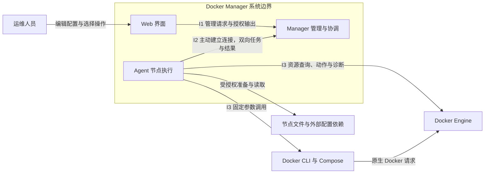
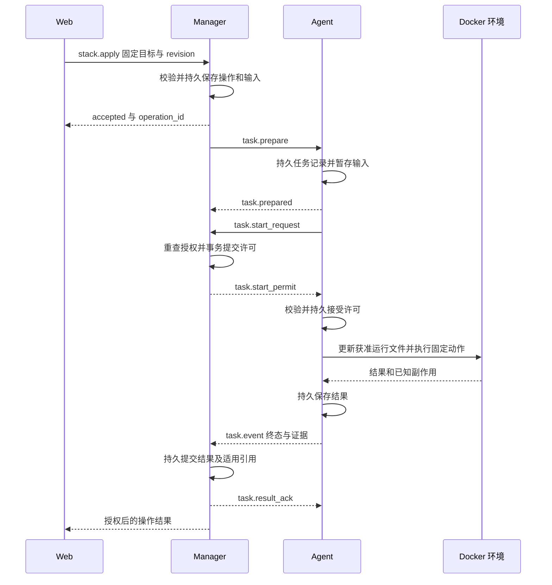

# Docker Manager 接口设计 arc42 对照稿

日期：2026-11-02。版本：0.1。状态：对照初稿，供审阅。

Docker Manager 的接口需要把用户意图可靠地交给正确节点，并让调用者知道操作究竟处于受理、执行、完成还是结果未知状态。本稿围绕 Web、Manager、Agent 和 Docker 环境之间的职责与协作，解释接口为什么这样划分、关键调用如何完成，以及断线和并发时双方应遵守的约定。

本稿与[现有接口设计](api-design.md) v0.1 使用同一组项目要求和候选机制，供比较写法，暂不替代现有契约。项目输入为[需求说明](requirements.md) v0.9、[功能设计](functional-design.md) v0.5、[架构设计](architecture.md) v0.3 和[数据设计](data-design.md) v0.3。Agent 主动接入、可信运维协作及迁移后的验证与来源处置属于已确认要求；逻辑方法名、消息结构和执行协调机制仍是设计建议。传输协议与机器可读 schema 尚未定稿。

正文按 arc42 的上下文、组件接口、运行场景和共同机制展开，再说明决策、质量场景与风险。它是接口专题的裁剪组织，不是 arc42 官方规定的独立接口模板。arc42 第 5 章允许按接口特点选用表达方式，相关 FAQ 进一步建议结合语法、语义、交互、样例及测试说明接口。本文的方法对应和两稿阅读对照见附录二。[组件视图](https://docs.arc42.org/section-5/)、[接口说明方法](https://faq.arc42.org/questions/B-6/)

## 一 接口目标与约束

维护人员在 Web 中管理多个内外网节点，保存 Compose 配置并明确发起部署。Manager 必须把这次选择转换成固定目标、固定输入和明确授权的操作；Agent 则负责执行和保存证据。接口成功不能仅指消息送达，还要能够区分“配置已经保存”“部署命令完成”和“应用已经通过验证”。

| 目标或约束 | 对接口设计的影响 |
| --- | --- |
| 多人按节点与动作授权 | 身份来自认证上下文；每次请求和任务开始均检查权限，查询与输出也受当前权限限制 |
| Agent 主动连接 Manager | Manager 的任务通过已认证的回连通道交付；节点之间不必直连 |
| Web 维护原生 Compose | 文件字节、文件顺序、变量来源、项目目录和项目名进入明确输入；保存本身不执行 |
| 重发、断线和进程重启 | 用户请求、节点任务和事件分别标识，结果不确定时先核对，不自动制造第二次副作用 |
| Node Cross 表示迁移 | 切换、迁移后验证和用户选择来源处置分别表达；Copy 与 Apply 保持独立 |
| 可信运维协作 | 获准任意部署的人被信任管理该节点；接口授权不承诺同主机不可信租户隔离 |
| Unix-like 与原生 Docker 行为 | 以可用 CLI、Compose、Engine 和实际路径为前提；不提供 Build、Dockerfile 或构建上下文能力 |
| 约 20 节点的参考规模 | 列表、文件和流有边界，部分节点故障可单独表达；20 不是接入上限 |

本稿中的 Stack 是管理器保存的 Compose 配置及其管理关系；revision 是不可变配置版本；binding 将 Stack 与具体节点、Engine 和实际 Compose 项目关联；Operation 记录一次有明确意图的管理动作。它们不取代 Docker 自身的容器、网络或卷身份。

## 二 系统上下文与接口边界

### 整体边界

以 Docker Manager 整体为观察对象时，Web、Manager 和 Agent 都是系统内部组件。运维人员和已有 Docker 环境位于系统边界之外。浏览器与 Manager 之间虽然跨网络，其接口在这个系统范围内仍属于组件间接口；不能把“经过 HTTP”直接等同于“对外第三方 API”。



图中箭头标识发起或调用方向；I1、I2 的响应和输出沿相应会话返回。I2 的连接由 Agent 建立，建立后允许 Manager 下发任务。图中的节点执行部分可重复出现；它不建立 Agent 到其他节点的迁移数据通道。

| 系统外部参与方 | 输入或依赖 | 系统向其提供或取得的结果 |
| --- | --- | --- |
| 运维人员 | 登录信息、原始配置、目标节点、操作及数据范围选择 | 可授权读取的配置、观察、操作状态、差异与待处理问题 |
| Docker CLI 与 Compose | 明确工作目录、项目、文件列表、环境来源和参数 | 原生校验或执行结果、退出信息及输出 |
| Docker Engine | 目标身份、受支持的资源动作或查询 | 资源观察、动作结果、日志、统计和容器交互 |
| 节点文件及外部依赖 | 已声明路径、用户提供文件、获准访问范围 | 文件就绪情况、读取结果或缺失依赖；路径引用不自动授予读取权 |

镜像仓库等服务属于原生执行的外部依赖。访问凭据由任务按用途取得，实际下载或拉取遵循所选 Docker 环境。系统不承担镜像仓库托管，也不把业务应用流量转发经过 Manager。

### 网络与部署条件

建议 Web 通过 HTTPS 访问 Manager，Agent 使用 TLS 保护的持久双向通道；WebSocket 是候选，未作为定稿协议。一个活动 Manager 负责协调是当前架构建议。节点必须能到达 Manager，并能访问明确的 Docker 目标；Agent 所见路径与 Engine 所见路径需要按实际环境核对，不能仅凭 Linux 或 FreeBSD 名称判断。

连接失效只说明通道不可用。已有 Docker 操作可能继续，缓存观察可能过期，接口分别报告这些事实。Manager 不向浏览器透传 Docker socket、任意 Engine API、Agent 凭据或宿主机通用 shell。容器终端是 I3 中绑定具体容器的专用能力。

## 三 组件职责与接口契约

### 职责如何分配

Web 表达用户选择、保存尚未提交的编辑并展示结果；Manager 决定请求能否受理及何时允许开始，保存配置与操作历史；Agent 根据已批准输入调用原生工具，持久记录实际执行依据。Manager 保存的配置是管理配置的依据，Engine 观察是节点当前运行状态的依据。

因此，Web 不能自行声明操作者、权限或执行成功；Manager 不能仅因超时就断言节点已停止；Agent 不能把输入替换成最新 revision、另一 Docker context 或其他凭据版本。管理端内部的授权、配置和任务模块按[架构设计](architecture.md)划分，这些职责不要求部署成多个服务。

### I1 Web 与 Manager 的管理接口

**提供方是 Manager，使用方是 Web。** I1 接受用户的查询、配置修改和明确操作意图。Manager 在响应前完成认证、必要授权和受理判断；需要节点执行的动作返回可持续查询的 Operation。

| 接口组 | 主要输入 | 结果和完成含义 |
| --- | --- | --- |
| 身份、账号与授权 | 登录信息，或获准修改的账号、节点、动作集合及记录版本 | 当前会话或新的管理记录；不会因分组、标签而隐式扩权 |
| 节点与资源查询 | 节点、资源类型、过滤、分页和详情范围 | 带目标身份、时间与新鲜度的观察；离线不表示资源为空 |
| 配置维护 | Stack、基础 revision、记录版本、完整文件清单与部署输入 | 新的不可变 revision；不写节点运行目录、不调用 Docker |
| Apply 与资源控制 | 明确目标、固定配置或资源引用、动作专用参数和凭据用途 | 已持久受理的 Operation；执行结果通过同一操作跟踪 |
| Copy | 固定来源版本、目标节点与名称、用户确认的目标调整 | 独立目标配置、复制记录和依赖提示；不自动部署 |
| run 转 Compose | 原命令文本、转换规则版本及用户提供文件 | 草稿、已映射项、差异和阻塞项；不执行文本或访问节点 |
| 管理恢复与审计 | 备份范围、检查对象、授权过滤条件 | 备份任务、只读检查或脱敏历史；实际恢复使用受控运维流程 |

请求和返回采用以下逻辑结构。字段名称沿用现稿，JSON 用来展示契约，不代表已经选定 JSON RPC 或 HTTP 路径。

| 部分 | 必需约定 |
| --- | --- |
| 请求标识 | `contract_version`、`request_id`、`method`；target 和 params 按方法定义，必填参数不得省略 |
| 调用身份 | 从认证会话取得；请求正文不能用 `user_id` 冒充身份 |
| 变更去重 | 普通已登录变更带服务端给出的 `request_scope_id` 与本次 `request_key`；初始化、登录使用各自流程 |
| 目标 | Node、Stack、binding 和原生资源标识逐级核对归属，不能以同名对象替换 |
| 并发前提 | 覆盖式修改带 `expected_version`；配置保存还带 `base_revision_id` |
| 同步完成 | `outcome=completed` 与 data；只表示该方法完成，例如保存完成 |
| 异步受理 | `outcome=accepted` 与 operation_id、状态和获准目标摘要；不表示 Docker 已执行 |
| 请求拒绝 | `outcome=rejected` 与错误码、脱敏说明及下一步；不能借此否认此前可能已受理的请求 |

响应丢失时，Web 先查原请求或原操作。重新登录之后也不能自动把旧请求换成新键再次提交。错误与重发的完整共同规则见第五节；查询接口和方法索引见附录一。

### I2 Manager 与 Agent 的任务接口

**Agent 提供节点执行能力，Manager 提供授权、任务协调和受限内容获取能力。** 连接由 Agent 发起；任务与结果都在经过身份校验的连接中交换。普通断线重连继续使用原任务身份。

接入先经过 `agent.enroll`。Agent 验证 Manager 服务端身份后提交限定节点的一次性注册凭据；Manager 原子消费它并建立独立连接身份。注册响应丢失时，管理员核对并撤销孤立身份后重新发放注册材料，不能仅凭 Node ID 再次领取秘密。

随后每次 `agent.connect` 都认证身份并交换契约版本、能力、实际 Engine 观察及 installation／当前 recovery。Manager 分配 connection_id 与递增 connection_generation。身份重复、已撤销、Engine 改变或恢复不一致时，连接只能进入受限核对，不能直接执行。

| 交换 | 方向和内容 | 接收方承担的责任 |
| --- | --- | --- |
| `task.prepare` | Manager → Agent：任务键、固定输入、摘要、动作和受限内容获取授权 | 验证身份与目标，持久建立或找回任务；只在暂存区准备 |
| `task.prepared` | Agent → Manager：任务键、摘要、事件流、准备结果和依赖观察 | 记录准备事实；准备就绪不等于获准执行 |
| `task.start_request` | Agent → Manager：任务键、摘要、准备依据和当前连接 | 重查用户、节点、动作、凭据、冲突和准备有效性 |
| `task.start_permit` | Manager → Agent：许可、任务键、摘要、身份、连接代次、授权版本、恢复标识及适用部署序号 | Manager 先持久提交许可与 running；Agent 验证并持久接受后才执行 |
| `task.start_denied` | Manager → Agent：任务键、原因及处理要求 | 不启动；已证实未执行可结束，否则核对 |
| `task.query` 与 `task.report` | 双向：原任务键、本地阶段、许可、执行者和结果证据 | 查询本身不执行；查无记录不等于此前未执行 |
| `task.cancel_prepare` 与 `task.cancel_report` | 双向：取消请求与持久未开始证据 | 协调取消与许可接受；无证据不能确认安全取消 |
| `task.event` 与 `task.result_ack` | 事件、结果和持久确认 | 按任务流去重，确认有明确持久化含义，丢确认只补报结果 |

任务键由 installation、操作创建时 recovery、node、operation 组成。当前连接上下文另含当前 recovery、Agent identity、connection 和代次；重连及 Manager 恢复不能给旧任务改键。message_id 用于单条消息识别，不承担跨重连的任务去重。

Agent 只在当前有效连接接受新的开始许可。已经有效接受并持久保存的许可，允许该任务在随后断线时继续；进程重启后先核对任务和执行者，不因磁盘上存在旧许可就再启动一次 CLI。许可接受情况不明时保持未知；只有可信证据排除旧执行者并证明尚未开始，才能重新协调开始阶段。

文件和凭据通过绑定任务的受限流程取得。凭据固定到输入引用的秘密版本、节点与用途，每次发放重新授权；普通任务和审计只含引用。Agent 不取得全部用户授权表、所有仓库密码或其他节点的秘密。

### I3 Agent 与原生 Docker 环境的接口

**Agent 是调用方，Docker CLI、Compose 与 Engine 是能力提供方。** Compose 使用受支持的原生 CLI；资源管理和诊断优先使用 Engine API。Agent 将结构化动作转换成固定参数，保留原生错误，不能把浏览器提交的命令字符串直接交给宿主机 shell。

| 能力 | Agent 交付的输入 | 返回事实及限制 |
| --- | --- | --- |
| Compose 校验与部署 | 明确的 Engine、项目、稳定目录、文件顺序、profiles、环境来源和选项 | 校验或进程结果与实际观察分开；禁止触发构建，无法满足依赖时明确拒绝 |
| 容器、镜像、网络和卷动作 | 固定目标及原生标识、按动作允许的参数、必要凭据 | 结果可能包含部分副作用；不能用旧缓存保证删除安全 |
| 日志与统计 | 明确对象、时间或采样范围、流选项 | 有时间和来源的输出；限流、截断或丢样明确可见 |
| 容器终端 | 固定容器、参数数组、用户、工作目录与 TTY 尺寸 | 专属交互会话；断线不重放输入，关闭流不保证容器内进程退出 |

运行配置使用稳定目录，revision 更新不以更换工作目录改变相对路径语义。文件准备与目录切换遵守[架构设计](architecture.md)的文件规则；运行目录在获准开始后才能更新。挂载文件是否被容器正确看到仍需实际验证，不能仅以宿主机文件写入成功判定。

配置含 build 字段时保留原文；能够在不构建条件下使用已有或可拉取镜像的输入，按原生规则处理。无法满足执行所需镜像或构建依赖时返回 `BUILD_UNSUPPORTED` 或依赖错误，不删除 build 字段后假装等价执行。

Docker 版本、API 能力、Compose 语法和路径组合必须记录并验证。项目通过原生能力执行，不重新定义这些外部接口；实现者应使用对应版本的 [Docker Engine API](https://docs.docker.com/reference/api/engine/)与 [Compose CLI](https://docs.docker.com/reference/cli/docker/compose/)资料。

## 四 关键运行场景

### 场景一 保存配置以及处理响应丢失

用户读到 `stack_web` 的记录版本 7 和配置 `rev_3`，修改后先上传所需文件，再提交完整新清单。Manager 核对文件归属、授权和基础版本，在一个事务中发布新 revision 并记下请求结果。节点离线不妨碍保存配置，但保存不能证明目标可部署。

```json
{
  "contract_version": "draft-1",
  "request_id": "rq_save_1",
  "method": "config.save",
  "request_scope_id": "scope_session_a",
  "request_key": "save_key_1",
  "target": {"node_id": "node_a", "stack_id": "stack_web"},
  "params": {
    "expected_version": "7",
    "base_revision_id": "rev_3",
    "files": [{"path": "compose.yaml", "upload_id": "upload_ready_1", "purpose": "compose"}],
    "deployment_input": {
      "compose_files": ["compose.yaml"],
      "project_directory": ".",
      "project_name": "web",
      "profiles": [],
      "environment_files": [],
      "interpolation_values": {}
    }
  }
}
```

```json
{
  "request_id": "rq_save_1",
  "outcome": "completed",
  "data": {"stack_id": "stack_web", "revision_id": "rev_4", "row_version": "8"}
}
```

`upload_ready_1` 表示该用户在该目标已完成的上传，不能替换为任意摘要；空环境输入表示没有额外输入，不允许 Manager 自动混入自己的环境。上例内容为逻辑样例。

如果返回丢失，同一会话可先用 `requests.lookup` 查询，再按原键、原语义输入重发；Manager 返回原 `rev_4`，不生成第二个版本。去重比较先于把重发作为新保存做版本校验。同键换内容返回 `REQUEST_KEY_REUSED`。

另一名编辑者用自己的新请求提交基于 7／rev_3 的修改，会收到 `VERSION_CONFLICT` 和当前版本引用。Web 保留其本地修改，重新读取后合并或另行确认，不自动更新 expected_version 覆盖他人修改。示例可转化为测试计划 T08、T09、T22 的契约测试。

### 场景二 明确部署一个保存版本

用户选择 `rev_4` 并确认目标 binding、Engine 和执行选项。Manager 持久保存 Operation 与不可变执行输入后返回 accepted；Agent 的准备结果和开始许可随后决定能否执行。



图示为正常路径，省略文件分片和输出帧；各箭头并不代表一次不可分割的分布式事务。Manager 不能在等待网络期间一直持有数据库事务。权限撤销、取消和开始许可必须在 Manager 事务边界上排出明确次序。

```json
{
  "contract_version": "draft-1",
  "request_id": "rq_apply_1",
  "method": "stack.apply",
  "request_scope_id": "scope_session_a",
  "request_key": "apply_key_1",
  "target": {"node_id": "node_a", "stack_id": "stack_web"},
  "params": {
    "revision_id": "rev_4",
    "expected_binding_id": "binding_web_a",
    "expected_engine_id": "engine_a",
    "options": {"remove_orphans": false},
    "credential_uses": []
  }
}
```

```json
{
  "request_id": "rq_apply_1",
  "outcome": "accepted",
  "data": {
    "operation_id": "op_apply_1",
    "status": "accepted",
    "target": {"node_id": "node_a", "stack_id": "stack_web"},
    "input_id": "input_apply_1"
  }
}
```

示例假设 binding 与 Engine 已核对；`remove_orphans=false` 不请求清理本次配置未定义的项目容器，若选择 true，须展示范围并具备相应删除权限。凭据数组为空表示不使用受管秘密。所有影响执行的选择都固定在 input_apply_1 中，执行不能改用后来的 rev_5。

Agent 准备失败可返回依赖或能力问题；磁盘记录失败不能进入执行；任务已获准后可能部分修改资源，再以 failed 结束。取得 Compose 退出成功只能报告本次动作成功，应用健康需另行观察。正常流程与权限竞争分别关联 T13、T23，预检读取授权关联 T38。

### 场景三 许可或结果丢失后的核对

Agent 接受许可后连接断开，Manager 无法仅凭心跳判断动作是否开始或结束。Web 继续查询原 Operation；超时不能触发创建第二次 Apply。

| 失联窗口 | 核对依据 | 后续行为 |
| --- | --- | --- |
| 尚未接受开始许可 | Agent 的持久阶段、旧连接与旧执行者状态 | 没有有效许可不启动；确认未开始且排除旧执行者后才能重新协调 |
| 已接受许可，执行进程状态不明 | 原任务键、本地许可、执行者身份、文件及 Docker 观察 | 保留 unknown 与冲突占用，先确认执行者和副作用 |
| 结果已保存，确认丢失 | 原事件流与结果事件序号 | 重传结果，Manager 重复确认；不重新执行 |
| Manager 恢复了较旧备份 | 新恢复代次、原任务记录、Agent 已批准序号和当前资源 | 经受控恢复核对历史；不把旧任务作为新任务派发 |

人工核对提交目标操作、当前状态版本、Agent 观察引用、执行者处置证据、资源及受管理文件观察，以及核对结论与说明。`operations.reconcile` 同时要求系统恢复管理权限与核对涉及的节点读取／控制授权；恢复资格不能代替任意节点的操作权。Manager 核查证据是否属于本次操作、实际目标和执行者，并检查其新鲜度。

文本“已经停止”或一个 force 参数不能直接解除占用。旧执行者须被停止或隔离，必要证据保留后才能解除该操作自己的占用；无法判断成功时仍保留 unknown，不能为了开放新操作伪造成功。

迟到结果继续进入原操作历史；它不能倒退该 binding 的最近成功部署序号，也不能解除后来操作的占用。节点级清理、Stack 动作和容器入口共享层级冲突规则。核对场景对应 T24—T26、T29、T37。

### 场景四 配置复制与部署迁移

Copy 从明确来源 revision 建立目标独立配置，保存目标首版、CopyOrigin、操作结果和请求去重记录在同一发布事务内完成。提交前重查来源读取和目标创建权限；用户改动的目标文件、名称和依赖均进入这次复制输入。源版本后来变化不影响这次选择，目标已合法建立后按目标权限管理。

Copy 完成后用户另行 Apply，目标部署失败不改变来源。来源离线时可以复制已保存的完整配置，但这不能证明来源已经退出运行。目标数据需要手动准备时，只记录用户准备说明及可取得的证据。

Node Cross 的目标是迁移部署位置，接口必须依次表达以下意图与结果：

1. **准备迁移。** 固定来源、目标、配置与数据范围，检查冲突和依赖，选定可执行切换方案。
2. **执行切换。** 取得来源切换和目标接替的阶段证据；配置复制或目标启动成功不能单独代表切换完成。
3. **迁移后验证。** 绑定本次迁移、对象、输入、检查批次和证据，分别报告通过、未通过、未知或已失效。
4. **选择来源处置。** 验证通过后用户选择保留或删除来源；保留不自动重启为第二个活动部署。删除固定来源配置、运行资源及持久数据的具体范围，分别授权，清理结果单独记录。

来源重启、复用或相关状态改变时，旧验证不能继续授权删除；通用删除和清理入口也不得绕过迁移保护。完整切换次序、Stack 身份延续、验证清单、回退与跨节点占用机制仍待设计。此处是迁移契约的边界，不能据此发布可执行的 migrate 方法；存储搬运机制继续暂缓。Copy 与迁移分别对应 T15—T16 和 T33—T36。

### 场景五 撤权时的日志与容器终端

Web 请求订阅时说明目标、流类型、范围和可选恢复游标，Manager 按当前权限建立 subscription_id。操作事件可在持久保留范围内补读；日志可以截断但须报告缺口；统计允许丢弃旧样本但须注明时间和丢样。

容器终端额外要求 `container.exec`，绑定 node、Engine 和容器原生标识。每次输入仍检查权限，序号只用于当前会话发现重复或乱序；重连不重放按键、粘贴或命令。字节丢失无法恢复时关闭并说明中断。

退出、停用、撤权或恢复代次变化后关闭相应受限订阅。恢复访问需要重新认证和授权；旧游标不是访问凭据。已开始操作可以继续取得后台结果，但撤权用户不能继续读取受限输出。此场景对应 T02、T03、T20。

## 五 跨接口的共同机制

### 身份 授权与可见范围

Manager 在受理时检查身份、节点动作和凭据使用范围，在批准节点开始时再次检查。撤权或取消先提交则不得批准开始；许可先提交则已批准范围可继续取得结果。撤权即时影响新的请求、后续阶段和受限输出，不能用网络通知代替许可事务内的授权判断。

| 权限类别 | 动作与范围 |
| --- | --- |
| 节点与配置 | `node.read`；`config.read`；`config.{create,update,adopt,delete}`。编辑既有配置还需读取权，管理配置动作本身不控制 Docker |
| Stack 运行 | `stack.deploy`、`stack.{start,stop,restart,remove}`。部署与目标预检需所用凭据授权，remove 不隐含删除卷 |
| 容器与诊断 | `container.{create,start,stop,restart,delete}`、`diagnostics.{logs,stats}`、`container.exec`。容器入口沿用所属项目冲突约束 |
| 镜像 网络与卷 | `image.{pull,tag,delete,prune}`、`network.{create,delete,prune}`、`volume.{create,delete,prune}`。按实际动作授权，数据删除明确范围 |
| 凭据 | `credential.use` 绑定具体凭据、节点及用途，与对应动作同时满足；不授予读取密码能力 |
| 系统管理 | `system.{users,grants,nodes,classification,credentials,backup,recovery,audit}`。管理资格不自动绕过节点动作检查 |

花括号只用于目录缩写，各动作分别授权。Copy 要求来源 config.read 与目标 config.create，Apply 要求目标 stack.deploy 及实际秘密用途权；Node Cross 按每一阶段涉及的两端动作重新检查。迁移验证通过不授予来源删除权限。

`config.check` 的 structure 模式只处理获准提供的文件，不读取节点文件，不能代表原生 Compose 完整解析；target 模式通过目标 Agent 的原生校验能力处理，可能读取节点文件或访问外部依赖，因此要求目标部署及实际凭据使用权限。完整解析预览另需 config.read；不能先读取敏感内容，再因授权失败隐藏返回值。

检查结果绑定检查模式、目标身份、revision、输入摘要、工具版本与观察时间，并列出未验证项目。目标或输入改变后，原结果失效，应对新的条件重新检查；即使输入未变，结果也不保证镜像标签、外部文件或其他依赖之后保持不变。Web 应显示检查范围与时间，不能把结构检查或旧输入的通过结果展示为本次目标已就绪。

不可见对象统一返回 `NOT_FOUND_OR_FORBIDDEN`。计数、分类筛选、冲突引用、审计和事件都按当前权限过滤。原提交者在撤权后不自动保有输出读取权；详细配置、日志和终端也不能由节点概览权限推导。

初始化只能在未初始化状态，经部署侧一次性引导材料或等效受控入口创建首位管理员；管理员和初始化状态原子提交。响应丢失后查询状态或正常登录，不重新开放匿名初始化。账号变更不能并发移除最后可用管理员。用户会话与 Agent 身份分开；若采用浏览器 Cookie，会话保护还需落实受保护 Cookie、跨站请求校验及实时连接 Origin 检查。

### 请求重发 版本与操作状态

用户变更请求的作用域由认证会话、用户和 Manager recovery 约束。同一作用域与请求键只对应一个语义输入；同输入返回原结果，不同输入拒绝。详细结果清理后仍保留有效键墓碑，返回 `REQUEST_RESULT_EXPIRED`，不能把它当新请求。

`requests.lookup` 未查到不证明在途提交从未被受理；原作用域有效时可用完全相同的键和输入重发，由受理事务协调。登录或恢复使作用域失效时，先通过获准对象历史核对旧结果；只有用户明确另行操作才生成新请求并关联原操作。

覆盖式修改检查 expected_version，配置保存同时检查 base_revision_id。Engine 或 binding 变化返回目标冲突，不以当前同名对象代替原目标。离线节点的新变更拒绝为 `NODE_UNAVAILABLE`，不积累恢复后突然执行的长期队列。

| Operation 状态 | 依据与允许行为 |
| --- | --- |
| `accepted` | 已持久受理但未批准开始；可准备、前置失败，或经证实未执行后取消 |
| `running` | Manager 已批准开始，Agent 正在或可能已经执行；不能把状态当进程存活证据 |
| `succeeded` | 有本次动作成功依据；运行健康与迁移验证另行判断 |
| `failed` | 有失败依据，可能已经产生部分副作用；修复是另一个明确动作 |
| `unknown` | 执行或完成情况无法确认；保留核对需要，不自动重做 |
| `cancelled` | 已证实未进入执行范围；当前不承诺撤销已经开始的 Docker 动作 |

Operation 查询同时返回动作、目标、固定 input_id、状态版本、阶段、时间、结果摘要、已知副作用及核对要求。完整输入与输出分别鉴权；阶段只说明进展。

取消提交 Operation 的 expected_version。尚未派发时可事务取消；已经准备时须取得 Agent 持久未接受有效许可且未修改运行文件的证据，Manager 与 Agent 分别协调许可和取消竞争。无法确认不能报告 cancelled，超时也不能单独解除节点、项目或资源占用。

### 文件 输入与秘密版本

文件上传经过 `uploads.begin`、分片传输和 `uploads.finish`。begin 绑定用户、会话、用途及目标节点／Stack，明确字节数和限额；分片带偏移和内容，同偏移同内容可重复确认，不同内容、非法重叠和越界拒绝。finish 核对长度和服务端摘要后才返回就绪引用。

配置保存是完整清单发布。清单项含逻辑 path、就绪 upload_id 或当前获准 revision 的文件引用、用途和受支持属性；省略原条目表示从新版本清单移除，旧 revision 不变。相对路径不能逃出文件包，清单外业务目录不参与删除。下载从获准 revision 或任务输入定位，不能凭全局内容摘要取文件。

ExecutionInput 固定动作、Node／Engine、Stack／binding、revision 与文件清单、原生资源、实际项目名、稳定工作目录、有序文件列表、profiles、环境来源、全部执行选项和凭据版本引用。节点的运行状态和镜像标签可能变化，观察另存，不改写原输入。

文件建议用 SHA-256 原字节摘要；复合输入采用带格式版本的确定性编码，参与字段、缺省与 null、数字表示及测试向量需要随物理契约定稿。秘密正文不进入普通摘要展示，影响执行的秘密版本引用必须进入固定输入。内容摘要只用于一致性核对，不能代替访问授权。

Agent 在任务隔离的认证环境中取得所需秘密；准备阶段需要使用秘密时也重新检查对应用途权。获取或解密失败应报告阶段和依赖，不能悄悄改用另一版本。备份中需要恢复的密钥材料属于受控备份范围，普通 API 不返回解密密码。

### 事件 结果确认与流量边界

Agent 事件包含原 task_key、输入摘要、固定 event_stream_id、递增 event_seq、发生时间、类别和载荷或受限输出引用。Manager 自身事件使用该操作下另一条流；生产者身份由认证连接确定。

Manager 用 `(operation_id, event_stream_id, event_seq)` 去重。同键同载荷重复确认，同键不同载荷报冲突并核对；序号跨 Agent 重启保留。收到 1 和 3 时，连续确认只能到 1，并保留 2 的缺口。终态有独立充分证据时可持久确认，但不能伪造缺失事件。

终态事件还包括执行依据、退出信息、已知部分副作用、错误和输出引用。`task.result_ack` 指明任务键、事件流、终态事件序号、已连续持久序号和已记录状态；只有 Manager 持久提交后才发出。结果确认丢失时，Agent 重传原结果。清理本地记录还要满足保留规则，不能仅凭一次发送成功删除证据。

历史结果通过当前认证连接携带原任务键核对。身份替换由管理员关联旧身份与证据，新 Agent 不能自行认领旧任务；旧连接不能申请新许可。迟到结果只有在绑定与 deployment_seq 规则允许时才能更新最近成功引用。

控制消息、关键事件和批量文件／输出有独立预算；慢日志不能阻塞撤权、开始拒绝或结果确认。关键记录空间不足时停止受理新变更，普通输出则按流类型截断、报 gap 或关闭。终端内容和日志视为不可信展示内容，不执行其中的 HTML 或外链命令。

### 兼容性 错误与恢复边界

握手选择双方支持的契约主版本和能力集。缺少必需能力拒绝相关任务，不能删掉不认识的参数继续执行。未知变更字段或动作拒绝；查询响应可增加可选字段，未知枚举显示不支持。动作含义、必填字段或摘要编码改变时升级相应格式版本。

`capabilities.get` 公布契约与功能能力、动作目录和限额，能力不表示权限。请求体、文件、文件包、名称、分页、转换输入、并发上传与订阅、输出缓冲、任务受理时限均需明确限额，接收过程中尽早拒绝超限。有效上限取各端较严格者。默认数值及兼容组合尚待验证，心跳和超时不能用来推定任务执行成功。

| 错误类别及代码 | 调用方的后续动作 |
| --- | --- |
| `UNAUTHENTICATED`、`SESSION_EXPIRED` | 恢复认证并查询旧操作；不自动用新作用域重做 |
| `NOT_FOUND_OR_FORBIDDEN`、`ACTION_FORBIDDEN` | 不泄露不可见对象；已可见对象的动作不足可提示所需权限 |
| `INVALID_ARGUMENT`、`PRECONDITION_REQUIRED` | 按脱敏字段问题修正参数或补齐版本前提 |
| `VERSION_CONFLICT`、`TARGET_CHANGED` | 重新取得配置或目标并核对，不自动覆盖 |
| `REQUEST_KEY_REUSED`、`REQUEST_SCOPE_EXPIRED`、`REQUEST_RESULT_EXPIRED` | 分别处理输入冲突、旧作用域和墓碑，不把错误转换为盲目新提交 |
| `OPERATION_CONFLICT`、`RESULT_UNKNOWN`、`RECONCILIATION_REQUIRED` | 跟踪或核对已有操作及执行者 |
| `NODE_UNAVAILABLE`、`DEPENDENCY_UNRESOLVED` | 恢复连接或准备依赖；不把未知目标当空环境 |
| `UNSUPPORTED_ACTION`、`CAPABILITY_MISMATCH`、`BUILD_UNSUPPORTED` | 保留原输入并指出不支持项；不静默改变执行含义 |
| `LIMIT_EXCEEDED`、`RATE_LIMITED` | 显示实际限额或等待要求；重发仍遵守原请求身份 |
| `CANNOT_CANCEL` | 说明无法确认安全取消，转入查询或核对 |
| `PROTOCOL_INCOMPATIBLE`、`IDENTITY_REVOKED`、`RECOVERY_REQUIRED` | 升级、重新授权或受控恢复；不继续执行 |
| `INTERNAL_ERROR` | 提供脱敏说明、追踪标识及可用操作引用；副作用未知时明确查询路径 |

错误的 recovery 指引可取 refresh、lookup_request、follow_operation、reconcile、fix_input 或 none。单个 retryable 标记不足以授权自动重做。若使用 HTTP，需要分别映射受理、完成和拒绝；HTTP 状态不替代 Operation 状态。

管理备份只有在数据库、引用内容、必要密钥及清单一致可用后才可下载。`recovery.inspect` 仅检查备份；实际恢复须先隔离旧 Manager，再生成新 recovery、使旧控制材料失效并逐节点核对任务与部署序号，不自动派发备份中的任务。具体入口和前提承接[部署与运维](operations.md)的 O06—O08。管理状态恢复不代表业务数据已恢复。

## 六 重要选择及其代价

以下记录沿用现有架构与接口稿中的选择及约束推导，帮助理解接口形态。除表中明确标为用户确认的事项外，仍属于候选设计；本稿不增加新的产品决定。

| 选择及状态 | 原因 | 代价或限制 |
| --- | --- | --- |
| Agent 主动建立通道，用户已确认 | 内外网混合节点需要从受管环境到达管理端 | 每个节点需要维护 Agent 身份、升级和重连；仍要求可达路由 |
| 管理请求与节点执行分开，候选机制 | 用户会话和节点执行生命周期不同，任务可能跨断线继续 | Web 需要操作查询与状态展示，不能靠一个请求一直等待结果 |
| 逻辑契约先行，候选组织方式 | 当前可以明确意图与状态，传输组合仍待选择 | 尚不能直接生成可运行客户端；必须补齐 schema、认证载体和物理协议 |
| 固定输入后再准备及批准，候选机制 | 多人编辑、凭据更新和撤权不能悄悄改变已选执行 | 需要版本、摘要、持久记录与许可协调，增加存储和恢复工作 |
| 不确定结果先核对，候选机制 | Docker 副作用与管理记录不能组成同一原子事务，重发可能重复操作 | 部分故障需要人工介入；不承诺任意崩溃窗口都能自动恢复 |
| 迁移验证后由用户选择来源删除，用户已确认 | 目标接替后仍需验证和明确来源处置 | 迁移、验证与清理分别有状态，清理失败不会抹去迁移结果 |

候选传输需要验证请求响应、文件、日志与控制消息的共同负载，再决定使用一个或多个由 Agent 发起的通道。连接方式、协议编码和部署技术栈的选择不应改变前述意图与结果边界。决策说明按 arc42 第 9 章保留状态、理由和后果。[架构决策指导](https://docs.arc42.org/section-9/)

## 七 质量场景与契约验证

接口质量用环境、触发、预期响应与判定依据说明。以下场景将需求中的质量目标落实到可检查结果，采用 arc42 第 10 章的质量场景组织方式；关联用例位于[测试与验收](test-plan.md)。它们是待执行的契约与故障测试，不是当前已通过的测试。[质量场景指导](https://docs.arc42.org/section-10/)

| 场景与触发 | 预期响应和可判定标准 | 证据与关联用例 |
| --- | --- | --- |
| QS1 保存已提交，返回在网络中丢失；原会话重发同键请求 | 只发布一个新 revision；改内容沿用同键拒绝；其他用户旧版本提交冲突 | revision 数量、请求记录和返回引用；T08、T09、T22 |
| QS2 任务准备完成，撤权与开始申请竞争 | 撤权先提交则无许可且无新执行；许可先提交可取得原任务结果，撤权后无受限输出 | 许可事务顺序、Agent 持久记录和原生调用观察；T02、T23 |
| QS3 Agent 在许可接受或进程调用边界崩溃 | 无法确认时为 unknown 且不自动再调用；冲突入口保持受控 | 持久任务、执行者证据、实际副作用及所有入口调用记录；T24、T37 |
| QS4 事件重复、乱序，或旧部署结果迟到 | 同键同载荷不重复应用；缺口不被连续确认跳过；旧部署不倒退成功引用 | 事件三元组、确认值、binding 序号与操作历史；T25、T26 |
| QS5 用户无目标部署权但请求节点预检，或无配置读取权请求完整预览 | 未授权节点文件与凭据读取为零；获准执行但无读取权时不返回完整配置 | Agent 请求、文件和秘密访问观察；T19、T38 |
| QS6 约 20 节点中一部分离线或日志消费者很慢 | 按节点报告过期或不可用；控制和结果确认保持可处理；第 21 节点不因固定数量被拒绝 | 队列、延迟、内存、丢样与错误记录；T20、T30、T31 |
| QS7 迁移后无有效验证，或用户未选择来源删除 | 不允许来源清理；通用删除入口同样不能绕过；用户保留来源可完成迁移 | 验证批次、对象状态、用户选择与拒绝记录；T33、T34 |
| QS8 Manager 从较旧备份恢复并收到旧任务结果 | 旧控制材料失效；原任务保留原键；无自动重新执行；序号经核对后才开放变更 | 恢复代次、身份、任务与批准序号记录；T28、T29 |

QS6 的负载、持续时间、响应时间和内存预算需要在测试前确定。约 20 节点不是完整性能条件，尚不能承诺具体延迟。QS7 的真实切换验证依赖完整迁移方案，模型测试通过不能代替 T35、T36 的实际迁移验证。

第四节的请求／响应样例应随 schema 定稿转成共享契约测试：保存重发、版本冲突、Apply 受理与结果未知分别断言；I2 再覆盖事件缺口、重复终态、许可竞争和恢复旧任务。这样读者可同时看到调用样例、期望语义与可执行证据。当前提供样例及测试关联，契约测试尚待实现。[arc42 内部接口说明](https://faq.arc42.org/questions/C-5-8/)

## 八 风险与待定事项

| 待解决事项 | 对接口的影响 | 关闭条件 |
| --- | --- | --- |
| Node Cross 切换、身份延续、验证清单与回退 | 无法确定完整阶段状态、两端占用及失败后的合法操作 | 完成相关设计并落实 T33—T35；此前不开放可执行迁移契约 |
| 存储搬运机制暂缓 | 无法定义传输任务、数据一致性和停机边界 | 用户重新开启该议题后单独设计；手动准备说明不冒充数据验证 |
| 物理协议、认证载体与完整 schema | 示例无法直接作为线上协议，跨端可能出现编码分歧 | 固定传输、字段必选性、错误映射、摘要编码和共享测试向量 |
| Docker 与 Compose 兼容组合 | 相同参数在不同版本或远端 Engine 下可能有不同效果 | 建立版本矩阵和原生对照，补齐资源动作参数支持清单 |
| 崩溃窗口与人工核对入口 | 不能仅凭现有状态名称保证无重复执行或安全解锁 | 完成任务持久化、执行者隔离和真实故障注入，验证证据要求 |
| 数值限额与保留规则 | 影响资源耗尽、输出缺口、去重墓碑与恢复证据保留 | 形成可配置默认值、边界和容量验证；未知任务证据不因普通超时自动删除 |
| 备份恢复和密钥交付入口 | 普通在线 API 不足以安全替换管理状态 | 补齐受控恢复工具、管理员与 Agent 核对、恢复演练 |

这些问题按对契约完整性和副作用安全的影响排列；它们属于已识别的设计与验证缺口，不表示已经产生实现技术债。风险记录采用 arc42 第 11 章的“问题、影响与应对”思路。[风险指导](https://docs.arc42.org/section-11/)

## 附录一 方法与数据参考

### 按能力查找逻辑方法

下表作为查找入口。方法仍继承正文的身份、权限、去重、固定输入和结果规则；花括号与星号表示接口族，物理 schema 需要展开每个动作，不能直接把它们当方法名。

| 能力 | 逻辑方法 | 调用输入与主要结果 |
| --- | --- | --- |
| 初始化与会话 | `system.initialize`、`session.{create,get,close}`、`account.password.change`、`capabilities.get` | 受控引导、登录或会话上下文；返回会话、请求作用域与能力，改密明确其他会话处理 |
| 账号与权限 | `users.*`、`grants.replace` | 账号字段、明确节点动作集合与 expected_version；返回新管理记录并保护最后管理员 |
| 节点接入 | `nodes.{list,get,create,update,detach}`、`node.enrollment.issue`、`node.identity.revoke` | 节点字段、版本、身份或解除选择；返回记录、观察或受控凭据，detach 不删除应用资源，未知任务先核对 |
| 分类 | `groups.*`、`tags.*`、`node.classification.update` | 分组标签、node 和 expected_version；返回组织关系，不附带授权继承 |
| Stack 与配置 | `stacks.{list,get,create}`、`config.{get,save,export,check}` | 目标、revision、清单、部署输入或校验模式；返回配置、版本或固定条件下的检查结果 |
| 文件 | `uploads.{begin,finish}` 及分片传输、获准文件下载 | 目的、目标、字节长度、偏移与内容；返回上传标识或就绪文件引用，具体传输编码待定 |
| 部署与运行控制 | `stack.apply`、`stack.control`、`stack.remove_runtime`、`stack.delete_config` | 固定对象、配置或动作、明确删除范围；运行变更返回 Operation，配置删除不影响 Docker 资源 |
| 独立复制 | `stack.copy` | 来源 revision、目标及调整输入；返回独立 Stack、revision、复制 Operation 和依赖 |
| 原生资源 | `resources.{list,get}`、`container.create`、`resource.action` | node／Engine、资源类型和原生引用、动作专用参数；返回观察或 Operation |
| 发现与接管 | `projects.discover`、`stack.adopt` | 目标项目、提供的原配置、目录及归属依据；接管建立管理关系，不自动部署或覆盖同名对象 |
| 凭据 | `credentials.*` | 名称、用途、授权范围及受保护的设置值；返回元数据和不可变值版本，普通读取无密码 |
| 文本转换 | `run.convert` | 命令文本、规则版本及文件；返回 complete、needs_input 或 unsupported，以及差异；complete 不证明目标可部署 |
| 操作查询与核对 | `operations.{list,get,cancel,reconcile}`、`requests.lookup` | 原操作或原请求身份、版本与核对证据；返回历史结果、状态或核对记录 |
| 交互输出 | `subscriptions.{open,close}` | 目标、流类型、参数及可选游标；返回订阅身份、恢复能力、限制和观察；终端不跨会话重放 |
| 备份与审计 | `backups.{create,get,download}`、`recovery.inspect`、`audit.list` | 管理备份范围、备份引用或授权过滤；返回受控结果；实际恢复另走运维入口 |
| Agent 通道 | `agent.{enroll,connect}` 与第三节的 `task.*` | 身份与能力协商、原任务键、固定输入和持久证据；不允许按显示名认领旧节点 |

资源动作按类型校验参数：容器创建使用镜像、命令参数数组、环境、挂载与网络；镜像拉取使用明确引用及凭据版本；网络和卷使用受支持驱动参数。删除、prune、强制选项及 Stack 命名卷删除都必须显式限定对象和影响范围，缺省不能扩大删除。接管前需要已有项目身份与原配置核对，发现资源不等于可以重建其原始 Compose。

### 值表示与查询规则

| 类型或字段 | 表示与含义 |
| --- | --- |
| `*_id` | 不透明且不可复用；示例名称只便于阅读，显示名不作身份 |
| `*_at` | UTC 毫秒精度时间点；缺失事实为 null，远端墙钟不决定任务先后 |
| `*_seq`、`*_version` | 作用域内非负整数；JSON 示例用十进制字符串保留精度，按数值比较 |
| `*_bytes`、`offset_bytes` | 非负整数字节数及从零开始的字节偏移，不能以字符数替代 |
| 缺省 null 与空集合 | 缺省是未提供；null 仅用于可清空字段；空数组表示已知为空，不能表示未采集 |
| `observation` | 目标身份、采集与接收时间、fresh／stale／unavailable 和可空数据 |
| `digest` | 算法、编码格式版本及摘要值；不能当内容下载凭据 |
| 列表输入与返回 | 有界 limit、允许过滤、稳定排序与 cursor；返回 items、next_cursor、观察和部分失败信息 |

游标绑定用户、授权版本、过滤与排序；失效返回 `CURSOR_INVALID`，重新分页不能扩大范围。实时列表不承诺跨页快照。名称按统一 Unicode 规则计数，内容与传输按字节限额；具体计数算法须随 schema 固定。请求不能写入服务端拥有的权限、连接代次、结果状态或成功部署序号。

部署输入中的 Compose 文件、环境文件顺序具有语义，不能为了摘要排序而改变。profiles、变量和路径以原生解析规则及明确来源为依据；run 转换只处理文本，不能读取 Manager 环境、执行 shell 表达式或默默丢弃不支持的选项。

## 附录二 arc42 对应与两稿阅读对照

### 本稿使用的指导

以下是本稿实际采用的章节指导及落点，查阅日期为 2026-11-02。章节编号属于 arc42，本稿按接口阅读顺序重新编号；已有项目目标与约束在第一节摘要承接，未重复建立一份完整系统架构。

| arc42 指导 | 在本稿中的用法 |
| --- | --- |
| [第 3 章 上下文](https://docs.arc42.org/section-3/) | 第二节先固定整体系统边界，区分外部依赖与 Web／Manager／Agent 内部接口 |
| [第 5 章 组件视图](https://docs.arc42.org/section-5/)及[内部接口 FAQ](https://faq.arc42.org/questions/C-5-8/) | 第三节按提供方、使用方、职责、输入和保证说明 I1—I3，附录承接方法与类型 |
| [第 6 章 运行视图](https://docs.arc42.org/section-6/)及[接口说明 FAQ](https://faq.arc42.org/questions/B-6/) | 第四节选取关键正常与异常场景，结合顺序图、样例和测试关联解释语法与语义 |
| [第 7 章 部署视图](https://docs.arc42.org/section-7/) | 第二节说明通道方向、实际 Engine 与路径前提，完整部署由架构和运维文档展开 |
| [第 8 章 共同机制](https://docs.arc42.org/section-8/) | 第五节集中说明跨接口的授权、重发、文件、事件、流量、兼容和恢复规则 |
| [第 9 章 决策](https://docs.arc42.org/section-9/) | 第六节保留选择状态、理由与代价，区分用户确认和设计建议 |
| [第 10 章 质量要求](https://docs.arc42.org/section-10/) | 第七节使用环境与触发、系统响应、可判定标准和证据，不用抽象“可靠”代替要求 |
| [第 11 章 风险](https://docs.arc42.org/section-11/) | 第八节按影响排列缺口，并说明需要什么才能关闭 |

### 对照现有接口稿

两稿的章节安排是本项目的具体写作选择，不能据此认定 NASA 只能按字段组织，或 arc42 只能写概要。现稿同样含有场景和样例，本稿也保留了方法、参数及错误参考。

| 要比较的内容 | 现稿位置 | 本稿位置 |
| --- | --- | --- |
| 参与方与职责 | 第一节先列交互 | 第二、三节从系统范围展开到三个组件接口 |
| 保存与 Apply | 第五至八节定义，再在第十二节看样例 | 第三节建立契约，第四节连续阅读流程与样例 |
| 重发 断线与取消 | 第四、七、八节 | 第四节场景三与第五节共同机制 |
| Copy 与 Node Cross | 第九节 | 第四节场景四，迁移缺口在第八节集中查看 |
| 字段 权限与错误查找 | 第二至五节 | 第五节及附录一 |
| 为什么这样设计 | 散见各处及上游架构 | 第六节集中解释选择、状态与代价 |
| 判断接口是否满足目标 | 第十三节场景检查表 | 第七节质量场景及对应测试 |
| 后续定稿范围 | 第十三节末 | 第八节按影响及关闭条件列出 |

比较时可以先连续阅读第四节的保存、部署与断线场景，再分别查找权限、字段和错误，判断哪种安排更适合实际使用。两稿都保留物理契约和迁移设计的未决状态；选择其中一种写法不会自动解决这些设计问题。
