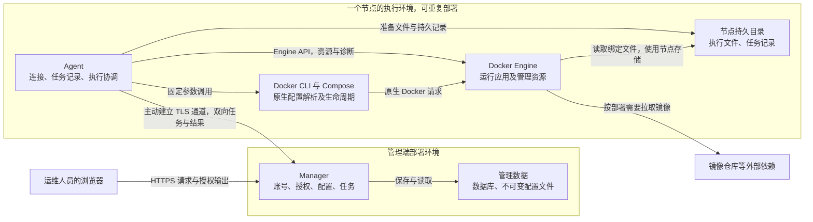

# Docker Manager 架构设计

日期：2026-11-02。版本：0.3。状态：待审阅。用户已确认可信运维协作、Agent 主动连接管理端，以及 Node Cross 迁移后验证、按用户选择删除来源。其余架构细节和技术组合为建议；迁移切换与回退机制待补全，尚未实现验证。

Docker Manager 由 Web 界面、管理端 Manager 和节点侧 Agent 组成。Manager 保存账号、授权、节点、Stack 配置及任务记录；Agent 主动建立到 Manager 的连接，在对应 Docker 环境中准备文件、调用原生 Compose 和 Docker Engine，并记录执行结果。应用继续由各自节点的 Docker 运行，管理端不会成为应用流量入口或跨节点调度器。

本文面向开发者和维护者，解释系统如何实现[需求说明](requirements.md)和[功能设计](functional-design.md)规定的行为。需求与用户操作不在此重复完整定义；数据字段、消息格式、安装命令和测试用例由后续文档展开。

## 一 架构目标和约束

| 需要解决的问题 | 对架构的要求 |
| --- | --- |
| 内外网混合，节点通常不超过 20 个 | Agent 主动连接 Manager；不要求节点暴露公网端口或节点之间直连，不设置 20 节点硬上限 |
| Web 中维护原生 Compose | 配置可以集中保存，但必须在明确的执行环境按原生文件、变量与路径规则部署 |
| 多人按节点与操作授权 | Manager 统一判定权限，Agent 校验任务身份、目标和执行条件；用户不能直接代理任意 Docker 请求 |
| 可信运维协作 | 获任意部署能力的人被信任管理对应节点；管理器入口仍检查其他节点和系统操作的权限，部署拓扑还须符合第九节的宿主机信任边界 |
| 迁移与复制意图分开 | Node Cross 协调迁移、验证与可选来源清理；Copy 创建独立目标，Apply 复用部署，不改变来源 |
| 断线、崩溃与重复请求 | 任务必须持久记录并可核对；无法确定结果时保留未知，不能以自动重试制造重复副作用 |
| 易于自托管和恢复 | 先采用一个活动 Manager 与本地持久数据，不引入运行基础功能所不需要的外部队列或集群 |

当前不提供镜像构建、Dockerfile 或构建上下文管理。自动化存储搬运细节继续暂缓；当前已展开配置处理与执行基础，Node Cross 还需补全跨节点切换、迁移验证及失败恢复。不能把 Copy／Apply 的设计视为完整迁移方案，不预定存储协议、停机方式或数据一致性机制。

Unix-like 是当前操作环境方向，实际运行前提是可用的 Docker CLI、Compose 和目标 Docker。Linux、FreeBSD 等平台名称不等于 Docker 运行方式相同；是否存在虚拟机、远端 daemon 或文件路径映射，需要按实际组合验证，不提前建立庞大的跨平台适配层。

## 二 方案选择和代价

### 节点接入方式

| 方案 | 对本项目的适用性 | 代价与结论 |
| --- | --- | --- |
| Agent 主动连接 Manager | 内网节点只需能访问管理端；文件、Compose 和任务记录可在执行环境就近处理 | 每个节点需要安装和更新 Agent；2026-11-02 用户已选择此方案 |
| Manager 通过 SSH 执行 | 可利用现有 SSH，少维护一个常驻进程 | 需要到每个节点的可达路径，还需补充持久任务跟踪与文件管理；保留为比较依据，本轮不并行实现 |
| Manager 直接访问远端 Docker API | 容器等资源可以通过 API 管理 | 单独使用不能解决 Compose 执行、附属文件准备及 daemon 主机的挂载路径；不作为完整节点执行方案 |

Docker 官方提供通过 SSH 或 TLS 访问 daemon 的方式，但这只解决 Docker 接口访问的一部分条件。[Docker 远程访问保护](https://docs.docker.com/engine/security/protect-access/)。Portainer Edge Agent 也使用由受管环境向管理端发起连接的思路；此处借鉴连接方向，不照搬它的协议、端口或实现。[Portainer Edge Agent](https://docs.portainer.io/advanced/edge-agent)

### 管理端和持久化建议

本稿建议 Manager 使用模块化单体：账号、节点、配置和任务属于同一服务中的模块，先由一个活动实例负责写入和调度。Web 静态资源可随 Manager 发布。这样能够在一个事务边界内协调授权、配置版本与任务受理，约 20 节点的目标没有给出必须拆为微服务的理由。

建议使用事务型本地数据库保存管理记录，受管理文件采用不可变内容加清单保存。SQLite 是首个候选，适合减少独立数据库运维；它同一时刻只有一个写者，因此事务应短小，不能在数据库事务中等待节点或流式日志。后续以实际资源量、并发写入和备份要求验证，不用“20 个节点”直接推导性能承诺。[SQLite 适用范围](https://www.sqlite.org/whentouse.html)

当前不建议多个 Manager 实例同时调度同一批节点或共享一个 SQLite 文件。若未来要求高可用，需要重新设计数据库、调度所有权和故障切换；这不是把实例数改为二就能获得的能力。节点侧应用不依赖 Manager 持续在线，但管理界面和新操作会受 Manager 停机影响。

## 三 系统边界与组成

下图是建议方案的系统组成与通信关系图。方框表示软件组件或存储，外层分组表示部署位置；它不是 Docker 容器清单，也不使用 C4 中 container 一词表示被管理容器。箭头标明连接或数据的方向，Agent 发起的连接建立后承载双向消息。

### Manager 的职责

| 模块 | 负责的内容 | 不承担的职责 |
| --- | --- | --- |
| Web 与访问入口 | 登录会话、请求校验、输出订阅、静态资源 | 不把浏览器请求直接转成任意节点命令 |
| 授权 | 节点与动作判定、凭据使用权、撤权后的请求和订阅处理 | 不承诺隔离已经被授权控制主机的运维人员 |
| 节点目录 | 节点身份、接入凭据、Agent 会话、能力、分组标签及状态缓存 | 不把离线缓存当作节点当前事实 |
| Stack 配置 | 版本、文件清单、部署输入、项目绑定及复制来源记录 | 不从容器 inspect 静默重建原始 Compose |
| 操作协调 | 受理、重复请求识别、授权开始、冲突控制、结果归档和核对 | 不凭连接超时判断 Docker 操作已经失败或停止 |
| 输出与诊断 | 将获准的操作输出、日志、统计和终端流交给用户 | 不将任意高频流全部长期写入主数据库 |
| 配置转换 | 纯文本 run 解析、映射和差异报告 | 不执行输入、不读取 Manager 主机的环境或任意文件 |

这些是代码职责边界，不要求每行部署成独立服务。转换逻辑建议与 Docker 执行模块隔离，并以独立样例测试；部署权限只在进入 Stack 部署时参与，转换请求本身不能访问节点执行通道。

### Agent 的职责

Agent 维护到 Manager 的认证连接、接收结构化任务、校验目标、准备受管理文件、调用 Docker 能力并保存执行依据。Agent 只绑定一个节点身份及一个明确的目标 Docker 环境；一台物理机存在多个 Docker 环境时，可按独立管理对象接入，不能在任务期间随意切换全局 Docker context。这种管理身份划分不自动形成宿主机安全隔离，部署约束见第九节。

Agent 内部划分连接处理、任务记录与互斥、文件准备、Compose 执行、Engine 访问及输出转发。Compose 执行使用受支持的原生 CLI；容器、镜像、网络、卷与诊断优先使用 Engine API，并协商目标支持的 API 能力。解析 CLI 展示文本不作为所有资源数据的唯一来源。[Docker Engine API](https://docs.docker.com/reference/api/engine/)

Agent 不持有用户密码、全部用户授权表或其他节点的凭据。它信任已配对的 Manager 下达已授权任务，同时校验自己的节点标识、连接代次、任务标识、输入摘要和动作支持范围。它不提供通用远程 shell 接口；容器控制台是受控的专用操作，仍按功能设计授予权限。

## 四 节点接入与通信

### 网络前提

Manager 提供所有受管 Agent 能访问的地址，可位于公网、内网或经现有 VPN 连通的网络。选择主动连接并不消除路由、DNS 和证书条件：完全无法访问 Manager 的节点不能直接纳管，应由使用方先提供可达路径。不同节点可以使用能到达同一 Manager 的不同地址，但身份和授权保持一致。

本稿建议浏览器使用 HTTPS，Agent 使用经 TLS 保护的持久双向通道，优先评估 WebSocket。该协议建议尚未成为用户确认决定；实现前验证反向代理的长连接、超时和输出流量行为。连接方向已确认，不因协议调整改为要求节点开放入站管理端口。

任务控制消息与批量文件、日志和终端输出必须有分别可控的队列和流量限额。心跳、撤权和结果确认不能被大日志阻塞；必要时使用同样由 Agent 发起的独立传输连接。协议格式、大小限制、心跳与重连参数在接口设计定义，不在此编造性能数值。

### 注册与节点身份

管理员创建待接入节点，并取得一次性、限时、限定该节点的注册凭据。安装 Agent 时配置 Manager 地址和服务端信任信息；Agent 验证 Manager 后申请注册。Manager 绑定 Agent 身份、签发独立且可撤销的连接凭据，注册凭据随成功注册失效。

每次连接均检查身份、节点状态和协议兼容性。重连不能靠显示名认领节点，也不能因为提供某个 Node ID 就成为该节点。Agent 重新安装或替换凭据须经管理员明确处理；旧身份和旧会话被撤销。探测到目标 daemon 身份变化或疑似重复纳管时，进入待核对状态，阻止直接把新目标当成旧节点执行。

每个节点只允许一个有效执行会话；会话建立时分配递增的连接代次，旧代次不能接收新的执行许可。Agent 进程在本地持有独占运行锁，避免重复启动两个执行者。新连接可查询和接回旧任务结果，但不能使旧任务自动重新执行。

节点移除先撤销连接与注册能力，再按功能设计保留或移除管理记录；不向 Docker 发出清理工作负载指令。凭据轮换和 Manager 地址变更的可执行步骤由运维文档说明。

## 五 配置来源和节点文件

### 保存位置与信息权威

| 信息 | 主要保存或取得位置 | 恢复与一致性原则 |
| --- | --- | --- |
| 账号、授权、节点和分组标签 | Manager 数据库 | 管理器备份的一部分，Agent 不自行改写授权 |
| Stack 原始文件与部署输入 | Manager 不可变配置版本及文件清单 | 保存不修改节点运行目录；新版本不覆盖旧任务引用 |
| 操作意图和用户可见状态 | Manager 操作记录 | 与请求受理一致保存；状态来源可追踪 |
| 节点接收、开始和完成的依据 | Agent 本地任务记录 | 先持久保存再确认相应阶段；断线后补报 |
| 当前容器、网络、卷等状态 | Docker Engine 的实时观察 | Manager 缓存带节点、时间和新鲜度，可丢弃重建 |
| 实际运行文件、卷与绑定目录数据 | 节点或外部存储 | 不因 Manager 配置版本变更而自动迁移、清理或恢复 |

Manager 先写入不可变文件内容并校验摘要，再以数据库事务提交版本清单和当前版本引用。若文件写入完成但事务失败，孤立文件可在确认无引用后清理；不能先发布一个指向缺失文件的版本。Copy 可以在存储层复用不可变内容，但两端有独立配置标识和版本引用，任一端修改都创建新内容。迁移可复用这一内容准备机制，其运行切换及成功判断另由迁移流程负责。

### 文件路径与原生语义

Agent 必须能把运行配置放到目标 Docker 环境正确的位置。Docker 的绑定挂载读取 daemon 主机上的路径，不能假定 Compose 客户端看到的文件自动出现在远端主机。因此基础部署建议 Agent 与 daemon 就近运行，并共享一致的运行文件路径视图；Agent 若容器化，须显式验证挂载路径在 Agent 和 daemon 两侧的含义。其他执行组合应在验证后列入支持范围。[Docker 绑定挂载](https://docs.docker.com/engine/storage/bind-mounts/)

每个 Stack 有稳定的节点工作根目录，内部保留用户受管理文件的相对关系；Compose 项目目录和文件顺序属于明确输入。`../` 引用只在已声明且获准访问的文件布局中解析，不因路径出现就读取或写入任意其他 Stack、Agent 凭据或 Manager 文件。上传的文件名、归档路径及符号链接都应检查实际落点，不能穿出指定文件边界。

接管已有项目时，先核对原项目目录、配置位置与实际挂载；允许把明确获准的原目录登记为该 Stack 的工作目录，不强制搬到新目录。若用户选择新位置，需显式处理路径差异及所需数据，不能因接管而把原 `./data` 改指向空目录。项目目录不明确时维持资源级管理，补齐依据后才允许接管部署。

**配置版本归档与运行工作目录分开。** 不能每次部署都把 `./data` 解释到一个新版本目录，否则可能让应用得到新的空目录。运行目录中的业务数据和外部挂载不属于配置文件清单；更新只涉及明确受管理的文件，不用“同步目录”递归删除未列入清单的内容。用户把配置和可写业务目录混在一起时，需识别覆盖冲突，不能把新增运行文件反向纳入配置备份。

保存草稿只修改 Manager 的配置版本。Agent 可以把版本放入独立暂存区做解析准备，但暂存路径下的检查不等于对最终工作目录的完整验证。实际部署开始后，在工作目录写入受管理文件并再次按真实输入校验；附属文件若已经被运行容器挂载，写入本身可能产生可见影响，属于部署操作，失败时也要记录，不能说“尚未调用 up 就没有变化”。

文件替换涉及多文件一致性和单文件绑定挂载的实际观察行为，不能只用一次 rename 推导应用已看到新配置。部署应跟踪哪些文件完成更新、哪些容器按原生行为重建；不承诺热更新和整体原子回滚。关键组合列入第十一节验证项。

Agent 保存上次落地的受管理文件清单和摘要。部署前发现这些文件在节点被外部修改时，返回差异让有权限的用户选择导入修改或明确以选定版本覆盖；不把外部修改悄悄写回 Manager 主库。对运行数据不做同样的配置摘要同步，更不能把其变化当作待覆盖的配置冲突。

### Compose 输入与执行

Manager 保存原始文件、选取顺序、项目目录、最终项目名、profiles、变量来源及凭据引用。Agent 在受控进程环境下使用这些输入运行原生 Compose，不继承无关宿主环境，不通过全局 `docker context use` 影响其他任务，也不把用户文本拼成 shell 命令。

项目名按原生规则解析并在部署前展示，确认后固定到该 Stack 的项目绑定；后续执行使用明确参数，防止暂存目录名或环境变量改变归属。输入之间存在覆盖时显示最终来源，不能静默强加管理器生成的名字。项目名的原生优先级以 Docker 文档为准。[Compose 项目名](https://docs.docker.com/compose/how-tos/project-name/)

解析与校验使用目标可用版本的 `docker compose config` 等原生能力，保留源文件，不把规范化输出重新存成用户原文。解析成功只说明可解析的模型及输入有效，不证明镜像可拉取、端口可绑定或业务健康。[Compose config](https://docs.docker.com/reference/cli/docker/compose/config/)

配置编辑者可以对已经授权取得的受管理文件做不访问节点的结构检查。需要在节点解析外部文件、访问 Docker 或使用仓库凭据的预检，要求相应目标部署和凭据使用权限；输出完整解析配置还需配置读取权限。未授予任意部署能力的人不能借“预览”让 Agent 读取任意节点文件。原生解析器可能读取引用文件或远端内容，因此预检同样要限制输入与访问范围，不把它当作天然无副作用的文本函数。

部署路径始终禁止构建，具体行为遵循功能设计第五节。Agent 的动作集合不提供 build、Dockerfile 编辑和构建上下文上传；执行器使用明确的不构建参数，所选服务没有可用镜像时返回对应错误，不删除 build 字段后继续冒充原配置。用户应用本身的任意代码不被视为管理器提供的构建服务。

## 六 关键运行过程

### Web 保存和部署

1. 浏览器提交文件、输入和打开时的版本。Manager 检查账号、目标节点和配置动作权限，再进行版本比较；冲突则返回已有版本信息，不改动节点。
2. Manager 保存不可变版本，返回版本标识。校验及预览关联此版本、目标身份、输入摘要和观察时间；输入改变后需要重新校验，预检不能作为永久有效的承诺。
3. 用户提交部署。Manager 再次授权，在一个事务中建立操作、绑定版本、占用冲突范围并记录待派发任务。重复请求返回原操作；不在长事务里执行节点调用。
4. Agent 接收准备任务，校验身份、输入与能力，持久记录后准备配置和依赖检查；此阶段不修改运行目录或工作负载。结果返回 Manager，缺失条件使操作失败并释放已确认安全的占用。
5. 准备就绪后，Manager 在当前授权下批准开始，并将操作转换到执行中。批准开始与撤权在 Manager 中有明确先后关系；批准前撤权阻止执行，批准后按已开始操作处理。这个可记录的授权开始点，是功能设计中“开始执行前再次校验”的实现边界。
6. Agent 接收当前会话的开始许可，先持久记录再进入运行文件准备和 Docker 执行；同一操作只进入一次执行路径。输出带操作标识和序号，完成结果先本地保存再报告。
7. Manager 归档结果，并另行刷新 Engine 状态。成功部署版本只在有充分成功依据且不会倒退较新部署记录时更新；失败或未知保留相应记录，前端分别展示配置、操作和实时运行状态。事件去重与部署顺序的具体约束见[数据设计](data-design.md)第五节。

开始许可不能作为离线任务队列永久缓存。Agent 尚未取得有效许可就断线时，不启动新操作；重连后由 Manager 核对并重新授权尚未开始的任务。已开始的一个操作可继续处理已批准范围并记录结果，但不能扩大到其他节点或额外的用户动作。

### Copy 与 Apply

来源和目标的授权、版本选择及冲突规则以功能设计第六节为准。Manager 从已保存来源版本建立独立目标版本，记录来源关系但不建立持续同步；来源完整配置已保存时，这一步不需要来源 Agent 在线。

目标 Agent 只收到目标配置与目标任务，检查实际项目名、现有资源及运行依赖；它不会获得来源节点的连接凭据。目标凭据引用由用户重新选择并按目标权限检查。后续部署走同一任务机制，来源 Agent 不接收停止、删除或清理消息，目标失败不会触发反向补偿。

当前 Copy／Apply 不提供节点间运行数据传输，也不要求 A 能连接 B。用户可手动准备数据后部署；这不等于完成 Node Cross，也不从 Agent 双向通道推导已经支持数据搬运。

### Node Cross 迁移与验证

迁移遵循功能设计第六节，至少关联来源、目标、固定配置、执行阶段、迁移后验证和来源处置选择。Manager 负责协调与记录，各 Agent 只执行本节点上明确授权的阶段任务；不能把一条目标部署任务的成功当作两端迁移成功，也不能要求 Agent 自行使用另一节点的凭据。

切换涉及来源与目标，不能只靠复制配置或更改 Stack 的节点字段实现。来源退出活动部署角色、目标达到预期状态以及必要数据准备都需要可核对的依据；具体顺序、冲突占用持续范围和失败回退待方案补全。来源离线时可准备已保存配置，但不能据此断言来源已停止或切换完成。

迁移执行后单独验证。验证结果绑定本次迁移、两端对象、配置及观察依据；通过后，用户才可选择是否删除来源。清理是独立授权的操作，固定删除范围并重新核对状态，持久数据删除另行选择。验证失效、未通过或结果未知时禁止来源清理；保留来源不自动启动旧部署。清理失败与迁移验证结果分别显示。

重连、重试和恢复必须按阶段取得证据，沿用单节点任务的去重及结果未知规则；尚未开始的阶段重新授权。数据库不能与两端 Docker 组成原子事务，不自动重启来源或删除目标作为通用补偿。存储传输、停机、验证清单及回退机制仍需专门设计，本节只确立职责和约束。

### 资源查询、日志和容器控制台

Manager 授权后向相应 Agent 请求资源。Agent 通过固定目标 Engine 查询并返回结构化结果，Manager 根据用户动作权限选择摘要或受限详情；不先把完整敏感响应交给浏览器再隐藏字段。

日志、统计和控制台使用单独的订阅身份，绑定用户会话、节点、对象与动作。Manager 撤权或用户会话失效时，停止转发并通知 Agent 关闭订阅；连接中断也终止交互会话。控制台输入不重放、不记录为普通审计正文；是否记录交互内容属于后续明确的产品选择，当前不默认录屏或记录全部命令。

查询可以超时后重试，但不能把同样策略套在变更动作上。日志和统计使用有界缓冲；慢客户端导致丢弃或截断时明确反馈。关键完成结果和任务记录不能像实时统计一样静默丢弃。

## 七 任务一致性与故障恢复

### 两端记录和重复请求

Manager 的操作标识在一次受理后保持不变，Agent 以该标识建立本地记录；相同标识携带不同输入摘要时拒绝处理。Manager 保存请求去重信息及待派发记录，Agent 保存接收、授权开始、执行阶段和结果，从而区分请求重发与用户新发起的一次重试。

数据库、进程启动和 Docker 副作用之间不存在覆盖全链路的原子事务。Agent 已调用 Docker、但还没保存结果就崩溃时，只能进入核对流程；不能承诺“恰好执行一次”。设计目标是同一记录不因重连自动开启第二次执行，并对无法判定的窗口诚实报告结果未知。

Manager 已受理但没有派发的记录可在恢复后继续检查；已派发的任务先查询 Agent 的记录。Agent 本地没有记录不总等于未执行，例如任务记录磁盘丢失；需要结合执行环境的恢复情况判断。任务记录无法可靠持久化时，拒绝开始新的变更操作，不以仅存内存的状态继续承诺可恢复性。

### 冲突控制

Manager 负责用户可见的冲突占用，Agent 负责执行环境的本地互斥。Stack 任务按节点和实际项目绑定协调，直接容器操作纳入其所属 Stack 的冲突范围。镜像、网络、卷等操作按实际对象协调；影响范围无法可靠限定的清理操作使用节点级排他范围。不同节点的独立操作可并行，资源查询不被一个长部署整体阻塞。

本稿沿用功能设计的建议：发生冲突时拒绝新的冲突动作，并返回正在处理的操作入口，不建立用户难以察觉的长期待执行队列。内部持久待派发记录用于可靠传递，不能因此把用户在离线节点上的动作无限期排队，等连接恢复后未经核对突然执行。

占用与执行状态一起持久记录。超时、会话更换或进程重启都不能单独释放结果未知的占用；本地锁只能阻止本程序的并发，无法阻止外部 SSH、Docker CLI 或另一个管理工具。执行前和结果核对时仍需读取目标身份及资源现状。

### 故障处置

| 情形 | Manager 与 Agent 的处理 | 用户可见结果 |
| --- | --- | --- |
| 浏览器断开 | 变更操作独立于页面请求存活，记录继续更新；交互会话关闭 | 重新进入可找回操作，不能认为关闭页面取消了任务 |
| Agent 尚未获得开始许可便断线 | 不开始新的变更；重连后核对输入、权限和任务状态 | 待核对或已确认未执行的失败，不伪报部署成功 |
| 操作开始后 Agent 与 Manager 断线 | Agent 可继续既定操作并保存结果；Manager 保留最后阶段和未知标记 | 恢复后补报，不能把离线显示为资源为空 |
| Manager 重启 | 暂停派发，恢复任务和占用，与 Agent 核对后再开放相应动作 | 已开始操作不会因 Manager 重启自动重做 |
| Agent 进程重启 | 重建本地互斥并核对执行者、任务记录和 Engine；不直接重跑旧 CLI | 无法取得完成依据时继续未知 |
| 文件或节点磁盘写入失败 | 开始前失败则不执行；已开始则保存能够取得的部分结果，阻止新增无法记录的任务 | 明确哪一阶段失败及哪些内容可能改变 |
| Agent 身份或目标 daemon 发生变化 | 暂停该节点变更，要求管理员核对实际目标和旧任务 | 待核对，不自动将新环境视为原节点 |
| Manager 数据恢复到旧备份 | 使用恢复模式核对节点及操作，不直接发送备份中的旧任务 | 保留历史及差异，恢复管理记录不触发应用重部署 |

完成结果只有在 Manager 已持久确认后，Agent 才能按保留策略清理本地副本；仍被未知任务引用的输入和必要证据不能提前回收。输出分片可有截断策略，但终态、错误摘要和阶段依据须有独立的持久记录空间。

### 取消与人工核对

尚未派发的操作可以在事务中取消；已经进入节点准备阶段的操作，要由 Agent 确认未进入授权开始及运行文件修改，再完成取消。消息在途或无法取得确认时，不显示“已取消且未执行”。授权开始之后不提供通用的取消回滚承诺。

对于无法自动恢复的未知操作，管理员先取得当前 Agent 对执行者状态的报告，核对该项目资源与受管理文件，并说明处置依据。只有能够阻止旧任务继续执行、确认不再有旧请求在途后，才允许解除占用；断开的旧 Agent 无法确认时，需先在运行环境停止或隔离旧执行者。单击“忽略错误”不能替代这些条件。

人工处置保留原操作的未知或人工核对状态，不伪造原命令成功；后续修复是新的有权限操作。具体核对证据、解除操作的请求字段和审计记录在接口、数据设计中落实。这里不承诺通过 Engine 观察就能还原所有历史命令。

## 八 授权与敏感信息保护

用户身份和 Agent 身份分开。用户会话只进入 Manager 的用户接口；节点连接凭据只允许对应 Agent 建立连接和提交自身记录，不能作为管理员登录凭据。浏览器不获得 Docker socket、Agent 长期凭据或其他节点连接信息。

Manager 对读取、提交、授权开始和订阅持续访问分别校验权限。撤权与授权开始以数据库中可记录的顺序为准：等待中的任务失去权限后终止，已批准开始的任务按既定范围完成并记录；撤权立即关闭受限输出和交互输入。全局授权版本或等效机制用于使缓存失效，不能等用户下次登录才生效。

Agent 连接建议使用独立高强度凭据并在 TLS 上认证，Manager 保存用于验证的摘要，Agent 本地限制凭据文件访问。初次注册、轮换和撤销各有独立操作；默认不允许跳过服务端证书验证。用户会话建议由服务端维护，配合受保护的 Cookie、跨站请求校验和实时连接来源检查；具体参数和实现库在接口与实现阶段锁定。

仓库凭据和其他需要解密使用的秘密由 Manager 独立保存，以受保护的密钥加密；使用时检查该节点和动作的凭据使用权，仅向目标 Agent 提供完成操作所需内容。Agent 使用任务专用 Docker 认证环境，不把一次拉取凭据写成整个主机所有用户共享的默认登录配置。临时材料清理与失败后的保留需要有明确规则，相关文件不进入应用配置快照。

原始 Compose、环境文件和日志可能包含用户写入的秘密，访问遵守功能设计中的配置和诊断权限；日志脱敏只处理管理器能够识别的凭据，不声称可以自动识别一切应用秘密。请求摘要、追踪信息和异常报告不得默认记录完整输入。所有受管文件和流式内容都按不可信输入做格式、长度和访问范围校验；“可信运维”不是取消输入校验的理由。

Agent 对对应 Docker 的访问是高权限能力。Manager 被攻破可能影响其获准控制的节点，因此 Manager 的持久数据、恢复密钥和管理员账号需要作为管理基础设施保护；这项边界沿用已确认的协作模式，不额外引入同节点租户隔离系统。

## 九 部署、更新和备份

### 基础部署形态

| 部署位置 | 所需内容 | 持久内容与访问条件 |
| --- | --- | --- |
| Manager 主机 | 一个活动 Manager，可内置 Web 静态资源；TLS 入口可直接提供或由反向代理提供 | 管理数据库、配置文件内容、凭据保护材料和必要记录；浏览器及各 Agent 可达 |
| 每个节点的执行环境 | Agent、Docker CLI、Compose 与到目标 Engine 的受控访问 | Agent 身份、任务记录、Stack 工作目录；能主动访问 Manager 和部署所需外部依赖 |
| 用户浏览器 | Web 编辑和管理界面 | 未提交编辑内容属于当前会话；不负责执行任务或保存唯一配置副本 |
| 外部依赖 | 镜像仓库、应用外部网络或服务 | 由节点按配置访问；可达性与业务数据不被 Manager 自动保证 |

本稿建议 Agent 先以 Unix-like 系统服务运行，减少执行文件与 daemon 文件视图不一致的问题；在 Linux 上的容器化 Agent 可作为经路径验证后的交付形态。这里是部署建议，具体安装包和服务管理方式由运维设计落实。不能承诺同一 Docker 镜像原生适用于所有被提及的平台。

Manager 默认部署在独立的可信环境中。只有当同机节点的任意部署人员也被信任管理整套管理基础设施时，才建议 Manager 与该节点共享宿主机；仅分开目录、进程、Docker 环境或账号，不能阻止具有宿主机访问能力的人读取 Manager 数据和密钥。若两者信任范围不同，应分离宿主机或采用经验证的隔离边界。

同一宿主机上的多个 Docker 环境同样共享可能的主机权限影响范围，不能仅因各自有 Node ID 就作为不可信人员之间的隔离边界。节点级权限仍在管理器入口执行，但不能越过真实的宿主机信任边界作出保护承诺。同机部署也不得跳过 Agent 授权及任务记录。

Manager 的 Docker 部署与“管理器不替应用注入网络和卷”是两个不同范围：管理器自身所需持久存储必须在安装说明中清楚列出。

### 更新与协议兼容

Agent 握手报告自身协议版本、Docker 与 Compose 版本及可用能力。Manager 使用能力结果决定是否允许动作，未知能力不能当成可用；不支持的字段或动作返回明确错误。版本记录与一次部署的输入和结果关联，便于解释环境更新前后的差异。

Manager 更新前暂停派发并持久保存状态，升级后先恢复核对，再继续服务。Agent 更新应等待本节点运行中的操作结束或完成明确的人工处置，不杀死进程后假定任务未执行。协议不兼容时保持节点可诊断，拒绝不支持的动作；允许哪些版本组合通过实际测试形成支持清单。

### 管理数据备份与恢复

备份必须覆盖数据库中的一个一致视图、该视图引用的不可变配置内容、凭据恢复所需材料及版本清单。创建备份期间固定相关文件引用，禁止清理它们；数据库使用受支持的一致备份方法，不能只在运行中随意复制主文件。SQLite 的备份接口可作为实现依据，但数据库一致不等于跨文件备份已经完整。[SQLite Backup API](https://www.sqlite.org/backup.html)

恢复先进入维护模式，验证文件摘要、数据版本及必要密钥；在核对完成前不派发旧任务。恢复到另一个运行实例前，必须停止或隔离旧 Manager，不能让恢复实例和原实例同时控制节点。每次恢复生成新的管理恢复标识，旧浏览器会话、未使用注册凭据和旧开始许可失效；节点重新核对身份并轮换连接凭据后才开放执行，避免备份中的旧凭据或旧连接代次重新获得效力。备份中较旧的账号与授权也需要管理员复核后再开放普通用户访问。

恢复后发现实际节点状态比备份新时，保留差异而非直接覆盖；Agent 留存的旧任务先核对结果，不按新恢复标识重新执行。应用容器可以继续运行，不因管理数据恢复自动回到旧配置。恢复标识、Node ID、操作 ID 和连接代次的组合由数据与接口设计统一定义。

Agent 的本地记录是断线任务的重要核对来源，但不是 Manager 配置主库的替代品。两端记录都缺失时，需要人工恢复管理关系，不能宣称完整还原操作历史。卷和绑定目录中的应用数据不属于本节备份范围，也不随 Copy 自动传送。Node Cross 的数据搬运机制仍待设计。

## 十 技术组合建议和决策记录

以下技术组合由本稿提出，可在实现验证后调整；用户确认的是 Agent 连接方向和协作边界，没有确认具体语言、框架或数据库版本。

| 部分 | 建议起点 | 理由及需要验证的内容 |
| --- | --- | --- |
| Manager 与 Agent | Go，共享消息和领域类型，分别构建程序 | 便于维持两端协议与执行逻辑；验证实际目标环境、进程控制和所选依赖的构建方式 |
| Web | Vue 3 与 TypeScript | 面向节点视图、文件编辑和操作状态组织前端；编辑器和终端组件按实际需要选型 |
| 管理数据库与 Agent 任务记录 | SQLite 与本地持久文件 | 减少外部服务，保持记录可恢复；验证并发写入、文件与数据库一致性、空间限制和备份 |
| Docker 资源访问 | Engine API，Go 实现时使用合适的官方 SDK 能力 | 验证 API 协商、错误、日志和 exec 流，不固定所有节点必须使用同一最新版本 |
| Compose | 节点侧受支持的原生 Docker Compose CLI | 验证多文件、变量、include、绑定路径及不构建行为，不自行重写 Compose 引擎 |
| 通信 | 浏览器 HTTPS；Agent 主动 TLS 双向通道，优先 WebSocket | 验证代理和断线行为、流量隔离、身份和版本协商；字段另见接口设计 |

这些是当前约束下的设计判断，不是框架自身对本项目可行性的保证。语言与前端资料入口为 [Go 文档](https://go.dev/doc/)和 [Vue 文档](https://vuejs.org/guide/introduction.html)；各组件的具体版本随实现验证锁定。

| 重要决定 | 状态及依据 | 主要代价 |
| --- | --- | --- |
| 可信运维协作，节点与动作授权 | 用户已确认，见需求 R11 和功能设计第二节 | 任意部署不是同节点不可信用户隔离边界 |
| Agent 主动连接 Manager | 用户已确认，适应内外网混合与节点侧执行 | 增加 Agent 安装、升级和身份维护 |
| 一个活动 Manager，模块化单体 | 本稿建议，降低当前规模的部署与事务协调成本 | Manager 停机影响管理功能，暂不提供多实例自动接管 |
| Manager 版本主库与节点运行目录分开 | 本稿建议，满足保存不部署、复制独立和配置恢复 | 需处理文件清单、下发、漂移及部署部分完成 |
| 原生 Compose 与 Engine API 分工 | 本稿建议，延续原生部署语义并取得结构化资源数据 | 两条执行路径必须共用授权、目标和任务约定 |
| 两端持久任务记录，不确定时不重跑 | 本稿建议，满足 Q04 的失败可判断要求 | 增加恢复核对流程，部分故障需要人工处理 |
| Node Cross 迁移与独立 Copy／Apply | 用户已明确区分；迁移后验证，通过后由用户选择是否删除来源 | 现有执行基础可复用，需补全跨节点切换与恢复，不能以 Copy 模型代替 |
| 自动化存储搬运暂缓 | 用户已确认当前讨论范围，R15 目标保留 | 当前不承诺自动搬运数据及其一致性或恢复能力 |

## 十一 质量场景和技术验证

以下检查用于判断架构能否支撑需求，没有执行结果。后续测试文档把它们细化为环境、步骤和预期结果，开发实施计划据此安排验证任务。

| 质量要求 | 架构措施 | 应验证的场景 |
| --- | --- | --- |
| Q01 目标明确 | 节点身份、实际项目绑定、任务输入摘要和独立会话 | 同名 Stack、切换视图、Agent 重新注册及目标变化不会使动作落到另一节点 |
| Q02 状态可解释 | 配置版本、操作状态、Engine 观察分开保存和展示 | 保存后未部署、部署部分失败、来源离线复制时不混淆结果 |
| Q03 权限有效 | Manager 多阶段授权、Agent 身份与固定目标、订阅撤销，部署符合宿主机信任边界 | 直接请求、跨节点复制、撤权与开始竞争均遵守已定义边界；同机环境不被误报为主机隔离 |
| Q04 故障可核对 | 两端记录、去重、冲突占用和未知结果处理 | 在接收、授权开始、进程调用及结果确认前后断线或重启，不自动重复副作用 |
| Q05 多人修改 | 版本比较和不可变输入快照 | 两人保存冲突不覆盖；执行中的任务不使用后来保存的内容 |
| Q06 原生兼容 | 目标 CLI 解析、明确输入、稳定运行目录、禁止构建 | 多文件和 include 路径、变量优先级、文件绑定、项目名及已有同名项目保护 |
| Q07 敏感信息 | 摘要输出、分离凭据、受限配置与诊断、任务专用认证环境 | 日志、错误、备份和临时文件不泄露管理器已知凭据；未授权用户不能取完整配置 |
| Q08 管理恢复 | 一致数据库视图、文件清单、密钥材料及恢复核对模式 | 备份恢复后能关联配置和节点，不把旧任务重发，不将应用数据误报为已恢复 |
| Q09 日常规模 | 按节点隔离查询失败、有限并发、有界输出和短事务 | 约 20 个混合网络节点下增加慢节点、大日志和并发用户，记录负载后确定响应目标 |
| Q10 迁移结果可核对 | 区分配置准备、切换、验证及可选来源清理 | Copy／Apply 成功不等于迁移成功；验证通过及用户选择是来源清理前提，完整切换和搬运机制仍待补全 |
| Q11 转换可信 | 纯文本转换模块及显式支持清单 | 引号、变量、挂载和 env 文件差异样例正确报告；输入没有被执行 |

优先技术验证项按对架构的影响排列：

1. **执行文件与挂载路径。** 在真实节点上验证多文件、include、`../` 引用、单文件绑定挂载、已有项目接管和稳定数据目录；确认 Agent 原生或容器化部署时两侧路径一致，配置保存不影响运行文件，外部配置修改得到明确处理。
2. **崩溃窗口和进程恢复。** 分别中断 Manager、Agent 和连接，核对任务记录、进程是否仍存活及 Docker 部分副作用；证明未确认结果不会被自动重新执行。
3. **开始授权和取消的竞争。** 控制撤权、开始许可、断线与取消的到达顺序，确认结果符合第六至八节；不能仅以正常流程演示代替。
4. **原生 Compose 且不构建。** 覆盖只有 build、有 image 和 build、profiles、多文件环境输入及错误配置，检查实际调用和产生资源，没有由管理器自动触发构建。
5. **混合网络与输出流量。** 让 Agent 经常见反向代理连接，模拟重连、连接替换及慢日志消费者，验证控制消息可用、订阅可撤销。
6. **一致备份和恢复核对。** 在有并发保存与未结束任务的情况下生成备份，验证文件引用完整、恢复不误执行、缺失密钥时能明确失败。
7. **实际规模与技术组合。** 用明确的节点、资源及并发用户数量测量数据库写入、查询和内存；验证候选语言、SDK 与实际 Unix-like 执行组合，记录支持范围。

首两项若无法满足，需要调整执行目录或任务记录方案；其余项失败时回到对应机制修改。检查项是计划，不代表已经进行原型开发或确认可用。

## 十二 后续文档与维护

[数据设计](data-design.md)展开 Node、Agent 身份、Stack、配置版本、文件清单、操作、订阅及凭据引用的关系，并说明数据库与文件提交顺序、状态变更、保留和回收约束。接口设计随后定义浏览器与 Manager、Agent 与 Manager 的请求、消息、错误和兼容约定。测试和运维文档据此补全可执行验证及安装恢复步骤，不在这些文档中另造授权或任务状态规则。

术语以需求说明为主；本文新增 Manager 指管理端服务，Agent 指节点执行程序，任务记录指恢复操作所需的持久状态，连接代次指区分当前和旧 Agent 会话的标识。它们不改变 Node → Stack／Docker 资源的产品模型。

本文依据需求与功能设计，以及 2026-11-02 用户确认的两项架构前提编写。结构参考 arc42 的[方案策略](https://docs.arc42.org/section-4/)、[组件职责](https://docs.arc42.org/section-5/)、[运行过程](https://docs.arc42.org/section-6/)、[部署关系](https://docs.arc42.org/section-7/)、[共同机制](https://docs.arc42.org/section-8/)、[决策](https://docs.arc42.org/section-9/)、[质量](https://docs.arc42.org/section-10/)与[风险](https://docs.arc42.org/section-11/)，图示按 [C4 检查表](https://c4model.com/diagrams/checklist)核对范围、职责和关系。只采用适合本项目的内容，不要求复制框架目录。外部资料查阅日期：2026-11-02。
