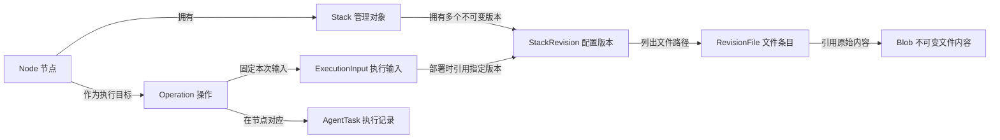

# Docker Manager 数据设计

日期：2026-11-02。版本：0.3。状态：待审阅。本文提出逻辑数据模型及一致性规则，并按用户更正区分 Node Cross 与 Copy／Apply；迁移协调模型仅列必要记录，完整切换机制待补全。数据库与技术组合仍为建议，尚未创建数据库或执行结构迁移。

Docker Manager 保存管理决定和操作依据：谁能访问哪个节点、Stack 的原始配置是什么、某次操作提交了什么，以及结果如何取得。Docker 当前运行状态由节点观察取得；应用卷和绑定目录中的业务数据继续由相应运行环境保存。

本文承接[需求说明](requirements.md)、[功能设计](functional-design.md)和[架构设计](architecture.md)，面向开发者、接口设计者和维护者。重点规定对象关系、字段含义、约束、提交顺序、清理与恢复；交换约定见[接口设计](api-design.md)，物理路径与编码随协议选型定稿。表中的英文名称是建议的逻辑实体和字段名称，不要求一张表对应一个页面或服务。

## 一 信息范围与保存原则

| 信息类别 | 主要来源与保存位置 | 处理原则 |
| --- | --- | --- |
| 账号、节点授权、节点目录和分类 | Manager 管理数据库 | 是管理事实，修改需事务、授权和审计 |
| Stack 原文、文件清单及部署输入 | Manager 不可变配置内容与版本记录 | 保存不部署；部署固定输入；保留原文而非仅保存解析结果 |
| 操作及开始许可 | Manager 数据库 | 记录用户意图、授权开始、冲突占用及结果依据 |
| 接收与执行依据 | Agent 本地持久记录 | 与 Manager 操作对应；断线补报，不以重发替代恢复核对 |
| 节点实际资源与运行状态 | Docker Engine，Manager 可缓存 | 标注目标和采集时间；缓存可以重建，不用缓存取代操作前校验 |
| 日志、统计和交互流 | Engine 或执行进程 | 有界传输；操作必要输出按策略保留，不默认保存完整终端输入和所有统计样本 |
| 用户未保存的编辑、run 转换原文 | 当前浏览器会话或短期处理内存 | 默认不长期保存；用户保存为 Stack 后才进入配置模型 |
| 应用运行数据 | Docker 卷、绑定目录或外部服务 | 不进入配置内容库，不被管理数据备份或 Copy 自动搬运；Node Cross 存储搬运机制待设计 |

本稿沿用架构的“事务记录 + 不可变文件内容”建议。纯数据库存储全部文件可简化跨存储提交，但会让备份、输出和文件容量更紧密耦合；直接把一个可变工作目录当作配置主库则难以保证版本和并发保存。当前选择保留不可变内容与版本清单，并在第八节明确两者的提交与回收顺序。

自动化存储搬运细节仍按用户要求暂缓，不建立传输分块、停机或数据一致性机制。Node Cross 的部署迁移、迁移后验证及用户选择来源删除与这些细节分开；第六节列出所需记录边界，不能以 CopyOrigin 代表完整迁移任务。

## 二 标识、字段与关系约定

### 通用字段

| 字段或类型 | 定义与约束 |
| --- | --- |
| `*_id` | 全局唯一的不透明标识，创建后不更改、不复用；恢复备份后新建对象也不能使用旧编号覆盖历史 |
| `*_at` | UTC 时间点，逻辑精度为毫秒；无记录用空值，不能用零或未来时间表示未知；界面按用户时区展示 |
| `*_bytes` | 非负整数字节数；与传输文本字符数区别处理 |
| `*_seq`、`*_version` | 在规定对象范围内递增的整数；比较并发和顺序，不用时钟推断先后 |
| `row_version` | 可变记录的并发版本，更新需要匹配读取版本；配置内容另用不可变 revision 标识 |
| `status` | 对应明确枚举；实体生命周期、连通状态、执行阶段各自保存，不共用一个模糊状态字段 |
| `digest` | 对约定字节内容计算的摘要；文件按原始字节计算，复合输入按版本化确定性编码计算；摘要不是访问凭据 |
| 空值与空集合 | 空值表示未提供或没有该事实；空集合表示已知为空；不能把未采集的容器列表编码为已知零容器 |

名称用于显示或原生 Docker 输入，标识用于关联。管理器登录名、分组名和标签名建议使用 Unicode NFC 后按大小写区分比较，禁止首尾空白，不对凭据和文件内容做这类转换；Docker 项目名和资源名按原生规则验证，不套用管理器名称规则。具体长度、消息大小和容量限制由接口及部署配置给出，必须在各端一致执行。

事件同时保存 Agent 报告时间和 Manager 接收时间，顺序以同一操作事件流内的序号及状态转换条件判断。两个节点时钟可能不同，不按时间戳决定谁覆盖谁。

主要生命周期状态建议如下；到期时间、连通性和执行阶段另列字段，不塞入这些枚举中。

| 对象 | 生命周期值 | 说明 |
| --- | --- | --- |
| User | 启用、停用 | 历史身份仍保留，凭据到期不等同账号被删除 |
| Node | 待接入、受管理、已解除 | 在线、离线与最近观察独立；解除后不允许旧凭据接入 |
| AgentIdentity | 有效、已撤销 | 身份替换撤销旧身份；断线不等于身份被撤销 |
| Enrollment | 未使用、已消费、已撤销 | 是否过期由到期时间判定；只有未使用且未过期才可消费 |
| Stack | 受管理、已解除、已删除配置 | 从未部署由成功部署引用为空表达，不用单一运行状态覆盖管理状态 |
| ProjectBinding | 待核对、活动、已释放 | 只有核对后的绑定可供执行；保存草稿可以没有活动绑定 |
| Blob | 暂存、就绪、删除中、已删除 | 正式版本只引用就绪内容；删除中不接受新引用 |

### 核心关系

下图只展示配置与操作的主要关系，未列出全部字段。连线文字说明归属或引用；文件内容可被多个版本共享，版本仍分别属于各自 Stack。

`Node` 与 `Stack` 是产品对象；`Revision`、`Operation` 和 `AgentTask` 是实现版本与执行跟踪所需的记录，不增加用户要求之外的全局 Service 层。Compose service 保留在原始配置中，必要时作为可重建的解析索引。

## 三 账号、授权和节点身份

### 账号与访问

| 实体 | 主要字段 | 约束与含义 |
| --- | --- | --- |
| `User` | `user_id`、`login_name`、`login_key`、显示名、状态、`is_system_admin`、`password_hash`、`row_version` | 登录键唯一；密码保存专用密码哈希而非明文；停用与删除管理数据区分，历史操作者标识不得变成另一人 |
| `UserSession` | `session_id`、`user_id`、会话令牌验证值、创建及到期时间、撤销时间、`recovery_id` | 令牌原值不进入通用日志；过期、停用、撤销或恢复代次变化均使会话失效 |
| `NodeGrant` | `user_id`、`node_id`、`action_code`、授予者和时间 | 三者组合唯一；没有记录即未授权；节点分组和标签不生成授权 |
| `AccessRevision` | 单例 `authorization_revision` | 账号状态、管理员资格、节点动作授权及凭据使用授权变化时，在同一事务中递增；用于使缓存和订阅判定失效 |
| `AuditEntry` | 审计标识、操作者、动作、对象引用、脱敏摘要、时间及关联操作 | 记录管理变更的结果或拒绝原因；不保存完整密码、配置正文和控制台输入 |

动作码引用功能设计中的实际能力，由接口设计给出统一目录。本稿建议便利角色模板在授予时展开成明确动作，不引入隐藏的动态继承；修改模板不自动改变既有授权。系统管理员资格属于全局管理能力，节点资源动作仍按明确的授权规则执行。

账号停用或授权调整与 `authorization_revision`、会话撤销及审计写入一起提交。检查“至少存在一个可用系统管理员”必须在同一串行化修改过程中完成，不能由两个并发请求分别检查后同时移除最后的管理员。

### 管理器与节点身份

| 实体 | 主要字段 | 约束与含义 |
| --- | --- | --- |
| `ManagerIdentity` | `installation_id`、`recovery_id`、`initialized_at`、数据结构版本、当前授权版本 | installation 标识同一管理系统；recovery 在备份恢复时生成新值，普通进程重启不更换；不是可登录凭据 |
| `Node` | `node_id`、名称、生命周期状态、可空 `group_id`、`active_identity_id`、目标 Docker 身份记录、`row_version` | 节点移除不删除 Docker 资源；显示名不用于认领身份；20 不是字段范围上限 |
| `NodeGroup`、`Tag`、`NodeTag` | 分组或标签标识、名称；节点与标签关联 | 沿用平级单分组、多标签的功能建议；同一节点和标签关联唯一，分类变化不调整授权 |
| `AgentIdentity` | `identity_id`、`node_id`、身份状态、注册时间、撤销时间、替代身份引用 | 一个节点至多一个当前有效身份；历史任务保留原身份引用，替换不会改写为新 Agent 已执行 |
| `Enrollment` | 注册标识、`node_id`、一次性凭据验证值、到期时间、使用与撤销时间、`recovery_id` | 绑定一个节点；成功消费、建立身份与设置当前身份必须原子提交；过期或被使用的凭据不能再次注册 |
| `AgentCredential` | 凭据标识、`identity_id`、验证值、状态、签发及撤销时间、`recovery_id` | Manager 只保存可验证表示；Agent 保存原值并限制本地访问；恢复后旧凭据不得直接成为有效凭据 |
| `AgentConnection` | `connection_id`、`identity_id`、`recovery_id`、递增连接代次、协议版本、建立与失效时间 | 同一节点只有一个当前执行连接；旧连接可按受控核对途径提交历史结果，不能取得新开始许可 |
| `NodeObservation` | `node_id`、Agent 和 Engine 身份、采集时间、接收时间、Docker／Compose 版本、能力和连接观察 | 可重建缓存；不能把身份记录、最近观察和当前连接揉成一条永远有效的“在线”事实 |

Node ID、Agent 身份、Engine 身份和连接代次分别回答“管理哪个对象”“哪个执行程序被信任”“实际访问哪个运行环境”“当前是哪条连接”。发现 Engine 身份改变时保留旧观察，标记待核对；不得仅更新字段后继续派发旧任务。

首次管理员创建与 `initialized_at` 从空值转为完成时间在同一事务中提交。初始化完成后不能因找不到可用账号就自动重新开放匿名初始化；账号恢复使用单独的运维恢复过程，不能通过清空初始化标记绕过已有管理权。

节点分组、标签和总览计数从授权后的节点集合计算。缓存键和查询条件必须包含用户授权范围或在返回前重新过滤，不能把管理员视图的缓存直接交给普通用户。

## 四 Stack、文件与部署输入

### Stack 与不可变版本

| 实体 | 主要字段 | 约束与含义 |
| --- | --- | --- |
| `Stack` | `stack_id`、`node_id`、名称、管理状态、当前 revision、当前 binding、最近成功部署操作、`row_version` | 所属节点不能被“修改节点字段”用作迁移；Copy 创建独立 Stack，Node Cross 的标识延续另行设计；当前版本与成功部署引用可以不同 |
| `ProjectBinding` | `binding_id`、`stack_id`、`node_id`、Engine 身份、实际项目名、稳定工作根目录、项目目录、绑定状态、部署序号计数 | 活动绑定中节点和实际项目名唯一；管理器内唯一不能代替检查节点已有未接管项目 |
| `StackRevision` | `revision_id`、`stack_id`、本 Stack 的 `revision_no`、父版本、作者、时间、清单摘要及格式版本 | 版本号在 Stack 内唯一；提交后原文、文件清单和部署输入不可修改，编辑生成新版本 |
| `RevisionFile` | `revision_id`、逻辑相对路径、`blob_id`、文件用途、可选文件权限信息 | 同一版本路径唯一；用途如 Compose、环境、附属配置，不包含自动收集的应用数据 |
| `Blob` | `blob_id`、原始字节摘要、字节数、存储位置、内容状态、创建时间 | 内容不可变；同摘要复用还须核对长度与内容完整性；不可通过猜测 blob 标识或摘要直接下载 |
| `RevisionInput` | `revision_id`、有序 Compose 文件列表、项目名输入、项目目录、profiles、插值环境及环境文件来源 | 顺序和来源属于语义，不能把有序列表存为无序集合；敏感输入按配置权限保护 |
| `RevisionDependency` | `revision_id`、引用类型、原文位置、路径或资源引用、用户准备说明 | 仅描述依赖；“依赖存在且可用”属于带目标和时间的检查结果，不是版本的永久属性 |

父版本必须属于同一个 Stack；创建复制目标时建立目标第一版，用独立来源记录表达复制关系，不把来源版本当作目标可变父节点。版本内容包括输入，不仅是 YAML 正文；修改环境输入、文件顺序或 profiles 同样产生新版本。

Compose 原始文件按字节保存，保留注释、换行和顺序。解析索引和规范化预览可以缓存，但须记录解析器版本、输入摘要和目标条件；不能作为唯一配置来源，也不能自行按通用 JSON 合并规则代替原生 Compose 合并。[Compose 合并规则](https://docs.docker.com/reference/compose-file/merge/)

### 文件布局与访问

`RevisionFile` 的逻辑路径位于受管理文件包内，使用一致的 Unix 路径表示，禁止绝对路径、空字节及穿出包根的条目；保留大小写，不重写用户文件名。Compose 内部的 `../` 引用可以在已声明布局中解析，例如项目目录位于文件包的子目录；文件包外的真实主机路径另列依赖和访问条件，不能靠导入路径扩大文件写入权限。

附属文件的二进制内容可原样保存，Web 文本编辑只对可识别文本开放。文件权限记录仅用于明确支持的运行文件属性，不自动恢复上传机器的用户身份或特殊权限。归档导入、符号链接及节点实际落点的检查沿用架构第五节。

配置内容可能包含秘密，即使某条目没有被标为“敏感”，也必须通过其所属 Stack 的配置读取授权访问。一次下载先从有权限的 revision 或操作找到内容引用，再读取 blob；物理去重不能成为越权查找同内容文件的接口。

### 本次执行的固定输入

| 实体 | 主要字段 | 约束与含义 |
| --- | --- | --- |
| `ExecutionInput` | `input_id`、动作、目标节点与 Engine 身份、可空 Stack／revision／binding 引用、原生对象引用、明确执行选项、摘要及格式版本 | 一次变更操作引用一个固定输入；直接容器操作也使用该模型，不能要求其必有 Stack |
| `CredentialUse` | `input_id`、凭据引用及已选择版本、用途 | 不复制凭据明文到普通输入摘要；开始前重新检查使用权限、状态和版本可用性 |
| `ValidationObservation` | 验证标识、输入摘要、目标身份、工具版本、时间、检查结果及未验证项 | 结果与检查时输入绑定；目标或输入变化使原检查失效，不保证外部资源之后保持不变 |

执行输入中的实际项目名、工作目录、文件顺序和环境解析来源要足以解释本次调用；原始秘密仍放在受保护内容或凭据版本中，普通操作摘要使用引用和脱敏信息。摘要覆盖所有会改变本次动作含义的输入，确定性编码和摘要算法由接口契约统一，不由两端各自拼接字符串。

配置可重复取得不意味着外部世界可重复：镜像标签、外部文件、网络、卷或服务可能变化。实际解析到的镜像摘要和外部依赖观察可以记录为执行依据，不能回填覆盖原始用户输入。未保存的编辑内容不能被操作引用。

`ProjectBinding` 的工作目录不随 revision 改变。接管保留经核对的原目录；改变项目身份或目录按照功能与架构规定显式处理，不能仅更新一个外键让旧运行资源看似自动搬迁。

## 五 操作、许可和两端记录

### Manager 的操作记录

| 实体 | 主要字段 | 约束与含义 |
| --- | --- | --- |
| `Operation` | `operation_id`、创建时 `recovery_id`、操作者、动作、执行位置、目标、`input_id`、可空 `deployment_seq`、状态、阶段、时间、`row_version`、可空重试来源 | 目标和输入受理后固定；重试是新的操作标识，不改写原失败记录；执行位置区分 Manager 内部与 Agent |
| `RequestDedup` | 用户与请求作用域、请求键、请求摘要、关联操作或创建结果、创建与到期时间 | 同作用域同键唯一；同键同输入返回原结果，同键不同输入拒绝，返回时仍检查当前权限 |
| `DispatchRecord` | `operation_id`、节点、准备或查询消息阶段、发送尝试及确认进度 | 可靠派发的持久意图，与 Operation 受理一起提交；发送次数不等于执行次数 |
| `StartPermit` | `permit_id`、操作、输入摘要、节点、Agent 身份、当前连接代次、签发恢复标识、授权版本、可空部署序号、签发及失效信息 | 批准开始时创建；只适用于指定任务和当前有效会话，不是可离线复用的通用能力 |
| `ConflictClaim` | 操作、节点、范围类型、项目或资源标识、占用与解除依据 | 占用必须持久；项目级、资源级和节点级范围按包含关系检查冲突，不能只检查字符串是否相同 |
| `OperationEvent` | `operation_id`、`event_stream_id`、`event_seq`、生产者身份、事件类型、时间、脱敏载荷或受限输出引用 | 操作、事件流、序号三者组合唯一；事件流必须绑定已授权的生产者及该任务；迟到事件不能使结果倒退 |
| `Reconciliation` | 操作、核对者、依据引用、结论、旧执行者处置、是否解除占用及时间 | 人工核对不伪造原命令成功；保留原不确定性及后续修复关联 |

Operation 的用户可见状态复用功能设计第九节：已接受、执行中、成功、失败、结果未知、已取消。另存 `phase` 描述准备、文件写入或 Docker 执行等具体阶段；阶段变化不能另造一套互相冲突的成功状态。人工核对是附加记录，原结果仍未知时不新增一个暗示成功的终态。

Copy 等只在 Manager 内完成的操作不创建 AgentTask 或节点 StartPermit，其结果和目标配置可以同事务提交。Apply 使用目标节点部署操作；Node Cross 通过第六节的迁移记录关联多个固定目标的阶段操作，不把一个 Operation 改成可任意切换节点的任务。普通元数据修改可只记 AuditEntry，不要求每一次标签编辑都成为异步任务。

已接受可在已确认未开始时取消，也可因前置检查失败结束。授权开始的事务把操作改为执行中并保存许可；之后失联可标为结果未知，可靠结果到达后再更新为成功或失败。取消和授权开始使用同一并发版本控制，不能同时成功。失败只在已确认失败时使用，不拿网络超时充当失败依据。

“最近成功部署”由 Stack 引用已经确认成功的部署 Operation，再由其指向输入和 revision；不直接保存一个无法解释来源的 `deployed=true`。停止、移除运行资源、外部变更或健康异常都不抹去这条历史事实，也不意味着资源当前仍按该版本运行。

为避免迟到结果倒退这条引用，每个项目绑定在批准一次部署开始时递增 `deployment_seq`，并把分配值保存到 Operation 和 StartPermit；分配与授权开始同事务完成，同次操作重复传递不重新分配。序号按开始授权顺序排列，允许有空缺，不按完成时间或消息到达时间排序。接收成功结果时，只有操作仍属于 Stack 当前绑定，且序号高于该绑定已经记录的成功部署序号，才更新最近成功引用。旧绑定或较旧序号的成功结果只补充历史。

例如部署 A 结果未知，经核对后安全解除占用，后续部署 B 已成功；之后 A 补报可靠成功结果，可以完善 A 的记录，但不能把最近成功引用从 B 改回 A。绑定变更后，旧成功引用若仍保留，只能作为旧绑定历史展示，不代表新绑定已部署成功。

### Agent 本地数据

| 实体 | 主要字段 | 约束与含义 |
| --- | --- | --- |
| `AgentLocalIdentity` | Manager installation、已配对恢复标识、node、Agent identity、凭据文件引用、目标 Engine 身份 | 凭据和配对材料受本地权限保护；身份改变后不能认领另一个节点的旧任务 |
| `AgentTask` | 任务键、输入摘要与本地快照引用、固定 `event_stream_id`、已接受许可、持久阶段、执行者标识、结果摘要、结果确认状态 | 任务键为 installation、操作创建时 recovery、node、operation 的组合；重连不换键，恢复核对保留旧键 |
| `AgentTaskEvent` | 任务键、`event_stream_id`、`event_seq`、阶段或结果、输出片段引用 | 序号在该任务事件流内递增；记录先持久化再确认；重发保留原流和序号 |
| `MaterializedManifest` | 节点与项目绑定、落地操作、各受管理路径、已写入摘要与阶段 | 记录实际完成的文件写入；部分失败时允许清单体现混合状态，不强行宣称等于某完整 revision |
| `LocalConflictClaim` | 任务键、范围、取得状态及核对依据 | 配合本地进程锁；重启重建后先核对遗留执行者，不自动认为锁文件消失即无任务 |

执行者标识不能只有 PID，应包含该进程实例可核对的信息；PID 复用不能作为旧 CLI 仍运行的证据。启动进程与写入结果无法形成跨 Docker 的原子事务，记录存在但执行结果未持久化的窗口按照架构保留未知，不自动重做。

连接代次属于传递许可的约束，不属于任务去重主键，否则重连会制造“新任务”。备份恢复后的新恢复标识用于新会话和新操作；核对旧任务时保留其原始标识，不能把旧任务换上新 recovery 再发送执行。

Agent 为每个任务建立独立事件流，并持久保存流标识与最后序号；不同任务可以各自从第一个序号开始，Manager 按完整三元组去重，不按整个 Agent 身份与序号去重。Agent 重启继续原任务事件流，不能从零重新发送不同内容；Manager 自身产生的操作事件使用该操作下另一条固定事件流。生产者身份用于鉴别来源，不替代事件流的作用域。

Manager 接受终态时，事务内保存结果依据、更新操作，按绑定与部署序号规则更新适用的 Stack 历史引用，并解除已确认安全且仍归该操作所有的冲突占用。只有持久提交完成，才向 Agent 确认结果已收妥。Agent 未收到确认时可重复提交相同结果，但不能再次执行任务；迟到结果不能解除后来操作的占用。

## 六 迁移、复制、观察和临时信息

### Copy 来源关系

`CopyOrigin` 保存目标 Stack／初始 revision、来源节点与 Stack 的标识、所选来源 revision 及摘要、复制操作者和时间、关联复制操作。它是出处记录，不是持续同步规则；目标直接引用自己的文件清单和输入，不能通过“读取来源最新版本”获得内容。

来源被删除或不再可见后，目标配置仍可读、可部署和修改。来源关联采用可空引用及必要的历史标识，不级联删除目标，不因保留来源关系而强制永久保留来源全部文件。来源名称等历史信息按用户当前来源访问权展示，不能通过复制详情泄露后来无权查看的节点信息。

复制内容与目标第一版、来源记录、Manager 内部复制操作结果及请求去重记录在一次数据库事务中发布，事务内重新检查来源读取与目标配置维护权限。文件内容已就绪时可物理共享 Blob；目标产生独立引用，之后任一端改动创建自己的新 revision。来源仓库或连接凭据的使用授权不复制，目标使用 `CredentialUse` 中明确选择的目标凭据。

如果用户说明目标需要旧数据，保存本次准备说明、用户自行准备的确认及确认者和时间。该说明不是管理器验证结果，不能更新为“迁移已验证”。CopyOrigin 只表示独立配置复制的出处，不记录迁移切换或删除许可。

### Node Cross 迁移与验证记录

迁移已明确需要执行后验证，并在通过后由用户选择是否删除来源。以下是支撑这些行为所需的逻辑记录建议，不构成完整迁移执行模型；阶段转换、切换顺序和存储搬运方案仍需补全。

| 记录 | 必须能说明的内容 | 约束 |
| --- | --- | --- |
| `MigrationRecord` | 迁移标识、操作者、来源与目标节点及部署引用、固定配置与范围、当前阶段、各阶段 Operation 关联 | 与 CopyOrigin 分开；阶段任务保持固定节点和输入，目标部署成功不能单独结算迁移 |
| `MigrationVerification` | 所属迁移、检查批次、两端对象与配置依据、检查时间、自动检查证据和用户业务确认、结论及失效原因 | 区分待验证、通过、未通过、未知与已失效；结论不代替执行 Operation 的状态 |
| `SourceDisposition` | 所属迁移、引用的有效验证、用户选择保留或删除、操作者与时间、明确对象清单及数据范围、清理 Operation 和结果 | 未选择不删除；开始清理前重查验证有效性、对象与权限，持久数据不能默认并入 |

来源与目标的运行记录保留实际节点和绑定，迁移历史不能通过改写旧 Operation 的目标表示。Node → Stack 模型继续适用；迁移前后 Stack 标识是否延续、迁移关联怎样呈现还需随切换设计确定，不能让 Copy 创建新 Stack 的规则提前替代这一决定。

迁移验证引用明确检查依据，相关配置、部署或资源状态改变后须核对并使不再适用的结论失效。来源处置选择绑定验证批次及删除对象；重新选择或重试不能悄悄扩大范围，来源复用或重新启动后不得依赖旧验证直接清理。清理沿用固定输入、授权许可、冲突控制和去重，重复请求返回同次清理记录。

迁移执行、验证和清理分别保留结果：验证通过而用户保留来源是可接受结果，清理失败单独记录；验证未通过时保留证据与待核对状态，不通过修改元数据伪造回退。验证后至清理前的并发控制、未结束迁移记录的引用保留和恢复核对需随完整切换方案一起落实；相关流程定稿前不宣称本模型已足够实现自动迁移。

### 资源与解析观察

| 记录 | 保存内容 | 有效性边界 |
| --- | --- | --- |
| `ResourceObservation` | 节点、Engine 身份、资源类型、原生标识或名称、关联线索、采集批次及时间、摘要与受限详情 | 数据可重新取得；资源删除或节点重装后不能仅按同名自动认领 |
| `ParsedConfigObservation` | revision、输入摘要、解析器及 Compose 版本、目标条件、解析索引或受限预览 | 输入、工具或影响解析的条件变化后需重新生成；原始文件仍是编辑来源 |
| `OutputSegment` | 操作、输出来源、序号范围、字节数、存储引用及截断标记 | 内容按诊断或配置权限访问；片段缺失明确显示，不能篡改为完整日志 |
| `LiveSubscription` | 当前用户会话、授权版本、节点、对象、动作、关联连接和缓冲预算 | 运行时对象；断开、撤权、过期或 Manager 恢复后不自动重新打开交互终端 |

容器和网络可记录其原生 ID；卷等没有等价稳定实例 ID 的对象，保存名称及观察到的属性和采集批次，不能宣称这些信息能够证明同名对象从未被替换。删除前重新取得当前对象并按操作确认范围核对；外部并发变化仍可能导致 Docker 拒绝或状态变化。

原生资源名称、Compose 标记和关系只提供关联依据。缺失标记不等于“独立资源”，相同标记也不能单独证明原配置已经完整掌握。完整 inspect 和日志不进入普通概览缓存响应。

run 转换默认不建立永久的命令历史表。转换输出及差异在当前处理上下文保留；用户存为 Stack 时，只发布其选择保存的文件与输入，来源摘要可注明“由命令转换创建”，不把含秘密的原命令写入审计正文。

## 七 凭据与敏感内容

| 数据 | 建议保存形式 | 使用和生命周期 |
| --- | --- | --- |
| 用户密码 | 专用密码哈希及算法参数 | 只能验证，不能解密；算法和升级策略在实现时使用经过维护的库 |
| 会话、注册和 Agent 认证令牌 | Manager 保存验证值及状态；仅需要持有者保存原值 | 到期、撤销与恢复失效分别记录；不能用一般对象 ID 代替凭据 |
| 仓库等可恢复使用的密码 | `Secret` 和不可变 `SecretVersion`，密文、加密参数、密钥标识、状态 | 使用时授权；新密码产生新版本，旧版本不会被悄悄替换成新值 |
| 用户写入配置的秘密 | 受保护的原始文件或输入内容 | 随配置读取、导出和复制权限保护，不能假定系统已准确识别每个秘密 |
| 临时 Docker 认证材料 | Agent 任务专用临时位置，记录所属任务 | 不写入应用文件包或主机默认共享登录配置；任务结束后清理，故障遗留由受控恢复处理 |

`Secret` 保存用途、名称、所属管理范围及当前版本；`SecretVersion` 保存值版本与加密格式。`SecretGrant` 保存用户、节点、凭据和允许用途的组合，开始前同时检查用户动作权限与凭据使用授权。凭据删除或撤销不改写历史操作的版本标识；尚未开始且依赖失效凭据的任务应失败或由用户创建新的输入，不自动改用最新密码。

长期记录旧密码版本的标识不要求永久保存其可解密值。满足保留策略后可销毁失效版本的密文，留下“值已清理”的版本记录；历史操作不能因此再被表述为可无条件重放。仍在执行中确实需要的凭据材料，按已批准操作的生命周期处理并记录清理条件。

密钥材料与密文分开保护。加密密钥轮换可以重包同一个秘密值，但不能伪装成业务密码已变化；要记录加密格式和密钥版本，备份清单列出恢复仍保留密文所需的材料。没有密钥时明确报告无法恢复相应功能，不把密文当作可用凭据。

## 八 事务边界与写入顺序

### 必须一致完成的更新

| 动作 | 同一事务内的更新 | 事务外工作及失败处理 |
| --- | --- | --- |
| 修改账号或授权 | 用户／授权记录、授权版本、必要会话失效及审计 | 提交后通知订阅关闭；请求检查不能依赖通知一定送达 |
| 消费注册凭据 | 检查凭据未过期且未消费，创建身份与凭据验证记录，绑定节点，标记已使用 | 返回凭据失败时走注册结果核对或重新签发流程，不能再次生成另一个活动身份 |
| 保存配置 | 比较 Stack 当前版本，创建 revision、文件引用与输入，更新当前版本及审计 | 文件先就绪；事务失败保留为待回收内容，不发布半个版本 |
| 发布复制目标 | 目标 Stack／第一版、文件与输入、来源记录、Manager 内部复制操作结果、请求去重结果 | 内容先就绪；重发返回同一目标，目标部署另建 Agent 操作 |
| 受理变更操作 | 权限与对象检查、固定输入、Operation、冲突占用、去重和待派发记录 | 提交后发送；发送失败保留记录并核对，不靠回滚数据库撤销已发出的 Docker 动作 |
| 批准开始 | 检查最新授权、身份与输入，部署动作分配绑定内序号，创建 StartPermit，转换为执行中 | 许可通过当前会话发送；丢失或断线先核对，不能释放占用后自动重跑 |
| 接收完成结果 | 按任务事件流去重，保存结果和依据，按绑定与部署序号更新成功引用，只解除该操作自己的适用占用 | 持久提交后确认；Agent 可重报相同结果，迟到旧结果不倒退新部署记录 |
| 解除管理关系 | 记录状态、撤销相应凭据或访问关系、保留历史引用及审计 | 不等同 Docker 资源删除，不递归删除节点工作目录 |

事务只覆盖同一持久存储中的管理修改。等待节点、文件传送、Compose 执行和外部 Docker 请求不占用长事务。运行控制或删除所需的额外文件与资源变化必须以操作阶段表示，不能宣称与数据库记录整体原子提交。

### 配置内容发布与回收竞争

1. 上传或保存把文件写到独立暂存位置，核对字节数和摘要；尚未完整写入的文件不可引用为已就绪内容。
2. 内容完成后建立就绪 Blob，并为本次发布保留短期内容占用。使用已有 Blob 时也必须验证就绪状态，不能复用正在删除的内容。
3. 在保存或复制事务中发布文件引用并转移该占用。多人版本冲突或事务失败时，不改变原 Stack 当前版本；暂存内容之后回收。
4. 回收器只选择没有版本、执行输入、读传输或备份占用的候选内容。在事务中再次确认无引用并将其标为删除中，然后处理文件；发布者不能引用删除中内容，应重新取得就绪内容。
5. 实际删除失败保留可重试记录。仅有一个引用计数为零不足以证明可删，必须能核对真实引用和占用；活跃上传和备份不得仅因时间较久就被误清理。

文件存储键由管理器生成，不直接使用用户文件名拼接到内容目录。写入、同步落盘、原子替换和进程崩溃窗口需在所选文件系统上验证。上述规则给出可恢复顺序，不宣称数据库与文件系统拥有跨系统原子事务。

### 请求、事件与并发检查

变更请求的去重作用域绑定用户身份、认证会话和 Manager 恢复标识。原作用域失效后拒绝其请求，不能换用新登录会话把旧作用域悄悄解释为一次新操作。界面重新登录后通过操作标识找回结果；用户明确决定重试时使用新请求键。

去重详细结果清理后，至少保留最小墓碑，说明原键已使用和原结果已清理；不能因为删除去重记录而允许同键再次产生副作用。仅在原请求作用域已经永久失效且旧请求必被拒绝后，才可回收相应墓碑。Agent 的执行记录去重独立于浏览器会话，不随用户退出登录清理。

许可绑定当前恢复标识、Agent 身份和连接代次；同一个旧许可不能在重连后开启新执行。对已开始操作的结果核对使用原任务键，不受新连接编号变化影响。消息具体重发、失效与确认格式由接口设计定义，但不能改变这里的身份关系。

可变记录更新使用版本比较；不可变记录禁止原地更新其含义。操作状态更新同时检查事件来源、输入摘要和允许的状态转换，异常冲突进入核对记录。来自另一节点的同号事件、旧连接上的开始请求或同操作不同输入都应被拒绝，而非覆盖现有记录。

同一操作事件流内相同序号的事件，只有载荷一致时才能当作重复确认；完整事件键相同但内容不同须拒绝并核对，不能让后到的消息覆盖原始执行证据。不同任务的相同序号不是重复事件。

## 九 保留、删除与备份恢复

### 生命周期与清理限制

| 对象 | 默认处理建议 | 不能被普通清理破坏的关系 |
| --- | --- | --- |
| 用户 | 先停用，保留历史操作者引用；不复用其标识 | 审计和操作不能因账号变化指向另一人 |
| 节点 | 移除管理时撤销接入，默认保留离线记录 | 未核对任务、关联 Stack 和历史结果；节点业务资源不受级联删除 |
| 分组和标签 | 删除分类或关联，节点仍保留 | 节点授权和部署位置不改变 |
| Stack 管理记录 | 按用户选择解除或删除配置管理；保留必要历史标识 | 未结束操作先处理；删除配置不默认删除运行资源或节点文件 |
| 配置 revision | 当前版本、最近成功部署版本、未核对操作及保留历史有明确引用 | 来源删除不得破坏目标引用；正在传输或备份的版本不可回收 |
| 操作及审计 | 按可配置策略保留正文和摘要，未核对操作不自动清理 | 去重墓碑、必要结果依据、占用及人工处置记录不能提前丢失 |
| Agent 任务 | Manager 确认持久接收结果后才进入清理候选 | 活跃或未知任务、未确认终态和对应输入仍保留；剩余去重依据按协议保留 |
| 输出和临时内容 | 有界缓冲及可配置保留，截断和清理状态可见 | 输出被清理不等于操作不存在或未执行 |

管理记录使用明确的撤销、解除或删除状态，而不是让数据库任意级联删除整棵对象树。对实际 Docker 删除动作，只有执行反馈才能改变观察结果；删除数据库中的 ResourceObservation 仅清理缓存。

释放项目绑定后，节点可能仍有原项目。下一次同名部署仍需检查 Engine 并按显式接管规则处理，不能因管理器唯一约束不再冲突就覆盖原应用。已保存但从未部署的 Stack 可以没有活动项目绑定；删除它也不应构造一个 Docker down 任务。

本稿不把保留天数和容量写成未经讨论的固定承诺。定义按时长、条数、字节数的保留参数，以及必须保留的引用；未配置自动清理策略时不自动清理正式管理记录。输出缓冲和节点磁盘预算必须有有限配置并在交付时验证，空间不足时限制输出或拒绝无法可靠记录的新任务，不能破坏尚未核对的证据。

### 备份清单

`BackupManifest` 至少包括备份标识、数据结构版本、Manager installation 与备份时 recovery、数据库一致快照标识、被引用的 Blob 清单及摘要、必要凭据材料的版本和恢复方式、生成阶段与最终校验结果。备份状态区分生成中、可用和失败；文件包存在不等于可用备份。

生成数据库快照前，先建立持久的备份准备记录并暂停内容回收；从一致快照收集全部必要文件引用，创建对应备份占用并确认生效后，才恢复普通回收。这样避免“快照中仍有引用，文件却在建立占用前已被删除”的窗口。准备阶段崩溃后先恢复或终止这次备份，再解除相应回收限制，不能单靠超时跳过。

备份占用持续到复制和校验完成。未复制完时中断可以重试或清理临时备份，不能误删正式配置。数据库快照、配置内容和密钥材料的完整性必须一并检查；仅有数据库校验通过不足以判断可恢复。

应用卷、绑定目录业务数据、实时连接、内存缓存和终端流不纳入管理数据备份。数据库快照中即使包含会话、旧许可或观察缓存，恢复过程也必须将其作废或标为历史，不能恢复为有效控制能力。

### 恢复代次和未知任务

恢复遵循架构第九节：先隔离旧 Manager，生成新的 `recovery_id`，让旧用户会话、注册凭据、连接凭据和未消费许可失效，并复核授权。旧 Operation、AgentTask 和审计保留原创建标识；新恢复标识不用于给旧任务换身份后重执行。

恢复生成 `RecoveryRecord`，记录备份来源、新恢复标识、节点重新核对进度、凭据轮换及人工处置。各节点在身份和旧任务核对完成前保持不可执行状态。Agent 持有而备份未包含的操作，需要导入为待核对历史或记录未识别任务，不能因 Manager 查无记录就允许 Agent 将其当作新任务再做一次。

绑定的部署序号计数必须把 Agent 保存的已批准序号纳入恢复核对，不能沿用旧备份中的较小计数重新分配。如果无法可靠恢复该绑定的序列范围，保持不可执行；经管理员完成身份与旧任务核对后，也可建立新的绑定标识，保留旧绑定历史，再从新绑定开始计数。旧绑定结果不得跨绑定更新新的最近成功引用，此过程本身不触发部署或改变实际项目名。

恢复完成后重新采集资源缓存，旧采集时间不能变成当前时间。若文件、关键密钥或输入快照缺失，显示具体缺口并限制依赖它的动作。即使 Manager 配置已经恢复，应用运行状态和数据仍需要另行核对，不能自动回滚到备份时部署。

## 十 物理存储建议与结构演进

### 约束与查询入口

逻辑模型不依赖特定数据库。若采用当前 SQLite 候选，建议关系记录映射到独立表，文件内容放在受管理内容目录；列表或运行输入可以使用带格式版本的结构化字段。关系主键、外键和关键唯一性不能全部藏进无法约束的 JSON 中。

需要落地的关键约束包括：用户登录键唯一；节点与动作授权唯一；节点标签关联唯一；Stack 内版本号唯一；版本内路径唯一；活动节点身份及活动项目绑定唯一；去重作用域与请求键唯一；操作、事件流和序号三元组唯一；同一绑定已分配的部署序号唯一。跨节点引用还要检查归属，例如操作的 Stack、项目绑定和目标 Node 必须一致，父 revision 必须属于同一 Stack。

当前版本与最近成功部署的引用同样需要验证归属。引用存在并不够：不能让 A 节点 Stack 指向 B 的成功操作，或以另一个 Stack 的 revision 作为当前版本。需要在数据库外键／唯一约束、事务内校验和对应测试中共同实现这些规则。

若使用 SQLite，应在每个数据库连接上明确启用并检查外键约束，而不依赖默认配置；活动记录的唯一性可评估条件唯一索引。检查创建后只有一个活动 Agent 等条件时，也要覆盖并发事务。相关实现依据为 [SQLite 外键](https://www.sqlite.org/foreignkeys.html)、[条件索引](https://www.sqlite.org/partialindex.html)及[事务](https://www.sqlite.org/lang_transaction.html)。

索引从实际查询出发：用户的节点授权、分组标签筛选、节点下的 Stack、Stack 的版本顺序、节点或对象的近期操作、待核对操作、未确认派发和待回收内容。为审计列表建立稳定排序条件，如接收顺序和标识；不以所有名称字段都建索引代替查询设计。实际容量和写入负载由后续验证确定。

### 数据结构版本与升级

`SchemaVersion` 记录数据结构版本及成功迁移历史；数据库、版本清单、执行输入和备份清单各自带格式版本。升级先检查支持范围并生成可恢复备份，再按迁移步骤处理；失败时保留明确阶段，不继续以半升级数据运行。

结构迁移不能触发 Docker 操作，不能把未知任务改成待重新执行，也不能用数据库升级改写用户 Compose 语义。涉及不可变内容格式变化时，建立新格式内容和引用或提供读取旧格式的适配，保留摘要的算法与格式说明；不能原地改变旧摘要对应的字节。

恢复或数据库迁移完成后，检查外键、唯一性、对象归属、所有必要 Blob 的可读性和关键摘要。支持向前升级的具体版本列表随实际发布维护，不在尚无实现时承诺任意跨版本恢复或降级。SQLite 数据库的一致备份可使用其[备份接口](https://www.sqlite.org/backup.html)，仍需结合第九节的跨文件清单。

## 十一 场景走查和后续验证

| 场景 | 数据变化及预期约束 | 对应需求 |
| --- | --- | --- |
| 初始化管理员，创建普通账号并授予一个节点 | User、NodeGrant 与授权版本一致；最后管理员不能被并发移除，分类不扩权 | R01、R11、R14；Q03、Q07 |
| Agent 注册请求重发，之后身份替换 | 一次注册只有一个结果；旧身份的任务保留原引用，旧连接不能取得新许可 | R02、R13；Q01、Q03、Q04 |
| 两人从同一版本编辑 | 只有一个保存事务更新当前 revision；另一个返回冲突，不覆盖原文，孤立上传可回收 | R04；Q02、Q05 |
| 保存新版后仍在运行旧版，部署又部分失败 | 当前 revision、最近成功操作、失败输入、落地文件清单及 Engine 观察分别保留 | R04、R05、R06；Q02、Q04、Q06 |
| Copy 把 A 的第 3 版复制到 B，再修改或删除 A | B 有独立 Stack 和第一版，可共享不可变内容；来源删除不删除 B 的文件引用 | R17；Q01、Q02、Q03 |
| Node Cross 执行结束但验证未通过或结果未知 | 迁移、验证和来源处置分别记录，目标部署成功不能批准清理 | R07；Q02、Q04、Q10 |
| 迁移验证通过后选择保留或删除来源 | 选择绑定验证与范围；无选择不清理，相关对象变化后重新核对，清理结果独立 | R07、R11、R15；Q03、Q10 |
| 目标需要旧数据，用户手动准备 | 只记录用户说明及确认，不生成数据传输记录或虚构验证结果 | R15；Q10 |
| 已有项目接管，外部工具后来修改配置 | 绑定保留核对后的目录；落地清单与实际文件差异可发现，不静默回写主库 | R12；Q02、Q06 |
| 同一部署请求重发、Agent 断线重连 | 返回原 Operation；任务键不因连接代次改变而变化，结果未知不再起一次执行 | R05、R13；Q04 |
| 同一 Agent 的两个任务各产生第一个事件 | 分别归属各自操作事件流；不会因 Agent 相同和序号相同而碰撞，重启重发仍正确去重 | R13；Q04 |
| 新部署成功后，旧未知部署补报成功 | 旧操作历史得到完善，最近成功引用仍指向较新部署；不会解除新操作的占用 | R05、R13；Q02、Q04 |
| 撤权和批准开始同时发生 | 授权版本、操作状态与许可按事务顺序判定；不会使用旧授权缓存批准新开始 | R11；Q03、Q07 |
| 删除卷或镜像前，节点状态发生变化 | 资源引用含节点和观察依据；重新检查且保留实际结果，不以缓存删除等同资源删除 | R08、R09、R10；Q01、Q04 |
| 配置复制、下载、备份和内容回收并发 | 活动内容占用及发布引用阻止误删，目标仍可读取完整配置 | R17、R13；Q08 |
| 恢复较旧备份，Agent 仍有新任务记录 | 新恢复标识封闭旧控制能力，旧任务按原标识核对，缺失结果不能直接重发 | R13；Q04、Q08 |
| 未授权用户查询同内容 blob 或完整资源缓存 | 访问经有权限的对象引用判定，不因去重、缓存或历史出处泄露内容 | R03、R11；Q03、Q07 |
| 转换带密码或环境文件的 run 命令 | 不保存通用命令历史，只有用户保存的配置进入版本模型；差异提示不假装完成部署 | R16；Q07、Q11 |
| 约 20 个节点持续查询、部署并输出日志 | 缓存与流有界，操作关键记录独立保留，事务不等待节点；资源量和并发条件随测试记录 | R02、R03、R13；Q09 |

这些是模型走查与后续测试输入，没有实际数据库或 Docker 测试结果。数据检查不能替代原生 Compose、文件挂载与崩溃恢复的运行验证。

## 十二 接口衔接与依据

[接口设计](api-design.md)使用本篇标识和状态关系，定义请求作用域、版本冲突、开始许可、事件确认、输出订阅、文件访问及恢复核对的逻辑契约。Copy、Apply 与 Node Cross 分开；完整迁移契约需在切换、验证与恢复设计补全后细化。物理编码、消息限额和保留参数仍需定稿，不改变对象归属与授权边界。

本文的逻辑模型属于基于现有功能与架构的设计建议；可信运维协作和 Agent 主动接入继续作为用户已确认前提。尚未决定的技术组合、实际保留数值和运行兼容版本不被反向写成已确认需求。

内容组织按[文档编写实施方案](documentation-implementation-plan.md)，参考 [arc42 共同机制](https://docs.arc42.org/section-8/)组织数据一致性，并参考 [NASA 数据字典指导](https://swehb.nasa.gov/spaces/SWEHBVD/pages/102695667/5.07%2B-%2BSDD%2B-%2BSoftware%2BData%2BDictionary)补足字段含义、表示、单位和约束。仅采用与本项目相关的内容，不引入其航天系统专用条目。外部资料查阅日期：2026-11-02。
