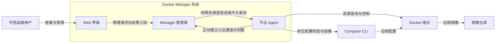
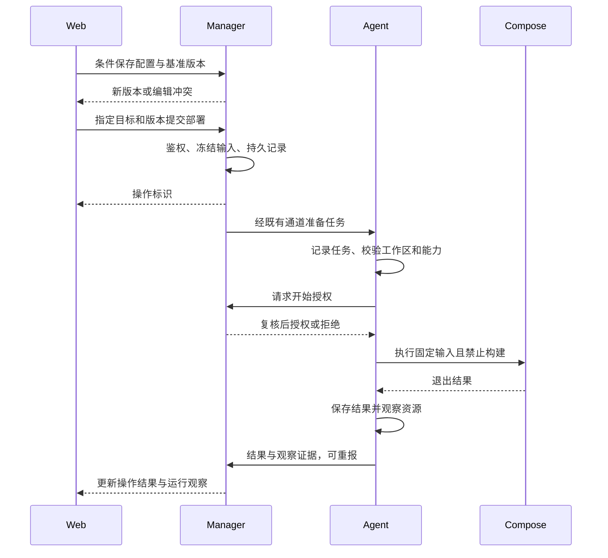

# Docker Manager 架构设计

更新日期：2026-11-04。状态：架构与 M1 技术方案草案，待审阅和技术验证。面向技术审阅者及实现者；按 arc42 组织，承接[需求](requirements.md)和[功能设计](functional-design.md)。Agent 主动接入已经确认，P01—P10 等方案尚未成为批准的实现决定。

## 1. 目标与主要质量诉求

在独立节点模型下提供 Web 管理、原生 Compose、跨节点配置复用和迁移。首要质量是目标及影响清楚、授权有效、配置语义一致、未知结果可核对。20 节点是参考规模；性能预算和高可用目标未确定。完整质量判据维护于需求 Q01—Q11，本文说明其承担方式。

产品审阅者据此判断操作行为与边界；开发者沿构件和接口实现各端；部署维护者依据部署关系和恢复约定运行系统。节点运维人员关注应用不被意外修改，管理人员关注身份、授权和管理数据可恢复。这些是阅读职责，不预设团队人数或组织结构。

## 2. 约束

系统由使用方自托管，节点 Agent 主动连接管理端；内外网可达路径由部署环境提供。优先满足 Unix-like 中可用 Docker CLI／Compose 的一致操作，不承诺尚未验证的平台组合。不执行镜像构建，不引入自动调度。UI 不预先冻结。数据搬运细节按用户要求暂缓。

## 3. 上下文与系统边界

图为系统逻辑上下文；箭头标示调用或消息方向，不表示 Manager 另向节点发起网络连接。Docker、Compose 和仓库是外部依赖；Web、Manager、Agent 是系统构件，逻辑分离不强制为三个独立安装包。用户的业务应用和运行数据属于受管理环境，不是管理端内部数据库。

| 边界 | 交换内容 | 需要明确的外部条件 |
| --- | --- | --- |
| 用户／Web—Manager | 身份、节点范围、配置、操作及诊断结果 | 浏览器访问、会话认证与传输信任 |
| Manager—Agent | 节点身份、能力、配置输入、任务与观察 | 主动接入路径、协议兼容、断线核对 |
| Agent—Docker／Compose | 资源和执行输入、状态与错误 | CLI／Engine 可用性、文件路径与权限 |
| Docker—镜像仓库 | 镜像和仓库认证 | 网络、凭据使用范围，不由 Manager 假定可达 |

## 4. 方案策略与取舍

P01 建议采用单个模块化 Manager，集中授权、配置和协调，Web 可由其交付。这样减少初期运行组成，代价是需要备份恢复且不能直接宣称高可用。多实例要额外解决会话归属、执行授权和分布式锁，当前不引入。

P02 建议 Manager 持有受管理配置及版本，Agent 按任务物化文件。选择依据是 Web 编辑、多人冲突和跨节点复用；代价是管理端掌握敏感配置，并需处理节点外部修改。节点文件或 Git 作为权威来源也是可行替代，不因文件落盘就失去 Cross 能力。完整取舍见[决策记录](decisions.md)。

资源操作使用 Docker 能力，Compose 执行交给原生 CLI；不在管理器内复制一套合并与插值引擎。P07—P09 将原候选细化为下列推荐组合，物理契约见[接口规格](api-design.md)，选择理由和替代方案集中见[决策记录](decisions.md#21-2026-11-04-的具体技术建议)。

| 部分 | 推荐实现 | 适用边界与代价 |
| --- | --- | --- |
| Manager | Go 单进程，提供 HTTP JSON API、Web 静态文件和 Agent WebSocket 接入 | 一份本地数据库，一个活动进程；不支持多实例同时写入和自动故障切换 |
| Web | Vue 3、TypeScript，构建后由 Manager 同源提供；M1 轮询操作快照 | 不要求浏览器连接节点；编辑器和组件库经原型再锁定，避免 UI 方案冒充用户要求 |
| Agent | Go 守护程序，主动 TLS WebSocket；本地调用固定 Docker／Compose 可执行文件 | M1 先验证 Linux 同机 Docker 端点；其余 Unix-like 与远程路径组合保留后续兼容任务 |
| 持久化 | Manager、Agent 各一份本地 SQLite；Manager 配置及冻结输入加密存库 | WAL 与备份须依实际内嵌 SQLite 版本验证；不放 NFS／网络共享目录 |
| 身份 | 人类本地账号及服务器端会话；节点独立随机凭据；TLS 验证管理端 | 首期不依赖外部身份服务，不声称提供秘密代理部署；节点凭据不能作为用户登录凭据 |

Go 和 Vue 的具体版本在 M0 结合发布支持期、依赖和构建结果锁定；当前不把“最新版”写进可执行安装说明。[Go 发布维护规则](https://go.dev/doc/devel/release)、[Vue TypeScript 支持](https://vuejs.org/guide/typescript/overview.html)用于核对工具能力，不作为本项目已经构建成功的证据。

## 5. 构件视图与逐层展开

| 一级构件 | 主责和对外关系 | 内部展开入口 |
| --- | --- | --- |
| Web | 用户上下文、配置编辑、提交、任务和诊断呈现；只向 Manager 访问管理能力 | [Web 设计](components/web.md)：上下文、查询、编辑、任务订阅、诊断和转换状态 |
| Manager | 用户和节点身份、权限、配置版本、任务协调、迁移编排、审计与转换 | [Manager 设计](components/manager.md)：内部调用、任务开始与恢复、数据提交边界 |
| Agent | 认证接入、节点能力、配置工作区、执行账本、Docker／Compose 适配和流会话 | [Agent 设计](components/agent.md)：文件、执行、去重、进程和恢复 |
| 管理持久化 | 保存账号、授权、节点、配置和操作证据，由 Manager 模块访问 | [数据设计](data-design.md)，当前逻辑存储责任，不是独立部署服务 |

任务协调、配置执行和前端异步状态同时涉及多个状态源、失败点和权限边界，因此本轮继续展开三个构件内部结构。简单列表操作依赖共用机制，不为每个资源类型新建模块文档。数据、接口为这些构件的共同展开，必须能从本表进入，不能成为脱离所属模块的另一套架构。

## 6. 运行视图

### 6.1 启动、接入和恢复

Manager 打开持久记录并核对未完成任务；恢复旧记录不自动重发变更。Agent 初始化身份、执行账本、工作区和 Docker／Compose 能力，连接并协商版本，再报告旧任务和当前观察。身份或协议不符不接收变更。管理端失联时，Agent 不开始新的未授权变更，已经开始的底层进程按执行策略处理并保留结果。

### 6.2 保存和部署

M1 建议由 Agent 生成开始请求 nonce 并开启本地单调时钟 10 秒窗口；Manager 的授权事务绑定操作、输入和当前连接，Agent 在窗口内持久记录 START_COMMITTED 后启动。授权事务提交是撤权竞争的分界：撤权先提交则不再发许可，许可先提交则仍可能发生开始。断线或许可过期不能单独证明没有执行，也不能释放未知任务占用。具体报文和顺序见[接口规格](api-design.md)；O03 原型仍需验证。用户关闭页面不取消已经受理的操作，命令结果与观察结论分开存储。

### 6.3 Copy／Apply 与迁移

Copy 由配置模块取得来源版本，授权模块检查两端权限，配置模块以新目标身份保存独立内容；无需来源执行器。Apply 进入部署流程。迁移由迁移协调器组织来源、目标操作与验证，继续使用相同配置、授权和任务机制；完整切换状态矩阵待 O05，不在此默认停源或双活。

### 6.4 查询与诊断

Agent 查询 Docker 并回报带采集时间的结果，Manager 过滤权限后交给 Web。日志、统计、控制台走独立授权会话，限定节点及资源；断线或撤权后关闭，恢复时重新检查。历史快照不能替代当前运行事实。

## 7. 部署视图

| 位置 | 逻辑构件与状态 | 运行关系 |
| --- | --- | --- |
| 用户浏览器 | Web、当前编辑草稿和视图状态 | 可访问 Manager；不持有节点长期凭据 |
| 自托管管理端 | Manager、Web 产物、管理存储及密钥材料 | 接受用户访问和 Agent 接入；配置数据需持久化 |
| 每个节点执行环境 | Agent、执行账本、受管理工作区，及可用 Docker／Compose | Agent 主动到 Manager；执行环境的路径须与实际 Docker 端点相容 |
| Docker 运行环境 | Engine、容器、镜像、网络、卷及应用数据 | 独立运行；管理端停止不等于应用停止 |

同机 Agent 和远程 Docker 端点不是自动等价：Compose 引用文件、绑定目录和外部配置的实际消费者可能不同，必须逐类验证。M1 建议交付 Manager 和 Agent 二进制，Web 随 Manager 分发；先以 Linux 服务方式验证，不先承担 Agent 容器与宿主机双重路径映射。Manager 可配置 HTTPS 监听地址，Agent 只需向该地址主动连接。[运行准备](operations.md)细化建议目录、密钥、备份与首次接入；实际安装命令、镜像和兼容版本仍以产物为准。

## 8. 共同概念

### 8.1 标识、输入版本与操作一致性

节点和 Stack 使用稳定标识，名称仅用于显示。配置版本不可变，部署输入包含文件、顺序、环境、项目参数及目标。任务持久化操作标识与输入摘要，同标识同输入返回已有任务，同标识不同输入拒绝。目标节点同名项目需要冲突检查，不能只靠 Manager 的 Stack 标识避免底层 Compose 名冲突。

Manager 资源串行化与 Agent 本地执行互斥共同防止冲突。未知操作保留阻塞关系，先核对而非自动解锁重跑。不同 Stack 也可能共享卷、网络或端口，不能声称单个 Stack 锁解决所有冲突；共享依赖在预检及执行前核对，底层失败仍需报告。

### 8.2 状态与事实来源

配置期望来自受管理版本，当前运行事实来自 Agent／Docker 的带时间观察。操作结果、可达性、部署版本和迁移验证分别维护；Manager 与 Agent 无法确认时进入 reconciliation_required，不能把超时写成失败后安全重试。精确定义见[数据设计](data-design.md)。

### 8.3 文件、环境和 Compose

配置包原文与原生参数一起保存，Agent 按相同路径关系物化，控制执行环境，避免意外继承管理进程变量。具体内建环境白名单和用户输入优先级按原生行为验证后确定。使用固定程序和参数数组启动 Compose，不把输入拼成 shell 命令。部署明确禁止构建，例如验证所用版本的 `up --no-build` 行为；这不保证配置一定可部署，缺镜像仍应失败。[官方命令说明](https://docs.docker.com/reference/cli/docker/compose/up/)

### 8.4 授权、敏感信息与审计

Manager 为用户授权边界，Agent 为节点身份和执行输入边界。Agent 只接受管理端给该节点的受认证操作，不接受 Web 直连或任意远程 shell。配置和冻结输入建议加密存库，主密钥独立保存；节点工作区必须供原生 CLI 读取明文，因此节点账号与备份权限也是保护边界。用户会话、节点凭据和密钥恢复分别见[接口](api-design.md)、[数据](data-design.md)和[运行](operations.md)。记录保留发起者、目标、阶段、结果和关联标识，避免无必要地复制秘密原文。

### 8.5 取消和恢复

待执行任务可被阻止开始；执行中取消是请求，不保证回滚。终止 Compose 进程后仍须核对 Docker 副作用。Agent 重启发现未完成任务时不得仅凭进程消失判定没有执行，必须回报未知并核对。操作日志、幂等和恢复统一由 Manager／Agent 设计承接。

## 9. 重要决策

已确认的 D01—D11、提案 P01—P10、待定 O01—O11 统一维护于[决策记录](decisions.md)。O02／O03／O04／O07 已有具体推荐及局部设计，仍需审阅、依赖锁定和原型证据；O05 决定迁移能否真实执行。技术提案的形成不等于相关验证已通过。

## 10. 质量场景的承担

| 质量 | 设计承担与检查 |
| --- | --- |
| Q01、Q02 | 稳定目标标识、配置版本、结果分层和 Web 上下文检查 |
| Q03、Q07 | 后端持续授权、节点身份、敏感内容分权和受限流会话 |
| Q04、Q08 | 操作持久化、Agent 账本、结果重报、核对流程和备份恢复 |
| Q05 | 条件保存、明确编辑冲突 |
| Q06、Q11 | 原生 CLI 校验与对照、受管理路径边界、转换诊断 |
| Q09 | 节点请求隔离、独立超时与有界采集／流；具体预算待 O08 |
| Q10 | 迁移执行、验证和清理分离，验证证据变更后重核 |

检查方法和故障用例见[测试计划](test-plan.md)，当前没有性能或恢复实测结果。

## 11. 风险与设计缺口

分布式调用无法仅靠重试保证 Docker 副作用唯一；任务开始边界、执行账本持久性和资源核对必须共同验证。配置原文包含外部依赖时，包完整性也不能保证目标可运行。FreeBSD 等环境的用户意向不可代替可用运行组合的证据。迁移涉及双活、停机和数据一致性，O05／O06 未定时仅支持配置复用设计，不声称已有完整迁移方案。

三个模块已展开 M1 的物理接口、存储事务、执行与前端状态建议，能够用于原型和技术审阅。依赖库／版本、完整 schema 生成与构建产物尚未形成，M2—M5 的专用接口和迁移状态机仍待相应阶段展开。出现新的复杂对象时复核[文档规划](documentation-plan.md)，不能只完成现有标题。

## 12. 术语与参考

业务术语主要维护于[需求第 3 节](requirements.md#3-术语和对象模型)，状态字段维护于[数据设计](data-design.md)。构件、运行、部署及共同概念分别采用 [arc42 第 5 章](https://docs.arc42.org/section-5/)、[第 6 章](https://docs.arc42.org/section-6/)、[第 7 章](https://docs.arc42.org/section-7/)、[第 8 章](https://docs.arc42.org/section-8/)的职责与展开方法，图示检查参考 [C4](https://c4model.com/diagrams/checklist)。
