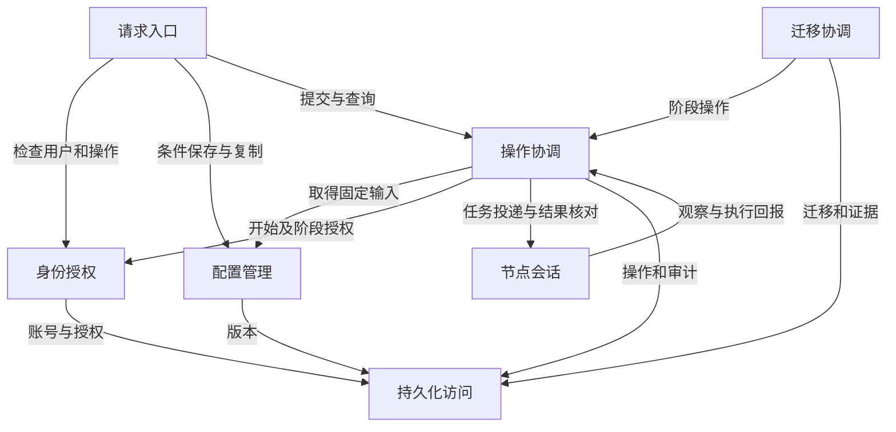

# Manager 模块设计

更新日期：2026-11-07。状态：M1内部设计及v1工作规格；现有Manager命令模式仍是M0冻结通信探针，另有独立的[本地持久协调库](../specifications/m0-manager-operations.md)和本轮实现的[v2扫描接收与业务恢复](../specifications/m0-manager-recovery.md)，尚无用户HTTP服务、配置仓储或完整Manager进程。本文是[整体构件视图](../architecture.md#5-构件视图与逐层展开)中Manager的内部展开，承接R01—R07、R11—R17及Q02—Q05、Q07—Q10。第7节和[执行与恢复规格](../specifications/execution-recovery.md)说明目标实现的投递、证据和释放顺序；实际子集以各M0模块规格为准。第8节说明内部数据处理与维护入口，不追记为已有完整实现。

## 1. 内部组成与依赖

图中的方框是 Manager 内部逻辑职责，不要求成为独立进程。节点会话承接 Agent 通道，不能决定业务是否成功；持久化访问提供一致的数据提交边界，不能绕过授权成为另一管理入口。

| 部分 | 负责的处理 | 依赖与边界 |
| --- | --- | --- |
| 请求入口 | 解析输入、绑定用户与目标、返回操作和错误 | 调用领域操作；不等待长任务结束才返回，不直接执行 Docker |
| 身份授权 | 用户会话、节点／操作权限、开始与阶段复核 | 管理授权版本；不因标签变更扩权 |
| 配置管理 | 文件包、条件保存、版本、Copy、输入完整性 | 依赖持久化及必要的 Agent 原生校验；不把校验等同部署 |
| 节点会话 | 注册身份、连接代次、能力、心跳、请求关联、结果接收 | 不向错误身份投递，不因通道重建授予新执行权 |
| 操作协调 | 受理、去重、目标串行化、开始许可、状态与恢复 | 使用固定配置输入；以操作结果和观察分层表达结论 |
| 迁移协调 | 准备、阶段编排、两端核对、验证和清理前提 | 复用操作协调，不自行下发脱离账本的 Docker 操作 |
| 转换处理 | 文本解析、映射与诊断 | 纯计算，不访问 shell、节点环境或远程 URL 取得猜测值 |
| 持久化与记录 | 原子提交实体、审计、事件和恢复索引 | M1 SQLite 事务与配置内容保护提案见[数据设计](../data-design.md)，尚待验证 |

配置管理和操作协调按边界调用：配置版本建立后不可变；执行器只能引用已确定输入，不能在运行时再取“最新配置”。转换结果仍是用户可编辑输入，不能跳过配置管理和部署授权。

## 2. 配置保存和 Copy 的提交边界

保存时读取 Stack 及权限，比较基准版本，再提交新版本和当前版本指针；比较失败返回 conflict，不改变现有版本。若内容在文件存储、元数据在数据库，先准备不可变内容，再原子发布可见版本；失败留下的未引用内容可后续回收，不能先发布缺文件的版本。

Copy 校验来源读取及目标配置维护权限，取得来源固定版本，检查目标名称冲突后建立新 Stack 身份和版本。目标创建、请求去重记录及返回结果需有一致提交边界，防止响应丢失后再建一份。Copy 不执行节点命令；Apply 由另一个操作提交。

外部配置修改不能静默覆盖 Manager 版本。Agent 发现工作区内容不符时回报差异；采用重新物化、导入差异或人工核对的规则待 O04／O10，不在后台随意选一边胜出。

## 3. 操作协调的内部处理

### 3.1 接收和准备

1. 将用户、操作类型、目标标识、固定版本和操作参数规范化为请求摘要。
2. 检查逻辑权限、对象存在性和本操作前提；相同提交标识若已有同摘要记录，返回该记录；不同摘要拒绝。
3. 在一致提交中建立 accepted 操作、操作输入、资源占用关系和审计记录，再通知发送器。
4. 发送器只消费已持久接受的任务；进程在提交后崩溃也能恢复投递。M1 使用同事务 outbox 引用，具体规则见第 7 节，不依赖不可恢复的内存队列作为唯一记录。
5. Agent 准备工作区并回报 ready。离线时不默认无限排队等待以后突然执行，当前提交返回节点不可用；已受理任务遇失联保留可核对状态。

### 3.2 开始许可与执行

Agent 请求开始前，操作协调复核当前节点会话、目标占用、输入摘要、取消状态和用户权限，再记录开始许可。M1 把许可事务提交作为授权生效点，并用当前 session_id、一次性 start_nonce 和 Agent 本地 10 秒窗口约束接收；已经提交的许可可能晚于撤权实际开始，不能宣称即时撤销。Agent 先持久 START_COMMITTED 再执行；精确定义见[接口第 6 节](../api-design.md#6-m1-物理接口提案)，仍需 O03 故障验证。

同一 Stack 的变更串行处理；涉及共享卷、项目名或多个对象时显式列出占用范围。等待顺序和锁生命周期属于任务机制，不等于用户获得永久锁。无法确认上一个变更结束时保留占用并进入核对；不能因 UI 超时直接释放后再执行删除或更新。

### 3.3 接收结果与恢复

Agent 回报含节点身份、操作标识、输入摘要、执行阶段、退出结果及资源观察。协调器检查关联并保存；重复同一结果不重复发布副作用，前后矛盾的结果进入核对。向 Web 推送失败不撤销已保存结果；Web 可重新读取。

Manager 重启后恢复未终结任务及占用，等待相应 Agent 账本与当前观察。尚未授权开始的任务可以明确取消；已授权但无结果的任务不能直接标为没有执行。Agent 报告无记录、丢失账本或工作区变化时，人工核对目标，不生成新标识盲目重试。逻辑状态与证据见[数据设计](../data-design.md)。

## 4. 迁移协调的内部处理

迁移持有来源、目标和配置版本的固定引用，分别记录准备检查、数据声明、切换步骤、验证及来源清理。每个产生副作用的步骤使用独立操作标识，并关联同一迁移；重试查询已有步骤，不能从第一步重跑整个迁移。

验证器结合 Agent 观察和获准用户的业务确认形成证据；协调器只在所需检查全部达到约定结果后标记 verified。清理请求重新核对权限、来源对象身份、配置版本、目标接替状态和证据有效性；不使用历史名称删除当前新对象。

尚缺 O05 的具体切换、回退和证据失效规则，所以本轮只确定协调器边界和不变量，没有可直接执行的完整迁移状态机。自动搬运实现继续等待 O06。此缺口阻塞迁移执行器，不阻塞 Copy 和 Apply。

## 5. 对外操作与数据责任

Manager 向 Web 提供配置保存／Copy、操作提交查询、迁移准备／验证／清理和诊断会话；向 Agent 提供注册、身份核对、准备任务、开始许可、结果确认及恢复核对。具体逻辑契约见[接口规格](../api-design.md)，共同实体见[数据设计](../data-design.md)。

管理端持有账号授权、节点身份、配置版本、操作和审计记录。Agent 账本属于节点执行事实，管理端不得用自己的“已发送”覆盖 Agent 的“未确认”或“执行中”。资源快照带采集时间，失联后只作为历史观察。

## 6. 失败归属、工程接入与验证

鉴权错误由身份授权拒绝；编辑冲突由配置模块返回；节点不可用由会话模块提供事实；执行失败由 Agent 回报并由协调器保存；无法确认执行结果由恢复流程接手。记录错误只带必要对象与标识，不把秘密配置复制进普通审计。

工程建立后，先为配置仓储、操作仓储、授权判断和节点通道定义端口，再连接真实数据库和协议；各职责仍可在同一进程内。任务发送器和结果接收器必须通过同一操作账本，不能一侧内存成功、一侧数据库未知。

关键验证：提交后响应丢失只形成一个操作；撤权阻止尚未批准的开始，已批准部分能明确核对；Manager 在提交、发送、许可、结果保存的边界崩溃后可核对；同名项目和重连旧消息不能作用于新对象。对应 T03、T05、T07—T10、T14、T15，见[测试计划](../test-plan.md)。本篇按 [arc42 构件](https://docs.arc42.org/section-5/)、[运行](https://docs.arc42.org/section-6/)及[共同概念](https://docs.arc42.org/section-8/)继续展开，生命周期表达参考 [OpenTelemetry End](https://opentelemetry.io/docs/specs/otel/trace/api/#end)，不移用其具体策略。

## 7. M1 内部实现提案

### 7.1 工程边界与调用顺序

建议 Go 应用入口为 `cmd/manager`，内部以 `internal/manager/{identity,nodes,configs,operations,transport,store}` 承接已有职责。HTTP 和 WebSocket 适配器调用应用服务；应用服务通过显式事务边界访问仓储，不能由 handler 各自直接更新任务表。`identity` 返回用户和能力判定，`nodes` 管会话和 ledger_id，`configs` 冻结输入，`operations` 拥有任务状态机；`transport` 不拥有执行决定。这些是拟定目录，不是现有工程清单。

浏览器同源会话和 Agent bearer 是两条认证链。`system.admin` 只开放管理入口；节点变更仍检查显式 Grant。第一次创建管理员不自动部署；由管理员明确设置节点权限后才可进入首条流程。人类会话的 CSRF、权限字符串和 Agent 认领字段以[接口规格](../api-design.md#6-m1-物理接口提案)为唯一维护位置，模块不另定义别名。

### 7.2 受理、保存与结果的事务

| 边界 | 一次写事务中完成的事情 | 事务之外的处理 |
| --- | --- | --- |
| 新建 Stack／保存版本 | 查询当前权限和幂等记录；检查项目名／If-Match；插入版本、更新指针、保存提交结果和审计 | 大小、路径及编码的无副作用检查可先做；涉及当前权限和版本的检查在事务内重做 |
| 接受 Apply | 查询授权和同键结果；验证固定版本与节点可用性；冻结输入，建立 accepted 操作、资源占用、outbox 和审计 | 内容加密的计算可提前准备，但事务失败不能留下可见版本或可投递任务 |
| 批准开始 | 重查用户、Grant/auth_rev、节点身份、当前连接、取消、占用和摘要；保存 authorized、permit_id 与许可关联 | 提交后才发送许可；网络写入不持有数据库事务 |
| 接受回报 | 按操作、source=agent 和 event_seq 去重，保存阶段／结果、增加 revision；可终结时写终态、release_status=pending 及 finalize 意图，暂不释放 Manager 占用 | 提交后 ack；匹配 finalized 另开事务释放占用并写 released；Manager 自己的事件另用 source=manager |
| 撤权／取消 | 更新 Grant 或账号状态及 auth_rev，或设置 cancel_requested；阻止以后发放许可，保存审计 | 通知连接和 Agent；通知失败不撤销数据库中的限制 |

normal_exit 的结果只有 observation.status=complete 且 ownership_status=consistent 才形成 succeeded／failed 并建立 finalize 意图；完整观察但归属漂移或未知时保持 reconciliation_required。not_started 使用其持久未启动证据；interrupted／unknown 不自动终结。Manager 在写终态前就执行这些条件，不把 Agent 后续拒绝 finalize 当作结果校验的替代。

单 Manager 的 SQLite 写事务串行化许可和撤权；不得在事务外缓存一次授权后无条件写 authorized。资源占用使用持久唯一约束，M1 至少占用稳定 Stack 身份和节点内 Compose 项目名，节点外部 Docker 进程的动作仍只能通过预检及事后观察发现。数据库繁忙、崩溃或网络超时不得自动释放占用。

请求 HMAC 与执行 input_digest 各有固定输入域；前者排除服务端后来生成的 ID，后者包含完整固定目标及执行数据。冻结 payload 的密文和 digest_key_id 随操作保存，outbox 仅存引用；重发解密同一份字节，不读最新配置再生成一份看似相同的请求。配置、密钥和数据表的物理细节见[数据设计](../data-design.md)。

### 7.3 节点会话与投递器

会话注册以 node_id、凭据状态和 ledger_id 为入口，welcome 分配新 session_id；旧连接不再接受新消息。正常重连保留 Agent 账本，完成所需旧操作核对后才投递新变更；相同凭据却不同 ledger_id 进入隔离，不靠名称重新关联。轮换只改变认证秘密，不能替换执行历史。

outbox worker 每次发送前重新读取节点当前会话和操作状态。持久状态为 pending／waiting／confirmed／suppressed；写通道成功仍为 waiting，收到匹配业务证据才 confirmed。prepare 按同一 operation_id 和冻结输入重发，cancel 与 finalize 各有独立固定意图；具体重试、代次与失效条件见[投递生命周期](../specifications/execution-recovery.md#4-manager-outbox-生命周期)。许可只服务当前 start_nonce，不作为可在未来任意重放的 outbox 消息。Manager 若在许可提交后、发送前崩溃，重启后记录仍为 authorized，进入核对，不能重新生成另一个许可绕过未知。

发送成功仅表示写入当前通道；Agent ready／started／result 才是阶段证据。每节点独立发送队列且有界，建议最多 32 条待发送小消息、一次一个配置包；队列满暂停该节点投递并保留数据库引用，不无限驻留秘密正文，也不阻塞其他节点查询。一个 Agent 的慢连接不能让所有 HTTP 请求等待它完成。

### 7.4 恢复、取消与运维边界

Manager 正常重启先恢复未终结操作、占用和 outbox；有未完成任务的节点先核对，其他核对完成节点可以继续工作。来自备份的首次恢复使用单独隔离模式，管理员也不能绕过隔离自动授权或触发部署；先确认身份、账本和实际资源，再显式开放。程序不能仅凭“数据库能打开”判断是不是安全的当前状态，恢复入口必须设置并持久保存这一模式。

accepted／preparing／ready 且没有已提交许可的任务可持久决定取消；Agent 可能已准备时仍须取得未开始结果并完成释放握手。只有 scope=all 的完整可信对账证明 Agent 无记录且 Manager 从未授权，才可在管理端直接释放；pending 集合缺席不满足条件。已有许可只设置 cancel_requested，等 Agent 持久证明未开始或回报执行事实。START_COMMITTED 后无法确认的任务保持 reconciliation_required；对外“重试”不能产生新的冲突操作。结束进程不代表资源回滚，结果展示需保留受影响对象。

结果事件矛盾、旧账本缺失、输入 fingerprint 不一致和节点对象替换都升级为核对，不让最后一条消息覆盖证据。[恢复判定矩阵](../specifications/execution-recovery.md#5-恢复判定与占用释放)区分自动可终结、只补观察和必须隔离的情况。M1 原型没有通用“强制解锁并重跑”按钮；真正未知的人工恢复入口须在可交付安装包前完成设计与验证，当前保持隔离并保留证据。何种资源观察足以证明成功依操作类型定义，无法证明时保留未知，不制造通用成功结果。

### 7.5 验证重点

事务测试覆盖同键并发、新旧 If-Match、相同项目名以及许可／撤权两种提交顺序；协议故障实验覆盖发送前后崩溃、旧会话迟到、许可过期、started 丢失和 result 重报。对每个实验同时记录 Manager 操作表、Agent 账本及 Docker 资源事实，才能说明没有自动重复执行。现有通信测试覆盖其中的会话替换等传输子集；本节的 Manager 业务事务与 Docker 联合实验尚未建立，不能用传输测试替代。

## 8. 内外数据处理与维护

### 8.1 入口如何变为内部事实

Manager 的三个入口分别是浏览器业务请求、Agent 当前会话消息、启动时的持久记录恢复。HTTP 适配器负责取得用户身份与条件头，节点适配器负责绑定认证节点与会话，恢复入口读取原记录；它们都把处理交给第 1 节的领域职责。适配器通过结构检查不代表有权改业务状态。下表是既有对象在 Manager 内部的处理关系，不新增线上类型或另一套字段定义。

| 外部输入／来源 | 内部持有者及处理 | 持久事实与输出边界 |
| --- | --- | --- |
| Cookie、CSRF、目标路径、`Idempotency-Key`、`If-Match` 和正文 | 身份授权解析用户；请求入口固定实际路径与目标；配置或操作服务按规范请求计算请求摘要 | 幂等记录的键是用户与 key，不是浏览器会话；当前权限先保护读取，重复同输入返回保存的安全回执。HTTP 字段与顺序见[条件更新](../specifications/http-api.md#3-条件更新幂等与分页) |
| Save 的 `Config`、目标 Stack、基准版本 | 配置管理校验包与编码，保留原文件字节和有序列表；事务内重查权限、当前版本并发布不可变版本 | `config_versions` 存密文，`stacks.current_version_id` 与回执一起提交；返回版本 ID／ETag，不创建投递意图。保存不能证明目标 CLI 接受输入 |
| Apply 的 `{version_id}` 与路径中的 Stack | 操作协调取得该 Stack 的节点、项目名和所属版本，从节点登记取得执行配置，构造 Schema 的 `FrozenPayload`；执行摘要针对冻结后的原始字节 | `operations` 保存密文与 `input_digest`，`outbox` 只引用它。Web 不能借请求指定 socket 或把版本换到别的 Stack；后续保存不改变这份输入 |
| `hello` 与当前认证连接 | 节点会话核对 node／ledger、替换会话并记录能力；向操作协调提供会话是否可变更的事实 | `session_id` 是连接代次，`ledger_id` 是持续执行历史。Node 的用户 `capabilities` 来自 Grant，`agent_capabilities` 来自 Agent，不能互相代用 |
| `started`／`result` 的信封与 body | 节点会话核对当前连接及关联，操作协调核对操作、摘要、事件位置与状态前提，再保存证据并判定结局 | `operation_events` 保留来源和序号，`operations.revision` 是 Manager 快照修订；二者不直接比较。只有提交成功才 ack，重复不再次产生状态副作用 |
| 操作、最新结果和已保存观察 | 查询服务按当前权限投影 HTTP `Operation`／`OperationResult`／`Stack` | 摘要使用[HTTP 返回对象白名单](../specifications/http-api.md#4-准确返回对象)，不直传 Agent body 或数据库行；原始输出走独立授权入口，内部摘要和事件序号不透出 |

上述记录的列、密钥域及约束以[数据设计第 7—9 节](../data-design.md#7-m1-存储布局与物理类型提案)为主定义。请求摘要回答“是否同一次提交”，执行摘要回答“是否同一份冻结输入”；Agent 本地指纹由 Agent 自己计算，Manager 既不生成也不代替它验证本地文件。把这几种摘要合并会破坏重试或两端输入核对。

### 8.2 从保存到结果的贯通示例

以现有 Stack 的版本 V1 为例，用户保存 V2 后再部署：配置服务用 V1 的 ETag 条件写入 V2；成功响应丢失时，原 key 的安全回执仍指向 V2。另一用户后来保存 V3，不改变这个历史回执；下一次保存仍须检查当时真正的当前版本。Apply 明确选择 V2 时，操作协调读取 V2 原文并冻结目标及执行配置，返回操作 O。此后 V3 可以成为最新保存版本，O 的输入仍是 V2。

O 的 prepare 经节点会话发送，ready 只进入准备完成；request_start 经授权事务批准后才发许可。收到 started 后显示可能已开始；收到 result 后按执行事实、完整观察和归属形成结论。只有满足成功判据时才更新 `last_applied_version_id` 为 V2；`last_operation_id` 表示最新受理尝试，失败和未知不覆盖最近成功版本。随后 finalize／finalized 完成占用释放。读取 O 不会触发任何一次重新部署。

失败由首次不能满足前提的职责处理：配置条件写失败整体回滚；受理事务未提交不投递；已受理后连接中断保留 O 和占用；结果存储失败不 ack，等待同事件重报；只有normal_exit、观察不完整且无已确认归属漂移时可按[补观察规则](../specifications/execution-recovery.md#52-已知正常退出后的补观察)只补观察；证据冲突保留旧事实并转核对。详细判据只维护在[恢复矩阵](../specifications/execution-recovery.md#5-恢复判定与占用释放)，本例不建立另一套状态机。Copy、迁移和转换虽然共用部分配置或操作职责，其专用接口仍按后续增量实现，不能从此例推导已经可调用。

### 8.3 生命周期与排障接入

目标服务的启动依赖顺序是确认数据库、密钥与恢复模式 → 恢复操作／占用／投递意图 → 接受节点认证并完成所需核对 → 对已满足前提的节点开放新变更。连接引用、发送队列和请求关联是可丢弃的内存状态；操作、许可、输入、证据和释放决定必须跨重启保留。普通重启与备份恢复的区别见第 7.4 节，不能仅清空内存队列就恢复授权。

停机或会话关闭不创造“操作失败”事实，也不清除占用；尚未取得业务确认的发送意图由恢复流程重新判断。生产服务的具体排空、进程退出时限和运行入口仍需在实施时落实。当前探针的有界退出只关闭通信连接，不是上述业务服务的停机验证。

| 维护现象／修改目的 | 先查的事实及职责 | 需要保持的规则与验证入口 |
| --- | --- | --- |
| 保存超时、重复创建或版本回退 | 幂等记录的原响应／ETag、Stack 当前指针；配置服务事务 | 原 key 返回原结果，当前读取权限仍生效；检查 T03／T05 及 HTTP 连续保存规则 |
| 节点显示在线却不能部署 | 节点撤销／核对状态、Agent 能力、当前 session、用户 Grant | 传输连通不是执行能力；当前 `prototype_frozen` 是预期限制，查[通道实现及支持矩阵](../specifications/m0-channel-probe.md#3-当前网络交互) |
| 已受理但无进展 | 操作状态、outbox 意图、许可是否提交、Agent 对应账本 | 写通道成功不等于收到；不得改 ID 或重新发许可绕过未知，查第 7.3 节与 T07／T08 |
| 命令有结果但目标仍占用 | 原 result、ownership_status、release_status、finalize/finalized 关联 | ack 只保存证据；查[双端释放](../specifications/execution-recovery.md#53-双端释放握手)，不能手工删占用当作修复 |
| 修改返回结构或权限 | HTTP 投影与当前授权，Agent 证据原文保持独立 | 不把新增协议字段自动暴露给 Web；同时检查权限裁剪、敏感输出和 T14 |

现有原型包括[命令入口](../../cmd/channelprobe/main.go)、[通道](../../internal/channel/channel.go)和[协议校验](../../internal/protocol/validator.go)，具体函数与诊断由[M0维护说明](../specifications/m0-channel-probe.md#8-接手维护时的数据与协作关系)承接。2026-11-07进一步新增[Manager本地持久协调模块](../specifications/m0-manager-operations.md)：独立v1库保存固定输入、双占用、持久Grant／许可、started／首result及finalize意图，源码从[operations](../../internal/manager/operations/types.go)进入，证据见[实施与验收](../implementation/m0-manager-operations.md)。本轮v2扫描接收与业务恢复沿用该库的事务和加密机制，内部流程见下节。第7.1节其余业务目录仍为建议；认证、配置仓储、HTTP、网络投递及双端释放仍待接入，不能把Fixture身份和本地库称为完整Manager进程。

### 8.4 本轮本地扫描接收与业务恢复

本轮实现及R01—R12证据由[独立恢复规格](../specifications/m0-manager-recovery.md)和[实施与验收](../implementation/m0-manager-recovery.md)维护。恢复使用显式新Manager v2库，保留v1入口且不做旧库升级；输入是可信绑定、Agent boot及完整协议报文，尚未接入HTTP或网络任务处理器。

调用方先绑定当前节点／ledger／session和Agent boot，再启动扫描。存储层在冻结事务保存本地轮次、请求及当时已有操作／事件水位；这些expected记录用于证明无记录释放的操作在该轮开始时已经存在且没有事件。收件箱核查请求关联、分页与数量，将原body加密保存；业务层在页面完整后重读证据，对照既有操作、许可、事件和占用，幂等导入首结果或建立隔离case。

Agent同boot可能向新Manager轮次重放此前固定快照，因此不能仅凭页面水位低于expected判定历史回退。旧页与较新Manager事件合并时保留原终态和claims，非空任务仍等待后续核对，不回退状态也不制造case；真正同位异文和开始／未开始互斥事实仍隔离。members.phase只索引已保存页中的阶段，必须回到解密原页核验；接收not_started的最终事件事务也检查已有START_COMMITTED页，防止Process返回waiting后迟到结果覆盖已知开始事实，不补造started消息或时间。

业务就绪后才保存complete请求；当前completed提交前再次检查绑定、页面、隔离和释放依据，只解除该节点的冻结。换session／任一boot或收到scan_expired、scan_changed、cursor_invalid等明确失效会废弃旧轮完成资格；旧回执不能开放新轮。发现矛盾时，quarantined保护事实先持久化，再保存加密case；即使密钥额度或case写入失败也不开放受理，当前没有清除隔离或强制解锁入口。

本轮只实现all完整证明缺席、从未授权且无事件的取消释放例外，absence_releases保留引用的扫描依据。已存在Agent记录的任务仍等待not_started／真实结果；可终结结果保留pending、finalize意图和claims，unknown／interrupted结果沿原规则保持核对。本库未知操作、矛盾记录、finalized历史及超出首结果序列的历史均保留case，不补造操作、结果或释放事实。下一依赖是双端finalize／finalized及受控任务通道；检查数据库和本地组合不替代真实Compose、备份回退或掉电耐久验证。
