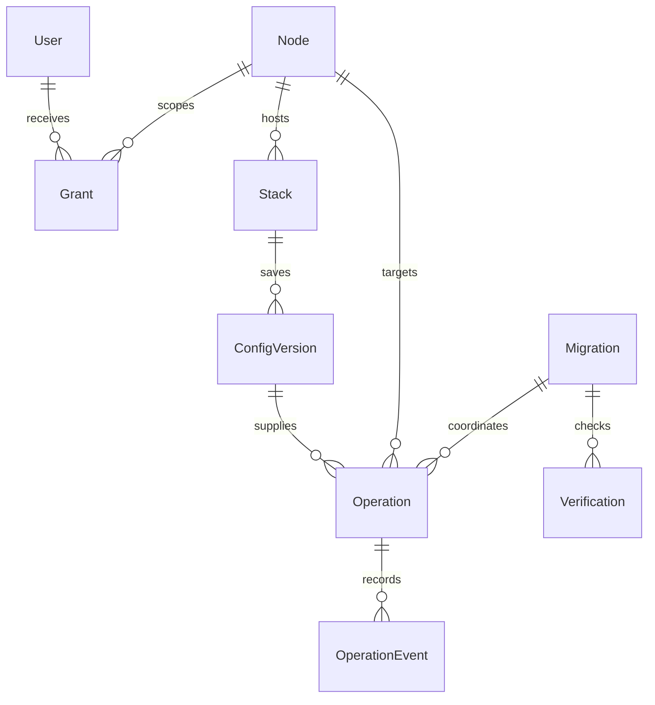

# Docker Manager 数据设计

更新日期：2026-11-07。状态：逻辑模型及M1物理存储提案；Agent开始账本及事件／首结果的必要子集已有真实SQLite原型证据，具体范围见[账本实施记录](implementation/m0-agent-ledger.md)与[事件日志记录](implementation/m0-agent-journal.md)。本文面向持久化及接口实现者，承接[arc42共同概念](https://docs.arc42.org/section-8/)与[构件的数据职责](architecture.md#5-构件视图与逐层展开)，细化R04、R05、R07、R11—R17及Q02、Q04、Q05、Q07、Q08、Q10。第7—11节落实P09，除明确列出的原型子集外仍是待实现、待验证的设计。

## 1. 数据责任和关系

2026-11-12实际存储状态补充：Agent v4／Manager v3的释放回执、当前轮确认MAC及原子占用删除已完成本地验收，重要私有字段及生命周期以[双端释放规格§7](specifications/m0-dual-release.md#7-实施中的接手补充)为主定义。M1正式账号／节点／配置仍按[服务v4规格](specifications/m1-manager-service.md)实施中；本文的完整物理模型不能被误读为所有表都已交付。

Manager 管理期望配置、账号授权、节点身份和协调记录；Agent 管理本地执行事实；Docker 提供当前资源事实。三者不是互相覆盖的一份状态。快照有采集时间，命令有退出结果，迁移有验证证据。

图展示主要逻辑关系，未列所有查询和审计引用。删除对象后历史证据仍需能够解释目标身份；M1 建议保留身份行并标记停用，不自动回收版本、操作或账本，长期保留策略仍属 O11。Migration 同时引用来源和目标节点／Stack，不能以单一 hosts 关系表达整个切换。

## 2. 逻辑数据字典

标识为不依赖显示名称的稳定值；时间为带时区或统一时间基准的时刻；版本为可比较的变更令牌。以下是完整产品的逻辑字段；第 7 节给出 M1 子集的编码和存储约定，尚未实现的迁移等对象不因此进入 M1 建表范围。

| 对象 | 主要字段与逻辑类型 | 约束和责任 |
| --- | --- | --- |
| User | id、登录标识、启用状态、身份提供者引用、授权版本 | 登录秘密不作为普通返回字段；M1 建议本地账号，具体保护见第 9 节，O07 跟踪审阅与验证 |
| Grant | 用户／主体引用、node_id、操作能力集合、版本 | 节点归类不隐式产生 Grant；管理器级权限另有明确作用域 |
| Node | id、显示名、身份材料引用、撤销状态、能力、最近会话、最近观察时间 | 同名不等于同身份；接入身份不得因重装自动复用 |
| NodeGroup／Tag | id、名称或键值、节点关联、变更版本 | P05 为分类提案；分类变更不改变授权和运行归属 |
| Stack | id、node_id、显示名、Compose 项目名称、配置掌握状态、当前保存版本引用 | node_id＋项目名称在受管理目标内避免冲突；外部同名仍须预检 |
| ConfigVersion | id、stack_id、基准版本、文件清单、有序 Compose 文件列表、环境输入、项目参数、摘要、创建者／时刻 | 发布后不可变；复制生成目标自己的版本身份 |
| ConfigFile | 相对路径、内容或内容引用、内容摘要、用途标记 | 无越界路径；敏感标记不等于自动成功识别所有秘密 |
| SecretReference | id、使用范围、保护材料引用、轮换状态 | 不默认随 Copy 导出明文；具体加密、密钥和代理使用待决 |
| Operation | id、提交标识、发起者、类型、目标集合、配置版本／固定输入、摘要、阶段、取消请求、时间、错误引用 | 同提交标识对应同一摘要；多个目标要明确身份而非名称 |
| AgentExecution | operation_id、node_id、输入摘要、准备／许可／开始事实、进程监督引用、退出结果、回报确认 | Agent 本地执行事实，不是 Manager 的投递副本 |
| DeploymentObservation | node_id、stack_id、实际项目／资源标识、配置输入引用、命令结果引用、采集时间、资源状态 | 命令成功和运行状态不同；并非可从 Docker 反推完整配置 |
| ResourceSnapshot | 节点与资源标识、类型、可取得属性、关联、采集时间、采集错误 | 缺失或失联不表示空；跨节点标识须带 node_id |
| OperationEvent | 操作引用、单操作事件位置、阶段、内容、产生／接收时间 | 去重和保序；重连可用快照补齐，存储窗口待 O11 |
| Migration | id、来源与目标引用、固定配置、策略引用、阶段、步骤操作引用、数据准备记录、验证引用、来源选择 | 策略未定不能执行；不只修改 Stack.node_id 代表迁移 |
| Verification | id、迁移引用、检查范围、观察证据、业务确认、结论、人员／时刻、关联版本 | 与实际部署和来源状态绑定；相关变更后清理前重核 |
| CleanupRequest | id、迁移／验证引用、来源实际对象集合、删除范围、确认人、执行操作引用 | 明确是否影响数据；验证有效和权限充分才开始 |
| AuditEvent | 发起者、动作、目标、阶段、结果、关联标识、时刻 | 不存不必要的完整环境或凭据；历史可追溯 |

## 3. 配置版本与部署输入

版本保存原始文件和输入意图，不能只存渲染后的单一 YAML，否则会丢失注释、文件关系、变量来源及再次编辑的材料。渲染结果可作为校验产物，标明生成环境与版本，不取代原始版本。

部署固定输入至少包含目标节点、Stack／实际项目、配置版本、文件顺序、项目目录语义和明确的环境输入。秘密可以通过受控引用解析，但需在任务开始前固定其使用版本或等效身份，防止重试实际使用不同凭据却仍称相同输入。M1 采用整包加密与带密钥摘要，具体规则见第 9 节；独立秘密引用和仓库凭据代理不在此假定已经存在。

ConfigVersion 的不可变性不意味着用户永久可以读取秘密，也不替代保留策略。条件保存以当前版本令牌防止丢失更新；Copy 保留内容与依赖关系而创建新身份，不自动建立同步订阅。部署指向明确版本，后续保存只更新当前保存指针。

## 4. 操作状态与结果

| 逻辑状态 | 含义 | 允许的下一步 |
| --- | --- | --- |
| accepted | Manager 已持久受理，尚不能推定节点已收到 | 准备、取消或发现前提不成立 |
| preparing | Agent 已接收，正在检查工作区与能力 | ready、失败；断线可进入核对 |
| ready | 准备完成，尚未获准开始副作用 | 复核许可或取消 |
| authorized | 开始许可已记入协调记录 | Agent 记录并开始；许可无结果时需核对 |
| running | Agent 有开始记录，底层操作可能已有副作用 | 明确结果或核对；取消只作为请求 |
| succeeded | 已获得本操作约定的成功证据 | 保留结果和观察，不等于应用业务健康 |
| failed | 有确定失败证据，可能已有部分副作用 | 查看受影响对象，新的修复作为新明确操作 |
| canceled | 确认没有开始，或取消后已核实达到定义结果 | 保留证据，不隐含回滚所有资源 |
| reconciliation_required | 无法可信确定是否／如何执行 | 查询账本和资源后归结结果；禁止盲目重放冲突变更 |

取消请求作为独立字段保存，不覆盖 running。状态改变保存原因与证据；不会仅因 timeout 把 running 改成可安全重试的 failed。未知恢复后允许依据证据确认结果，但保留原始未知经过。

通用任务 succeeded 的成功范围由操作类型决定：保存是版本已发布，Copy 是目标配置已保存，Apply 是执行及约定观察结果已知。业务健康和迁移验证有各自字段。迁移准备／执行／待验证／已验证及可选清理结果分别记录；O05 未定前不冻结完整迁移枚举和切换状态图。

### 4.1 M1 Apply 的结果与占用释放

“观察完整”指目标项目及其容器的只读分页查询全部返回、有采集时间且没有缺页／采集错误，不要求所有容器业务健康。`observation.status` 分为 complete、incomplete、error，健康结果另列；分页完整不能单独证明被中断的旧 Docker 请求已经结束。

| 可取得的执行事实 | 操作状态与用户结果 | 资源占用 |
| --- | --- | --- |
| 准备失败，或有效证明未创建进程 | 按原因 failed；明确取消且未开始为 canceled | 保存证据后进入 finalize 释放握手；可信无记录且从未授权的例外见执行篇 |
| 正常监督到命令退出 0，未被信号／超时中断，观察完整且归属 consistent | succeeded；仍逐项展示 unhealthy、未声明健康检查等状态，不称业务健康 | 保存结果后 release_status=pending，持久收到 finalized 后才 released |
| 正常监督到非零退出，未被信号／超时中断，观察完整且归属 consistent | failed，保留部分副作用及命令错误 | 同样完成双端释放握手；新修复须另有明确意图 |
| 正常退出码已知，但观察不完整或失败 | reconciliation_required；命令退出事实仍可查看 | 保持；只重做观察，完整后按已保存退出码收敛，不能重执行 Apply |
| START_COMMITTED 后崩溃、执行结果丢失、被取消／超时中断，或证据矛盾 | reconciliation_required | 保持；核对进程终止、可能在途的 Docker 动作和资源，不能凭一次当前快照推断无副作用 |
| 已请求取消，但命令在受监督流程中正常完成 | 按正常退出码和观察规则归结，保留 cancel_requested | 与相应正常结果相同，不强行标 canceled |

线上使用 `ExecutionResult.outcome` 区分 not_started／normal_exit／interrupted／unknown，`ownership_status` 区分 not_checked／consistent／drifted／unknown。完整观察但归属 drifted／unknown 时保持核对，不因 exit_code=0 成功。完整字段与组合约束见 [协议 Schema](../contracts/agent-v1.schema.json)，HTTP 只返回[允许的摘要字段](specifications/http-api.md#4-准确返回对象)。ack 确认结果已存储，不能代替 finalized 释放确认。

未知结果的人工处理须保存执行终止与目标核对依据，无法建立依据时继续隔离。M1 不提供仅填写备注就自动解锁的通用按钮；真实维护工具必须满足这些证据约束后才能交付。

## 5. 一致性与并发不变量

1. 不发布缺失文件内容的配置版本；当前版本指针和条件更新具有原子可见性。
2. 同提交标识同摘要返回同一结果；不同摘要不能复用旧标识。去重范围和保留窗口在物理契约中确定。
3. 已受理操作和可恢复发送意图有一致提交边界；Agent 开始记录先于底层副作用，但不能据此宣称跨系统恰好一次执行。
4. 未确认结束的冲突操作保留占用；恢复必须检查身份、输入和资源，不能用新操作绕过未知。
5. 迁移验证未通过或已失去有效性时，来源清理不得开始；清理结果不改写已有迁移证据。
6. 管理配置、节点执行账本和应用数据分别备份／核对，不能互相冒充完整恢复。

## 6. 保存、保护与恢复

M1 的 SQLite、整包密文、事务和密钥方案在以下章节具体展开，O02／O11 仍需审阅及验证后关闭。需要恢复的内容包括账号授权、节点身份、配置及文件、秘密保护所需材料、操作／迁移记录和协议版本信息。备份要保证元数据和内容引用一致，不能复制数据库就忽略密钥或另行存储的节点工作区。

恢复后的 Manager 先隔离自动变更，核对节点身份与实际账本，旧备份不能使同一旧任务再执行。恢复流程及演练见[运行准备](operations.md)和 T16。设计将数据责任放在 arc42 构件与共同概念之下，字段服务于[模块协作](components/manager.md)及[接口](api-design.md)，不是独立于架构的存储模板。

## 7. M1 存储布局与物理类型提案

Manager 和每个 Agent 各使用一个本地 SQLite 数据库，分别保存管理状态与节点执行事实，不共享数据库文件。配置包完整正文存入 Manager 数据库的密文 BLOB；ConfigFile 是包内逻辑对象，M1 不另建内容文件仓库，避免发布版本时同时提交数据库和文件。Agent 的工作区是执行用派生文件，其一致性由第 10 节处理。

建议各数据库启用 `journal_mode=WAL`、`synchronous=FULL`、`foreign_keys=ON`，每条新连接验证实际值；单写连接处理短事务，查询连接及时关闭游标。网络文件系统不作为数据库目录。WAL 允许读写并行，但仍只有一个写者；持有写事务期间不等网络、Compose 或用户输入。持久性还依赖实际文件系统和存储设备，必须开展掉电或等效故障验证。[WAL](https://sqlite.org/wal.html)、[同步选项](https://sqlite.org/pragma.html#pragma_synchronous)、[事务规则](https://sqlite.org/lang_transaction.html)

数据库接入建议使用 Go `database/sql`，SQLite 驱动优先验证 `modernc.org/sqlite`，理由是纯 Go 交付和可用的备份接口；代价是需跟踪驱动内嵌 SQLite 与生成代码的版本。工程锁定驱动后记录 `sqlite_version()` 及编译选项，不能把模块号当作 SQLite 版本。[驱动文档](https://pkg.go.dev/modernc.org/sqlite)

SQLite 官方记录的 WAL-reset 问题已在 3.51.3 及指定旧分支回补版本修复；候选驱动必须证明其内嵌版本包含修复，并通过写入与 checkpoint 并发验证。这里给出兼容门槛，未声称项目已经安装或验证该版本。[官方问题说明](https://sqlite.org/wal.html#walreset)

| 类型 | M1 物理约定 | 对外或校验规则 |
| --- | --- | --- |
| 实体标识 | 小写带连字符 UUIDv4，`TEXT PRIMARY KEY` | 不从名字推导；名称修改不改变标识 |
| 时间 | UTC Unix 毫秒，`INTEGER` | API 使用 RFC 3339 UTC；耗时与开始许可期限使用进程单调时钟，不能混用 |
| 布尔／修订号 | `INTEGER`，分别约束为 0/1 或非负整数 | `revision` 用于条件更新；配置版本 ID 本身不作时间排序 |
| 摘要 | 32 字节 `BLOB`，附 `digest_key_id` | 普通 API 返回对象 ID／版本令牌，不公开秘密内容摘要 |
| 敏感正文 | 有版本的 AEAD 密文封装 `BLOB` | 加密前校验尺寸；解密失败不返回部分内容 |
| 状态 | `TEXT` 与枚举约束 | 仅允许本文及接口规定的迁移，未知枚举拒绝写入 |

建议配置包最多 128 个文件、单文件原始 UTF-8 内容最多 1 MiB、包内全部文件内容合计最多 4 MiB；路径、文件顺序与环境输入同属受控请求。它们是首个实现的工程候选上限，不是已确认产品容量；接口层另限制编码后请求体大小并在解密、解码前检查。超限整体拒绝，不能截断后保存。

### 7.1 Manager 表与约束

以下给出主列和跨表不变量，实际 schema 迁移须按此展开所有 `NOT NULL`、外键与检查约束。逻辑对象仍按第 2 节解释，M2 以后的分组、迁移等表在相应切片加入。

| 表 | 主列与约束 | 必要索引或补充规则 |
| --- | --- | --- |
| users | `id, login_name, password_hash, enabled, auth_rev, system_admin`；登录名唯一 | 密码编码包含算法、盐与成本参数；停用保留历史身份；system.admin 不隐式授予节点部署权 |
| user_sessions | `token_hash` 主键，`user_id, auth_rev, created_at, last_seen_at, expires_at, revoked_at, csrf_cipher,key_id,wrapped_dek` | `user_id` 外键；expires_at 为绝对期限，last_seen_at 用于空闲期限；不存原始 Cookie；会话绑定的 CSRF 随机值加密保存，GET me 可再次返回同值 |
| grants | `user_id, node_id, capability` 联合主键 | 节点能力逐项授予；管理器级角色单独列入 users，不用空节点隐式代表全局 |
| nodes | `id, display_name, status, credential_generation, session_id, ledger_id, last_seen_at` | 会话为观测状态；撤销状态独立保存，不从心跳反推 |
| node_credentials | `node_id, generation, token_hash, enabled, created_at` | 联合主键；随机 token 的 SHA-256 唯一，明文只由 Agent 保管 |
| enrollments | `id, token_hash, node_id, ledger_id, expires_at, consumed_at, candidate_hash` | 认领材料一次性；响应丢失时仅同一节点、账本与候选凭据可查询已有认领结果 |
| stacks | `id, node_id, project_name, current_version_id, revision, disabled_at` | `(node_id, project_name)` 唯一；M1 停用不释放同名身份；`current_version_id` 必须属于同一 Stack |
| config_versions | `id, stack_id, parent_id, created_by, created_at, package_cipher, key_id, wrapped_dek` | `(stack_id,id)` 唯一供组合外键；原文发布后不变；密钥封装允许轮换重包 |
| idempotency_records | `(user_id,idempotency_key)` 主键；`method,path,request_digest,digest_key_id,result_type,result_id,response_status,safe_response_json,response_etag` | 同一用户跨变更接口共用键空间；同事务冻结不含秘密的原响应与 ETag，不读当前对象重造原回执；认领 token 永不进入 safe_response_json |
| operations | `id,user_id,idempotency_key,node_id,stack_id,version_id,input_digest,digest_key_id,payload_cipher,key_id,wrapped_dek,state,cancel_requested,revision,permit_id,session_id,start_nonce,auth_rev,release_status,final_result_event_seq` | `(user_id,idempotency_key)` 唯一并引用幂等记录；release_status 为 held／pending／released；最终结果版本和释放意图一起提交 |
| resource_claims | `(node_id,resource_kind,resource_id)` 主键，`operation_id` 外键 | 同资源只能被一个未核清的操作占用；项目名也形成占用对象 |
| outbox | `id,operation_id,message_kind,message_generation,delivery_state,attempt_count,next_attempt_at,last_session_id,last_message_id,last_error_code` | `(operation_id,message_kind,message_generation)` 唯一；只引用固定输入／结果版本，不另存秘密；四态及转换见执行篇 |
| operation_events | `(operation_id,source,event_seq)` 主键，`kind,received_at,evidence_cipher,key_id,wrapped_dek` | source 限定 manager／agent；同来源同位置不同内容为冲突；原始命令输出须保护 |
| audit_events | `id,user_id,action,target_type,target_id,operation_id,created_at,outcome` | 索引目标、操作与时间；禁止完整配置或 token 进入此表 |
| schema_meta | `schema_version,manager_id,recovery_mode` | `manager_id` 为持久部署身份；备份恢复默认进入核对模式 |
| recovery_cases | `id,node_id,operation_id,case_kind,evidence_cipher,key_id,wrapped_dek,resolved_at` | 保存备份缺失操作及核对依据；operation_id 可无本库旧记录，不强造原发起者或配置版本 |

操作表另含 `created_at,updated_at`；许可有关列在未授权时为空，授权后与状态一起提交。配置和操作密文均按第 9 节统一封装；版本所引用的文件清单和环境不得只存可变外部路径。外键默认禁止级联删除证据。Stack 版本指针采用 `(id,current_version_id)` 引用 config_versions 的 `(stack_id,id)`；parent_id 同样限定同一 Stack，避免仅凭一个有效 ID 指向别的 Stack。[外键规则](https://sqlite.org/foreignkeys.html)

#### 7.1.1 M0 已实现的 Manager 存储子集

上述表是M1完整目标，不等于当前DDL。[本地协调规格](specifications/m0-manager-operations.md)的独立v1库实现固定输入、占用、用户／Grant、许可及首事件／结果；本轮[扫描接收与业务恢复规格](specifications/m0-manager-recovery.md)通过显式新v2库扩展它，完整私有字段、约束、用途和生命周期只在该规格及`002_recovery.sql`维护。本轮实现与R01—R12证据见[恢复验收记录](implementation/m0-manager-recovery.md)，两版互拒且无自动迁移。

v2将恢复数据按职责保存：recovery_nodes关联当前Agent boot、轮次及quarantined隔离事实；recovery_scans／requests保存轮次和持久请求链；recovery_pages保存加密原body，members定位页内身份和phase；recovery_expected在开始冻结事务固定本库已有操作及事件水位，作为absence证明操作当时已存在且无事件的历史依据；recovery_cases保存未知或矛盾历史的加密证据。页面完整后仍须重读校验关联和索引，不能仅凭计数为零判为空账本，也不能把页面缺失或解密失败解释为空。

Agent同boot的旧快照可跨新的Manager轮次重放，expected不是判断Agent历史回退的凭据。旧页与新事件合并保留较新Manager事实及claims，非空任务仍waiting；同位异文或互斥事实才按对应规则隔离。members.phase必须与解密页一致，接收not_started的最终事件事务据此定位并核验任何已保存START_COMMITTED页，防止业务核对之后写入互斥终态。当前completed提交仍是独立的开放条件。

本轮release_status=released只允许可信all扫描缺席且从未授权／无事件的取消例外，由absence_releases引用完整持久扫描，并与取消终态、投递抑制和删除claims同事务保存。常规结果仍为pending并保留占用，真实finalized释放尚未实现；不能从通用M1的released取值推定该路径已可用。已释放任务后来出现记录或事件仍须隔离，不能重写原取消证明。

quarantined在保存case正文前独立持久化，并跨轮次／重开保留；case写入失败无成功ack，已有隔离也不撤销。当前没有resolved_at对应的解决／清除入口，没有自动回收扫描或case；上表的人工解决及长期保留能力仍为目标设计。后续清理必须保留absence引用的证据和未解决case。

### 7.2 Agent 表与边界

2026-11-07的[开始账本规格](specifications/m0-agent-ledger.md)在001_start_ledger.sql展开agent_meta、executions和local_claims子集，保存稳定目标、原始输入HMAC、owner_boot与完整许可，不存输入正文。随后[事件日志规格](specifications/m0-agent-journal.md)在002_event_journal.sql定义新v2库，新增execution_events、event_state、event_keys和event_conflicts，保存加密started／首result、结果指针、包装额度及冲突。v1仍用原入口，v2不是自动升级脚本；开始phase保留，result阶段从指针派生。项目归属project_bindings、真实准备和释放尚未实现，下表完整目标不能全部标为已实现。

| 表 | 主列与约束 | 用途 |
| --- | --- | --- |
| agent_meta | 固定单行，`node_id,ledger_id,schema_version,ledger_key_id` | ledger_id 随首次初始化生成；重建／回退不得自动冒充原账本 |
| executions | `operation_id` 主键；`input_digest,local_fingerprint,ledger_key_id,phase,session_id,start_nonce,permit_id,workspace_ref,result_cipher,key_id,wrapped_dek,report_acked` | 同操作同输入返回既有事实；Manager 摘要与本地指纹都要一致 |
| local_claims | `(resource_kind,resource_id)` 主键，`operation_id` 外键 | 从准备到结果核清保持互斥，不因连接或进程退出自动释放 |
| execution_events | `(operation_id,event_seq)` 主键，`kind,evidence_cipher,key_id,wrapped_dek,acknowledged` | 结果持久后可重报；Manager 确认后标记，不删除执行去重事实 |
| project_bindings | `(docker_endpoint_id,project_name)` 唯一，`stack_id,ownership_revision,last_operation_id,baseline_collected_at,baseline_cipher,status` 及密钥封装列 | status 为 provisional／active／drifted；基线使用实际资源身份、逻辑键及来源证据，详细内容由执行篇维护 |

executions 另保存 finalized、final_state、finalized_result_event_seq 及本次 pre/post 归属证据的加密引用；结果事件 ack 和本地释放是不同持久事实。恢复扫描保存固定身份集合／数量、扫描冻结状态和最后完成回执，观察快照可按协议期限丢弃，执行账本不可随之删除。以上是必要持久信息，不要求公开为 HTTP 字段；完整私有 DDL 与迁移文件在存储实现任务中形成。

后续[M0扫描模块](specifications/m0-agent-scan.md)在显式新v3库落实recovery_control、recovery_members、recovery_changes：固定身份／水位、持续冻结及最后完成回执持久保存；含结果的原文快照仅在当前boot有界缓存，SQL仍引用既有加密事件。当前没有finalized，pending/all集合因此相同；重启只重放已完成回执，不恢复旧活动分页，也不释放claims。此版本仍无旧库迁移，三版本不能同时作为同一真实节点的执行入口。

Agent 内部 `START_COMMITTED` 表示开始事实已持久化、命令可能执行；对外映射为 `running`。执行表还记录 `created_at,started_at,finished_at,exit_code` 及不含秘密的错误码。主机 PID 只可辅助诊断，不能单独证明旧进程仍在或从未执行；进程监督由 [Agent 设计](components/agent.md)规定。

### 7.3 身份关联、事件序列与发布完整性

Manager 事件与 Agent 回报分别分配从 1 开始的事件序列；Agent 的 `(operation_id,event_seq)` 在线去重对应 `source=agent`，不会与 Manager 已受理／授权事件碰撞。序列分配与证据写入同事务；整体操作视图由 operations.revision 排序，不能比较两种来源的 event_seq 推断先后。重复同位置但内容不同立即保留冲突证据，不能覆盖旧事件。

| 关联 | 发布前必须满足的条件 |
| --- | --- |
| 新 Stack 与初始版本 | 事务内先插入 current_version_id 为空的 Stack，再插入其版本并设置指针；提交时指针必须非空，不能返回半成品 Stack |
| 版本基线 | parent_id 为空只用于初始版本；后续版本必须指向同一 Stack 的已存在版本，CAS 决定是否更新当前指针 |
| 幂等结果与操作 | 幂等键和引用结果同事务建立；提交时 result_type/result_id/response_status 必须齐备，不持久发布永久“处理中”的空结果 |
| 部署目标 | operations 的 node_id 必须等于 Stack.node_id，version_id 必须属于该 Stack；用组合外键及事务校验同时约束 |
| 节点凭据轮换 | 同一节点只有一代当前有效凭据；更新代次、当前 hash 与撤销旧代同事务完成，ledger_id 保持不变 |

普通操作详情按当前权限投影当前记录，输出权限另查。原请求的幂等重放则先按 [HTTP 规格](specifications/http-api.md)检查当前回执权限，通过后返回原事务冻结的 `safe_response_json`、状态码和 `response_etag`，不能从当前对象重建响应；权限不足时拒绝重放，不返回旧权限下的数据。节点认领秘密的一次显示例外按 HTTP 规格处理。

## 8. 写入事务与并发处理

Go 仓储接口以一次业务提交为事务边界，事务内所有语句只使用同一个 `sql.Tx`。写连接需验证驱动能够在事务开始取得写入资格；SQLite `IMMEDIATE` 或等效驱动配置用于避免先读后升级的竞争。锁等待建议最多 5 秒，超过返回可重试的存储忙错误；不自动重新执行底层 Docker 命令。[Go 事务用法](https://go.dev/doc/database/execute-transactions)、[SQLite 事务](https://sqlite.org/lang_transaction.html)

| 业务提交 | 同一事务内的步骤 | 提交后才允许的行为 |
| --- | --- | --- |
| 保存配置 | 查同用户幂等键及请求摘要；复核授权和基准版本；插入密文版本；CAS 更新 Stack 当前版本及 revision；写返回目标与审计 | 返回新版本；不执行部署；CAS 更新 0 行则整体回滚 |
| 创建／Copy | 查幂等键；复核两端适用权限与目标项目名；创建新 Stack、独立密文版本及当前指针；写幂等结果与审计 | 返回目标；来源身份与版本不变 |
| 受理部署 | 查幂等键；复核权限及可用会话；冻结并加密输入；插入操作、全部资源占用、幂等结果、审计与 prepare 发送意图 | 发送器读取已提交任务；绝不先发送再补表 |
| 授权开始 | 复核用户 auth_rev、权限、节点会话、准备 nonce、输入、占用和取消；CAS 更新状态并记录 permit_id 与开始授权事件 | 只在对应活跃连接上发送许可；事务提交是授权与撤权的排序点 |
| 结果落库 | 核对操作和事件位置；追加证据并按 outcome／观察／归属更新状态；可终结时保存 result_event_seq、release_status=pending 和 finalize 意图；记录审计 | ack 只确认回报；Manager 保留占用等待 finalized；未知保持 held |
| 释放确认 | 核对 finalized 的输入、事件位置与终态，删除对应 resource_claims，写 release_status=released 和 outbox confirmed | 允许后续冲突操作；重复回执无副作用 |
| 撤权／取消 | 更新授权版本或取消请求并记录审计；若尚未授权，可禁止后续开始 | 通知 Agent 并关闭应撤销的会话；已授权／开始的副作用不宣称立即撤回 |

输入加密等纯计算可在事务外准备，但权限、版本、幂等及占用必须在事务中复核。并发同键由唯一约束裁定，败方回滚后读取胜方结果；只比较原始请求，不把新生成的 operation_id 纳入 HTTP 请求摘要。相同键但内容不同返回冲突。已有键的重试仍需当前读取权限，不能绕过撤权泄露旧结果。

outbox 恢复只解决“受理已提交而消息未送达”。发送器处理前重新读操作状态，取消或失效的 prepare 不再发送；已授权许可不作为可以任意重发的通用 outbox 消息。Manager 重启或连接变化后先核对，新的开始许可必须重新走协议规则，不能以 outbox 重试恢复执行权。

## 9. 加密、摘要和秘密生命周期

配置包和固定任务输入整体加密，包含环境值及文件原文，避免把“普通文件”误当成无秘密。建议每条密文独立生成 32 字节数据密钥 DEK，使用 AES-256-GCM 加密正文；Manager 独立保存的 32 字节主密钥 KEK 再包裹 DEK。`key_id` 指向 KEK，`wrapped_dek` 和正文密文在同一数据库事务发布。用途、记录 ID、编码版本作为附加认证数据绑定，拒绝把别的记录密文换到当前行。

Go 实现优先使用 `cipher.NewGCMWithRandomNonce`，其密文自带随机 nonce 和认证标签，不自行管理 nonce；主密钥使用次数要计数，达到预设轮换阈值前停止新包裹或切换新 key_id，绝不达到同密钥 2^32 次加密上限。候选工具链需包含该接口；密钥丢失不能通过生成新密钥“修复”。[Go AEAD 文档](https://pkg.go.dev/crypto/cipher#NewGCMWithRandomNonce)

使用次数包含事务回滚前已经完成的包裹，不能仅统计数据库中现存密文行数。建议密钥环持久预留使用额度后再加密，崩溃可以浪费额度而不能退回；额度不明或从旧备份恢复时，先建立新写入 key_id，旧密钥仅用于解密。此计数和恢复机制纳入 M0 验证，不把数据库事务等同于随机数使用次数的完整账本。

KEK 与摘要密钥分离；各用 `crypto/rand` 生成，密钥文件不进数据库、镜像、命令行或普通日志。目录建议 `0700`、文件 `0600`，由服务用户持有。Agent 的敏感结果使用同样封装，但由本机独立 KEK 保护，与 K_ledger 分开，均不复用 Manager 密钥。加密保护静态数据库副本，不能阻止已取得 Manager 运行权限的操作者读取解密内容；Agent 为 Compose 物化的文件也必须是明文，应用宿主机仍处于可信运维边界。

`input_digest` 是 Manager 用专用 HMAC-SHA-256 密钥计算的摘要，作用于已冻结的 UTF-8 JSON `payload_bytes`；在线以 `payload_b64` 传输同一组字节。普通 API 不返回该摘要，Agent 将其作为不透明关联值保存，绝不获得 Manager 摘要密钥。Agent 用本机独立 `K_ledger` 对实际字节计算 `local_fingerprint`，检查重复消息的实际内容；本地指纹和 Manager 摘要任一不一致都拒绝。禁止把含低熵秘密的明文 SHA-256 当作可公开内容标识。[Go HMAC](https://pkg.go.dev/crypto/hmac)

HTTP 幂等摘要使用接口规定的规范化请求，不含服务端新生成 ID；去重记录保存 `digest_key_id`，轮换后用旧键复算已有键的重试。旧键只要仍被保留记录引用就不能销毁。32 字节随机会话／节点 token 只需保存 SHA-256 验证值；人类密码采用带随机盐的 Argon2id，候选成本为 64 MiB、3 轮、并行度 1、32 字节输出，需在目标硬件测量并限制同时验证数量，不把候选成本称为已达性能目标。[Go Argon2id](https://pkg.go.dev/golang.org/x/crypto/argon2#IDKey)

AEAD 密钥轮换先建立并可靠备份新 key_id，再切换新写入；历史 DEK 逐行在事务中重新包裹，不改变配置版本或输入摘要。旧密钥只有在全部在线引用、备份保留和恢复需求核清后才能退出。M1 首先提供可验证的密钥备份与失效拒绝，自动轮换工具须经过恢复测试后交付。

当前Agent v2事件原型已验证独立KEK／DEK的完整body封装、绑定AAD和配对校验；单KEK最多1048576次包装，先以独立事务永久预留后加密，事件回滚不退款。该上限是本轮保守技术选择。调用者负责专用密钥供给；本模块没有密钥文件管理、轮换、备份回退检测，也未实现Manager配置加密，不能将本节全部机制标为已交付。

## 10. Agent 文件与执行账本的一致性

Agent 先在数据库写入 prepare 记录和本地占用，再按 operation_id 建立独立 staging 临时目录。校验路径及字节数、写入文件、同步文件与父目录，并在同一文件系统原子发布到 `workspaces/{stack_id}/{version_id}/package/` 后，才把账本改为 ready。已有固定版本目录须逐文件核对包内原始字节，吻合才复用；不覆盖被外部修改的目录。运行 manifest、受控空 env 文件及每次操作的监督材料保存在包外按 operation_id 组织的运行目录，不混入不可变配置包。目录同步和重命名需按首个支持环境实际验证；不同平台不能照搬成功结论。

收到有效许可后，Agent 将 `START_COMMITTED`、permit_id、session_id、start_nonce 同事务持久化，再调用进程启动。以下边界均不允许猜测性重跑：

| 故障位置 | 重启后的依据与处理 |
| --- | --- |
| 文件写了一半，账本仍 preparing | 清点本操作临时目录；尚无开始许可时可继续准备或确定失败，不能直接执行 |
| 固定版本工作区已发布，ready 尚未提交 | 从 Manager 取得同操作固定输入并核对本地指纹，再比较受控路径内原文后恢复 ready；来源不明或不符转核对 |
| START_COMMITTED 已提交，exec 尚未发生或结果未知 | 当作可能有副作用，核对进程与 Docker；“可能还没启动”不足以重跑 |
| 命令退出，结果尚未持久化 | 保持未知并核对，不能凭进程消失写成功或安全失败 |
| 结果已持久化，Manager 确认丢失 | 重报同一事件位置和证据，不再执行命令 |
| 账本、K_ledger 丢失或身份与 ledger_id 不符 | 隔离变更，保留工作区，进入重新认领与资源核对；不自动创建空账本后继续旧任务 |

正常崩溃恢复与从旧备份回退是两件事。即使旧备份内 ledger_id 未变，也可能缺少后续执行；任何人工恢复 Agent 数据库必须使用隔离恢复流程并向 Manager 声明恢复，不能按普通服务重启处理。

## 11. 保留、迁移与验证边界

M1 不自动回收配置版本、操作幂等记录、Agent 执行事实或仍可能被容器引用的工作目录。输出和单次输入另设上限；检测磁盘不足后拒绝新受理及新开始，保留查询与恢复能力，不通过删除证据腾空间。其代价是持续增长，M5 前必须落实 O11 的容量监控、保留及安全回收规则。

完整产品的schema版本由顺序迁移维护；升级前生成数据库与密钥的可恢复备份组，迁移成功才更新schema_version。启动发现较新schema拒绝写入，不能自动降级。M0必须验证CAS并发、受理后崩溃、许可与撤权竞争、写盘失败、密文错配、旧键重试、账本回退及备份恢复。2026-11-07的开始账本切片已验证Agent并发首次提交、进程终止重开及真实SQLite事务错误拒绝，结果见L01—L10；事件日志切片进一步验证Agent事件加密／密文错配、包装额度、事件原子性与恢复读取，结果见J01—J10。Manager本地受理、事务许可、加密及事件转换由[独立v1规格](specifications/m0-manager-operations.md)和[M01—M10记录](implementation/m0-manager-operations.md)承接；这是受控输入子集，尚无配置版本仓储和HTTP幂等。Agent v1/v2互拒且无升级工具；真正写盘故障、密钥轮换、账本回退及备份恢复仍未验证，不能把整个集合列为通过。

## 12. 本轮具体定义的范围

领域对象的主语义仍由第 2—4 节维护；跨边界的字段结构由 [HTTP 规格](specifications/http-api.md)和[Agent Schema](../contracts/agent-v1.schema.json)维护；归属基线、outbox 和恢复动作由[执行与恢复](specifications/execution-recovery.md)维护。三处共同承担当前必要定义，不再抄成全字段数据字典。Schema 是线上对象约束，不是数据库 DDL，私有表结构不能直接作为返回对象。

关键区别：Manager 保存版本、执行输入版本及实际镜像／资源身份分别记录；Agent event_seq 与 Manager revision 分别排序；null 表示未知／尚无，空集合只表示在相应成功观察范围内为空。时间表示、单位、默认值与字段适用范围随相应主定义维护。
