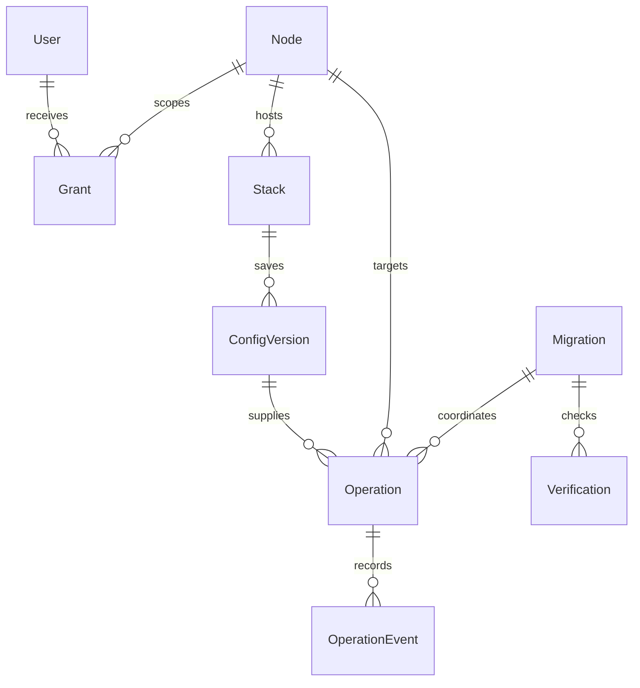

# Docker Manager 数据设计

现行阅读范围（2026-11-14整理）：本文维护逻辑实体、共同不变量及实际存储主定义导航。旧物理提案、在线密钥环／自动切换、顺序迁移和过时完成状态已移入[历史归档](../archive/2026-11-14-documentation/superseded-design/data-physical-proposal.md)。第7—11节现为当前实现的精确规格入口及维护边界；不能将逻辑实体清单直接当schema5完整DDL。

本文面向持久化及接口实现者，承接[arc42共同概念](https://docs.arc42.org/section-8/)与[构件的数据职责](architecture.md#5-构件视图与逐层展开)，细化R04、R05、R07、R11—R17及Q02、Q04、Q05、Q07、Q08、Q10。实际完成范围与验证见[M1推进](implementation/m1-first-version.md)，跨边界对象以第12节指向的协议主定义为准。

## 1. 数据责任和关系

正式账号／节点／配置及双端schema5已有实现，实际字段和生命周期见第7节。历史格式按各自API保留；M2—M5逻辑实体不因此进入当前建表范围。旧切片完成过程见[历史记录目录](../archive/2026-11-14-documentation/README.md)，不在本节并列维护旧状态。

Manager 管理期望配置、账号授权、节点身份和协调记录；Agent 管理本地执行事实；Docker 提供当前资源事实。三者不是互相覆盖的一份状态。快照有采集时间，命令有退出结果，迁移有验证证据。

图展示主要逻辑关系，未列所有查询和审计引用。删除对象后历史证据仍需能够解释目标身份；M1 建议保留身份行并标记停用，不自动回收版本、操作或账本，长期保留策略仍属 O11。Migration 同时引用来源和目标节点／Stack，不能以单一 hosts 关系表达整个切换。

## 2. 逻辑数据字典

标识为不依赖显示名称的稳定值；时间为带时区或统一时间基准的时刻；版本为可比较的变更令牌。以下是完整产品的逻辑字段；第 7 节给出 M1 子集的编码和存储约定，尚未实现的迁移等对象不因此进入 M1 建表范围。

| 对象 | 主要字段与逻辑类型 | 约束和责任 |
| --- | --- | --- |
| User | id、登录标识、启用状态、身份提供者引用、授权版本 | 登录秘密不作为普通返回字段；M1 建议本地账号，具体保护见第 9 节，O07 跟踪审阅与验证 |
| Grant | 用户／主体引用、node_id、操作能力集合、版本 | 节点归类不隐式产生 Grant；管理器级权限另有明确作用域 |
| Node | id、显示名、身份材料引用、撤销状态、能力、最近会话、最近观察时间 | 同名不等于同身份；接入身份不得因重装自动复用 |
| NodeGroup／Tag | id、名称或键值、节点关联、变更版本 | P05 为分类提案；分类变更不改变授权和运行归属 |
| Stack | id、node_id、显示名、Compose 项目名称、配置掌握状态、当前保存版本引用 | node_id＋项目名称在受管理目标内避免冲突；外部同名仍须预检 |
| ConfigVersion | id、stack_id、基准版本、文件清单、有序 Compose 文件列表、环境输入、项目参数、摘要、创建者／时刻 | 发布后不可变；复制生成目标自己的版本身份 |
| ConfigFile | 相对路径、内容或内容引用、内容摘要、用途标记 | 无越界路径；敏感标记不等于自动成功识别所有秘密 |
| SecretReference | id、使用范围、保护材料引用、轮换状态 | 不默认随 Copy 导出明文；具体加密、密钥和代理使用待决 |
| Operation | id、提交标识、发起者、类型、目标集合、配置版本／固定输入、摘要、阶段、取消请求、时间、错误引用 | 同提交标识对应同一摘要；多个目标要明确身份而非名称 |
| AgentExecution | operation_id、node_id、输入摘要、准备／许可／开始事实、进程监督引用、退出结果、回报确认 | Agent 本地执行事实，不是 Manager 的投递副本 |
| DeploymentObservation | node_id、stack_id、实际项目／资源标识、配置输入引用、命令结果引用、采集时间、资源状态 | 命令成功和运行状态不同；并非可从 Docker 反推完整配置 |
| ResourceSnapshot | 节点与资源标识、类型、可取得属性、关联、采集时间、采集错误 | 缺失或失联不表示空；跨节点标识须带 node_id |
| OperationEvent | 操作引用、单操作事件位置、阶段、内容、产生／接收时间 | 去重和保序；重连可用快照补齐，存储窗口待 O11 |
| Migration | id、来源与目标引用、固定配置、策略引用、阶段、步骤操作引用、数据准备记录、验证引用、来源选择 | 策略未定不能执行；不只修改 Stack.node_id 代表迁移 |
| Verification | id、迁移引用、检查范围、观察证据、业务确认、结论、人员／时刻、关联版本 | 与实际部署和来源状态绑定；相关变更后清理前重核 |
| CleanupRequest | id、迁移／验证引用、来源实际对象集合、删除范围、确认人、执行操作引用 | 明确是否影响数据；验证有效和权限充分才开始 |
| AuditEvent | 发起者、动作、目标、阶段、结果、关联标识、时刻 | 不存不必要的完整环境或凭据；历史可追溯 |

## 3. 配置版本与部署输入

版本保存原始文件和输入意图，不能只存渲染后的单一 YAML，否则会丢失注释、文件关系、变量来源及再次编辑的材料。渲染结果可作为校验产物，标明生成环境与版本，不取代原始版本。

部署固定输入至少包含目标节点、Stack／实际项目、配置版本、文件顺序、项目目录语义和明确的环境输入。秘密可以通过受控引用解析，但需在任务开始前固定其使用版本或等效身份，防止重试实际使用不同凭据却仍称相同输入。M1 采用整包加密与带密钥摘要，具体规则见第 9 节；独立秘密引用和仓库凭据代理不在此假定已经存在。

ConfigVersion 的不可变性不意味着用户永久可以读取秘密，也不替代保留策略。条件保存以当前版本令牌防止丢失更新；Copy 保留内容与依赖关系而创建新身份，不自动建立同步订阅。部署指向明确版本，后续保存只更新当前保存指针。

## 4. 操作状态与结果

| 逻辑状态 | 含义 | 允许的下一步 |
| --- | --- | --- |
| accepted | Manager 已持久受理，尚不能推定节点已收到 | 准备、取消或发现前提不成立 |
| preparing | Agent 已接收，正在检查工作区与能力 | ready、失败；断线可进入核对 |
| ready | 准备完成，尚未获准开始副作用 | 复核许可或取消 |
| authorized | 开始许可已记入协调记录 | Agent 记录并开始；许可无结果时需核对 |
| running | Agent 有开始记录，底层操作可能已有副作用 | 明确结果或核对；取消只作为请求 |
| succeeded | 已获得本操作约定的成功证据 | 保留结果和观察，不等于应用业务健康 |
| failed | 有确定失败证据，可能已有部分副作用 | 查看受影响对象，新的修复作为新明确操作 |
| canceled | 确认没有开始，或取消后已核实达到定义结果 | 保留证据，不隐含回滚所有资源 |
| reconciliation_required | 无法可信确定是否／如何执行 | 查询账本和资源后归结结果；禁止盲目重放冲突变更 |

取消请求作为独立字段保存，不覆盖 running。状态改变保存原因与证据；不会仅因 timeout 把 running 改成可安全重试的 failed。未知恢复后允许依据证据确认结果，但保留原始未知经过。

通用任务 succeeded 的成功范围由操作类型决定：保存是版本已发布，Copy 是目标配置已保存，Apply 是执行及约定观察结果已知。业务健康和迁移验证有各自字段。迁移准备／执行／待验证／已验证及可选清理结果分别记录；O05 未定前不冻结完整迁移枚举和切换状态图。

### 4.1 M1 Apply 的结果与占用释放

“观察完整”指目标项目及其容器的只读分页查询全部返回、有采集时间且没有缺页／采集错误，不要求所有容器业务健康。`observation.status` 分为 complete、incomplete、error，健康结果另列；分页完整不能单独证明被中断的旧 Docker 请求已经结束。

| 可取得的执行事实 | 操作状态与用户结果 | 资源占用 |
| --- | --- | --- |
| 准备失败，或有效证明未创建进程 | 按原因 failed；明确取消且未开始为 canceled | 保存证据后进入 finalize 释放握手；可信无记录且从未授权的例外见执行篇 |
| 正常监督到命令退出 0，未被信号／超时中断，观察完整且归属 consistent | succeeded；仍逐项展示 unhealthy、未声明健康检查等状态，不称业务健康 | 保存结果后 release_status=pending，持久收到 finalized 后才 released |
| 正常监督到非零退出，未被信号／超时中断，观察完整且归属 consistent | failed，保留部分副作用及命令错误 | 同样完成双端释放握手；新修复须另有明确意图 |
| 正常退出码已知，但观察不完整或失败 | reconciliation_required；命令退出事实仍可查看 | 保持；只重做观察，完整后按已保存退出码收敛，不能重执行 Apply |
| START_COMMITTED 后崩溃、执行结果丢失、被取消／超时中断，或证据矛盾 | reconciliation_required | 保持；核对进程终止、可能在途的 Docker 动作和资源，不能凭一次当前快照推断无副作用 |
| 已请求取消，但命令在受监督流程中正常完成 | 按正常退出码和观察规则归结，保留 cancel_requested | 与相应正常结果相同，不强行标 canceled |

线上使用 `ExecutionResult.outcome` 区分 not_started／normal_exit／interrupted／unknown，`ownership_status` 区分 not_checked／consistent／drifted／unknown。完整观察但归属 drifted／unknown 时保持核对，不因 exit_code=0 成功。完整字段与组合约束见 [协议 Schema](../contracts/agent-v1.schema.json)，HTTP 只返回[允许的摘要字段](specifications/http-api.md#4-准确返回对象)。ack 确认结果已存储，不能代替 finalized 释放确认。

未知结果的人工处理须保存执行终止与目标核对依据，无法建立依据时继续隔离。M1 不提供仅填写备注就自动解锁的通用按钮；真实维护工具必须满足这些证据约束后才能交付。

## 5. 一致性与并发不变量

1. 不发布缺失文件内容的配置版本；当前版本指针和条件更新具有原子可见性。
2. 同提交标识同摘要返回同一结果；不同摘要不能复用旧标识。去重范围和保留窗口在物理契约中确定。
3. 已受理操作和可恢复发送意图有一致提交边界；Agent 开始记录先于底层副作用，但不能据此宣称跨系统恰好一次执行。
4. 未确认结束的冲突操作保留占用；恢复必须检查身份、输入和资源，不能用新操作绕过未知。
5. 迁移验证未通过或已失去有效性时，来源清理不得开始；清理结果不改写已有迁移证据。
6. 管理配置、节点执行账本和应用数据分别备份／核对，不能互相冒充完整恢复。

## 6. 保存、保护与恢复

M1 的 SQLite、整包密文、事务和密钥方案在以下章节具体展开，O02／O11 仍需审阅及验证后关闭。需要恢复的内容包括账号授权、节点身份、配置及文件、秘密保护所需材料、操作／迁移记录和协议版本信息。备份要保证元数据和内容引用一致，不能复制数据库就忽略密钥或另行存储的节点工作区。

恢复后的 Manager 先隔离自动变更，核对节点身份与实际账本，旧备份不能使同一旧任务再执行。恢复流程及演练见[运行准备](operations.md)和 T16。设计将数据责任放在 arc42 构件与共同概念之下，字段服务于[模块协作](components/manager.md)及[接口](api-design.md)，不是独立于架构的存储模板。

## 7. 现行存储与字段主定义

2026-11-14整理：旧物理表提案及其中过时状态已移入[历史原文](../archive/2026-11-14-documentation/superseded-design/data-physical-proposal.md)。本节给出现行实现的查阅路径，不把逻辑实体表直接当DDL，也不另复制一套容易漂移的全字段定义。

### 7.1 Manager 表与约束

| 要查的内容 | 现行主定义和代码入口 |
| --- | --- |
| 用户、节点授权、认领、会话、Stack、不可变配置版本、HTTP幂等和审计 | [Manager服务规格](specifications/m1-manager-service.md)、[HTTP规格](specifications/http-api.md) |
| 固定操作、双占用、当前会话／恢复轮、加密投递、事件链、pending及终结释放 | [Manager v5 Store](specifications/m1-manager-runtime-store.md) |
| schema5精确表、列、外键和唯一约束 | [005_runtime.sql](../internal/manager/operations/migrations/005_runtime.sql)；存储包校验对应版本，不按本文逻辑表名猜测列名 |
| 所有历史行、密文和引用如何检查 | 同一Store规格中的封闭副本检查及[备份主定义](specifications/m1-maintenance-backup.md) |

配置版本、部署固定输入和实际资源身份分别保存；最新配置指针不能改写已受理操作。outbox／runtime delivery是持久发送意图，不是执行结果。新增事件和当前恢复事实必须经过正式Store事务，不以直接SQL清占用或改latest指针代替状态流转。

### 7.2 Agent 表与边界

Agent schema5的数据和接口由[Agent运行规格](specifications/m1-agent-runtime.md)定义：持久输入、准备证据、开始事实、进程创建／退出、结果／确认、恢复页、claims及归属发布各有不同生命周期。精确DDL沿[账本migrations](../internal/agent/ledger/migrations)与对应版本入口核对，不能仅看最后一份增量文件。

外部FrozenPayload先通过共享Schema及身份／摘要绑定，再形成内部记录和私有工作区。准备时保存的证据用于最终开始核对及后续只读观察；重启不能凭旧PID重新接管进程或重跑up。已知耐久退出但未写首结果时恢复原退出事实，未知／矛盾持续隔离。

### 7.3 身份关联、事件序列与发布完整性

| 数据类别 | 修改必须保持的关系 |
| --- | --- |
| Manager／node／ledger／operation／版本标识 | 稳定身份分别绑定，不用显示名、同名资源或最新版本替换历史目标 |
| session／boot／恢复round | 生命周期不同；旧连接或旧轮消息不能取得当前业务资格 |
| event_seq及latest指针 | 原结果不可覆盖；补观察只在允许的位置形成后继结果，pending不是已接受的最新事实 |
| claims／finalize／finalized | ACK确认持久接收；实际释放及归属发布依对应事务和当前轮认证回执 |
| 私有输入指纹、密文和AAD | 引用原算法、钥角色和绑定字段；不能用普通SHA替代本地HMAC或重编码历史原文 |

公开对象采用[HTTP规格](specifications/http-api.md)及[Agent Schema](../contracts/agent-v1.schema.json)，不直接暴露私有表。旧格式API及基础规则仍有独立规格；正式运行是schema5／protocol1，没有隐式升级。

## 8. 写入事务与并发处理

一次业务提交只在对应sql.Tx内检查和写入其权威状态。权限、基准版本、幂等、会话／轮次和资源占用须在提交前重查；发送、进程启动及HTTP成功返回不能先于必要的持久提交。密文额度预留与后续业务事务分别处理，不把回滚当额度退回。

Manager保存采用版本条件与稳定幂等回执；同键不同输入拒绝，原请求重试仍检查当前可见权限。grant变化、账号失效和登录会话撤销不是同一事件，精确行为由服务及HTTP规格定义。许可提交是相关授权竞争的排序事实，已发许可／已开始的外部副作用不能宣称立即撤回。

两端事件、补观察、扫描、finalize和归属的事务界线分别在[Manager v5](specifications/m1-manager-runtime-store.md)及[Agent v5](specifications/m1-agent-runtime.md)说明；[执行恢复](specifications/execution-recovery.md)定义跨端顺序。需要修改时沿这些入口及其测试核对，不从旧方案的事务表推导新的实现规则。

## 9. 加密、摘要和秘密生命周期

现行每端两把固定钥：Manager的摘要钥与加密钥、Agent的账本HMAC钥与journal加密钥分离；身份与原钥须匹配。文件布局和私有权限见[Manager运行](manager-first-run.md)、[Agent接入](agent-first-run.md)。不通过生成新钥“修复”原数据解不开的问题。

敏感配置、固定输入及相应历史正文加密保存；密文认证绑定身份、用途、记录和序列等上下文。数据钥／正文的认证域、规范化与原文指纹不可随意互换。持久额度包含可能回滚前已用次数；达到受控上限拒绝新加密，不能删除历史或退回计数。准确字段、算法和上限引用两端v5规格及加密实现。

当前没有在线密钥环自动切换、恢复转换或自动重加密命令。备份库已实现的检查和规划中的恢复／新KEK转换分开维护于[完整组](specifications/m1-backup-group.md)与[维护备份](specifications/m1-maintenance-backup.md)；旧提案已归档，不在这里作为现行操作建议保留。

## 10. Agent 文件与执行账本的一致性

[工作区／Compose／监督器规格](specifications/m1-compose-engine.md)定义从持久FrozenPayload到私有执行目录、原字节清单、原生命令和资源观察的流转。文件顺序、环境、工作目录及执行绑定冻结后不能切到另一操作的有效目录；核对失败不得提交ready或开始。

工作区中的明文是执行所需材料，不是普通共享导出；输出有预算且持续排空，秘密不写普通日志。文件发布、DB提交及真实进程副作用有不同边界：目录存在不证明已经开始，命令非零／取消不证明资源已回滚，资源快照不证明未知任务可以释放。

## 11. 保留、迁移与验证边界

当前不提供自动证据回收、旧库升级或备份回退恢复工具。长期容量／回收策略仍按后续范围处理，存储错误不能通过删除执行事实或占用来“恢复”。各旧格式入口保持明确版本，schema5新建不等于迁移旧库。

已实现子集和实际Linux验证以[M1记录](implementation/m1-first-version.md)、[IB记录](implementation/m1-instabox-debug.md)为证据；完整备份工具、隔离恢复、重加密、维护、正向部署和两节点业务组合仍分别验收。普通进程重开、受控I/O错误与真实掉电／磁盘故障分开报告。新增持久字段或密文表时同步所属模块规格、DDL、Inspector枚举及对应验证，不能只改逻辑模型。

## 12. 本轮具体定义的范围

领域对象的主语义仍由第 2—4 节维护；跨边界的字段结构由 [HTTP 规格](specifications/http-api.md)和[Agent Schema](../contracts/agent-v1.schema.json)维护；归属基线、outbox 和恢复动作由[执行与恢复](specifications/execution-recovery.md)维护。三处共同承担当前必要定义，不再抄成全字段数据字典。Schema 是线上对象约束，不是数据库 DDL，私有表结构不能直接作为返回对象。

关键区别：Manager 保存版本、执行输入版本及实际镜像／资源身份分别记录；Agent event_seq 与 Manager revision 分别排序；null 表示未知／尚无，空集合只表示在相应成功观察范围内为空。时间表示、单位、默认值与字段适用范围随相应主定义维护。

历史标题定位：原写作／阶段／物理方案正文已[归档](../archive/2026-11-14-documentation/superseded-design/data-physical-proposal.md)；以上旧定位仅承接历史书签，不恢复旧规则。
