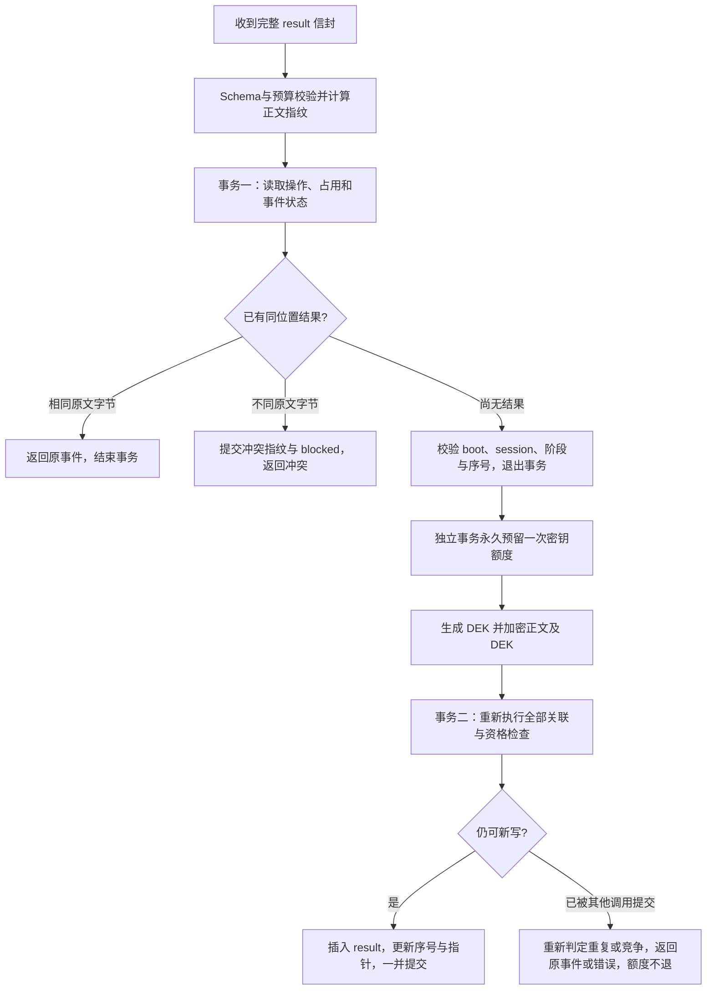

# M0 Agent 事件、首份结果与恢复读取实施规格

日期：2026-11-07。起点：`fac4fa6`。本规格在编码前保存；实施顺序、验收结果和交付版本见[执行计划](../implementation/m0-agent-journal.md)。

读者为接入本模块的开发者及接手维护者。第1—6节给出范围、约束、接口和验收；第7—10节说明内部实现、流转、字段与维护入口，按源码版本`8ff708b`在2026-11-07交付后补充，不追记为初次编码前已具备的说明。

## 1. 目标、来源与边界

承接已验收的[开始账本](m0-agent-ledger.md)，为后续受控任务通道提供可持久读取的started／result证据。本轮完成开始事实与started事件原子提交、首份受控结果、加密保存、重复／冲突处理、逐事件确认，以及单操作一致恢复读取。重启可读取原事件，不恢复执行权。

需求来自R04／R07／R12、Q04／Q07／Q08，主定义为[Agent协议](agent-protocol.md)第5—7节、[执行与恢复](execution-recovery.md)、[数据设计](../data-design.md)第7—11节和[Agent模块](../components/agent.md)。沿用现有Schema的started、ExecutionResult、RecoveryRecord，不创造另一份线上报文。

结果写入明确命名为Fixture：调用者提供受控执行结局，本模块校验结构及账本前提，不能证明真实进程退出、Docker观察或ownership_status。仅保存首份result；补观察的后续结果版本留待后续。当前不实现网络发送／重试调度、Manager授权与确认处理器、完整reconcile分页及完成握手、finalize、占用释放、真实执行、密钥文件管理、自动轮换或备份恢复。

## 2. 版本与兼容

继续使用现有Go1.27、CGO关闭和锁定SQLite依赖，不新增第三方库。新建v2完整DDL位于 `internal/agent/ledger/migrations/002_event_journal.sql`，这是新库定义，不是可直接对v1执行的升级脚本。

新增CreateJournal/OpenJournal入口；原Create/Open保持v1行为和原DDL不变。OpenJournal(v1)、Open(v2)均返回ErrSchema，保留原文件；不自动升级、删库、重建身份或补造历史started。CreateJournal只用于新建受控实验库，不能作为既有节点的升级或绕过旧占用的路径。v1→v2迁移及备份组恢复仍待专门模块，不能将两版账本同时接到同一真实节点。

两版共用已有安全文件打开、WAL/FULL/外键/5000、每连接读回及结构校验。v2也精确比较其版本DDL、兼容LF/CRLF，并拒绝未知结构。所有正式写入使用立即写事务和同一个sql.Tx。

## 3. 密钥、加密与数据

每个新v2账本由调用方注入独立的JournalKey：ID为1—128字节有效UTF-8，Key为32字节，必须不同于K_ledger；调用方须用安全随机数产生并专用于本账本，不跨账本共用。Store复制两种密钥，Close及局部操作结束时尽力清零副本，不承诺Go内存完全擦除。OpenJournal在空库时也验证实际KEK配对；错ID、错键或缺键不能靠新建密钥修复。

完整事件body按敏感内容加密，不能只加密output_b64。每条事件使用crypto/rand生成独立32字节DEK；正文与包装DEK均用AES-256-GCM和Go的NewGCMWithRandomNonce，nonce由标准库放入密文。两种AAD分别为JSON数组：`["dm-event-body-v1"或"dm-event-dek-v1",node_id,ledger_id,operation_id,input_digest,kind,event_seq,key_id]`。key_check为HMAC-SHA-256(KEK, `dm-event-key-v1` + 单字节0x00 + JSON数组[node_id,ledger_id,key_id])；body_fingerprint为HMAC-SHA-256(K_ledger,原始body字节)，仅内部使用。篡改、跨行替换、错用途或错误包装必须固定报错，不能返回部分正文。[Go标准库说明](https://pkg.go.dev/crypto/cipher#NewGCMWithRandomNonce)

KEK每次包装前，先在独立短事务中将uses加1并提交，再生成DEK和加密，之后才开始事件业务事务。固定上限为1,048,576次，低于标准库2^32上限；预留失败不加密，预留成功后其他步骤失败可以浪费额度，绝不退还。不允许在已占用唯一连接的业务事务里再开预留事务。额度耗尽拒绝新加密写入，仍允许读取、重报和确认。普通重开沿用可靠本地计数；旧备份回退可能回退额度，本模块不支持将恢复的备份用于继续写入，不宣称具备回退检测。

| v2新增表 | 主要字段与约束 | 用途 |
| --- | --- | --- |
| event_keys | id=1；key_id唯一；key_check为32字节BLOB；uses为0—1048576整数 | 单一KEK配对与永久预留次数，不存密钥 |
| event_state | operation_id主键并外键引用executions；last_seq为0—安全整数上限；latest_result_seq可空、不得大于last_seq；blocked为0/1 | 与prepare夹具同事务建立，序号及结果指针原子更新；结果指针组合外键引用真实事件 |
| execution_events | `(operation_id,event_seq)`主键；kind为started/result；body_cipher、wrapped_dek、key_id、32字节body_fingerprint；ack_session可空 | 外键关联操作及key；密文和包装同事务发布；ack不删除或改写body |
| event_conflicts | `(operation_id,event_seq,body_fingerprint)`主键；created_at为Unix毫秒；operation外键 | 同位置异内容只追加不含正文的冲突指纹，并将blocked置1；保留原事件与占用 |

表采用STRICT、NOT NULL、CHECK和禁止级联删除的外键。原executions.phase继续表示ready或START_COMMITTED，保留开始许可；结果阶段由event_state及恢复视图派生，不能为显示result而清空开始事实。元数据、指纹、计数和确认session明文，配置／结果正文和密钥不进入数据库、WAL或诊断明文。

## 4. 内部接口与协作边界

```go
type JournalKey struct { ID string; Key []byte }
func CreateJournal(ctx context.Context, path, nodeID, keyID string,
    key []byte, journalKey JournalKey) (*Store, error)
func OpenJournal(ctx context.Context, path string, expected Identity,
    key []byte, journalKey JournalKey) (*Store, error)
type Event struct {
    OperationID, Digest, Kind string
    Seq uint64
    Body json.RawMessage
    AckSession string // 空为尚无确认；非空为最后确认连接
}
func (s *Store) RecordResultFixture(ctx context.Context, rawResult []byte) (Event, error)
func (s *Store) ReadEvent(ctx context.Context, operationID string, seq uint64) (Event, error)
func (s *Store) PendingEvents(ctx context.Context, operationID, sessionID string) ([]Event, error)
func (s *Store) AcknowledgeEvent(ctx context.Context, operationID, digest string,
    seq uint64, sessionID string) error
func (s *Store) RecoveryRecord(ctx context.Context, operationID string) (json.RawMessage, error)
```

以上是存储接口。AcknowledgeEvent的调用方必须先完成认证、消息方向、当前session及reply_to关联验证；本轮只以受控调用验证持久确认，不提供线上ack处理器。函数自身校验ID、摘要、事件存在及记录关联，重复同session确认幂等；确认旧事件不覆盖最新结果。PendingEvents按event_seq升序返回ack_session不等于所给session的事件，因此新连接仍可取得已在旧连接确认的证据；它不是发送队列或扫描完成判据。

ReadEvent返回解密后的原body字节副本，重报时仅更新信封；本模块没有网络封装入口。校验用临时信封及RecoveryRecord也必须直接嵌入已经验证的原body，不能重新序列化而放大HTML字符或改变字节。每操作至多一条started与一条首result，PendingEvents至多2条。result经现有Validator按完整报文及1MiB输出上限验证，另限制body不超过7MiB，为RecoveryRecord及后续完整报文留出空间；超预算拒绝，不默默截断并称完整。合法1.0／1e0事件序号按数学整数提取，但body原字节不重编码；同位置不同JSON字节也按冲突处理。

继续使用已有固定错误，增加ErrJournal（非v2入口）、ErrEvidence（密文／关联证据无效）、ErrKeyExhausted；错误不带正文、密钥、SQL参数或驱动细节。读取坏密文整次失败，不输出部分结果或假造空结果。

## 5. 提交、重复、冲突及重启

v2的RecordReadyFixture同事务建立event_state(last_seq=0)。NewGate以及开始事务都复核未blocked、尚无result；只有数据库预读不够。开始回调先预留加密额度并制作started密文，再在原开始事务中提交完整许可、START_COMMITTED、序号1事件及last_seq=1。started_at只生成一次，开始记录和body完全一致。任一语句或Commit失败均不Start；提交后取消／断线／到期仍保留started，但不据此认为进程已创建。

RecordResultFixture校验既有result信封／Schema、操作／摘要及两个资源占用。新写必须本boot并与prepared_session一致。ready只接受not_started，期望seq=1；START_COMMITTED接受normal_exit/interrupted/unknown，要求已有完整started、期望seq=2。not_started的当前boot夹具代表受控未启动证据；数据库事务与开始提交竞争，只能其中一方取得资格。真实执行／归属证据仍须未来执行器提供。

序号分配由事务中last_seq+1决定，传入result的event_seq必须等于该值。插入事件、更新last_seq及latest_result_seq在同事务完成。此后不接收新result版本：同一位置同body返回已有事实，不增加序号、不消费新额度；同位置异body持久记录冲突指纹并blocked，返回ErrConflict；原body、结果指针及占用不变。不同未来序号直接拒绝，不伪造补观察。并发请求可以浪费已经预留的密钥额度，但只能提交同一份事件事实。

已有事件可在新boot读取、确认及相同body重放；旧boot不能新写执行结局、重新准备或NewGate。blocked操作仍可读取原事件和确认，其恢复phase为reconciliation_required，不清冲突或释放。没有结果的旧START_COMMITTED也投影为reconciliation_required，不能凭进程已消失构造not_started或normal_exit。当前boot下相同状态保留START_COMMITTED含义。

RecoveryRecord在一个事务快照内读取操作、event_state、事件、确认及两占用。它输出现有Schema的精确字段，latest_result及result_event_seq必须指向同一原body，last_event_seq不得凭调用次数增加；有结果且未blocked则phase=result，无结果则按上述阶段映射。report_acked仅表示最新result曾获持久确认，没有result为false；当前连接的确认另由AckSession判断。claims_held必须通过两个占用完整匹配确认；缺失或不一致返回ErrEvidence。final_state和finalized_result_event_seq始终null。此读取不是完整恢复扫描，也不授权解除冻结。

Close沿用既有锁顺序并清理KEK副本；不得持Store锁等待Gate或数据库连接，解密／加密期间使用受锁保护复制出的密钥。NewGate在数据库读取前后分别检查关闭／重复登记，最后持锁登记，避免与事务内解密形成锁反转；执行资格仍由开始事务复核。Start仍必须短小，不能重入Gate或调用Store.Close，可以查询已提交事件。所有结果、ack、读取及重启路径都不释放local_claims。

## 6. 验收与完成条件

以本机Windows/amd64、Go1.27、CGO关闭、本地SQLite、受控结果与实际辅助进程为环境。J01—J10全通过、无未解决重要审阅问题、全量回归／构建／契约／文档检查通过，才能交付本模块。真实Linux、掉电、备份回退及完整M0不在本次通过结论内。

| 编号 | 输入／动作／故障点 | 可观察通过条件 |
| --- | --- | --- |
| J01 | 新v2创建重开、错键／ID／等同K_ledger；交叉v1/v2打开 | 正确身份和结构保留；错误拒绝、文件不改；v1旧测试仍通过，不隐式迁移 |
| J02 | 同内容独立加密、正文／包装篡改、跨操作／序号替换、关闭并发 | 原字节往返，密文不同；错配整次失败无秘密诊断；库/WAL无测试明文／密钥，无关闭死锁 |
| J03 | 额度预留后事件写入／Commit失败、进程终止；额度耗尽 | 预留次数不回退、未提交事件不可见；无Start；耗尽仍可读取、ack和恢复查询 |
| J04 | v2正常许可、重复许可、started插入失败、提交期间取消 | Start内可读完整started；开始与事件全有或全无，最多启动一次；取消不删已提交证据 |
| J05 | 四类首结果、错误目标／摘要／session／boot／seq／预算；not_started与开始并发 | 合法结果与指针原子提交；非法输入拒绝；竞争只允许未启动结果或开始事实其中之一 |
| J06 | 相同result顺序重试、同位置改body、并发重复、未来版本 | 已可读到既有事件的顺序重试不耗新额度；并发重试允许浪费预留额度但只提交一份事件及序号；冲突保留旧证据并持久blocked及指纹，不得另起任务或覆盖较新结果 |
| J07 | 正确／错摘要／错位置确认，重复确认，重开与新session | 确认只改变相应ack_session，不释放占用；新连接PendingEvents重取原body；不声称已验证网络关联 |
| J08 | ready、当前/旧boot开始无结果、四类结果、blocked／缺占用 | RecoveryRecord符合Schema且字段来自同一快照；保留许可、未知隔离、latest_result和seq一致，ack不代表释放 |
| J09 | 辅助进程在started提交后、result提交前事务中、result提交后及ack提交后强制终止 | 重开只有完整提交的事件／指针／确认；body不变、额度不回退、原占用仍在、旧操作不重启 |
| J10 | 完整测试、vet/build/mod verify、静态契约／文档及独立审阅 | 前两模块回归通过；新入口、源码版本、逐项证据和暂缺能力可查；通道仍冻结 |

## 7. 内部结构与职责

事件日志是既有ledger包的v2扩展，与开始账本使用同一个Store及SQLite连接。它既不是独立后台服务，也不主动消费网络消息。调用者负责选择库版本、供给密钥和可信输入；模块负责把输入变成可核对的持久事实。开始事实与事件同库，是为了在一个事务中证明二者同时存在；加密额度单独提交，是为了失败后也不重用已消耗的包装机会。

| 实现位置 | 负责的内容 | 与其他部分的关系 |
| --- | --- | --- |
| [store.go](../../internal/agent/ledger/store.go)、[journal_store.go](../../internal/agent/ledger/journal_store.go) | 创建／打开、身份及版本校验、密钥复制、Store生命周期 | 共用v1基础；journalConfig保存不可变keyID及受锁保护的KEK，Close清理 |
| [records.go](../../internal/agent/ledger/records.go) | prepare夹具校验、固定输入元数据和两项占用 | v2首次登记同时建立空event_state；提供Record给事件关联校验 |
| [gate.go](../../internal/agent/ledger/gate.go) | 将内存许可门禁连接到开始事务 | `commitStartExpected`复核准备快照和占用，同事务写开始许可及started；是否调用Start仍由[内存Gate](../../internal/startgate/gate.go)作最后判断 |
| [journal_crypto.go](../../internal/agent/ledger/journal_crypto.go) | 密钥额度预留、正文加密／解密、AAD与指纹 | `sealEvent`需要独立事务；`openEvent`不访问数据库，可在业务事务内调用 |
| [events.go](../../internal/agent/ledger/events.go) | 事件读取、解密后Schema／绑定校验、待确认查询与确认 | `readEvent`接受DB或同一Tx，便于上层保持一致快照；不负责发送或认证 |
| [results.go](../../internal/agent/ledger/results.go) | 首结果、重复、冲突及结果指针提交 | 两次`recordResult`之间才做加密；第二次重新检查全部新写前提 |
| [recovery.go](../../internal/agent/ledger/recovery.go) | 将账本、事件、确认及占用投影为RecoveryRecord | 单事务核对完整历史，生成协议对象；不改变数据库阶段或恢复执行权 |

内存中的`eventBinding`是操作、摘要、事件种类和序号的关联元组，用于生成AAD及核对解密内容；`sealedEvent`只携带密文、包装后的DEK、指纹和keyID。它们不是新协议对象。`Event`是已解密的调用结果，Body属于调用方得到的原文字节；代码不得将它作为普通日志输出。完整prepare／result信封只作为入口校验输入，事件库保存body，不保存原message_id／reply_to；后续发送应生成新信封并关联当前连接。

## 8. 从入口到提交与恢复的流转

### 8.1 首结果的两阶段检查

下面的流程对应`RecordResultFixture`。第一次事务处理已经可见的重试或冲突；新结果退出事务后才预留额度及加密，以免单连接嵌套事务。第二次事务决定谁真正取得写入资格，第一次通过不构成承诺。



每个入口校验、加密或SQL失败均直接返回相应错误；不会从图中失败节点自动重试。事务一没有变更的分支通过延迟Rollback结束，事务二失败也回滚；已在独立事务提交的密钥额度保留。错误的未来序号、缺少占用、旧boot新写等情况在资格检查处停止。只有同位置已有result且原文不同才持久记录冲突；若not_started检查后由另一调用抢先提交started，则返回ErrConflict，不新增冲突行或blocked。

### 8.2 准备、开始、确认和重读

| 操作 | 处理顺序与提交点 | 提交后可依赖的事实 |
| --- | --- | --- |
| 登记准备夹具 | 校验prepare及解码输入 → 一个事务写executions、两条local_claims、event_state(0,NULL,0) → Commit | 元数据、占用和空事件状态同时存在；未运行文件准备或Docker |
| 消费开始许可 | Gate核对连接关联和期限 → `commitStartExpected`生成一次started_at → 预留额度／加密 → 开始事务重查准备快照、boot、许可及占用 → 同时写START_COMMITTED、完整许可、started(seq=1)、last_seq=1 → Commit → Gate最后复查取消／断连／期限 | started意味着已跨过持久开始边界；若最后复查失败，可以有started而没有调用Start，不能据此补造未启动结果 |
| 读取待确认事件 | PendingEvents在同一事务内按序找ack_session不同于当前session的事件 → 先收集序号并关闭游标 → 逐条解密验证 → Commit后返回 | 同一快照的原文及确认状态；新session会再次得到旧session确认过的事件 |
| 持久确认 | 调用方先完成网络认证与关联 → AcknowledgeEvent事务内读取并验证事件／摘要 → 更新这一行ack_session → Commit | 只有最后确认session改变；结果、序号、占用及冲突状态均保留 |
| 恢复读取 | RecoveryRecord事务内读取Record、event_state和两占用 → 核对事件数量及连续序号 → 解密各事件并核对started许可／时间与最新结果指针 → 生成元数据并原字节附加latest_result → 结束只读事务 | 输出同一快照；不持久改写phase，不作网络扫描完成或安全释放判断 |

PendingEvents先关游标再查事件，是单连接下的必要调用顺序。RecoveryRecord虽只读取数据，也通过同一连接配置的事务取得一致视图，可能等待写锁。模块无后台重试；SQLite锁等待配置为5000毫秒，连接池等待及整体调用期限由调用方context控制，本模块不另设总时限。Context中止数据库操作不等于业务取消，Gate仍需显式Cancel／Invalidate。

### 8.3 数据状态与对外阶段的区别

| 已有事实 | executions.phase | last_seq／latest_result_seq | RecoveryRecord.phase |
| --- | --- | --- | --- |
| 只有准备夹具 | ready | 0／NULL | ready，包含旧boot；可读取不代表可重新开始 |
| 未启动首结果 | ready | 1／1，seq1=result | result |
| 开始已提交，无结果，本boot | START_COMMITTED | 1／NULL，seq1=started | START_COMMITTED |
| 开始已提交，无结果，旧boot | START_COMMITTED | 1／NULL | reconciliation_required |
| 开始后首结果 | START_COMMITTED | 2／2，seq1=started、seq2=result | result |
| 上述操作后来发生同位异文冲突 | 原phase保留 | 原序号与指针保留，blocked=1 | reconciliation_required；已有latest_result仍返回 |

表中组合须先通过证据完整性检查；缺事件、序号空洞、错指针或缺占用会返回错误，不生成看似正常的视图。`result`仅表示已有报告，即使outcome为unknown／interrupted也不能视为业务成功。Gate内存状态、executions.phase及恢复phase分别回答“本次许可窗口如何结束”“持久开始是否提交”“当前有哪些可核对证据”，修改时不可合并为一个状态字段。

## 9. 内部数据定义与生命周期

共同身份、输入和占用字段沿用[开始账本数据定义](m0-agent-ledger.md)；消息body结构由[Agent Schema](../../contracts/agent-v1.schema.json)的started、ExecutionResult、RecoveryRecord维护。下表解释本模块增加的持久字段和派生规则；实际类型、唯一键及外键以[v2 DDL](../../internal/agent/ledger/migrations/002_event_journal.sql)为准。DDL允许安全整数序号，但当前模块只产生0—2，扩展结果版本须同时改运行时约束。

| 表／字段 | 存储形式及空值 | 来源、含义与变更规则 |
| --- | --- | --- |
| event_keys.id、key_id | INTEGER固定1；TEXT非空且唯一，1—128字节 | CreateJournal登记调用方提供的JournalKey.ID；当前仅一个KEK槽位，key_id与ledger_key_id分别指加密键和本地指纹键 |
| event_keys.key_check | 32字节BLOB，不可空 | 第3节HMAC配对校验值；创建时生成、打开时验证，不是密钥或正文 |
| event_keys.uses | INTEGER，0—1048576 | 初始0；每次包装前独立提交+1，只增不减；含失败和并发浪费，不可用事件条数回算 |
| event_state.operation_id | TEXT主键，引用executions | 首次prepare夹具同事务建立，每操作一行 |
| event_state.last_seq | INTEGER，初始0 | 最近持久事件位置；与事件插入同事务更新，读取／确认均不增加 |
| event_state.latest_result_seq | 可空INTEGER，组合外键指向同操作事件 | NULL表示尚无结果，首result提交时置1或2；当前必须等于last_seq，且引用kind=result |
| event_state.blocked | INTEGER 0或1，初始0 | 同位置不同result原文提交时置1；当前无清除入口，确认不能清除 |
| execution_events.operation_id、event_seq | TEXT及正INTEGER，组合主键 | result从已校验body提取，序号与事务中last_seq+1核对；started从许可取得操作ID、固定seq=1，并在事务中要求last_seq=0；不是网络message_id或全局序号 |
| execution_events.kind | TEXT started或result，单操作内唯一 | started由Gate适配生成，result由受控调用提供；限制每种至多一条 |
| execution_events.body_cipher | BLOB非空，DDL要求至少28字节 | 整个body的认证密文；不可用SQL直接当JSON读，提交后不改写 |
| execution_events.wrapped_dek | 60字节BLOB，不可空 | 本事件32字节DEK的认证密文，和body_cipher在同事务发布 |
| execution_events.key_id | TEXT非空，外键指向event_keys.key_id | 指明包装DEK的KEK，也参与AAD；不是K_ledger的ID |
| execution_events.body_fingerprint | 32字节BLOB，不可空 | HMAC(K_ledger,原body)；与密文一并保存，解密后复验；不同空白或等价数字写法也可能产生不同指纹 |
| execution_events.ack_session | 可空TEXT | 初始NULL；每次可信确认更新为所给session。NULL读入Event时表示为空字符串，不记录确认时间或确认历史 |
| event_conflicts.operation_id、event_seq、body_fingerprint | TEXT、INTEGER、32字节BLOB，组合主键 | 指向发生冲突的位置及传入异文指纹；同一冲突重复不新增，不保存冲突正文；这里只对operation设外键，位置语义由代码校验 |
| event_conflicts.created_at | INTEGER，不可空，Unix毫秒 | 首次记录该冲突时取本机时间；重复ON CONFLICT DO NOTHING保留原值 |

`Event.Digest`来自executions.input_digest的32字节BLOB，以无填充base64url返回；`Event.Body`是解密后的原始JSON字节，重读不会改变空白或转义。body内的operation_id／input_digest／event_seq必须与行关联一致。`AckSession`表示最后一次确认，不代表所有历史session；不同session的确认顺序由可信调用方保证，这个API不自行判断哪条网络连接较新。

RecoveryRecord中operation_id、input_digest、stack_id、version_id和project_name来自Record；last_event_seq及result_event_seq来自event_state，latest_result来自被指向的原事件body。无结果时两项结果字段为null且report_acked=false；有结果时report_acked取该结果AckSession是否非空，不能用它替代“当前session已确认”。claims_held只有在两项占用完整匹配后才返回true；final_state和finalized_result_event_seq固定null，因为释放尚未实现。所有表在本模块生命周期内均不自动清理。

## 10. 维护定位与变更约束

本模块没有维护CLI或自动修复入口。接手者先确定所用入口是v1还是v2、绑定的账本身份及两种密钥ID，再按操作ID和事件序号对照下面的路径；错误诊断中不附正文或密钥。不要为了读到数据而关闭身份、密钥或Schema校验。

| 现象／错误 | 首先核对的位置与含义 | 处理边界 |
| --- | --- | --- |
| ErrSchema／ErrJournal | store及journal_store：版本、精确DDL、是否误用v1入口 | 用匹配版本核对；当前无升级工具，不能换新库继续同一任务 |
| ErrIdentity／ErrKey | 打开参数、agent_meta及event_keys配对 | 核对原有身份和密钥供给；不能用新密钥覆盖配对值 |
| ErrKeyExhausted | event_keys.uses及reserveKeyUse | 新事件被拒绝，已有事件仍可读／确认；不能清零计数，轮换需后续模块 |
| ErrConflict／ErrFrozen | results及gate：摘要、session、boot、序号和已有结果；必要时读恢复视图 | 区分输入不匹配与已持久blocked，ErrConflict不一定产生冲突行；保留旧事实和占用，不能重建Gate消除不确定性 |
| ErrEvidence | readEvent、requireStartedEvent、RecoveryRecord：密文、绑定、序号历史、指针及占用 | 整次读取停止；不以空结果替代损坏证据，不手工改phase或删事件“修复” |
| ErrStorage | 打开／SQL／Commit／关闭路径、调用context和连接等待 | 错误为固定分类，单凭它不能断言磁盘损坏；结合发生步骤和已有事实定位，不自动重启执行 |
| 查询互相等待或关闭挂起 | Store.mu、单数据库连接、Gate.Start回调 | 持Store锁不得等待DB/Gate；预留不能嵌入业务Tx；Start须短小且不能重入Gate或Close |

改变事件字段或编码时，同步核对Schema校验、AAD、原文字节保留、结果幂等和恢复投影；改变状态／事务时核对not_started与开始竞争、失败后无Start及占用不释放；改变锁顺序时核对事务解密与NewGate／Close；改变DDL时同时设计版本和迁移，不能只改当前库表。关键验证入口分别为journal_crypto_test、events_test、results_test、recovery_test、journal_fault_test和journal_restart_test，完整路径与实际证据见[J01—J10验收记录](../implementation/m0-agent-journal.md)。本次维护说明按代码核对，不新增软件验收结论。
