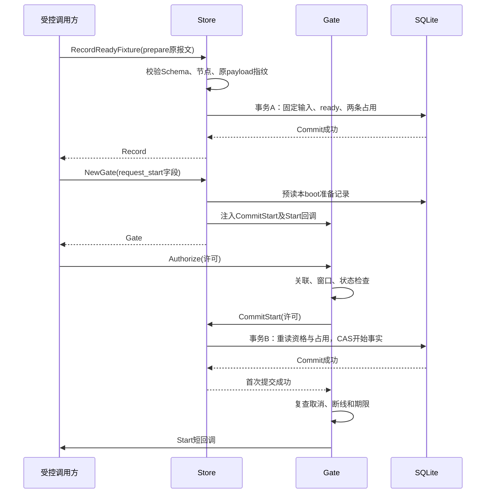

> 现行用途（2026-11-14归档整理）：本篇保留仍有代码入口的旧格式API及被M1明确引用的基础规则，不是当前阶段的实施计划。正式schema5／protocol1的完整运行与差异见[Agent v5](m1-agent-runtime.md)、[Manager v5](m1-manager-runtime-store.md)和[正式通道](m1-agentwire.md)。本篇已结束的实施／验收历史从[归档目录](../../archive/2026-11-14-documentation/README.md)查阅，不能把旧格式参数或当时状态套用于正式服务。

# M0 Agent 开始账本实施规格

日期：2026-11-07。起点：`d53de6d`。本规格在本模块编码前形成，落实用户“每个模块都需要实施规格等文档流程”的要求。状态：实施基线，验收结果由[执行计划与记录](../../archive/2026-11-14-documentation/m0-implementation/m0-agent-ledger.md)维护。

读者包括模块实现者、后续接手开发者和维护人员。第1—6节保留v1开始账本的实施范围与验收定义；第7节按现有源码补充内部实现、流转、数据语义和定位方法，第7.5节串起模块的完整使用生命周期。当前源码另有[事件日志v2扩展](m0-agent-journal.md)，其加密结果、确认和恢复读取不属于v1的原始交付，不能把下文“本轮没有”理解为整个代码库仍无这些能力。

## 1. 目标、依据与本次边界

交付对象是下一轮 Agent 实现者。本轮给已有内存许可门禁提供真实 SQLite 开始提交边界，证明固定输入、占用和开始事实不会因重复许可或普通进程重启变成第二次启动机会。可观察终点是受控 Start 回调至多一次，回调前完整开始事实已提交；重开库后旧操作只能查询，不能恢复执行。

依据：[Agent 设计](../components/agent.md)第 9 节、[数据设计](../data-design.md)第 7—11 节、[执行与恢复](execution-recovery.md)、[Agent v1 协议](agent-protocol.md)、[现有 Gate 实际行为](m0-channel-probe.md)第 5 节。已有协议和 Schema 继续作为主定义。本规格的存储布局、函数名与驱动版本属于实现者落实既有要求的技术选择，未逐项冒充用户决定。

本轮实现 `internal/agent/ledger`，使用真实文件数据库及测试辅助进程；复用 `internal/startgate`。准备阶段只提供名称明确的 `RecordReadyFixture` 受控夹具入口：它验证现有 prepare 报文并登记元数据，不物化文件、不运行预检，也不发送 ready。此入口不得用于真实部署处理器。没有 Manager 授权事务、执行事件、结果正文、ack/finalize、恢复扫描、解除隔离、网络任务处理或 Docker 调用。通道继续冻结且不增加能力广播。

选择先完成开始账本而后接网络，是因为当前缺少结果及核对记录，直接开放任务会让旧任务能否重做无法判定。SQLite 延续 P09；不另造数据库架构，不将整个 M0 缩减为本模块。

## 2. 依赖与数据库打开规则

Go 1.27.0、CGO_ENABLED=0；固定 `modernc.org/sqlite v1.61.1` 和其要求的 `modernc.org/libc v1.79.0`。驱动最低 Go 1.26，内嵌 SQLite 3.54.1；运行时必须查询并验证版本。驱动 BSD-3-Clause，SQLite public domain，其他传递依赖随 go.mod/go.sum 固定；正式发布前仍需复核全部许可及上游支持状态。[固定版本说明](https://pkg.go.dev/modernc.org/sqlite@v1.61.1)、[go.mod](https://raw.githubusercontent.com/modernc-org/sqlite/v1.61.1/go.mod)、[许可证](https://raw.githubusercontent.com/modernc-org/sqlite/v1.61.1/LICENSE)。选用纯 Go 驱动以适配当前无 CGO 的环境；mattn 驱动需要 CGO/GCC，未采用。[安装要求](https://github.com/mattn/go-sqlite3#installation)

数据库只接受本地文件路径；代码以 `net/url` 生成 file URI，拒绝内存库及调用者注入 DSN。Create 以排他新建创建文件，权限请求 0600，父目录由调用者准备；Windows 实际访问控制由宿主目录 ACL 决定，不以 Unix mode 宣称已隔离。失败保留文件，不自动删库重建。Open 使用 mode=rw，不存在即失败；调用者必须提供预期 node_id、ledger_id、key_id 与恰好 32 字节 K_ledger。

每个物理连接使用 WAL、synchronous=FULL、foreign_keys=ON、busy_timeout=5000，并读回校验；连接池最大打开／空闲连接均为 1。写事务统一 `sql.Tx`，以驱动 `_txlock=immediate` 在开始时取得写锁；不自行跨池拼 BEGIN/COMMIT。超时与事务失败不自动重试，不再次执行 Start。[驱动参数](https://pkg.go.dev/modernc.org/sqlite@v1.61.1#Driver.Open)、[SQLite 事务](https://sqlite.org/lang_transaction.html)、[WAL](https://sqlite.org/wal.html)

首次 schema_version=1，DDL 内嵌在包内 `migrations/001_start_ledger.sql`。Create 在一事务中安装表和元数据；Open 只接受版本1、匹配元数据及与内嵌迁移一致的表／索引定义。比较前统一CRLF为LF并移除外围空白和末分号，避免Git换行转换使同版库无法打开；不宽泛重写SQL。忽略SQLite内部对象，其他额外表、索引、视图或触发器均视为未识别schema；不能仅凭版本号和列名接受缺失约束的库。缺失、损坏或较新版本均拒绝，不升级、不降级、不补空身份。当前没有历史schema升级，也没有备份恢复工具。

## 3. 固定数据与存储约束

稳定执行上下文为 `(node_id, ledger_id, operation_id, stack_id, version_id, input_digest)`；node/ledger 由单库身份确定。session 只绑定本次准备和开始，不能代替稳定身份。原始 payload_bytes 由现有 Validator 校验后解码，从同一原文提取 project_name、docker_endpoint_id 和 policy_revision；不重新序列化后计算指纹。已通过Schema的数学整数写法1、1.0、1e0必须提取为相同整数；其原始字节仍不同，同操作改写会触发本地指纹冲突。时间物理列采用Unix毫秒INTEGER，Record查询结果再转UTC文本。

| 表 | 本轮字段与约束 | 事务语义 |
| --- | --- | --- |
| agent_meta | id=1 单行主键；node_id、ledger_id、schema_version=1、ledger_key_id、key_check | Create 生成随机 ledger_id；调用者提供有效小写 UUIDv4 node_id 和非空且至多128字节 key_id |
| executions | operation_id 主键；stack_id、version_id；input_digest、local_fingerprint 为32字节BLOB；project_name、docker_endpoint_id、policy_revision；prepared_session、owner_boot_id；phase；session_id、start_nonce、permit_id、auth_rev、reply_to；created_at、started_at | ready 与 START_COMMITTED 两种 phase；开始字段含 started_at 要么全空，要么全齐，且仅 START_COMMITTED 可非空；revision 为0至9007199254740991 |
| local_claims | `(resource_kind,resource_id)` 主键；operation_id 外键指向 executions，禁止级联删除 | kind 为 stack 或 project；stack 键为 stack_id；project 键为 JSON 数组 `[docker_endpoint_id,project_name]` 的紧凑编码；与执行记录同事务插入 |

必要字段 NOT NULL，BLOB 长度、阶段、成组许可、数字范围、主键和外键由 DDL 约束；UUID 与 prepare 的完整内容沿用应用层 Schema 验证。开始字段第一次提交后没有覆盖或清空方法。project 不只用显示名作键，避免不同端点混淆。登记第二个占用失败时整个新操作回滚，不能留下半条记录。

key_check = HMAC-SHA-256(K_ledger, `docker-manager/ledger-key/v1` + 单字节0x00 + JSON编码的 `[node_id,ledger_id,key_id]`)；Open 用恒定时间比较，不能仅凭 key_id 相同认定密钥正确。local_fingerprint = HMAC-SHA-256(K_ledger, 原始 payload_bytes)。Manager input_digest 只作为32字节不透明值保存，不验证 Manager HMAC。既有 operation_id 必须同时匹配稳定上下文、两个摘要、项目／配置、准备 session；冲突拒绝且不覆盖。报文 message_id 变化不改变准备事实。

不存配置原文、payload_b64、输出或密钥，因此本切片不需要把完整正文加密机制一并实现。身份、项目名、时间等元数据仍明文，指纹不得当作公开接口字段输出。K_ledger 的生成、秘密文件权限、备份与轮换仍由后续身份／密钥模块落实；本 API 复制调用方密钥，关闭时尽力清零，不宣称 Go 内存可完全擦除。

## 4. 包接口与失败约定

以下均为内部 Go 接口，不是新网络协议：

```go
type Identity struct { NodeID, LedgerID, KeyID string }
func Create(ctx context.Context, path, nodeID, keyID string, key []byte) (*Store, error)
func Open(ctx context.Context, path string, expected Identity, key []byte) (*Store, error)
func (s *Store) Identity() Identity
func (s *Store) Close() error
func (s *Store) RecordReadyFixture(ctx context.Context, rawPrepare []byte) (Record, error)
func (s *Store) Get(ctx context.Context, operationID string) (Record, error)
func (s *Store) Claims(ctx context.Context, operationID string) ([]Claim, error)
func (s *Store) NewGate(ctx context.Context, request startgate.Request,
    now func() time.Time, start func(startgate.Permit)) (*startgate.Gate, error)
```

Record 暴露本轮表的元数据：Identity、OperationID、StackID、VersionID、Digest（规范Base64url）、LocalFingerprint（内部规范Base64url）、ProjectName、EndpointID、PolicyRevision、PreparedSession、BootID、Phase、CreatedAt、StartedAt、Permit（未开始为 nil）。Claim 为 Kind、ResourceID。Record 不含原始输入。时间记录 UTC RFC3339 毫秒；持久时间不用于重建10秒窗口。

错误使用可供 errors.Is 判断的固定诊断：ErrInput、ErrIdentity、ErrKey、ErrSchema、ErrStorage、ErrNotFound、ErrConflict、ErrClaimed、ErrFrozen、ErrGateExists、ErrAlreadyCommitted。失败不拼接配置、密钥、SQL参数或原始驱动报错到对外诊断。Gate 自身的关联、期限与状态错误保留。存储错误保守处理，不表示执行一定未发生。没有可自动释放占用的错误类别。

## 5. 开始、重复、失败与重启

每次 Create/Open 生成新的不可由调用者指定的随机 boot_id；登记时保存 owner_boot_id。重开后 Get/Claims 可查询旧记录；RecordReadyFixture 和 NewGate 对旧 boot 记录拒绝为 ErrFrozen，不更改 phase、不补许可、不续期限。本轮没有解除冻结入口。独立的 Store 可以创建不同的新夹具操作，数据库占用约束仍有效；此机制不是生产 Agent 的进程单实例锁，也不检测旧备份回退。

同一 Store 每操作最多创建一个 Gate；constructor 校验身份、prepare session、摘要与 ready，成功后保留登记，取消、拒绝或失败后也不允许再 NewGate。NewGate及提交适配器负责按既有Id/Digest/Revision规则校验请求与许可字段，包括nonce、message_id、permit_id和reply_to；不能依赖内存Gate的非空检查替代类型约束。再次使用既有 Gate 的 RegisterRequest/Authorize 遵守原规格。新 Gate 不能绕过已经开始的记录。

Close先禁止新登记／新Gate并使所有现有Gate失效，等已进入Start的短回调退出后关闭数据库；不得持有Store登记锁调用Invalidate，避免Start内Get的锁反转。Close返回后旧Gate不能再次调用Start；并发／重复Close均应等待同一次关闭完成。数据库调用的context取消只结束对应等待／事务，不自动等于业务Cancel或连接失效；后者由调用者明确调用Gate方法。另一个Open不会撤销仍存活的第一个Store，这不是进程接管机制。

CommitStart 回调在立即写事务内重读记录、检查本 boot、固定上下文、摘要、准备 session 与两个占用，CAS `ready → START_COMMITTED` 并保存全部许可字段。**只有本次首次成功提交才能返回 nil**；匹配的已有开始事实返回 ErrAlreadyCommitted，不同许可返回 ErrConflict，均不能再调用 Start。预读不是执行资格；CAS和事务检查才是提交边界。

提交结束后仍由 Gate 在同一互斥内复查取消、连接失效及10秒期限，再调用 Start。Start 必须短小、不可重入 Gate，也不可调用会等待本 Gate 的 Store.Close；可用Get读取提交事实。回调返回不代表业务成功。开始事实提交后若取消／失效／到期，Start 为0，但已持久事实及占用保留，不能报告 not_started 或取消完成。没有事件表，故不产生 started 报文。

Begin、写入、Commit 失败均不调用 Start，Gate 进入不确定状态或保留已经发生的取消／失效；原 Store 禁止重建 Gate，重开由新 boot 冻结。即使读回 ready，也不能据此重试旧门禁。已经开始的操作收到重复许可不再写入、不再次 Start。所有终态显示都不足以释放本轮占用；没有 Delete/Release/Finalize 接口。

| 故障点 | 重开后的事实 | 必须行为 |
| --- | --- | --- |
| ready 已提交，开始提交前进程被终止 | ready + 原占用 | 旧boot冻结，不自动恢复许可 |
| START_COMMITTED 已提交，Start 尚未调用 | 开始许可完整 + 原占用 | 视为可能有副作用，不自动重做 |
| Start 已调用后进程被终止 | 同一开始事实 + 原占用 | 不凭进程退出或回调计数判断结果，不再调用Start |
| 登记／开始事务中止或提交失败 | 事务前事实，或无法确定 | 不覆盖旧证据，不释放，不在当前流程内部重试 |
| 缺库、错身份、错密钥、未知schema | 打开失败 | 不自动新建替代账本 |

## 6. 验收与交付条件

执行环境为本机 Windows/amd64、Go1.27、CGO关闭、临时本地 SQLite 文件及无副作用回调。L01—L10 全部具备直接断言且通过、独立审阅无未解决重要问题、全量回归与文档检查通过，才能称本模块切片完成。不是完整 Agent／M0 或可安装产品。

| 编号 | 输入、动作／故障点 | 可观察通过条件 |
| --- | --- | --- |
| L01 | Create、关闭、正确Open；重新建立物理连接 | 身份不变、boot改变；SQLite3.54.1、WAL/FULL/外键/5000读回正确；原文件不能被Create覆盖 |
| L02 | 缺文件、错误node/ledger/keyID/key、非32字节密钥、损坏库、较新schema | 固定错误，不能生成替代库或改写执行证据 |
| L03 | 合法prepare夹具及1/1.0/1e0整数形式、相同重放、变摘要／原始字节／目标／项目／配置 | 同输入一条记录；任一固定内容冲突拒绝，原文不入库；原bytes而非重编码参与HMAC |
| L04 | 同Stack或同端点项目的并发新操作，另一端点不同Stack | 冲突组仅一个操作与两占用完整提交；非冲突组可登记；没有半条记录 |
| L05 | 合法许可及重复、不同reply_to重放、变permit/auth_rev；重复Gate构造 | Start内读到完整已提交事实；总调用数1；不同许可不覆盖；新Gate不得再次获得资格 |
| L06 | 提交前取消／失效；提交过程中取消／失效；提交后窗口到期 | Start=0；提交过的开始事实和两占用仍在；无虚构取消完成或释放 |
| L07 | 真实第二连接写锁等待超时／context取消、语句中止、延迟外键导致Commit失败 | Start=0；原事实与占用保留；原Gate不得再提交，新Gate拒绝；错误无秘密回显 |
| L08 | 辅助进程分别停在开始提交前、提交后Start前、Start后，再由父进程强制终止 | 重开数据与故障点一致；每组旧操作NewGate/重新登记均冻结；累计Start不增加 |
| L09 | 关闭重开旧ready/committed；改Gate摘要/session/关联、非法UUID/超范围许可、破坏占用夹具；提交中及Start中Close | 旧boot及不完整执行资格不能启动；时间窗口不由数据库UTC时间恢复；Close无死锁且返回后无新Start |
| L10 | 全量测试、vet、构建、模块校验、契约和文档检查；静态接线审阅 | 原通信切片回归通过；仍无网络任务入口与Docker调用；全部本轮结果、版本和限制可查 |

L07 的语句／提交故障证明代码拒绝继续，不冒充真实磁盘耗尽或掉电实验。L08 是进程终止恢复，不证明硬件掉电耐久。真实Linux、磁盘满／损坏期间写入、备份回退、迁移、完整加密、事件重报、两端核对与释放均待后续验证。

## 7. 内部实现与维护说明

本节于2026-11-07交付后补充，按源码版本8ff708b核对，不追记为初次编码前已具备的说明。v1的字段与持久行为仍由前文定义；本节解释它们如何协作，并标出同包v2扩展的边界。阅读顺序为：先确认使用Create/Open还是CreateJournal/OpenJournal，再沿入口、事务、返回值和故障处理追踪一个operation_id。

### 7.1 组成、责任与源码入口

| 部分 | 内部职责 | 维护入口 |
| --- | --- | --- |
| Store及数据库连接 | 持有单库身份、本次boot、密钥副本、连接池和Gate登记；创建／打开时验证版本、密钥配对、连接设置和结构；关闭时统一失效Gate | [store.go](../../internal/agent/ledger/store.go)的createStore、openStore、verifyConnection、validateSchema、Close |
| 准备记录和资源占用 | 从已校验prepare中取得固定元数据及原payload指纹；同事务写一条执行记录和两条占用；提供Record／Claim查询投影 | [records.go](../../internal/agent/ledger/records.go)的RecordReadyFixture、readRecord、readClaims |
| 持久开始适配 | 将请求绑定本boot准备记录；向Gate注入commitStartExpected；事务内复核资格并且只承认首次开始提交 | [ledger/gate.go](../../internal/agent/ledger/gate.go)的NewGate、commitStartExpected、samePreparedRecord、samePermit |
| 内存许可门禁 | 管理10秒窗口、请求关联、许可选择和取消／断线；提交后在同一互斥区内复查并调用Start | [startgate/gate.go](../../internal/startgate/gate.go)；完整接口和状态见[通信原型规格第5节](m0-channel-probe.md#5-独立开始许可门禁) |
| 数据库约束 | 保证固定类型、主键、两种phase和许可字段成组，以及占用引用；不是输入报文校验器 | [001_start_ledger.sql](../../internal/agent/ledger/migrations/001_start_ledger.sql)；应用层prepare结构沿用[Agent Schema](../../contracts/agent-v1.schema.json) |

`Store`和`Gate`均不能按值复制。Store的boot、Gate登记表、closing及密钥副本是进程内状态；执行记录和占用是持久事实。Store不是进程单实例锁：另一个Open生成不同boot，但不会终止旧Store。网络连接认证、session替换通知以及真实执行器在调用方；当前测试夹具代替这些调用方，不是生产入口。

### 7.2 一次操作如何流转



事务A前，Validator校验完整prepare及其解码输入；随后只把所需元数据和指纹带入事务。新操作先插入executions，再登记stack和project占用，任一步失败整体回滚。既有操作先检查boot，再比较固定输入和准备session；完全匹配直接返回原Record，保留原创建时间和phase，即使它已开始也不恢复新的执行资格。该重放分支不修复占用；提交开始时必须重新核对恰好两条匹配占用。

NewGate的数据库预读只用于建立本次关联。当前实现先在Store锁内检查关闭／已有Gate，释放锁后读数据库，构造后再持锁检查并登记；不能持Store锁等待数据库连接。真正执行资格由事务B重读并检查，随后以operation_id、owner_boot_id、phase=ready条件更新，要求恰好一行改变。两次检查的目的不同：前者避免登记重复Gate，后者防止准备后发生的状态或占用变化被绕过。

Gate调用CommitStart时不持Gate锁，允许取消／断线同时进入；Commit返回后重新持锁检查。只有本次首次提交成功且仍未取消／失效／过期，才在这次互斥区内调用Start。数据库START_COMMITTED与Gate的started不是一个状态：提交后取消可能留下完整开始事实而Start调用数为0；此时仍按可能开始处理。数据库UTC时间用于记录事实，Gate的10秒期限来自内存时钟，重开不能用started_at或created_at恢复期限。

v2复用同一调用链，在事务A额外初始化event_state，在事务B同时提交started事件；加密额度在事务B之前单独预留。具体边界见[事件日志规格第5节](m0-agent-journal.md#5-提交重复冲突及重启)，不要为v1补造历史started或把v2DDL当成升级脚本。

### 7.3 私有数据的来源与生命周期

下表说明第3节字段的含义和产生者，物理类型、空值与唯一约束以v1 DDL为准。DDL未为业务字段声明DEFAULT，调用代码负责显式赋值；所有未注明可空的字段均必填。

| 字段 | 含义、来源和保存方式 | 生命周期／查询映射 |
| --- | --- | --- |
| agent_meta.id、schema_version | 单行槽位1与v1版本1；同时检查PRAGMA user_version | 创建时固定；不提供运行时迁移或修改接口 |
| node_id、ledger_id、ledger_key_id | 调用方提供节点及账本密钥ID，Create生成账本UUID；三者组成Identity | 整个库稳定；Open必须与调用方预期一致；密钥ID不等于密钥 |
| key_check | 32字节密钥配对HMAC，算法见第3节 | 创建时生成，Open比较；不是配置内容或密钥备份 |
| operation_id、stack_id、version_id | prepare绑定的操作、目标Stack、固定配置版本，TEXT | 首次登记后固定；对应Record同名字段，不能换成最新版本 |
| input_digest、local_fingerprint | 前者解码Manager传入摘要，后者由Agent对原payload字节计算；均为32字节BLOB | 首次登记后固定；Record.Digest和LocalFingerprint输出无填充Base64url；前者不由本模块验证Manager HMAC，后者不向公网接口公开 |
| project_name、docker_endpoint_id、policy_revision | 来自解码输入及其execution_profile，前两项TEXT，revision为安全范围INTEGER | 固定运行目标和配置修订，不跟随后续配置变化；映射ProjectName、EndpointID、PolicyRevision |
| prepared_session | prepare信封的session_id，TEXT | 固定准备连接；请求及许可必须匹配，不在重连后覆盖为新session |
| owner_boot_id | 首次登记时Store随机boot，TEXT | 映射Record.BootID；同库重新打开生成的新boot只存在新Store，不改旧行；不匹配即冻结写入／开始资格 |
| phase | ready或START_COMMITTED，TEXT | 首次登记ready；仅首次开始事务可改为START_COMMITTED，不回退、不表示命令成功 |
| session_id、start_nonce、permit_id、auth_rev、reply_to | 获准开始的许可及请求关联；除auth_rev为INTEGER外均TEXT；ready时全部NULL | 开始事务一次写齐，readRecord组装Record.Permit；reply_to是当时匹配的请求ID，不是许可身份，samePermit比较不包含它 |
| created_at、started_at | Agent本机Unix毫秒INTEGER；前者首次登记时生成，后者仅开始时生成且此前NULL | 查询转为UTC毫秒文本；ready时StartedAt为空串且Permit为nil。时间不参与窗口续期或自动恢复执行 |
| local_claims.resource_kind、resource_id、operation_id | kind决定stack_id或紧凑JSON `[docker_endpoint_id,project_name]` 键，operation_id指向持有人 | 与准备记录同事务建立；当前无更新／释放接口；Claims按kind、id排序返回，不负责推断可释放状态 |

请求重传的message_id集合、已选择许可、取消／失效、Gate状态、deadline都只在内存。数据库只保存被消费许可当时的reply_to，不保存整个重传集合。`Get`返回单个Record；`Claims`是独立查询，两次调用不能当作同一事务快照。当前Get未找到返回ErrNotFound；Claims未找到返回空集合，不保证该操作存在。v2需要一致恢复投影时使用RecoveryRecord。

### 7.4 维护定位与修改影响

| 现象或修改点 | 首先核对什么 | 相关代码与验证 |
| --- | --- | --- |
| Open失败 | 是身份、密钥、schema还是存储错误；使用的v1/v2入口、预期身份和对应密钥是否一致；不要新建替代库或手改user_version | store.go；[store_test.go](../../internal/agent/ledger/store_test.go)的打开拒绝、连接替换与结构约束测试 |
| 准备冲突或资源已占用 | 同operation的固定输入／原字节是否改变；新operation是否占用相同Stack或端点项目；通过Get／Claims读取现存事实，不删除占用重试 | records.go；[records_test.go](../../internal/agent/ledger/records_test.go)的固定输入、并发占用与回滚测试 |
| ErrFrozen或ErrGateExists | 记录是否属于旧boot；当前Store是否已经登记过该操作的Gate；这些不是临时重试信号 | gate.go；[gate_test.go](../../internal/agent/ledger/gate_test.go)的FrozenReadyAndCommitted及ConcurrentConstruction测试 |
| 已保存开始但未观察到Start | 检查提交后的取消、失效、到期或进程终止；先保留事实，不能由回调次数反推未开始或自行补结果 | gate.go、startgate/gate.go；gate_test.go的CommitThenCancelInvalidateOrExpire及[restart_test.go](../../internal/agent/ledger/restart_test.go) |
| 改动事务、关闭或锁顺序 | 维持两条占用原子性、开始只提交一次、提交后复查、Close等待短回调且不持Store锁等待Gate／数据库 | [fault_test.go](../../internal/agent/ledger/fault_test.go)、gate_test.go；修改共享Store/Gate时还需执行v2事件日志回归 |

故障证据记录错误类别、使用的入口版本和受影响operation_id等必要元数据；固定错误不提供底层SQL文本，不能靠向诊断加入原payload或密钥补充上下文。当前模块没有修复命令、迁移或解锁入口。扩充恢复能力时，应先定义证据、状态转换和完成条件，再新增接口；不要通过改数据库phase、owner_boot_id或删除local_claims绕过既有边界。

### 7.5 完整使用实例与资源生命周期

本小节是2026-11-07本轮文档补充，以本轮起点`5b726aa`中的实现核对；前述实施基线与首次内部说明的形成时点保持不变。账本是由调用方显式驱动的Go包，没有主循环、任务队列或自行续期的后台工作。下面从一个独立的v1受控实验库走完生命周期；`O`、`S`、`D`、`B1/B2`分别是操作ID、准备session、输入摘要和两次Store的boot的阅读代号，实际参数仍须符合[共同类型](agent-protocol.md#3-消息信封与共同类型)。

| 顺序与调用 | 调用方提供／接收什么 | 模块内留下的事实及下一步依据 |
| --- | --- | --- |
| 1. `Create(ctx, path, nodeID, keyID, key)`，取得`Identity()` | 调用方先准备目录及32字节K_ledger；成功后保留返回Identity，供以后Open核对。已有库则直接走Open，不以Create作失败兜底 | 新库仅有身份，Store持有B1、连接和密钥副本；Identity中的ledger_id由模块生成，boot不属于Identity |
| 2. `RecordReadyFixture(ctx, rawPrepare)` → `r` | 提供完整prepare信封；r中的OperationID=O、PreparedSession=S、Digest=D。调用方不能把返回ready解释为文件已准备好 | 原payload经校验、提取及HMAC后仅保存固定元数据；产生一条ready记录、stack/project两占用，开始字段为空 |
| 3. `NewGate(ctx, q, time.Now, start)` → `g` | q从r取Session／Operation／Digest，调用方生成本次Nonce及MessageID；在模拟首次request_start的时点构造，start为短小的无副作用观察回调 | 保存Gate登记与准备快照，不改数据库。构造Gate时开始10秒窗口；不能在准备完成后先建Gate，再无限等待发送 |
| 4. `g.Authorize(p)` | p沿用q的关联值，ReplyTo对应已登记请求ID，PermitID／AuthRev来自受控许可；完整信封验证和真实连接认证并非此Go调用完成 | 正常分支先提交START_COMMITTED及许可，再调用start一次。回调内Get可读到完整开始事实；同一许可再次Authorize可返回nil，但不再提交或调用start |
| 5. `Close()`，随后`Open(ctx, path, identity, key)` → 新Store | 调用方停止给旧Store派发工作，等待Close结果，按原身份和密钥重开；不复用旧Gate | 内存Gate／密钥副本不被恢复，新Store获得B2；Get仍得到B1记录及原许可，Claims仍为两项；重新登记O或为O创建Gate返回ErrFrozen |

输入到输出的转换不是可逆序列化：`rawPrepare.body.payload_b64`解码成原payload，供Validator及元数据提取使用；数据库保留的是第7.3节列出的字段和指纹，`Get`不能还原Compose文件、环境内容或原prepare信封。`Record`也不适合作为网络报文直接发送；网络层应按共享Schema构造所需响应。调用方仍负责输入正文的来源与保管，这个v1库不是配置备份。

`NewGate`的ctx还会被闭包保留，供稍后Authorize触发的CommitStart使用；不能在NewGate返回时就取消它，再期待随后许可能写库。该ctx传给数据库操作，不直接中止解析、HMAC、锁内Start回调或Close；连接初始化校验也使用独立的后台context。因此它不是整个调用的硬性总deadline，10秒许可窗口仍由Gate独立检查。业务取消／连接替换须显式调用Cancel／Invalidate，context取消本身不会替它们完成状态转换。

这里正常结束的是Store的内存与连接生命周期，执行证据和占用没有清理步骤。若第4步返回提交失败或提交后失效，仍按第5节保留证据；即便Get读到ready，也不能为O重建执行机会。可对照[gateReady及开始回调断言](../../internal/agent/ledger/gate_test.go)、[重开实验](../../internal/agent/ledger/restart_test.go)阅读实际夹具；本例是源码说明，本轮未重新运行这些实验。
